# V4 serves 1M tokens with two attention types
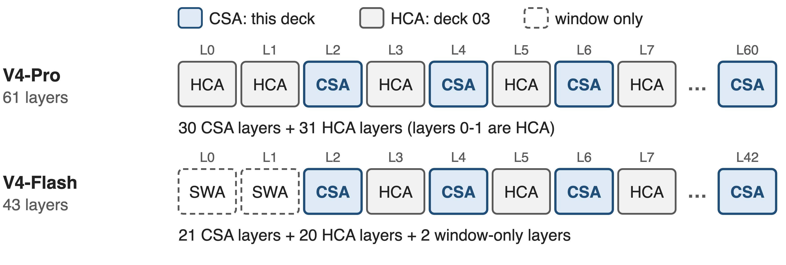{full}
> 1M-token context (V3.2 stopped at 128K): CSA is the sparse half, HCA (deck 03) the dense half
<!-- notes: DeepSeek-V4 comes in two sizes: Pro with 1.6T parameters, 49B active, and Flash with 284B, 13B active; both natively support a one-million-token context, where V3.2 stopped at 128K. Every attention layer is one of two new types. CSA, this deck, is the sparse one: 30 of Pro's 61 layers and 21 of Flash's 43. HCA, the heavily compressed dense type, fills the other layers and has its own deck. Sources: V4 abstract and Sec. 4.2.1; layer counts from the released config.json compress_ratios. -->

# At 1M, choosing costs more than attending
%% big: 30×
%% sub: more multiply-adds in DSA's indexer than in the attention it feeds
%% source: Analytic, per query per layer at 2²⁰ tokens: indexer 64 × 128 × 1,048,576 = 8.6 G; attention over top-2,048 = 0.29 G (V3.2 §2.1, §2.3)
<!-- notes: Start from the predecessor. DeepSeek Sparse Attention in V3.2 already made the attention itself cheap: each query reads only 2,048 entries. But to choose them, its lightning indexer scores every preceding token. At one million tokens that is 8.6 billion multiply-adds per query per layer, against 0.29 billion for the attention it feeds: thirty times more. This is our own count from V3.2's published configuration, not a measurement; the derivation is in notes/analytic.py. -->

# DSA selects tokens, so its cost tracks context
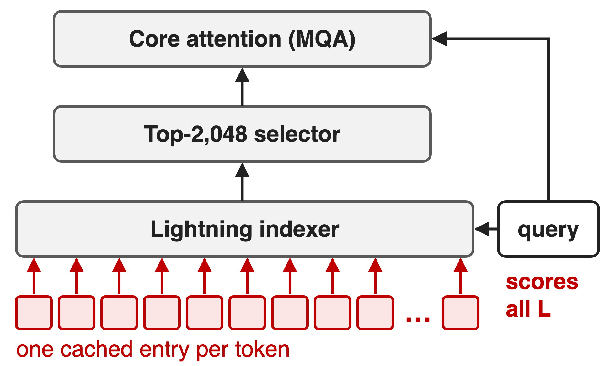{right 55%}
- !!Dense MLA!! (V3.1): reads all L entries
- !!DSA!! (V3.2): reads 2,048, still scores all L
- Cache: one 576-d entry per token, per layer
> Villain: token granularity. Scan and cache both grow one-for-one with L
<!-- notes: Two predecessors. Dense MLA reads every cached entry, so attention is quadratic in context. DSA fixes the read side but keeps two linear-per-token costs: the indexer scans all L tokens, and the cache stores one 576-dimensional latent per token per layer (512 latent plus 64 RoPE dims, from the V3 paper). The structural cause is the same in both: the single token is the unit of retrieval. -->

# Key idea: select among blocks, not tokens
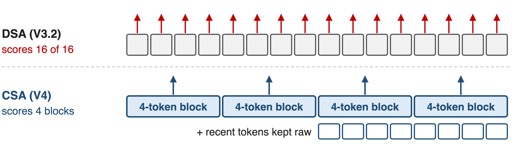{full}
> Score learned 4-token summaries: index scan and KV cache shrink 4×; a raw window keeps local detail
<!-- notes: CSA's turn is to change the unit. In this 16-token picture DSA scores all 16 tokens; CSA scores 4 learned block summaries. That cuts the indexer's scan and the main KV cache by the compression factor m equals 4, and each of the k entries the attention reads now stands for several tokens. Local precision, which summaries blur, comes back through a small window of raw recent tokens. -->

# CSA compresses, indexes, then attends
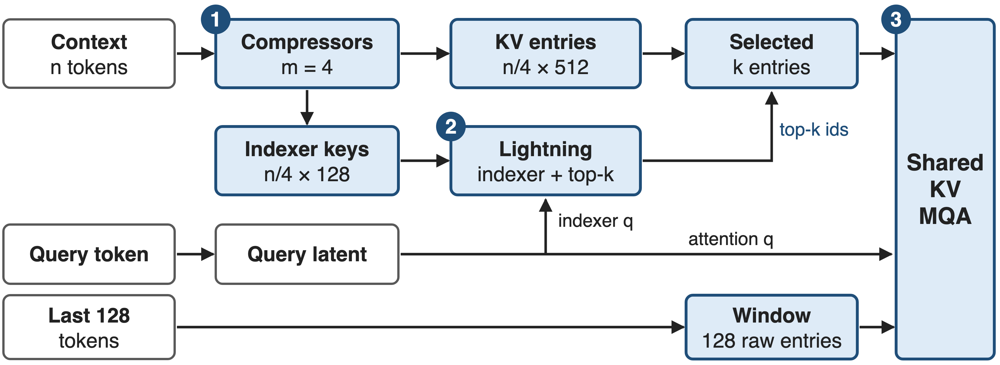{full}
%% caption: ❶ compressors: n tokens → n/4 entries · ❷ indexer keeps the top-k blocks · ❸ MQA over k blocks + 128 raw tokens
<!-- notes: The whole layer on one picture. One: two token-level compressors turn n context tokens into n over 4 KV entries of 512 dims, plus n over 4 indexer keys of 128 dims. Two: the lightning indexer scores the blocks for the current query and keeps the top k, 1,024 in Pro and 512 in Flash. Three: one shared-key-value multi-query attention reads the k selected entries together with 128 uncompressed window entries. Query projections come from one low-rank latent shared by the indexer and the attention. Source: V4 Sec. 2.3.1, Fig. 3, Sec. 4.2.1. -->

# ❶ Learned pooling folds 4 tokens into one
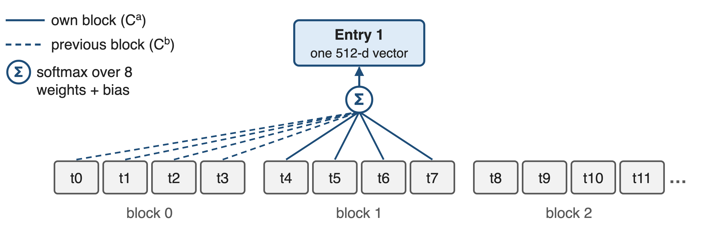{full}
> n tokens → n/4 entries of 512 dims; per-channel weights let each summary pick what to keep
--
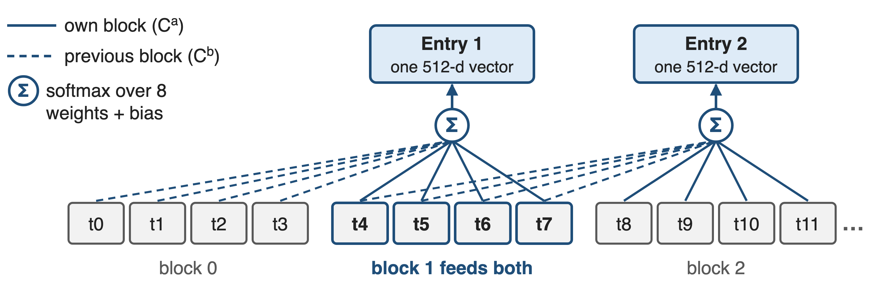{full}
<!-- notes: Challenge: compress without cutting dependencies at block edges. Each token produces two 512-dim projections, C-a and C-b, plus matching weight logits. Entry i takes its own block through C-a and the previous block through C-b: eight candidates, softmax-normalised per channel after adding a learned positional bias, then summed. Click: entry 2 draws on block 1 again (highlighted), so adjacent entries share four tokens. HCA uses the same pooling without the overlap. Source: V4 Eq. 9-12. -->

# ❷ A light indexer keeps the top 1,024 blocks
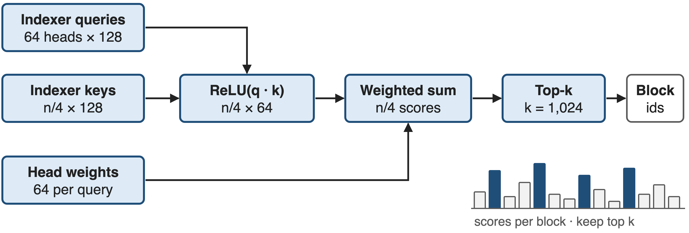{full}
> 64 heads × 128 dims = 8,192 multiply-adds per block; QK runs in FP4, scores in BF16 after QAT (deck 45)
<!-- notes: Challenge: pick the right blocks cheaply. The indexer has its own compressed keys, 128 dims per block. Its 64 query heads come from the same low-rank query latent the attention uses. For each block it takes a ReLU of each head's dot product, weights the heads by per-query scalars, and sums: one score per block. Top-k keeps 1,024 blocks in Pro and 512 in Flash, fewer than V3.2's 2,048 tokens. After post-training QAT the QK path runs in FP4 and scores are stored in BF16. Source: V4 Eq. 13-17, Sec. 2.3.4, Sec. 5.2.1. -->

# ❸ A raw 128-token window restores locality
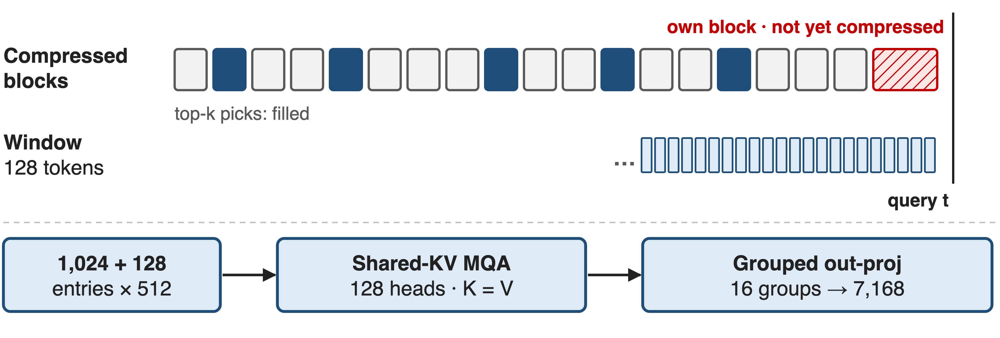{full}
> K = V = one 512-d entry: 1,152 entries feed 128 heads; outputs get RoPE(−i), so position stays relative
<!-- notes: Challenge: causality. A query may only read completed blocks, so its own partial block, and the most recent tokens, are invisible to the compressed path; compression also blurs local detail. CSA adds a sliding-window branch of the last 128 tokens, uncompressed, concatenated with the selected blocks. Each 512-dim entry serves as both key and value for all 128 heads, an attention sink lets a head attend to nothing, and the 128 by 512 output goes through a grouped projection, 16 groups of 1,024, back to 7,168. Source: V4 Sec. 2.3.1 and 2.3.3. -->

# V4 needs 27% of V3.2's per-token FLOPs at 1M
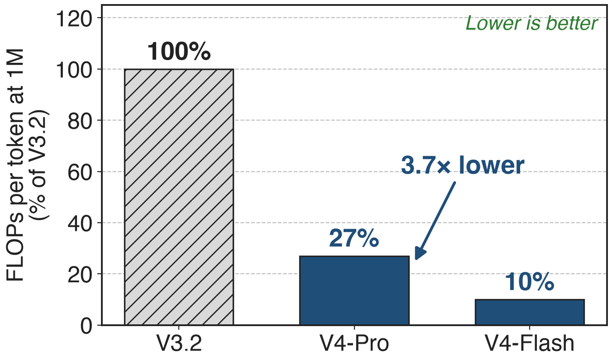{right 60%}
- Whole V4 stack: CSA + HCA + low-precision storage
- Pro activates more: 49B vs 37B
- Flash: 10% (9.8× lower)
<!-- notes: The paper's headline efficiency number, measured in FP8-equivalent FLOPs per generated token at a one-million-token context: V4-Pro needs 27 percent of V3.2, 3.7 times lower, even though it activates 49B parameters against V3.2's 37B; Flash needs 10 percent. This is the whole hybrid stack, CSA plus HCA plus FP8 and FP4 storage; DeepSeek does not publish a CSA-only ablation. Source: V4 abstract, Sec. 1, Fig. 1; Table 1 for 37B. -->

# Per layer, CSA does 3.9× less attention work
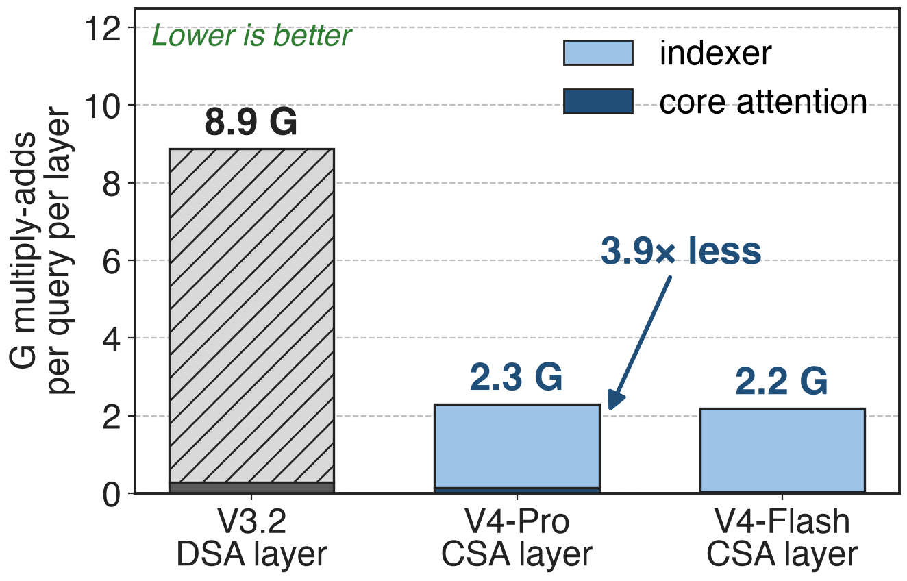{right 60%}
- Analytic: one query, 2²⁰ tokens
- Indexer scan: 1,048,576 → 262,144
- Attended: 2,048 → 1,152 entries
> The indexer still dominates, 14× core attention, which is why its QK path runs in FP4 (deck 45)
<!-- notes: To see what CSA itself buys, count multiply-adds per query in one layer at about one million tokens. V3.2's DSA layer: 8.9 G, nearly all indexer. V4-Pro's CSA layer: 2.3 G, 3.9 times less, because the indexer scans a quarter of the entries and attention reads 1,152 instead of 2,048. Flash is 2.2 G. The count ignores projections, softmax, top-k and precision, so it understates CSA's gain from the FP4 indexer. Derivation: notes/analytic.py. -->

# Long-context quality rises instead of falling
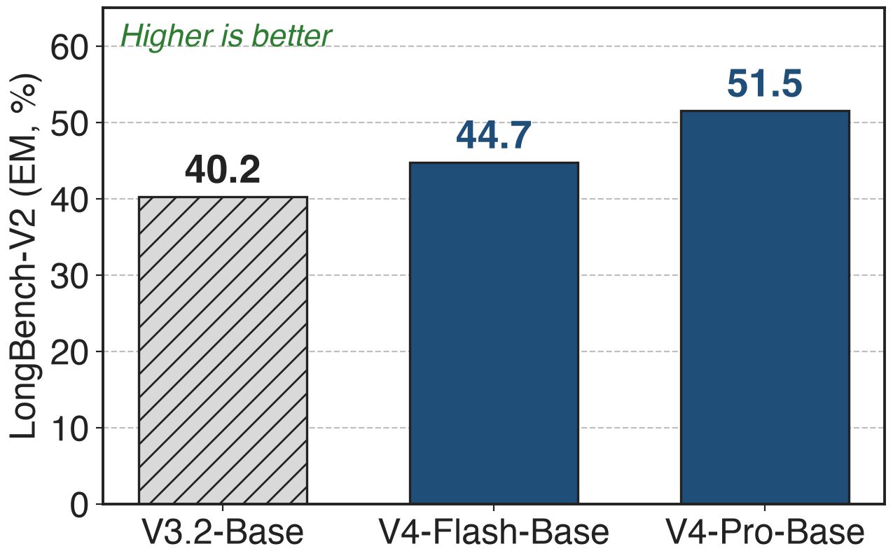{right 55%}
- MRCR at 1M: V4-Pro-Max **83.5** vs Gemini-3.1-Pro 76.3
- Claude Opus 4.6 still leads: 92.9
- Whole-model results: data and size changed too
<!-- notes: Compression did not cost long-context quality at the model level. On LongBench-V2 the base models go from 40.2 for V3.2 to 44.7 for the smaller V4-Flash and 51.5 for V4-Pro. On MRCR at one million tokens, V4-Pro-Max scores 83.5, above Gemini-3.1-Pro at 76.3 but below Claude Opus 4.6 at 92.9. These are whole-model comparisons, so they show CSA is not a quality bottleneck rather than isolating its effect. Sources: V4 Table 1 and Table 6. -->

# Cost: a quadratic indexer and harder serving
- Indexer is still O(L²/4) in prefill and dominates each layer
- Training starts dense (Flash: first 1T tokens), then indexer warm-up, sparse from 64K
- Serving and CP: state cache for uncompressed tails, 128-token blocks, boundary exchange
> No CSA-only ablation is published; DeepSeek calls the design "relatively complex"
<!-- notes: Three honest costs. The indexer is a quarter of DSA's but still quadratic over a prefill and still the largest term per layer. Training does not start sparse: Flash trains with dense attention for its first trillion tokens, and Pro for longer; then a short indexer warm-up, then sparse attention from 64K sequence length on. And the systems around it change: tokens not yet compressible live in a per-request state cache, cache blocks must hold a multiple of lcm(4, 128) = 128 tokens, and context parallelism must ship the last m raw entries across rank boundaries. Sources: V4 Sec. 4.2.2, 3.5.1, 3.4.3, 6. -->

# Summary
- !!Pain!!: at 1M, DSA's indexer does 30× the attention's work (analytic)
- ==Insight==: select among learned 4-token blocks, plus 128 raw tokens
- ❶ overlapping pooling ❷ FP4 indexer, top-1,024 ❸ shared-KV MQA
- V4 at 1M: **27%** / **10%** of V3.2's per-token FLOPs; LongBench-V2 **40.2 → 51.5**
%% qr: https://arxiv.org/abs/2606.19348
<!-- notes: To recap: at one million tokens the expensive part of sparse attention is choosing, not attending. CSA chooses among learned 4-token summaries, adds back a 128-token raw window, and reads them with one shared-KV multi-query attention. Together with HCA and low-precision storage, V4 needs 27 or 10 percent of V3.2's per-token FLOPs at 1M while long-context scores go up. Paper: arXiv 2606.19348; companion decks 03 (HCA) and 45 (FP4 QAT). -->
