# DSA is V3.2's only architectural change
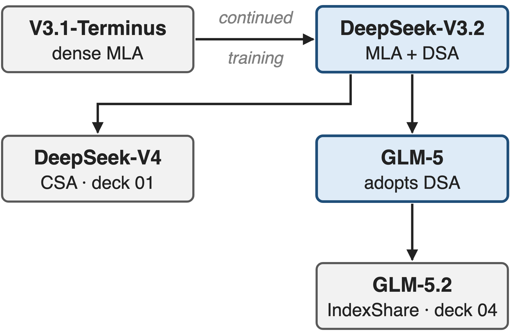{right 55%}
- V3 backbone: **671B** MoE, **37B** active, MLA
- **128K** context, continued from V3.1-Terminus
- Adopted by GLM-5 (**744B**)
<!-- notes: DeepSeek-V3.2 keeps the V3 backbone, a 671B mixture-of-experts model with 37B active parameters and multi-head latent attention. Compared with V3.1-Terminus, the only architectural change is DeepSeek Sparse Attention, added by continued training on 128K sequences. GLM-5, 744B, adopts it; GLM-5.2 shares its indexer across layers (deck 04), DeepSeek-V4 compresses before indexing (deck 01), and the indexer kernel is deck 10. Sources: V3 report abstract and §4.2; V3.2 §2.1, §2.1.1; GLM-5 §1. -->

# Dense attention makes late tokens 31× costlier
%% big: 31×
%% sub: decode cost per token at position 128K vs position 0 with dense MLA: ≈ $2.15 vs ≈ $0.07 per million tokens
%% source: DeepSeek-V3.2 report, Fig. 3(b): H800 service at $2/GPU-hour; values read from the figure's vector data
<!-- notes: DeepSeek measured what a token costs to serve as a function of where it sits in the sequence. With dense MLA in V3.1-Terminus, decoding a token at position 128K costs about 2.15 dollars per million tokens, against 7 cents at the start: thirty-one times more, because each new token attends to everything before it. The values are read from the vector data of Fig. 3 in the V3.2 report (notes/digitize_fig3.py), H800 at 2 dollars per GPU-hour. -->

# Every token's attention reads every cached latent
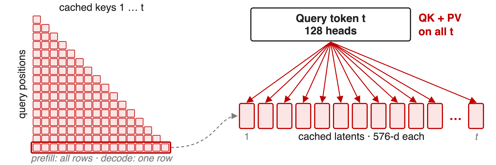{full}
> Villain: the 128-head attention itself decides which keys matter, so every key costs **139,264** multiply-adds
<!-- notes: In MLA's decode mode, a new token's 128 query heads take a dot product with every cached 576-dimensional latent and then sum the 512-dimensional values: 128 times 1,088 multiply-adds per cached key. Prefill does the same for every row of the causal matrix. Relevance and aggregation are one operation, so the expensive attention is paid even for keys that end up with negligible weight. The count is analytic, from the V3 hyper-parameters (notes/analytic.py). -->

# Fixed patterns and linear attention lose recall
%% layout: two-col
- **Fixed windows** (SWA, half the layers full)
- RULER@128K: !!−30.4!! interleaved, !!−5.7!! searched
|||
- **Linear attention** (GDN variants)
- RULER@128K: !!−11.3!! / !!−8.3!!
- Native sparse: !!new pretraining run!!
> Needed: content-based selection, added to an already-trained dense model
<!-- notes: GLM-5's team tried the obvious alternatives on a 9B model, keeping half of the layers full attention and continually training on 190B tokens. Sliding windows lose 30 RULER points at 128K when interleaved and still 5.7 with a searched layer pattern; gated-delta-net linear attention loses 8 to 11. A fixed pattern cannot follow the content. Natively sparse designs such as NSA avoid that, but they must be trained from scratch, which GLM-5 calls astronomical. Source: GLM-5 Table 5 and §2.1.1. -->

# Insight: scoring is 17× cheaper than attending
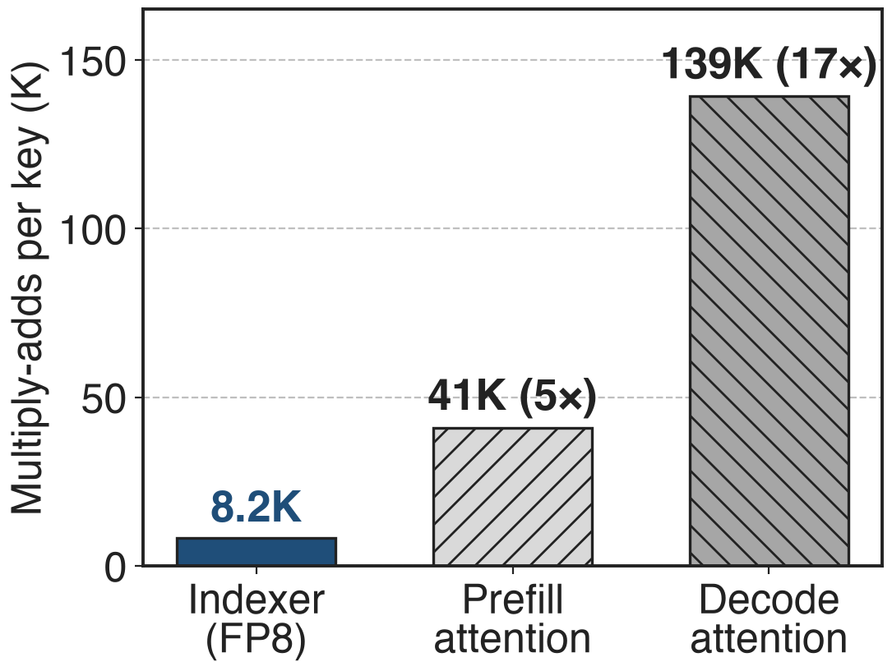{right 50%}
- Score a key: **64 × 128** FP8 multiply-adds
- Attend to it: **128 × 1,088** BF16 (decode)
%% caption: Analytic, per query per layer, V3.2 shapes
--
> Let a tiny FP8 scorer read every key; attention reads only the top 2,048 (**1.6%** of 128K)
<!-- notes: Deciding whether a key matters does not need the full attention. A scorer with 64 small heads of 128 dimensions costs 8,192 multiply-adds per key, and it can run in FP8; attending to that key in MLA's decode mode, 128 heads over a 576-dimensional key and a 512-dimensional value, costs 139,264 in BF16: seventeen times more. Dense prefill in V3.1-Terminus used MLA's MHA mode, 40,960 per key, so there the gap is 5×. So DSA lets the cheap scorer, trained to imitate the attention, look at every key, and the attention itself reads only 2,048 of them. Analytic counts from notes/analytic.py. -->

# DSA puts a cheap scorer in front of MLA
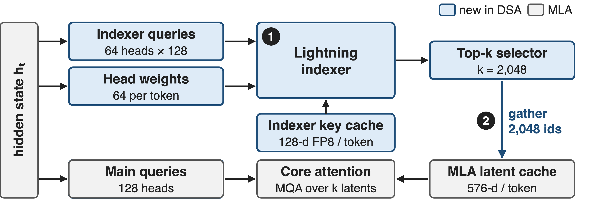{full}
%% caption: ❶ the indexer scores every cached token · ❷ the top 2,048 latents feed MQA-mode attention · ❸ continued training (not drawn)
<!-- notes: Blue is new. The lightning indexer has its own queries, 64 heads of 128 dimensions taken from MLA's query latent, per-token head weights from the hidden state, and its own key cache, one 128-dimensional FP8 key per token. Its scores go to a top-k selector; the 2,048 selected positions gather latents from the unchanged MLA cache, and the core attention runs in MQA mode over only those. Source: V3.2 §2.1 and Fig. 2; reference code in the HF repo, inference/model.py. -->

# ❶ The lightning indexer scores every key in FP8
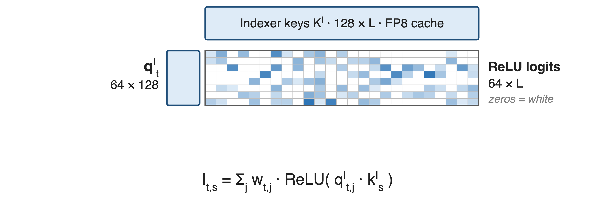{full}
--
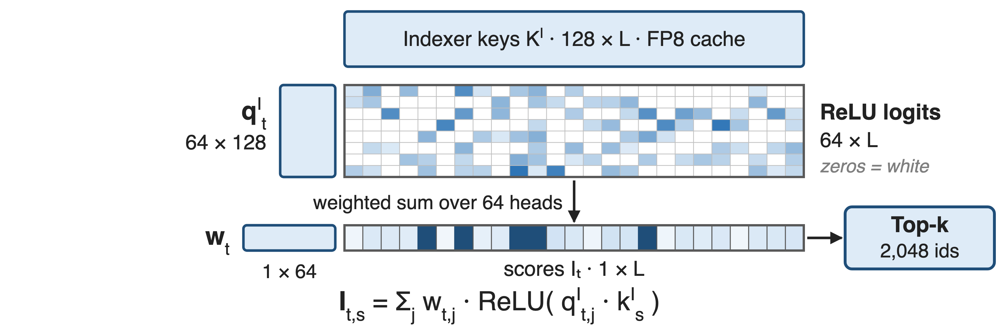{full}
> ReLU instead of softmax, one 128-d key per token shared by all 64 heads, E4M3 inputs
<!-- notes: For one query token t: its 64 indexer query heads multiply the cached indexer keys, an L by 128 matrix, giving 64 by L logits; ReLU zeroes the negatives. Click: a per-token weight vector of 64 entries collapses the heads into one score per key, and top-k keeps 2,048 indices. ReLU was chosen for throughput; the reference code rotates q and k with a Hadamard transform and quantises both to FP8 with one scale per 128 values. Source: V3.2 Eq. 1; HF inference/model.py Indexer. -->

# ❷ 2,048 shared latents serve all 128 heads
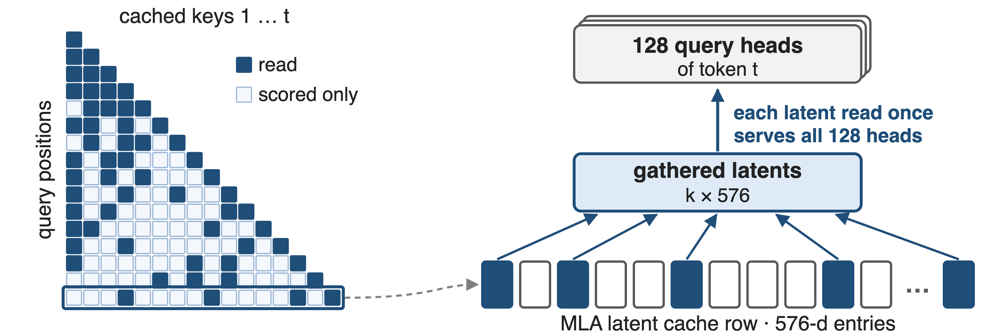{full}
> MQA mode: a token's 576-d latent is the key (512-d part the value) for all 128 heads
<!-- notes: Challenge: a per-query gather is only efficient if each gathered entry is reused by many queries. MLA's MQA mode gives exactly that: each token has one latent, 512 plus 64 RoPE dimensions, which is the key for all 128 heads, and its 512-dimensional part is the value. So top-k gathers 2,048 latents once and all heads attend over them. Every other key is scored by the indexer but never read by the attention. Source: V3.2 §2.1 and Appendix A; selection drawn with k = 4 for illustration. -->

# Prefill and decode call different indexer kernels
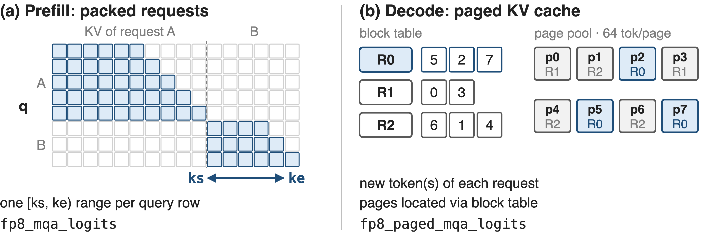{full}
> Both emit one score row per query, then top-2,048 feeds FlashMLA's sparse kernel (kernels: deck 10)
<!-- notes: Serving adds a wrinkle. In prefill, the queries of several requests are packed, and each query row gets its own key range, ks to ke, which encodes both the request boundary and causality; the non-paged logits kernel writes each row compressed to its span. In decode, each request contributes its new token, its indexer keys live in 64-token pages of the paged cache, and the paged kernel follows the block table. These are DeepGEMM's fp8_mqa_logits and fp8_paged_mqa_logits, now named fp8_fp4_*. Sources: vLLM blog 2025-09-29; DeepGEMM README and tests/test_attention.py. -->

# ❸ Warm up the indexer, then train sparse
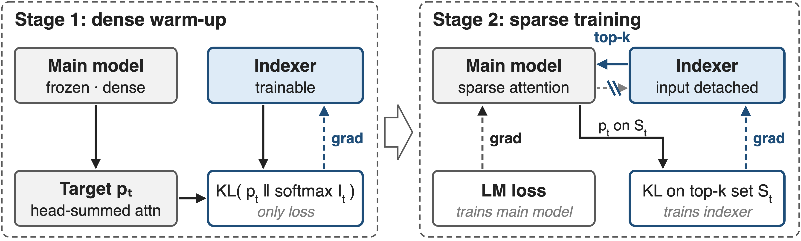{full}
> Warm-up: 1,000 steps, **2.1B** tokens · sparse stage: 15,000 steps, **943.7B** tokens of 128K sequences
<!-- notes: Challenge: a fresh indexer selects noise, and training a sparse model from scratch is unaffordable. Stage one freezes the model, keeps dense attention, and distils the indexer toward the attention distribution summed over heads with a KL loss. Stage two switches on top-k and trains everything: the language-model loss trains the main model, and a KL loss over the selected set trains the indexer, whose input is detached so the two objectives never mix. Source: V3.2 §2.1.1, Eq. 3-4; learning rates 1e-3 and 7.3e-6. -->

# DSA cuts 128K decode cost 8.7×
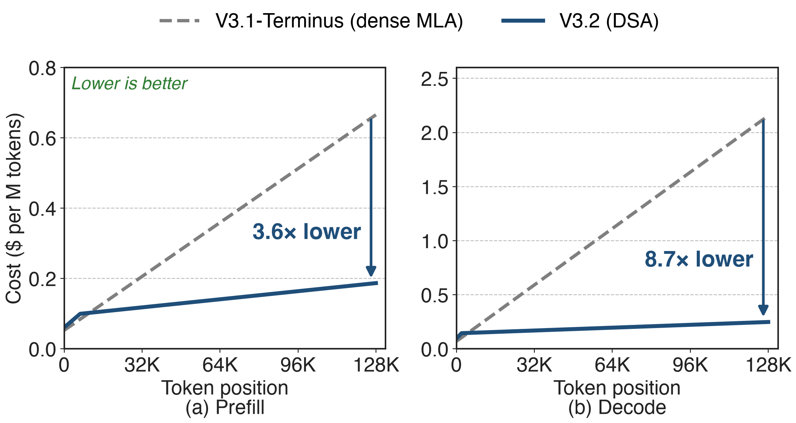{full}
%% caption: H800 service, $2/GPU-hour; curves read from DeepSeek-V3.2 Fig. 3. Below ≈ 5K (decode) / ≈ 10K (prefill) tokens DSA costs slightly more.
<!-- notes: Same figure as the pain slide, now with V3.2. Dense MLA's cost rises linearly with position; DSA's rises slowly, because only the indexer still touches every key. At 128K, decode drops from about 2.15 to 0.25 dollars per million tokens, 8.7 times, and prefill from 0.67 to 0.19, 3.6 times. At the launch of V3.2-Exp DeepSeek cut API prices by more than half. Very short contexts are slightly more expensive; for short prefill DeepSeek uses a masked MHA mode instead. Sources: V3.2 Fig. 3 and §2.3, digitised in notes/digitize_fig3.py; DeepSeek API news 2025-09-29. -->

# Quality holds: 128K RULER within 0.35 points
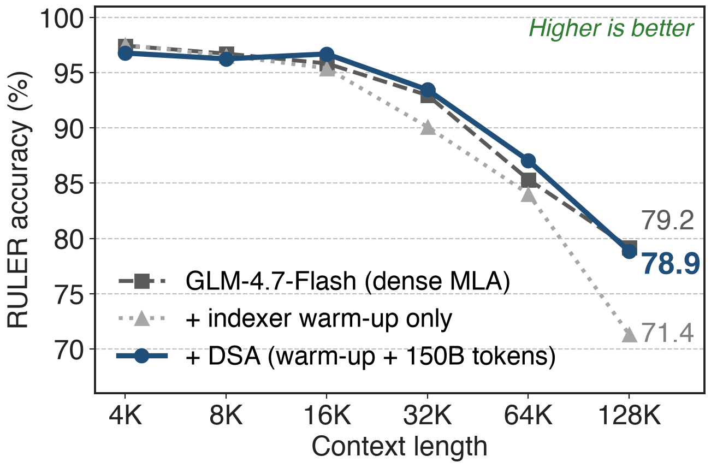{right 60%}
- V3.2-Exp: **+4** on AA-LCR vs V3.1-Terminus
- Warm-up alone: !!−7.9!! at 128K
- Joint training: **−0.35** at 128K
<!-- notes: DeepSeek reports V3.2-Exp on par with V3.1-Terminus on standard benchmarks and Chatbot Arena, and 4 points higher on the independent AA-LCR long-context test. GLM-5's ablation on GLM-4.7-Flash shows why the second training stage matters: with only the indexer warmed up, RULER at 128K falls from 79.2 to 71.4; after 150B tokens of joint training it is 78.9, within 0.35 of dense, and above it at 16K to 64K. Sources: V3.2 §2.2; GLM-5 Table 6. -->

# GLM-5 adopts DSA with 47× fewer tokens
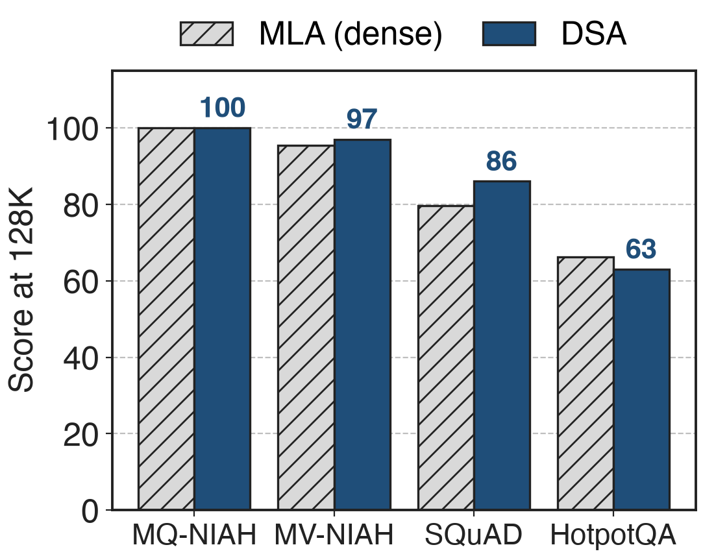{right 50%}
- Sparse adaptation: **20B** tokens vs DeepSeek's **943.7B**
- **32** indexer heads (V3.2: **64**)
- RL: deterministic `torch.topk`, frozen indexer
> Non-deterministic top-k kernels wrecked RL within a few steps
<!-- notes: GLM-5, 744B parameters, converts its MLA base with a 1,000-step warm-up on 14 sequences of 202,752 tokens and only 20B tokens of sparse adaptation, 47 times fewer than DeepSeek. The chart is its Table 3: at 128K the DSA base matches or beats MLA on three of four long-context tests and trails on HotpotQA, 63.0 versus 66.3; after the same SFT the two models tie in loss and benchmarks. RL exposed a new sensitivity: replaying 2,048 indices per token is impractical, and CUDA or TileLang top-k operators that are not deterministic caused drastic degradation and an entropy collapse after a few steps, so GLM-5 uses torch.topk and freezes the indexer during RL. Sources: GLM-5 §2.1.1, Table 10, "DSA RL insights". -->

# The cost: an O(L²) indexer and new state
%% layout: two-col
- !!Indexer still O(L²)!!: **79%** of per-query work at 128K
- Short contexts: slightly costlier
|||
- +**132 B** key cache per token per layer (+20%)
- Needs continued pretraining
> Next: share one indexer across layers (deck 04), make it fast (deck 10)
<!-- notes: DSA moves the quadratic term into the indexer; by our analytic count it is 79 percent of DSA's per-query multiply-adds at 128K, which is why deck 04 shares indexers across layers and deck 10 is about the kernel; DeepSeek-V4 (deck 01) attacks it by compressing keys. Below about 5K decode or 10K prefill tokens DSA costs slightly more. The indexer keeps a second cache, 128 FP8 bytes plus a 4-byte scale per token per layer, 20 percent on top of MLA's 656 bytes. And a model only gets DSA through continued pretraining: 944B tokens at DeepSeek, 20B at GLM-5. Sources: notes/analytic.py; V3.2 Fig. 3; HF model.py; vLLM blog. -->

# Summary
- Dense MLA: decode cost per token grows **31×** from 0 to 128K
- ==Insight==: scoring a key is **17×** cheaper than attending to it
- FP8 indexer → top-2,048 → MQA-mode sparse MLA, via continued training
- At 128K: **8.7×** lower decode, **3.6×** lower prefill cost; quality on par
%% qr: https://arxiv.org/abs/2512.02556
<!-- notes: DSA separates choosing from attending: a small FP8 indexer, distilled from the attention, reads every key, and MLA reads only the top 2,048 in its MQA mode. DeepSeek-V3.2 gets it by continued training from V3.1-Terminus and serves 128K tokens at a fraction of the cost. Related decks: 04 (IndexShare, cross-layer indexer reuse), 10 (FP8 MQA-logits kernel), 01 and 03 (DeepSeek-V4 CSA and HCA), 09 (FP8 block-sparse prefill attention). -->
