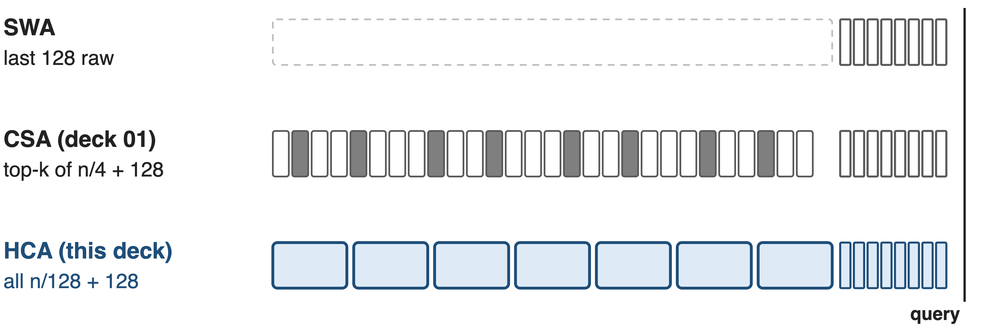
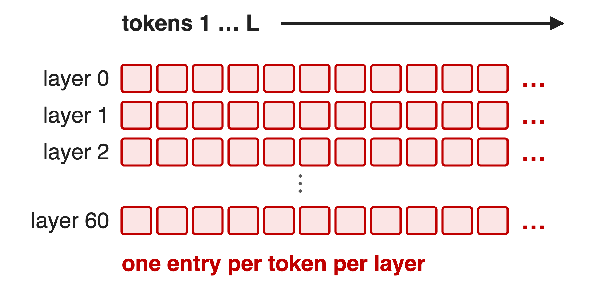
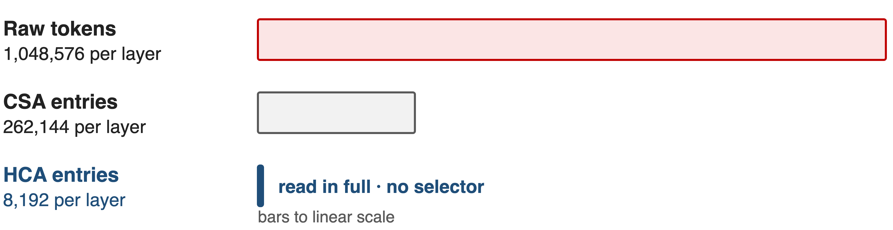
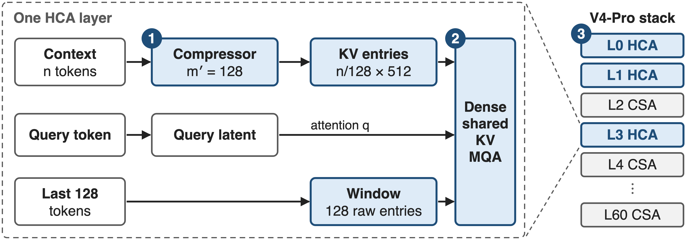
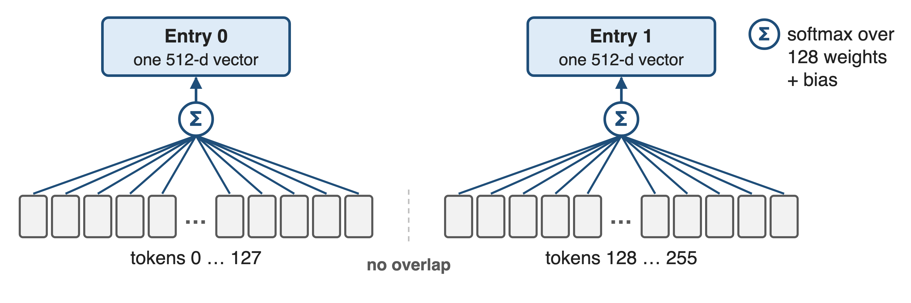
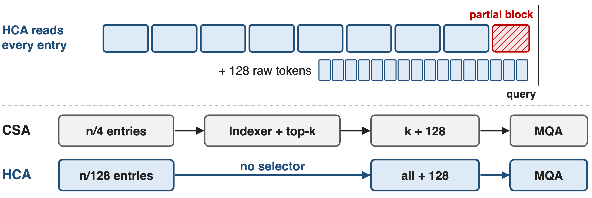
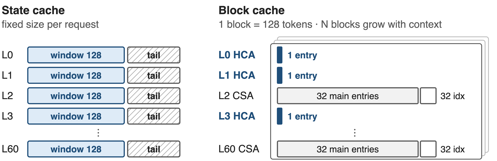
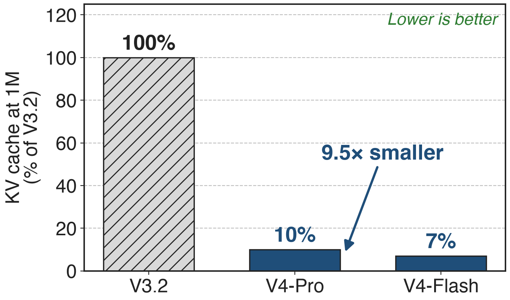
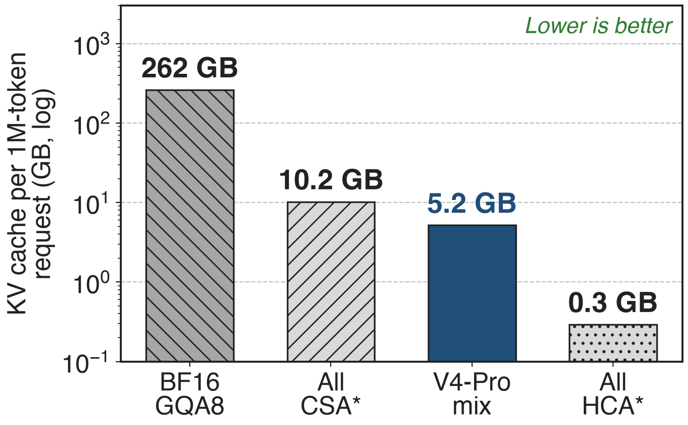
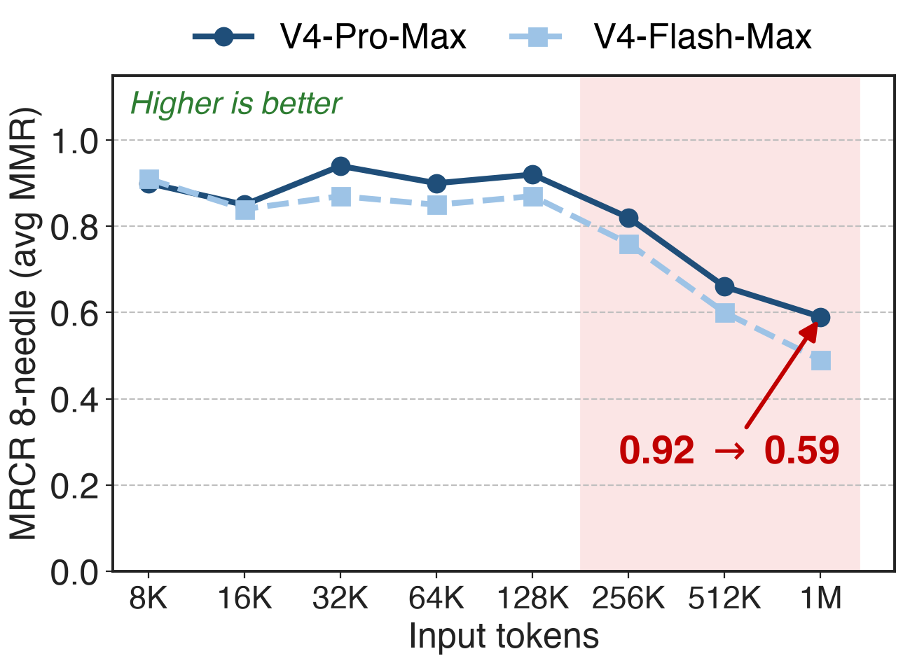

# V4 layers see context at three resolutions
{full}
> HCA is 31 of 61 V4-Pro layers and 20 of 43 Flash layers; CSA, the selective type, is deck 01
<!-- notes: DeepSeek-V4, Pro with 1.6T parameters and Flash with 284B, serves one-million-token contexts, and every layer is still softmax attention. What differs is resolution. A sliding-window layer reads only the last 128 raw tokens. A CSA layer, deck 01, keeps one entry per 4 tokens and selects the top k. An HCA layer, this deck, keeps one entry per 128 tokens and reads all of them, plus the same 128-token window. Sources: V4 Sec. 2.3 and 4.2.1; layer counts from the released config.json. -->

# A 1M-token request outgrows per-token caches
%% big: 262 GB
%% sub: of KV cache for one 1M-token request with BF16 GQA8 at 61 layers
%% source: Analytic: 8 KV heads × 128 dims × (K, V) × 2 B = 4,096 B per token per layer, × 61 layers × 2²⁰ tokens; BF16 GQA8 is the paper's own baseline (§2.3.4)
<!-- notes: Start with memory. A common attention layout, grouped-query attention with 8 KV heads of 128 dims in BF16, stores 4 KB per token per layer. At V4-Pro's depth of 61 layers and a context of 2 to the 20 tokens, that is 262 GB of cache for a single request, before any batching. This is our arithmetic on the configuration the paper itself uses as its baseline; derivation in notes/analytic.py. -->

# Narrower entries still grow with every token
{right 55%}
- !!GQA / MLA!!: shrink each entry, not the count
- !!CSA everywhere!!: count ÷ 4, still linear
- !!Window only!!: constant, but forgets far context
> Villain: uniform resolution. Every layer stores the whole context at the same granularity
<!-- notes: The usual fixes attack the width of a cell. GQA, MQA and MLA shrink each entry; V3.2's MLA caches a 576-dim latent per token per layer. But the grid still has one cell per token per layer. CSA everywhere would divide the count by four and add indexer keys, still linear. A window alone is constant size but cannot see far back. The structural problem is that every layer keeps the context at the same resolution. Sources: V3 Sec. 2.1.1 and 4.2; V4 Sec. 2.3.1. -->

# Key idea: some layers need only the gist
{full}
> At m′ = 128, a 1M-token context is 8,192 entries: few enough to read all, no selector needed
<!-- notes: The turn: not every layer needs fine detail. Compress 128 tokens into one entry and a million-token context shrinks to 8,192 entries per layer. The bars are to scale: the HCA bar is a sliver of the raw context and 32 times shorter than CSA's. That is small enough that every query can simply attend to all of it densely, with no indexer and no top-k. Fine detail is left to the interleaved CSA layers and to the 128-token window. -->

# HCA compresses 128×, reads all, and interleaves
{full}
%% caption: ❶ pool 128 tokens → 1 entry · ❷ dense shared-KV MQA over all entries + 128 raw tokens · ❸ alternate with CSA layers
<!-- notes: One HCA layer, left. One: a token-level compressor turns n context tokens into n over 128 entries of 512 dims. Two: one dense shared-key-value multi-query attention reads all of those entries plus the 128 raw window entries, with queries from the same low-rank latent as CSA. Three, right: V4-Pro starts with two HCA layers and then alternates CSA and HCA, which forces a new KV-cache layout. Source: V4 Sec. 2.3.2, Fig. 4, Sec. 4.2.1. -->

# ❶ Softmax pooling folds 128 tokens into one
{full}
> n tokens → n/128 entries of 512 dims; unlike CSA, no overlap and no indexer keys
<!-- notes: Challenge: one 512-dim vector has to stand for 128 tokens. Each token produces a 512-dim KV projection and a 512-dim weight logit. Within a block, a learned positional bias of shape 128 by 512 is added to the logits, a softmax runs over the 128 tokens separately for every channel, and the weighted sum is the entry. Blocks do not overlap, and there are no indexer keys because nothing is selected. Source: V4 Eq. 20-23. -->

# ❷ No selector: read every entry plus a window
{full}
> At 1M: 8,192 + 128 entries per query, 1.1 G multiply-adds per layer (analytic) vs 2.3 G for CSA
<!-- notes: Challenge: with no selector, cost must stay bounded and local detail must survive. The query attends densely to every compressed entry, plus the 128 most recent raw tokens, which also cover its own unfinished block. Each 512-dim entry is both key and value, shared by all heads, with the same attention sink, partial RoPE and grouped output projection as CSA. At a million tokens that is 8,320 entries, about 1.1 billion multiply-adds per query in V4-Pro, against 2.3 billion for a CSA layer and 8.9 billion for V3.2's DSA layer, by our count. Sources: V4 Sec. 2.3.2-2.3.3; notes/analytic.py. -->

# ❸ Interleaving needs a two-part KV cache
{full}
> Window and not-yet-compressed tails sit in a fixed state cache; each 128-token block holds 32 CSA entries or 1 HCA entry per layer
<!-- notes: Challenge: mixing compression rates breaks PagedAttention's assumption of one uniform cache. V4 splits the cache. A fixed-size state cache per request holds every layer's 128-token window and the tail tokens that are not yet a full compression block. The growing part is allocated in blocks of lcm(4, 128) = 128 tokens; in each block a CSA layer stores 32 main entries plus 32 indexer keys, an HCA layer stores one entry. Bar widths are proportional to bytes. Source: V4 Sec. 3.5.1 and Fig. 6. -->

# V4's 1M-token KV cache is 10% of V3.2's
{right 60%}
- Whole stack: CSA + HCA + FP8/BF16 storage
- Flash: 7% (13.7× smaller)
- FLOPs fall too: 27% / 10% (deck 01)
<!-- notes: The paper's measured headline for memory: at a one-million-token context, V4-Pro's accumulated KV cache is 10 percent of V3.2's, 9.5 times smaller, and Flash's is 7 percent, 13.7 times smaller. This is the whole design: compression in both layer types plus storing RoPE dims in BF16 and the rest in FP8, which alone nearly halves the bytes. No HCA-only ablation is published. Source: V4 abstract, Sec. 1, Fig. 1. -->

# The mix lands at 2% of a GQA8 cache
{right 60%}
- Paper: ≈2% of BF16 GQA8 at 1M
- Our byte model: 1.98% (analytic)
- CSA layers hold 97% of it
> * Hypothetical uniform stacks: making half the layers HCA halves an all-CSA cache
<!-- notes: The paper also says V4's cache is about 2 percent of a BF16 GQA8 baseline at one million tokens. Our byte model reproduces that: a 576-byte entry, 160 bytes per token in a CSA layer including FP4 indexer keys, 4.5 bytes in an HCA layer, gives 5.2 GB per million-token request against 262 GB, or 1.98 percent. The starred bars are hypothetical: all-CSA would need 10.2 GB, all-HCA 0.3 GB. HCA layers are nearly free, so the mix costs half of all-CSA while keeping selective layers. Derivation: notes/analytic.py. -->

# Retrieval holds to 128K, then fades
{right 60%}
- Pro-Max: 0.92 at 128K, 0.59 at 1M
- Still ahead at 1M: 83.5 vs Gemini-3.1-Pro 76.3
- Claude Opus 4.6 leads: 92.9
<!-- notes: What the compression costs in quality. On MRCR with 8 needles, V4-Pro-Max holds about 0.9 up to 128K tokens, then falls to 0.82 at 256K and 0.59 at one million; Flash falls to 0.49. On the full MRCR at 1M, V4-Pro-Max still scores 83.5, above Gemini-3.1-Pro at 76.3 and below Claude Opus 4.6 at 92.9. These are whole-model results, not an HCA ablation. Sources: V4 Fig. 9 and Table 6. -->

# Cost: coarse memory and custom cache plumbing
- Far context lives in 128-token gists; recall fades past 128K
- Custom cache: state cache, 128-token blocks, CP boundary exchange
- Disk prefix cache: window KV ≈ 8× the compressed KV
> No ablation of the CSA:HCA mix or of m′ = 128 is published
<!-- notes: Three costs. Half the layers remember the distant past only as 128-token summaries, and long-range retrieval does degrade past 128K. Serving needs its own cache manager, and context parallelism must exchange boundary tokens because compression windows straddle ranks. For shared-prefix reuse V4 stores compressed entries on disk, but the uncompressed window entries are about 8 times larger, so it offers full, periodic or zero window caching to trade storage against recomputation. Sources: V4 Sec. 3.5.1-3.5.2, 3.4.3, 6, Fig. 9. -->

# Summary
- !!Pain!!: 262 GB KV per 1M-token request with BF16 GQA8 (analytic)
- ==Insight==: some layers need only the gist, read in full
- ❶ 128× pooling ❷ dense MQA + window ❸ CSA/HCA mix, two-part cache
- V4 at 1M: KV **10%** / **7%** of V3.2; ≈**2%** of GQA8
%% qr: https://arxiv.org/abs/2606.19348
<!-- notes: To recap: a per-token cache does not survive a million tokens. HCA keeps one entry per 128 tokens and simply reads all of them, while interleaved CSA layers keep finer, selectable detail and every layer keeps 128 raw tokens. The result is a KV cache 10 or 7 percent of V3.2's, about 2 percent of a GQA8 model, at the price of fading long-range recall and a custom cache. Paper: arXiv 2606.19348; companion decks 01 (CSA) and 45 (FP4 QAT). -->
