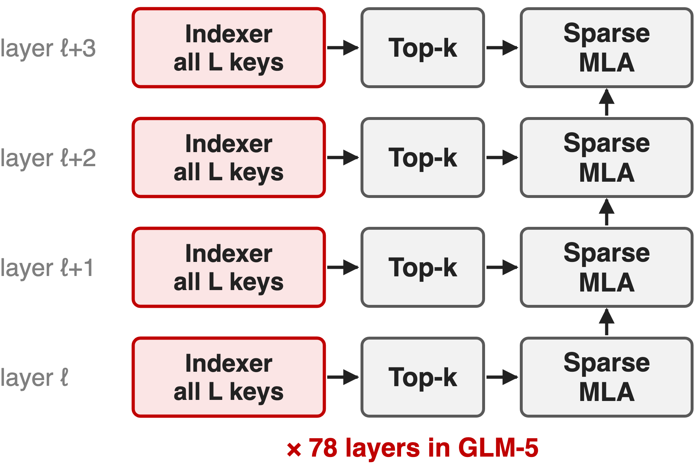
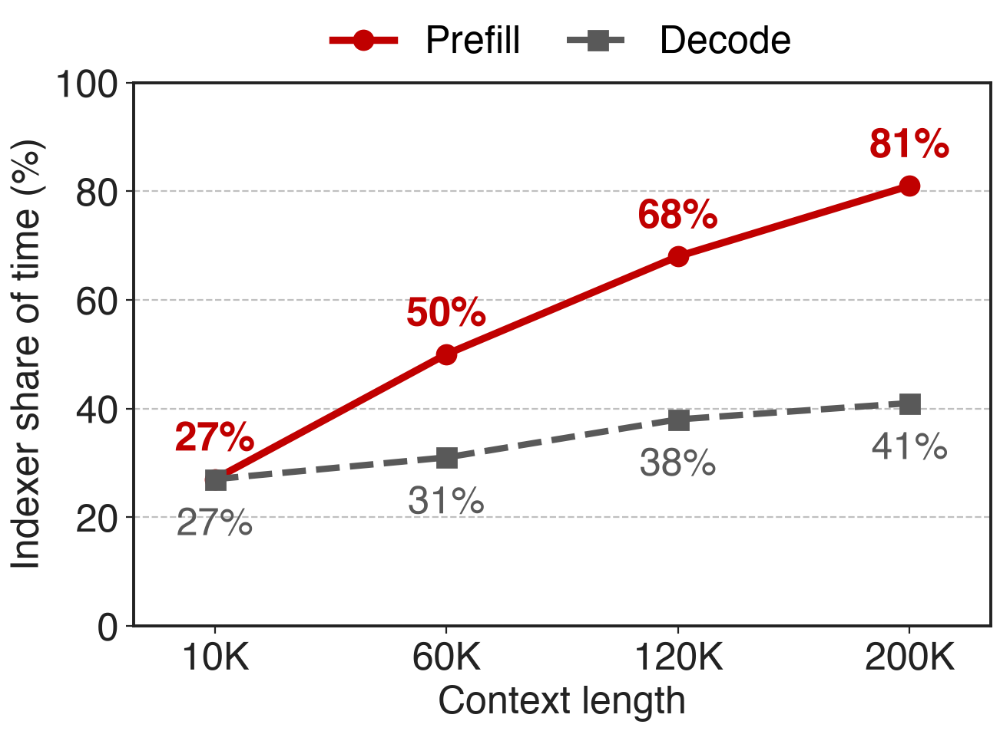
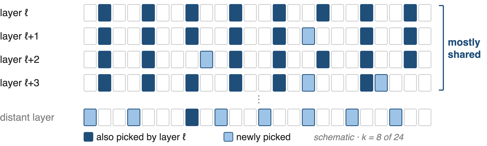
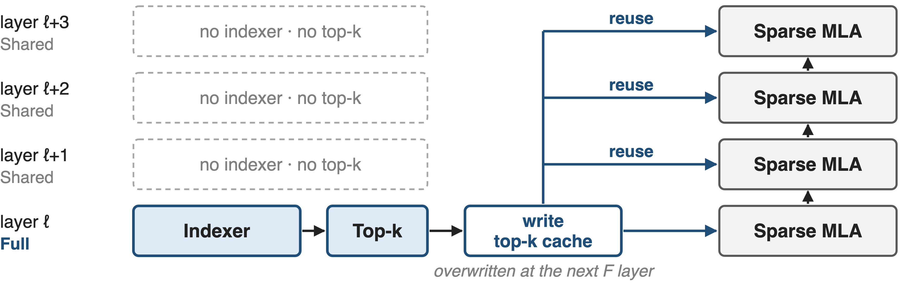
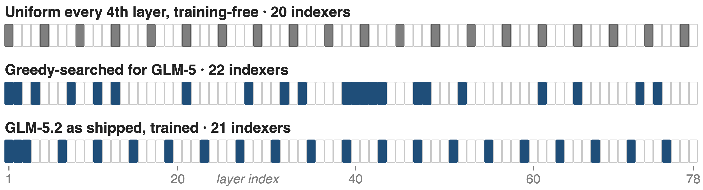
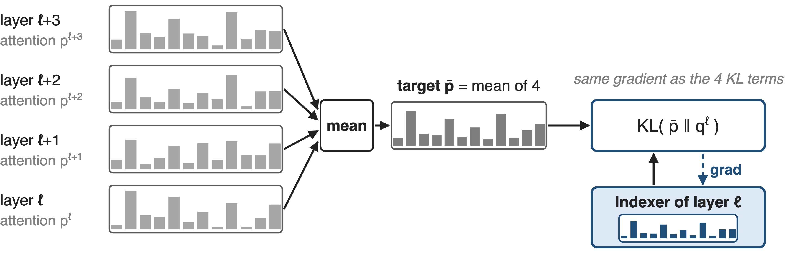
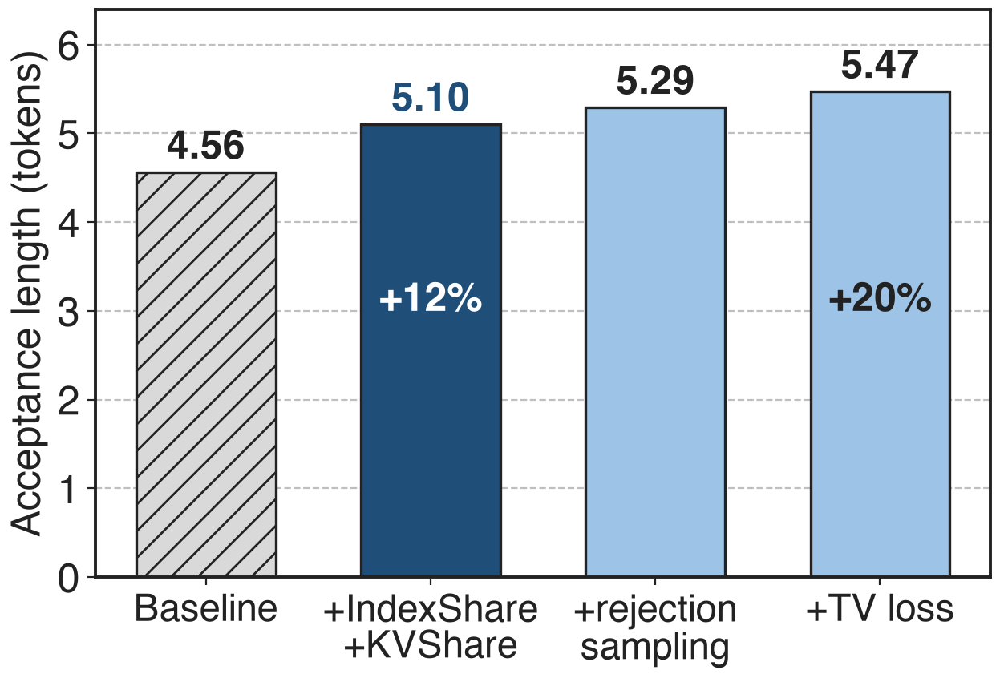
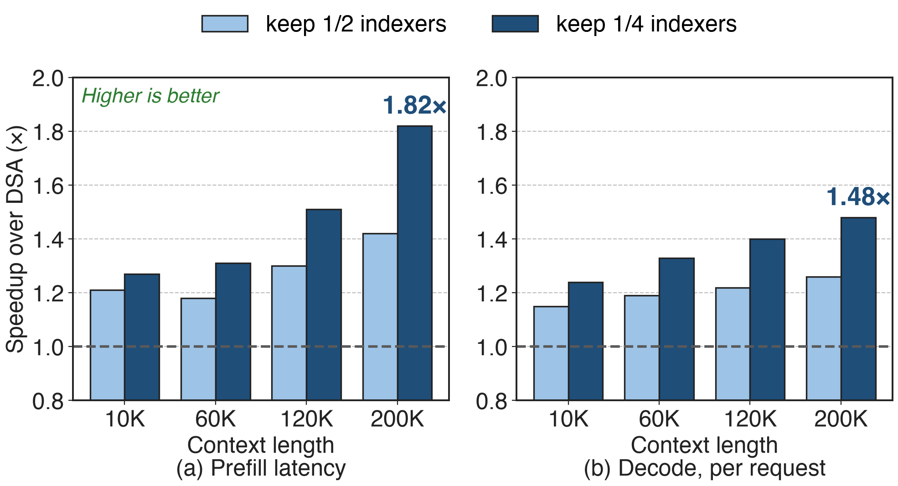
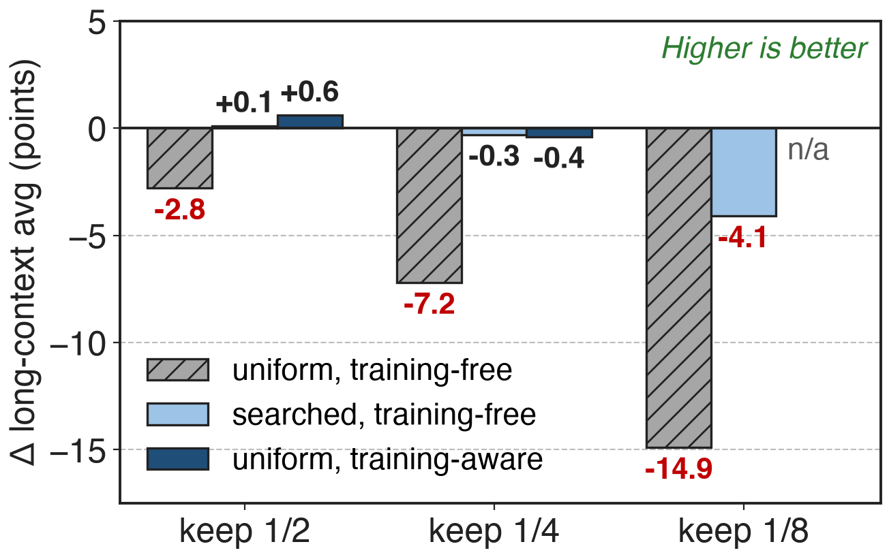

# Every DSA layer runs its own indexer
{right 55%}
- GLM-5: **744B**, **78** DSA layers, top-**2,048** (deck 02)
- GLM-5.2: context **200K → 1M**
- Paper: **IndexCache** · GLM-5.2: **IndexShare**
<!-- notes: GLM-5, 744 billion parameters with 40 billion active, adopted DeepSeek Sparse Attention in all 78 layers: each layer's lightning indexer scores every cached key and keeps the top 2,048 (deck 02). GLM-5.2 stretches the context from 200K to 1M tokens on the same backbone. Naming: the arXiv paper calls the method IndexCache; Z.ai's GLM-5.2 README and blog call the shipped feature IndexShare and link the same paper; the GLM-5 technical report predates both and uses neither name. Sources: GLM-5 Table 10; HF configs; GLM-5.2 README and blog; arXiv 2603.12201. -->

# At 200K, the indexer is 81% of prefill
%% big: 81%
%% sub: of prefill time goes to the lightning indexers at 200K tokens (27% at 10K), 30B DSA model
%% source: IndexCache, arXiv 2603.12201, §1 figure; 30B GLM-4.7-Flash-based DSA model on H100 with SGLang
<!-- notes: DSA made the attention itself cheap, 2,048 keys per query, but its indexer still scores every key in every layer. Profiling a 30B DSA model, the IndexCache authors find the indexer takes 27 percent of prefill time at 10K tokens and 81 percent at 200K. The rest of the layer grows only modestly with context, so the indexer is now the bottleneck. Source: IndexCache §1, indexer time-proportion figure. -->

# The indexer's share grows with context
{right 60%}
- N layers × all L keys: **O(N·L²)**
- Core attention: only O(N·L·k)
- Decode: **41%** at 200K
> Villain: each layer re-derives its top-k from scratch
<!-- notes: The same measurement for decode: 27 percent at 10K rising to 41 percent at 200K, because each new token runs one indexer pass over the whole context in every layer. Summed over N layers, indexer work is order N times L squared, while core attention is N times L times k. The structural cause: every layer computes its own selection as if the layers were independent. Source: IndexCache §1 and §2.1. -->

# Prior reuse needs a full-attention oracle
%% layout: two-col
- **Anchor-layer reuse** (TidalDecode, Kascade, HySparse)
- Copies top-k from !!full-attention!! layers
- DSA has !!none left!!
|||
- **Skip indexers uniformly**
- Keep 1/4: long-context avg !!−7.2!!
- Pick by similarity: !!no better!!
> Needed: a cheap oracle DSA already has, and a rule for which layers keep it
<!-- notes: Reusing token selections across layers is not new: TidalDecode, OmniKV, Kascade and HySparse take the top-k from a few full-attention anchor layers. But they need full attention as the oracle, and DSA has removed it from every layer. The naive alternative, keeping every fourth indexer without retraining, drops the 30B model's long-context average from 50.2 to 43.0. Choosing layers by output similarity with dynamic programming does no better than uniform. Sources: IndexCache §5.2, Table 2, Appendix C. -->

# Insight: adjacent layers share 70–100% of top-k
{full}
> The indexer's own output is the oracle: compute it in a few layers, reuse it in the rest
<!-- notes: The authors measured, for every pair of layers, the fraction of the 2,048 selected tokens they share, over 768 samples of 200K tokens on the 47-layer model. Adjacent layers share 70 to 100 percent; layers form blocks with mutually high overlap; early and late layers share 40 percent or less. So most indexer passes recompute a selection the previous layer already made. The figure is a schematic; the measurement is IndexCache §1 and Appendix A. -->

# ❶ F layers index, S layers reuse the cache
{full}
> One branch per layer; the cache is overwritten at each F layer, so no extra memory
<!-- notes: IndexCache labels every layer Full or Shared. A Full layer runs its indexer and top-k exactly as DSA does and writes the indices to a buffer; each following Shared layer skips the indexer and attends to the cached indices of the nearest Full layer before it. The first layer is always Full. In the inference loop this is one conditional branch, and the buffer is overwritten at the next Full layer, so it costs no extra memory. In the GLM-5.2 code, Shared layers carry no indexer at all: no indexer weights and no indexer key cache. Sources: IndexCache §3 and Fig. 2; transformers glm_moe_dsa. -->

# ❷ Greedy search keeps the indexers that matter
{full}
> Without retraining: flip one layer to S at a time, keeping the flip with the lowest calibration loss
<!-- notes: Challenge: without retraining, some layers depend on their own indexer far more than others, so which layers keep one matters more than how many. The greedy search starts with all layers Full and, at each step, tries flipping every remaining Full layer to Shared, measures language-model loss on a fixed calibration set, and commits the cheapest flip. A full search costs N times N minus 1 over 2 forward passes, fewer with pipeline-parallel blocks. The middle strip is the 1/4 pattern it found for GLM-5: dense in the early and transition layers, unlike the uniform strip on top. Sources: IndexCache §3.1, Alg. 1, App. B; GLM-5.2 HF config for the bottom strip. -->

# ❸ Distil each indexer for every layer it serves
{full}
> Trained this way, a plain every-4th pattern matches full DSA: GLM-5.2's choice
<!-- notes: Challenge: an indexer trained for its own layer now picks tokens for four. Training-aware IndexCache distils each Full layer's indexer against the attention distributions of all the layers that will reuse it: a sum of KL terms, which the paper proves has the same gradient as one KL toward their mean. The indexer learns a consensus selection, and the Shared layers adapt to inherited indices, so a simple uniform pattern works. GLM-5.2 ships exactly that: an indexer at the first of every four layers, trained with IndexShare from mid-training at 128K. Sources: IndexCache §3.2, Prop. 1, §4.4; GLM-5.2 blog. -->

# GLM-5.2's MTP drafts reuse indices and KV
{right 55%}
- Indexer runs on the first MTP step only
- Later steps reuse its top-k and KV
- No mixed target/draft KV in later steps
<!-- notes: GLM-5.2 applies the same idea to its multi-token-prediction draft layer. The indexer runs on the first draft step; later steps reuse its top-k and its KV cache, so a later draft token attends only to states computed by the target model, which removes a training-inference mismatch. On coding prompts with 7 MTP steps, IndexShare plus KV sharing raises the acceptance length from 4.56 to 5.10, plus 12 percent; with rejection sampling and an end-to-end TV loss it reaches 5.47, the plus 20 percent Z.ai advertises. Source: GLM-5.2 blog, MTP with IndexShare and KVShare. -->

# 1/4 indexers: 1.82× prefill, 1.48× decode
{full}
%% caption: 30B DSA model, one H100 node, SGLang. At 200K: prefill 19.5 s → 10.7 s, per-request decode 58 → 86 tok/s
<!-- notes: Keeping a quarter of the indexers, prefill at 200K tokens falls from 19.5 to 10.7 seconds, 1.82 times faster, and per-request decode rises from 58 to 86 tokens per second, 1.48 times. Gains grow with context because the indexer's share does. With a full KV cache, total decode throughput improves 22 to 51 percent. On the 744B GLM-5 the 1/4 setting gives at least 1.3 times beyond 100K. Sources: IndexCache Table 1, Fig. 3, §4.2. -->

# Searched or trained patterns lose ≤ 0.4 points
{right 60%}
- Avg of 5 long-context tests, 30B
- Reasoning avg within **1** point
- GLM-5, searched 1/4: **78.0** vs **78.4**
<!-- notes: Quality is the other half. Without retraining, a uniform pattern loses 2.8, 7.2 and 14.9 points as fewer indexers are kept; the greedy-searched pattern loses 0.3 at 1/4 but 4.1 at 1/8. With training-aware distillation, a uniform pattern is within 0.4 at 1/4 and slightly above DSA at 1/2. Reasoning benchmarks stay within one point except uniform 1/8. On GLM-5, the searched 1/4 pattern scores 78.0 against 78.4. Deltas are against each table's own DSA baseline. Sources: IndexCache Tables 2, 3, 4. -->

# GLM-5.2 ships it: 2.9× fewer FLOPs at 1M
%% big: 2.9×
%% tone: ours
%% sub: lower per-token FLOPs at 1M context, GLM-5.2 (21 indexers in 78 layers) vs GLM-5.1 (an indexer in every layer)
%% source: Z.ai GLM-5.2 README and blog ("Lower FLOPs with IndexShare"); indexer layout from the GLM-5.2 HF config
<!-- notes: GLM-5.2 is the production version: its config keeps an indexer in 21 of 78 layers, the first three plus the first of every four after that. Z.ai reports 2.9 times fewer FLOPs per token at a one-million-token context than GLM-5.1, a FLOPs count rather than a measured speedup. Our rough analytic check, counting indexer, sparse attention and two FLOPs per active parameter, gives about 2.7 times, consistent (notes/analytic.py). Z.ai also reports better long-context benchmarks than GLM-5.1 with less computation. -->

# The cost: search, retraining, a residual O(L²)
%% layout: two-col
- Search: **N(N−1)/2** forward passes (**3,003** for 78 layers)
- Keep 1/8: !!−4.1!! even when searched
|||
- Kept indexers stay O(L²); KV cache barely shrinks
- Uniform patterns need retraining
> Each remaining indexer still needs a fast kernel: deck 10
<!-- notes: The training-free path pays a calibration search: N times N minus 1 over 2 forward passes at 200K, 3,003 for a 78-layer model, and it degrades at aggressive ratios. The shipped uniform path needs the model trained for it, which GLM-5.2 did from mid-training. Reuse removes indexer passes but not their asymptotics: the remaining indexers are still quadratic, and Z.ai notes that per-token KV cache does not shrink in proportion, so 1M serving becomes cache-bound. The FP8 scoring kernel that runs the remaining indexers is deck 10; DeepSeek-V4 instead compresses the keys first (deck 01). Sources: IndexCache §3.1.2, Table 2; GLM-5.2 blog. -->

# Summary
- DSA's indexers: **81%** of prefill time at 200K
- ==Insight==: adjacent layers pick **70–100%** the same tokens
- ❶ F/S reuse ❷ greedy search ❸ multi-layer distillation
- **1.82×** prefill, **1.48×** decode at 1/4; GLM-5.2: **2.9×** fewer FLOPs at 1M
%% qr: https://arxiv.org/abs/2603.12201
<!-- notes: IndexShare, called IndexCache in the paper, removes most of DSA's indexer passes by letting a few layers choose tokens for their neighbours. It works because adjacent layers choose almost the same tokens, and it stays accurate if the retained layers are searched or the indexers are trained for sharing. Related decks: 02 (DSA and the lightning indexer), 10 (FP8 MQA-logits kernel), 01 and 03 (DeepSeek-V4 CSA and HCA), 09 (FP8 block-sparse prefill attention). -->
