# Kimi K3 runs 69 of 93 attention layers on KDA
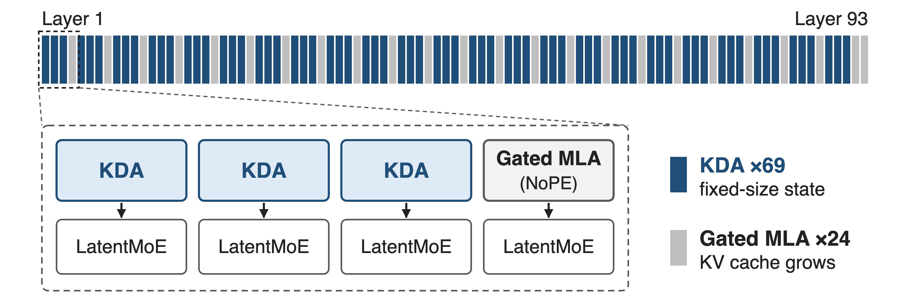{full}
> 2.8T-parameter MoE · 104B active · 1M-token context window
<!-- notes: Kimi K3 is a 2.8T-parameter MoE with 104B activated parameters and a 1M-token context. Its sequence mixer is a layerwise hybrid: every block has three Kimi Delta Attention layers and one Gated MLA layer, plus one extra MLA layer at the very end, so 69 of the 93 attention layers are KDA. This deck explains what a KDA layer computes; deck 08 covers its kernel and deck 69 how it is split across GPUs. Sources: K3 report abstract, Sec. 2.1, Table 1. -->

# Full attention pays for every past token
%% big: 11.48 ms
%% sub: per output token for a full-attention (MLA) model decoding at 1M context; its KV cache grows with every token
%% source: Kimi Linear (arXiv 2510.26692) Fig. 1b: MLA baseline in the 48B-A3B setting (same layers and heads)
<!-- notes: This is the cost KDA attacks. In the Kimi Linear paper's 48B-A3B setting, a full-attention MLA model needs 11.48 ms per output token when the context is one million tokens, because every new token reads a KV cache that has grown with every previous token. Prefill is worse still: attention FLOPs grow as 2 T squared d per head. K2 used 61 MLA layers; K3 trains at 1M context, 8 times K2's 128K. Sources: Kimi Linear Fig. 1b and Eq. 14; K3 Table 1. -->

# Growing caches and colliding writes both fail
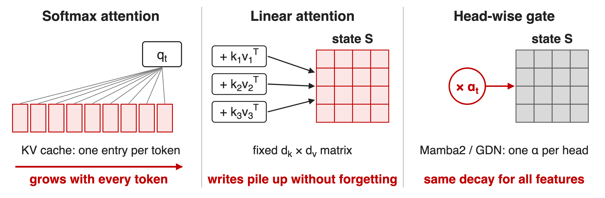{full}
> With 128-dim keys at most 128 orthogonal keys fit: what to forget must be learned
<!-- notes: Softmax attention keeps one cache entry per token, so memory and per-token reads grow without bound. Vanilla linear attention keeps a fixed d_k by d_v matrix but only ever adds k v-transpose, so with more than d_k keys the writes collide and nothing is ever erased. Mamba2 and Gated DeltaNet add a forget gate, but it is one scalar per head, so every feature fades at the same rate. The capacity bound is from the Gated DeltaNet paper, Sec. 1; d_k = d_v = 128 is the Kimi Linear head size, Sec. 4. -->

# Insight: write only what memory gets wrong
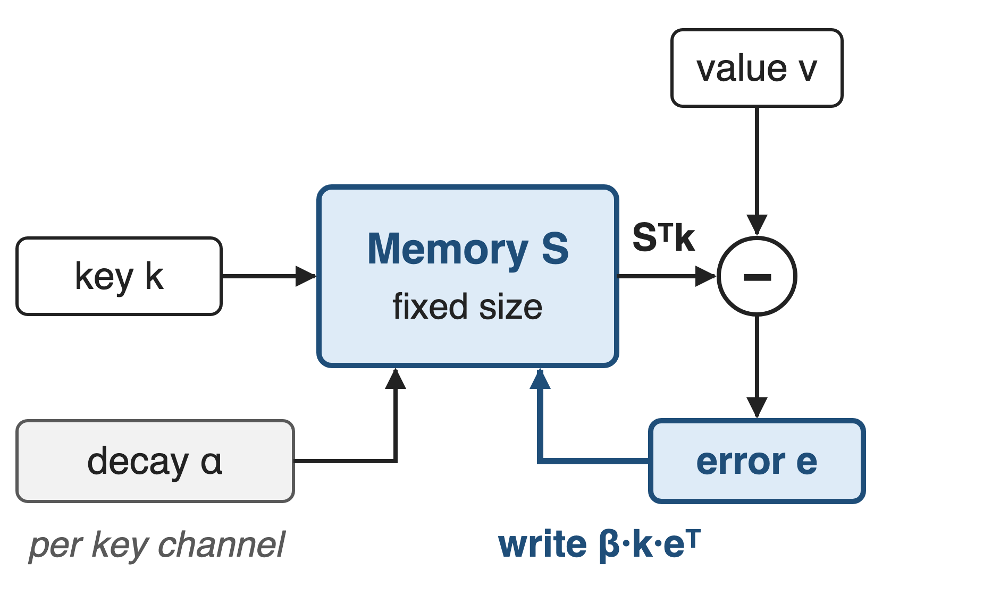{right 50%}
- Delta rule = one gradient step on ‖Sᵀk − v‖²
- Decay each key channel, then write the error
> S′ = Diag(α)·S, then S ← S′ + β·k·(v − S′ᵀk)ᵀ: size never grows
<!-- notes: Treat the state as an associative memory that is trained online. DeltaNet showed that subtracting beta k k-transpose S and adding beta k v-transpose is exactly one gradient step on the reconstruction loss of S-transpose k against v. So the write is only the prediction error: if the memory already maps k to v, nothing changes. KDA adds a per-channel decay before the step. Algebraically this is K3 Eq. 1: S_t = (I - beta k k^T) Diag(alpha) S_{t-1} + beta k v^T. Sources: Kimi Linear Sec. 2.2, K3 Eq. 1. -->

# One KDA layer: gated inputs, one fixed state
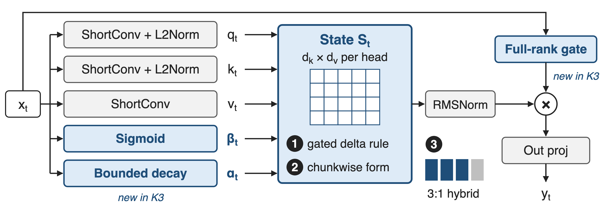{full}
%% caption: ❶ state update · ❷ chunkwise execution · ❸ 3:1 hybrid with Gated MLA; blue = KDA-specific parts
<!-- notes: Per head, the layer projects q, k and v through a short convolution and Swish, with L2 normalization on q and k. A sigmoid gives the write strength beta, and a low-rank projection gives one decay logit per key channel, which K3 maps through a bounded sigmoid. The state S is d_k by d_v; the output S-transpose q goes through head-wise RMSNorm and a sigmoid output gate, which K3 makes full rank. Sources: K3 Eq. 2, 5, 6 and Fig. 2. -->

# ❶ Each token: decay, predict, correct
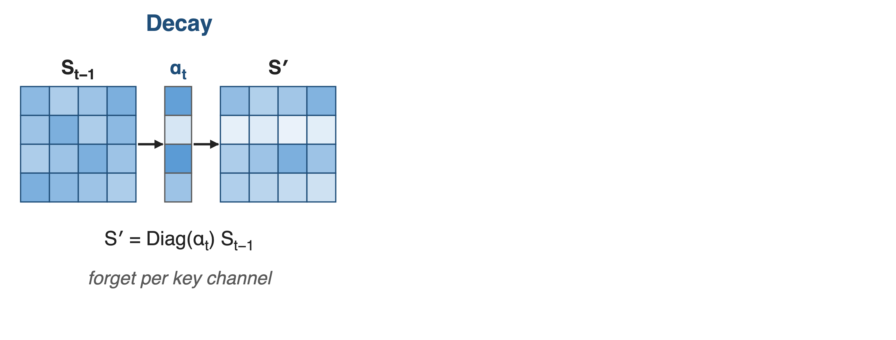{full}
> Same as K3 Eq. 1: new S = (I − β·k·kᵀ)·Diag(α)·old S + β·k·vᵀ
--
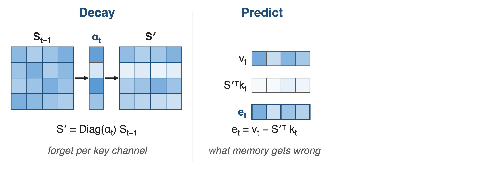{full}
--
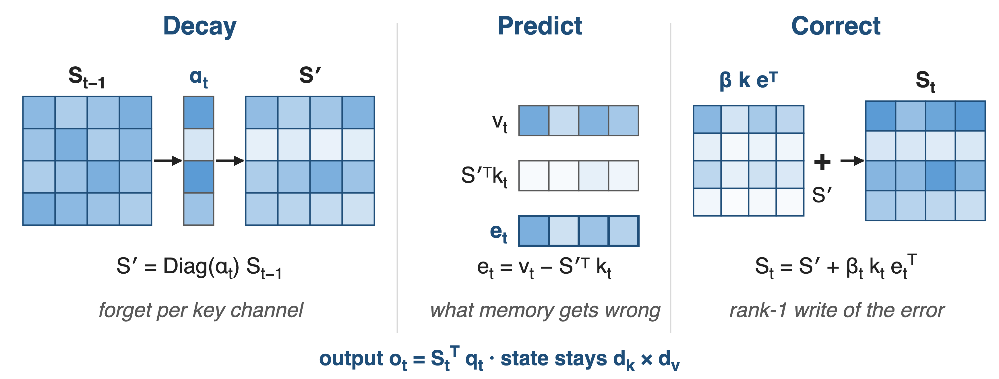{full}
<!-- notes: Three moves per token. Decay: Diag(alpha) scales each row of S, one rate per key channel, so stale features fade while others are kept. Predict: S-prime-transpose k is what the memory currently returns for this key; the error e is v minus that guess. Correct: add beta times k times e-transpose, a rank-1 write of only the error. The output is S-transpose q, and the state never grows. Toy 4 by 4 shades, not real values. Source: K3 Eq. 1 rearranged. -->

# ❶ Per-channel decay also encodes position
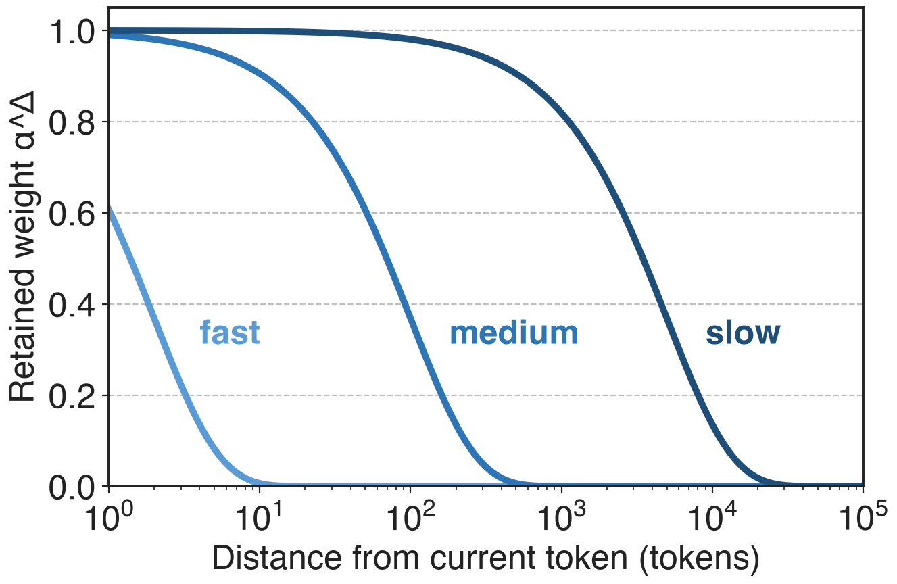{right 55%}
- One α per key channel, not per head
- Channels keep short to long horizons, like RoPE frequencies
- So all MLA layers drop RoPE (NoPE)
%% caption: analytic, constant α per channel for illustration
> Synthetic recall and state tracking: KDA leads GDN at 256-2,048 tokens
<!-- notes: Gated DeltaNet and Mamba2 forget a whole head at one rate. KDA gives each key channel its own retention factor alpha in (0,1), like GLA. Kimi Linear shows the gated delta rule is a multiplicative positional encoding with a data-dependent transition, the analogue of RoPE's per-dimension frequencies, so K3 delegates all position information to KDA and runs every MLA layer without RoPE. The chart is analytic: alpha to the power distance for three illustrative constant decay rates, showing short, medium and long memory horizons. Evidence: Kimi Linear Sec. 5.1 synthetic tasks (palindrome, MQAR, stack; KDA highest accuracy from 256 to 2,048 tokens, Mamba2 fails) and Sec. 6.1; no exact accuracies quoted here. -->

# ❷ Chunks: parallel inside, recurrent across
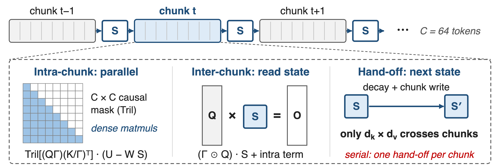{full}
> Kernel that overlaps the two phases: FlashKDA, deck 08
<!-- notes: Running the recurrence token by token would starve the GPU. The chunkwise form splits the sequence into chunks of C tokens, 64 in Kimi Linear. Inside a chunk, outputs are a causal-masked matrix product over pseudo-values U minus W S, where U and W come from the UT transform; across chunks, the queries read the incoming state, and only that d_k by d_v state is handed to the next chunk. The serial hand-off is what the FlashKDA kernel overlaps. Sources: K3 Eq. 3-4; Kimi Linear Eq. 8-9 and Sec. 6.3. -->

# ❷ Bounded decay: all tiles on Tensor Cores
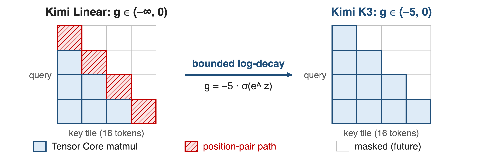{full}
> Per-token g > −5, so over a 16-token tile 1/Γ < e⁸⁰: inside BF16 range
<!-- notes: The intra-chunk term divides keys by the cumulative decay Gamma, which can overflow. Kimi Linear computes in log space with 16-token sub-tiles; off-diagonal tiles become matmuls but diagonal tiles still need an explicit position-pair computation, the main intra-chunk bottleneck. K3 replaces the negative-softplus decay with g = g_min times sigmoid, g_min = -5: each alpha exceeds e^-5, about 6.7e-3, a tile's cumulative log-decay stays above -80, and e^80 fits in BF16, so every causal tile runs on Tensor Cores. Source: K3 Sec. 2.1.1, Eq. 5, Fig. 3. -->

# ❸ Three KDA layers per global MLA layer
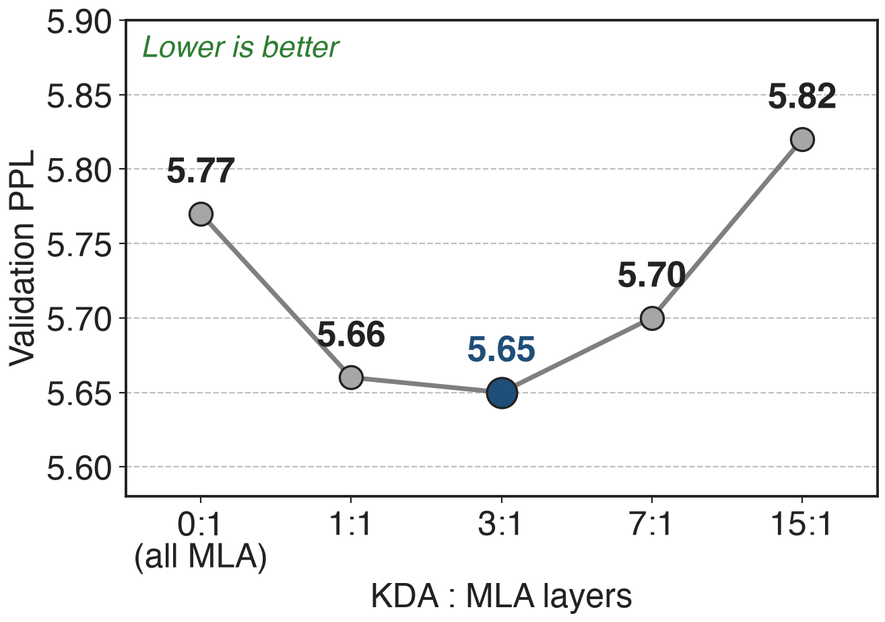{right 55%}
- A finite state cannot copy exactly: keep some global layers
- 3:1 is best; 7:1 and 15:1 lose on validation
- K3 adds one final MLA layer
<!-- notes: Pure linear attention struggles with exact retrieval and copying, so K3 keeps a global Gated MLA layer after every three KDA layers. In the Kimi Linear ablation at equal FLOPs, 3:1 had the lowest validation perplexity, 5.65; all-MLA was 5.77, 7:1 5.70 and 15:1 5.82, while 1:1 matched quality at higher inference cost. K3 also places one more MLA layer at the end so the last layer is always global. Sources: Kimi Linear Table 1 and Sec. 5.2; K3 Sec. 2.1. -->

# Same 1.4T tokens: KDA hybrid beats full MLA
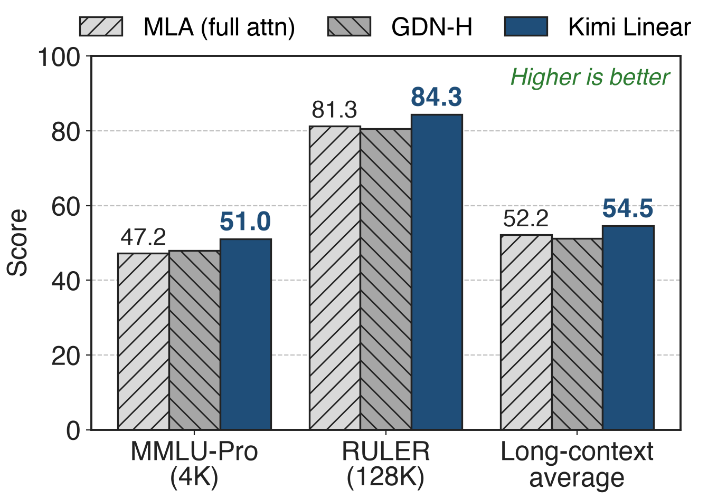{right 55%}
- 48B-A3B MoE, identical data and recipe
- Wins short and long context
- Scaling-law fit: about **1.16×** compute efficiency over MLA
<!-- notes: The fair comparison is from Kimi Linear: three 48B-total, 3B-active MoE models trained on the same 1.4T tokens, differing only in attention. The KDA hybrid scores 51.0 on MMLU-Pro versus 47.2 for MLA, 84.3 versus 81.3 on RULER at 128K, and 54.5 versus 52.2 on the long-context average; GDN-H, with head-wise gates, falls behind MLA on long context. The scaling-law study gives about 1.16 times compute efficiency. Sources: Kimi Linear Tables 3 and 5, Fig. 5. -->

# Decodes 6.3× faster than MLA at 1M tokens
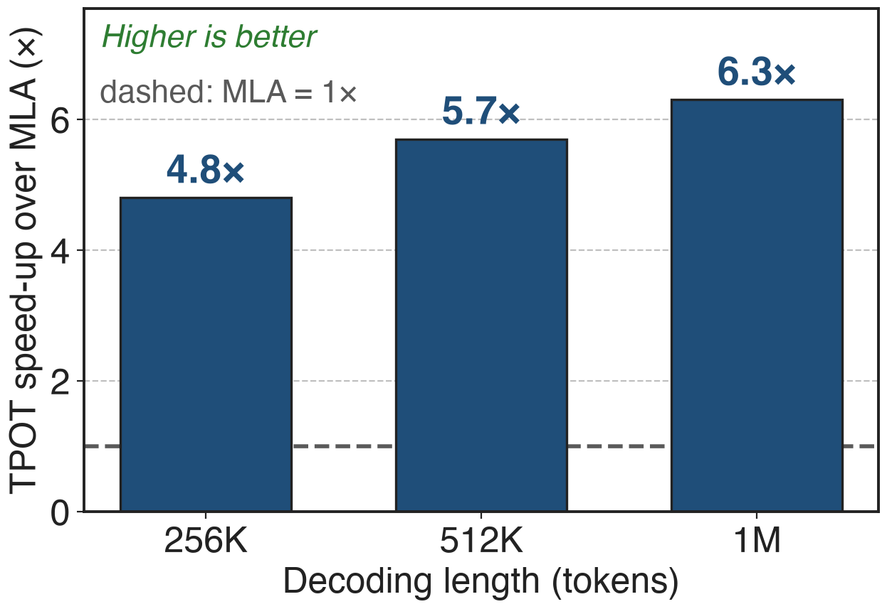{right 55%}
- **1.84 ms** vs 11.48 ms per token at 1M
- Up to **75%** less KV cache allows larger batches
- Batch size 1: 2.2× decode, 2.9× prefill at 1M
<!-- notes: Same currency as the pain: time per output token at 1M context drops from 11.48 ms to 1.84 ms, 6.3 times, because the KDA layers keep a fixed state and the freed memory admits larger batches. At batch size 1 the gain is 2.2 times for decoding and 2.9 times for prefill at 1M; the text of Sec. 6.3 says 2.3 times for batch-1 decoding, the figure says 2.2. Below about 16K tokens prefill is on par with MLA. Sources: Kimi Linear Fig. 1b, Fig. 7, abstract. -->

# At K3 scale: 2.5× scaling efficiency over K2
%% big: ≈2.5×
%% tone: ours
%% sub: Kimi K3 vs K2 scaling efficiency, from KDA + AttnRes + Stable LatentMoE + data and training recipes together
- 1M-token context with no RoPE rescaling or interpolation
%% source: Kimi K3 report (arXiv 2607.24653): abstract, Sec. 3.2 and Fig. 7 (scaling laws), Sec. 3.4 (NoPE context extension)
<!-- notes: At 2.8T parameters, K3 reports about 2.5 times better overall scaling efficiency than K2 on held-out validation loss. This is a joint result: KDA, Attention Residuals, Stable LatentMoE and refined data and training recipes together; the report gives no KDA-only ablation at this scale. Because positions come from KDA's decay, the context grows from 8K to 1M through a four-stage curriculum with no positional-encoding change. Siblings: AttnRes deck 59, Stable LatentMoE deck 57, context extension deck 06. -->

# Costs: long context only, new kernels and caches
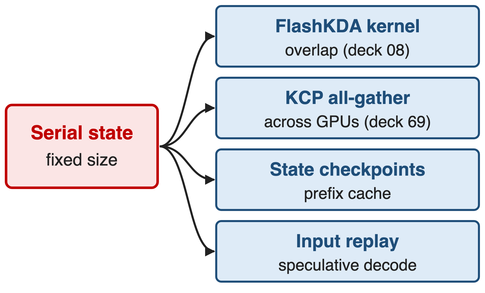{right 50%}
- Gains need long context: prefill ≈ MLA at 4K-16K
- 24 MLA layers still keep a KV cache
- No KDA-only ablation at K3 scale
<!-- notes: KDA is not free. Its speed advantage appears only at long context; at 4K to 16K prefill matches MLA. The global MLA layers still keep a KV cache. The serial state forces dedicated machinery: the FlashKDA kernel (deck 08), KDA Context Parallelism (deck 69), prefix caching that checkpoints the recurrent state at 512-token hash boundaries, and input replay for speculative decoding. Finally, the measured speed and quality numbers in this deck come from the 48B Kimi Linear model; K3 reports no KDA-only ablation at 2.8T. Sources: Kimi Linear Sec. 5.6; K3 Sec. 5.1, 5.4.1, 5.4.2. -->

# Summary
- Full attention at 1M: **11.48 ms** per token, cache grows with every token
- ==KDA==: per-channel decay, then write only the error into a fixed state
- **6.3×** faster decoding at 1M; better quality at equal tokens
- K3: 69 of 93 layers; kernel in deck 08, CP in deck 69
%% qr: https://arxiv.org/abs/2607.24653
<!-- notes: Full attention pays for every past token: 11.48 ms per output token at 1M context in the Kimi Linear setting. KDA turns a fixed-size state into a self-correcting memory: decay per key channel, then write only the prediction error. With three KDA layers per NoPE Gated MLA layer it decodes 6.3 times faster at 1M and beats full MLA at equal training tokens; K3 builds 69 of its 93 attention layers this way. Sources: Kimi Linear Fig. 1b, Tables 3 and 5; K3 Table 1. -->
