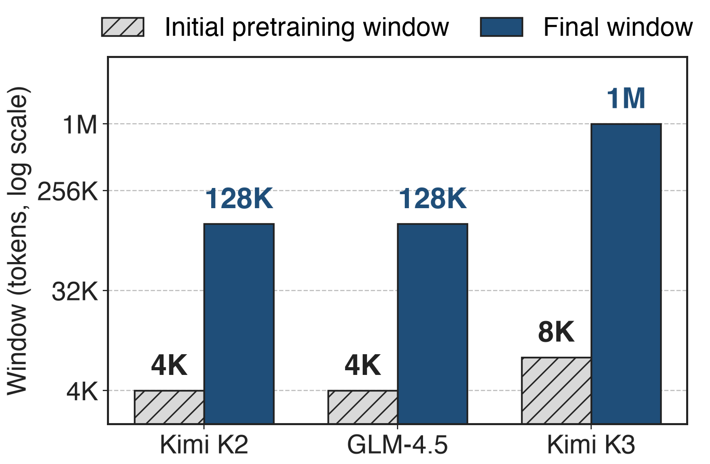
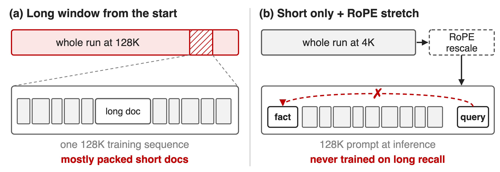
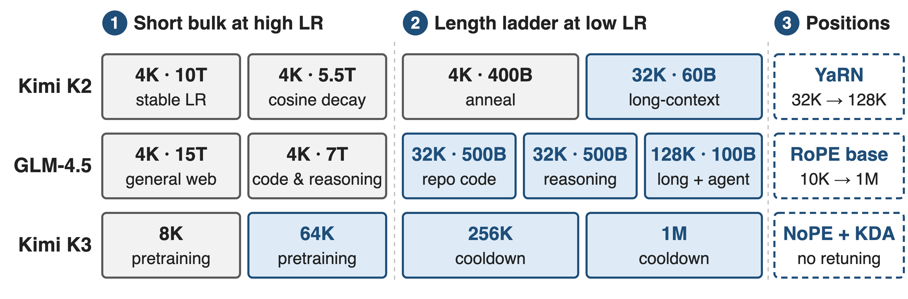
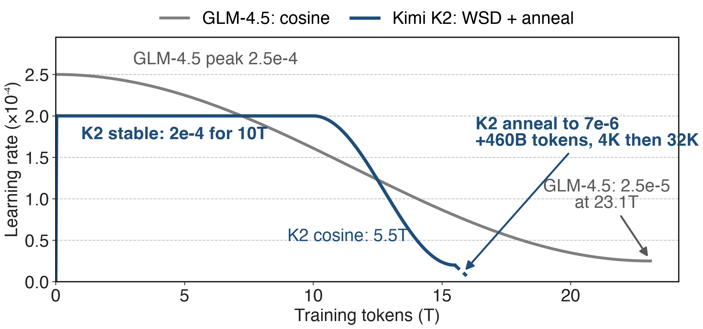
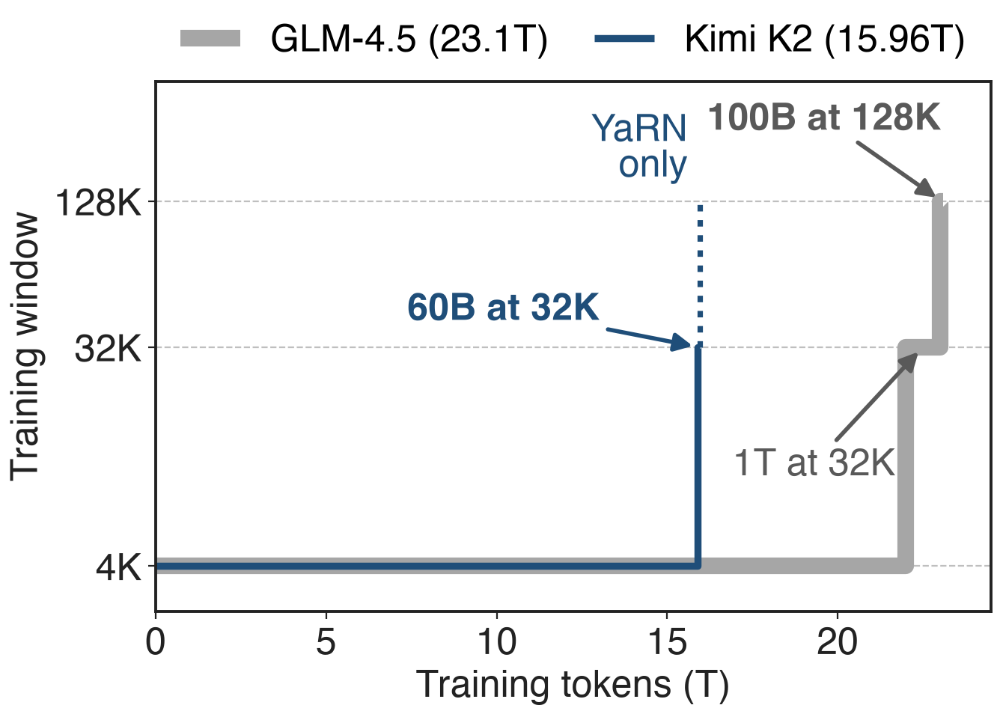
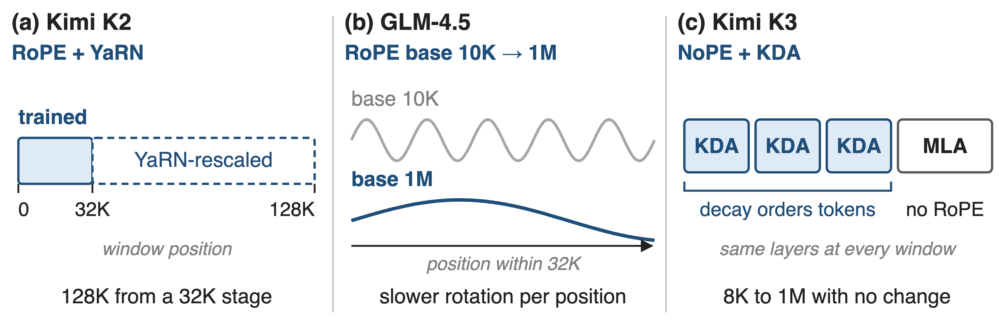
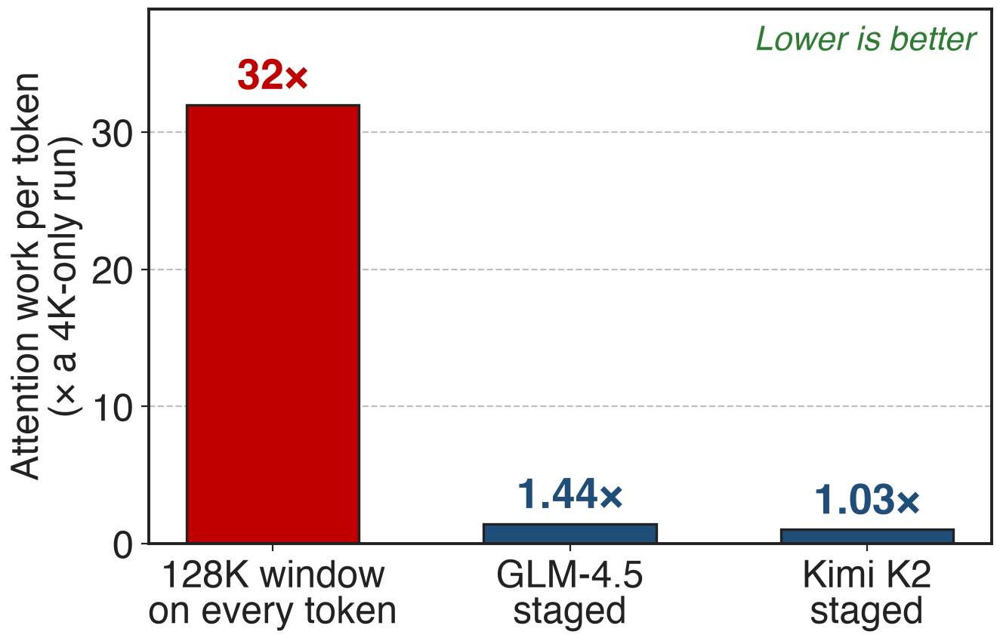

# Frontier MoEs pretrain short, then serve long
{right 55%}
- Kimi K2: **1.04T** MoE, **15.5T** tokens
- GLM-4.5: **355B** MoE, **23T** tokens
- Kimi K3: **2.8T** MoE, **1M** window
<!-- notes: Three recent frontier MoE runs all start pretraining at a short window and finish with a long one. Kimi K2 and GLM-4.5 start at 4K and ship 128K; Kimi K3 starts at 8K and ships one million tokens, eight times K2's training context. The question this deck answers is where in the run, and on how many tokens, the long windows are trained. Sources: K2 Table 2 and §2.5; GLM-4.5 abstract and §2.4; K3 abstract, Table 1 and §3.4. -->

# Long windows multiply attention work per token
%% big: 32×
%% sub: attention work per token in a 128K window vs. a 4K window (analytic); 128× from 8K to 1M
%% source: Analytic: causal attention reads every earlier token, so work per token grows with the window. Windows: K2 §2.5, GLM-4.5 §2.4, K3 §3.4
<!-- notes: In causal attention every token reads all earlier tokens of its sequence, so the attention work per token grows linearly with the window: a 128K window does 32 times the attention work per token of a 4K window, and K3's 1M window 128 times its 8K start, in its 24 global layers. This counts attention only; the expert FLOPs do not depend on the window. K2 shows that attention dominates at this length: at 128K, going from 64 to 128 heads alone adds 83% inference FLOPs (K2 §2.3). Derivation in notes/sources.md. -->

# Always-long and never-long training both fail
{full}
> (a) pays the long window on every token; (b) never practises using it
<!-- notes: Option (a): train at the target window from the first step. Every one of 16 to 23 trillion tokens pays the long-window attention, and because genuinely long documents are scarce, most of each long window is packed short documents anyway; K3 has to upsample long data so it is not overwhelmed by short sequences (§3.4). Option (b): train only at 4K and stretch the positional encoding at the end. The positions now reach 128K, but, as the K3 report puts it, length alone does not confer long-range capability: the model never trained on answers that sit far away. -->

# Insight: long-range skill is a late, small adaptation
- Knowledge and language: learnable in **4–8K** windows
- Using distant context: needs long **data**, not a long **run**
--
> Spend long windows only in the low-LR tail, on data that needs them
<!-- notes: All three reports make the same bet. What a model learns from most tokens, facts, language and code, fits in a short window. What the long window adds is the habit of using information far away, and that can be taught at the end, at low learning rate, on a small slice of long and synthetic long-dependency data. K3 says it directly: concentrating the long-sequence computation in a small fraction of the budget keeps the curriculum economical while the model adapts gradually (§3.4). -->

# Three runs share one shape: short bulk, long tail
{full}
%% caption: Not to scale. Blue = windows above the starting length. K3 publishes stage windows but no token budgets.
<!-- notes: Read each row left to right. K2: 15.5T tokens at 4K under a constant-then-cosine learning rate, then a 400B-token anneal at 4K and a 60B-token stage at 32K, and YaRN to reach 128K. GLM-4.5: 22T tokens at 4K, then 1T at 32K of repository code and synthetic reasoning, then 100B at 128K of long documents and agent trajectories, with the RoPE base raised. K3: 8K then 64K during pretraining, 256K then 1M during cooldown, with no positional change. Mechanisms one to three zoom into the columns. Sources: K2 §2.5; GLM-4.5 Fig. 3, §2.3-2.4; K3 §3.3-3.4. -->

# ❶ The LR schedule decays into a low-LR tail
{full}
> GLM-4.5 and K3 chose cosine: WSD underfit, or lost once each was tuned
<!-- notes: K2 uses warmup-stable-decay: 2e-4 for 10T tokens after a 500-step warm-up, cosine down to 2e-5 over 5.5T, then an anneal to 7e-6 over the final 460B tokens that carry the 32K stage; the anneal's shape is not published, so it is drawn dashed. GLM-4.5 runs one cosine from 2.5e-4 to 2.5e-5 that ends with its 128K stage; it found WSD underfits in the stable phase (worse SimpleQA and MMLU). K3 also uses cosine with a 1% warm-up, after an independent scaling-law search per schedule showed cosine reaches lower final loss than WSD. Either way the long rungs land where the learning rate is lowest. Sources: K2 §2.5; GLM-4.5 §2.4; K3 §3.2-3.3. -->

# ❷ The length ladder fills the last few percent
{right 55%}
- K2: **60B** tokens at 32K = **0.4%**
- GLM-4.5: **1.1T** at ≥ 32K (**4.8%**), **100B** at 128K
- Long docs upsampled; K3 adds synthetic long-range tasks
%% caption: To scale; K3 not plotted (stage budgets unpublished). Shares derived.
<!-- notes: Plotted to scale, both runs are flat at 4K for almost the whole budget and step up only at the very end. K2's 32K stage is 60 billion of about 16 trillion tokens, 0.4%. GLM-4.5 spends 1.1T, 4.8%, at 32K or more and only 100B, 0.4%, at 128K. Each rung needs data that fills it: both upsample long documents, GLM-4.5 uses best-fit packing in mid-training, and K3 permutes and concatenates documents so the embedded tasks can only be solved across the full window. Sources: K2 §2.5; GLM-4.5 Fig. 3, §2.3; K3 §3.4. -->

# ❸ Each rung re-fits positions, or needs none
{full}
> K3's KDA layers carry order, so 8K → 1M needs no RoPE change (deck 05)
<!-- notes: A RoPE model trained at 4K has never seen rotation angles for distant positions. K2 trains up to 32K and then uses YaRN to rescale positions out to 128K. GLM-4.5 raises the RoPE base from 10,000 to 1,000,000 when it moves to 32K, so each dimension rotates more slowly per position. K3 removes the problem: its MLA layers use no positional encoding, and the per-channel decay of its KDA layers gives order and recency, so the window grows from 8K to 1M with no positional modification. Wave periods are illustrative. Sources: K2 §2.5; GLM-4.5 §2.4; K3 §2.1.2, §3.4. -->

# Staging keeps attention work within 1.44× of 4K
{right 55%}
- Pain was **32×** per token at 128K
- Run average: **1.03×** (K2), **1.44×** (GLM-4.5)
- GLM-4.5's 128K rung: **0.4%** of tokens, ~**10%** of attention work
%% caption: Analytic, token-weighted from published stage budgets
<!-- notes: Same currency as the pain slide. Weight each stage's window by its tokens: K2 averages 1.03 times the attention work per token of a pure 4K run, GLM-4.5 1.44 times, against 32 times for a 128K window on every token. The tail is still not free: in GLM-4.5 the 128K rung is 0.4% of tokens but about 10% of the run's attention work, and the two 32K stages about a quarter. Attention only, assuming full causal attention over each packed window. Derivation in notes/sources.md. -->

# The trained windows hold up end to end
%% layout: two-col
- **Kimi K2**, 128K window
- MRCR **55.0%** vs 50.8% (DeepSeek-V3-0324)
|||
- **Kimi K3**, 1M window
- BrowseComp **90.4%** with no context management
- AA-LCR **74.7**
> Whole-recipe outcomes: no report ablates staging alone
<!-- notes: K2-Instruct, evaluated with a 128K window, beats DeepSeek-V3-0324 on the MRCR retrieval task, 55.0 versus 50.8 percent, while trailing it by about 2 points on FRAMES and LongBench v2. K3 scores 90.4 percent on BrowseComp using its full 1M window without any context management, against 91.2 percent with compaction at 300K tokens, and 74.7 on AA-LCR. These are end-to-end results of whole recipes, including post-training; none of the three reports isolates the staged schedule. Sources: K2 §4 and p.29; K3 §6.1.3 and Table 2. -->

# The cost: scarce data, extra infra, few ablations
%% layout: two-col
- !!Long data is scarce!!: upsample, synthesize, clean
- Tail still needs context parallelism (deck 69)
- K2's last 4×: YaRN, not trained
|||
- No staged-vs-unstaged ablation; K3 budgets unpublished
- !!Not for RL output length!!: GLM-4.5 single 64K beat 16K→64K, **83.4%** vs 80.6%
<!-- notes: Staging moves the long-context problem into data: K3 needs a dedicated cleaning pipeline, upsampling and synthetic long-dependency tasks. The tail still runs million-token sequences, which K3 makes tractable with KDA context parallelism (deck 69; softmax CP is deck 68). K2 never trains at 128K; the final factor of four is YaRN. None of the reports compares against an unstaged run, and K3 publishes no stage budgets. Finally, the idea does not carry over to RL output length: GLM-4.5's smaller experimental model reached 83.4% on AIME24 with single-stage 64K RL versus 80.6% with a 16K-to-64K curriculum (§3.2, Fig. 6). -->

# Summary
- Long windows: **32×** attention work per token (128K vs 4K)
- ==Insight==: learn knowledge short, teach length in the low-LR tail
- Top rung: **0.4%** of tokens in K2 and GLM-4.5
- Run average **1.03–1.44×** a 4K run; K3 reaches **1M**
%% qr: https://arxiv.org/abs/2607.24653
<!-- notes: Staged context extension trains almost all tokens at 4 to 8K and spends the long windows in the low-learning-rate tail on upsampled and synthetic long data, re-fitting or removing positional encodings at each rung. Related decks: 05 (KDA, why K3 needs no RoPE interpolation), 69 (KDA context parallelism for the 1M tail), 68 (context parallelism). Sources: K2 §2.5; GLM-4.5 §2.3-2.4; K3 §3.3-3.4. -->
