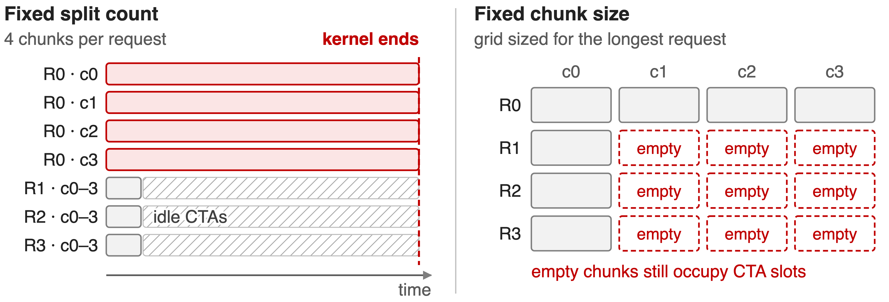
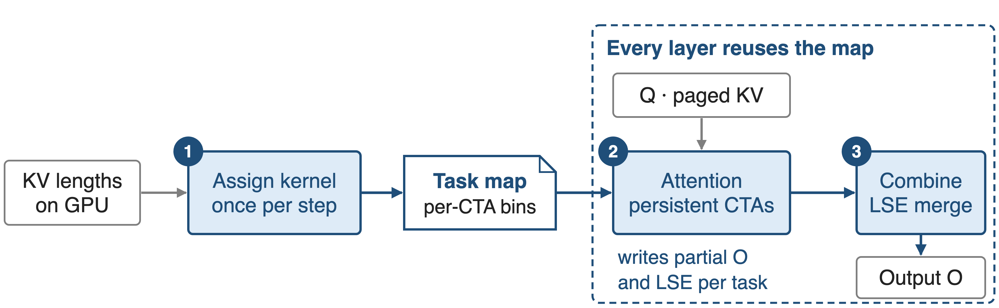
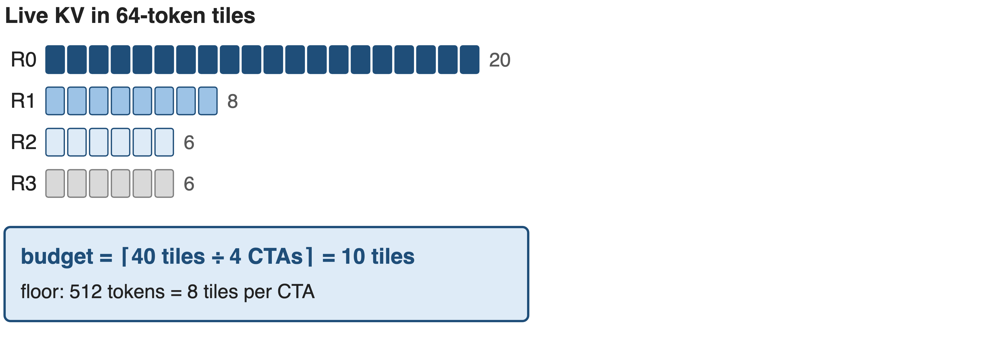
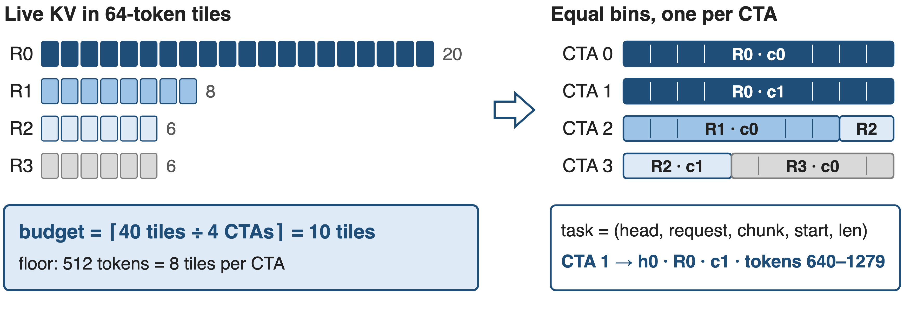
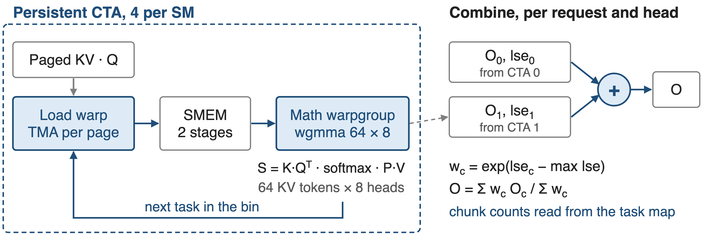
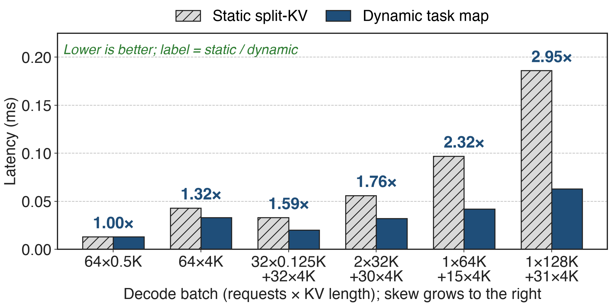
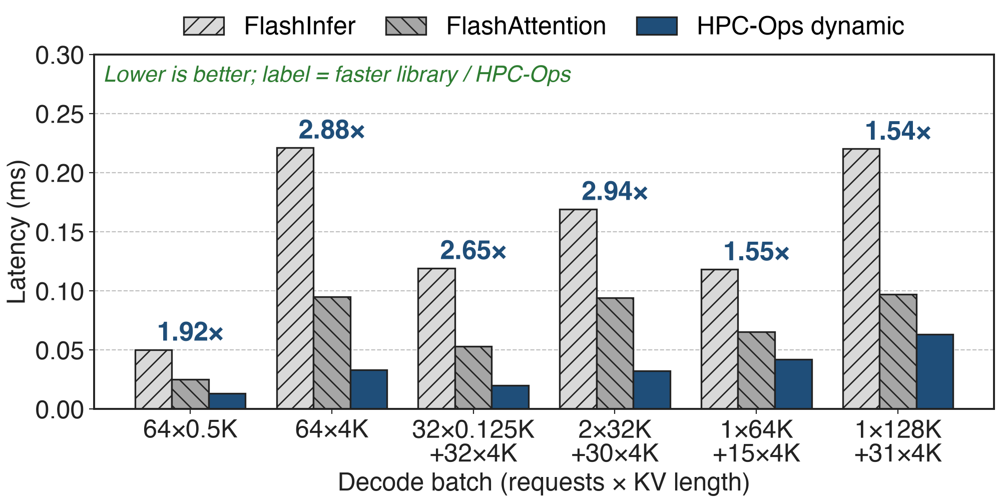

# Decode batches mix 128K and 4K contexts
- Continuous batching puts requests at every stage into one launch
- Long-context, multi-turn and agentic traffic widen KV lengths
- Attention work tracks live KV: 16K is **16×** the work of 1K
<!-- notes: During decode every new token attends over its request's whole KV cache, so attention work scales with the live length. In production a single decode launch mixes very long contexts with short ones. This kernel is HPC-Ops' answer, used in Tencent's Hunyuan serving and in SGLang's hpc_ops attention backend (deck 26 covers the library). Source: LMSYS / Tencent blog "HPC-Ops x SGLang", Attention section. -->

# Same KV work, 4.3× the latency
%% big: 4.3×
%% sub: longer static split-KV attention for 1×128K + 31×4K than for 64×4K, with ~2% less KV to read
%% source: Derived from LMSYS / Tencent "HPC-Ops × SGLang" Table 1 (H20, FP8 KV): 0.186 vs 0.043 ms; 258,048 vs 262,144 KV tokens
<!-- notes: Both batches read about a quarter million KV tokens: 64 requests of 4K, versus one 128K request plus 31 of 4K. With a static split-KV schedule the skewed batch takes 0.186 ms instead of 0.043 ms. The kernel time follows the longest request, not the total work. Derivation: 0.186 / 0.043 = 4.3; token counts from the scenario definitions. -->

# Static split-KV either stalls or wastes CTAs
{full}
%% caption: Launch grid = KV heads × requests × chunks, fixed before the live lengths are seen
<!-- notes: A static schedule picks one policy for the whole batch. Fix the split count, for example 4 or 16 chunks per request, and the long request's chunks are huge: a few CTAs run long while the rest sit idle. Fix the chunk size instead, and the grid must reserve enough chunks for the longest request, so short requests launch empty chunks. One policy creates uneven work, the other schedules nonexistent work. Sources: LMSYS Attention section; src/attention/entry.cc static split-k policy. -->

# Insight: balance KV tiles, not requests
- Work = live KV in 64-token tiles; lengths already sit on the GPU
- Budget = total tiles ÷ CTAs gives every CTA equal work
- Uniform batch: both schedules tie at **1.00×**
--
> Decide the split every decode step from live lengths, not per request from a fixed policy
<!-- notes: Because attention work is just the number of KV tiles, and the lengths are known on the device before each step, the balanced partition is a division, not a search. On a uniform 64 x 0.5K batch the dynamic and static kernels both take 0.013 ms, so the scheduler adds nothing where it is not needed. Sources: LMSYS Table 1 row 1; assign_task.cu. -->

# One task map per step drives every layer
{full}
%% caption: Built on the GPU from device-side lengths; attention and combine launch with PDL
<!-- notes: Once per decode step a small assign kernel turns the KV lengths into a task map. Every transformer layer's attention kernel reads the same map, so the scheduling cost is paid once per step and amortized across layers. Persistent attention CTAs write partial outputs with their log-sum-exp, and a combine kernel produces the final output. Sources: LMSYS "Scheduling around live KV work"; hpc/attention.py; dynamic kernel launch code (programmatic stream serialization attribute). -->

# ❶ The assign kernel sets a per-CTA tile budget
{full}
%% caption: Toy batch with one KV head; the real budget counts tiles over all KV heads and requests
<!-- notes: Each request's live KV is cut into 64-token tiles. The kernel sums tiles over all KV heads and requests and divides by the number of persistent CTAs, which is 4 per SM for single-token decode. A floor of 512 tokens, 8 tiles, per CTA keeps tiny batches from being over-split, which keeps the combine cheap. Toy numbers: 40 tiles over 4 CTAs gives 10. Sources: assign_task.cu (num_tile_per_cta), sched_task_info.h (kCtaPerSmMap), hpc/attention.py (min_process_len default 512). -->

# ❷ Equal bins: long requests span CTAs
{full}
%% caption: Fill order: KV head, then request; leftover tiles of a request spill into the next bin
<!-- notes: Each CTA's bin is filled up to the budget before moving on. R0 is split into two chunks on CTA 0 and CTA 1; R1 and the first part of R2 share CTA 2. Each entry is a 48-byte task descriptor: KV head, request, chunk index, token start and length, plus a flag on the request's last chunk used for causal masking with draft tokens. Sources: assign_task.cu; sched_task_info.h. -->

# ❸ CTAs drain bins; combine merges by LSE
{full}
%% caption: Combine switches to a multi-warp path above 24 chunks per request and head
<!-- notes: Each CTA has one TMA load warp that fetches K and V page by page into a two-stage shared-memory ring, and one math warpgroup. The wgmma puts 64 KV tokens on the M side and the 8 query heads of a GQA group on the N side, then does online softmax and P times V. Per task it writes a partial output and its log-sum-exp; the combine kernel reads each request's chunk count from the task map and merges the partials with weights exp(lse minus max). Sources: smallm_bf16_dim128_dynamic kernels; splitk_combine_kernels.cuh. -->

# Gains grow with skew, up to 2.95×
{full}
%% caption: H20, FP8 KV-cache decode; HPC-Ops static split-KV vs dynamic task map (LMSYS Table 1)
<!-- notes: From parity on the uniform batch to 2.95x on one 128K request plus 31 of 4K: 0.186 ms down to 0.063 ms. The README's headline for the same comparison is "up to 2.88x"; the newer blog table shows 2.95x. Source: LMSYS Table 1; README Performance table. -->

# 2.25× faster than the faster library on average
{full}
%% caption: Labels: faster of FlashInfer / FlashAttention ÷ HPC-Ops dynamic per case (derived); blog mean 2.25×
<!-- notes: Against external libraries on the same six batches, the dynamic kernel is 1.5 to 2.9x faster than the better of FlashInfer and FlashAttention, 2.25x on average. Part of this gap is the kernel itself rather than scheduling: the uniform cases already show it. FlashInfer used page size 64, FlashAttention 256 in the benchmark script. Sources: LMSYS Table 1 and Highlights; benchmark/attention_decode README. -->

# End to end: modest alone, large with fused MoE
- H200 Hy3-FP8, vs static: output throughput **+2.0%**, TTFT **−5.3%**
- H200 Qwen3 BF16, vs static: throughput **+3.0%**, TPOT **−2.8%**
- 8 × H20 Hy3-FP8, with fused MoE: TPOT **−15.1% to −48.8%**
> Alone, a 2–3× faster attention kernel is a few percent of throughput
<!-- notes: Attention is one part of a decode step, so a 2-3x kernel gain shows up as a few percent of serving throughput when only the schedule changes. On H20 with HPC-Ops attention and MoE enabled together the time per output token falls 15 to 49 percent at batch 4 to 64. Sources: LMSYS Table 6 (H200 upstream validation) and Table 7 (H20 end to end). -->

# Costs: one more kernel, SM90 only
- **Per step**: an assign kernel and workspace; the benchmark times it separately
- **Scope**: SM90, head_dim 128, GQA groups of 4 or 8, few MTP draft tokens
- **Residual skew**: 1×128K + 31×4K still **1.9×** slower than 64×4K
<!-- notes: The task map costs one extra kernel per decode step and a workspace sized for the maximum batch and length; the repository benchmark excludes it from the timed region unless --include-taskmap is set, though in serving it is amortized over all layers. The kernels are sm90 only, head dimension 128, 4 or 8 query heads per KV head. Even balanced, the skewed batch takes 0.063 ms versus 0.033 ms for 64 x 4K (derived from Table 1). Sources: benchmark script flags; entry.cc checks; dynamic kernel shape checks; LMSYS Table 1. -->

# Summary
- Static split-KV: same KV work, **4.3×** the latency on a skewed batch
- ==Insight==: balance 64-token KV tiles, not requests, every decode step
- Up to **2.95×** vs static; **2.25×** vs the faster library on average (H20)
- Library context: deck 26 (HPC-Ops); sparse prefill: deck 09
%% qr: https://github.com/Tencent/hpc-ops
<!-- notes: One line to remember: count the work in tiles, divide by the CTAs, and the tail disappears. Sources as on the previous slides. -->
