# Every KDA layer in K3 runs through FlashKDA
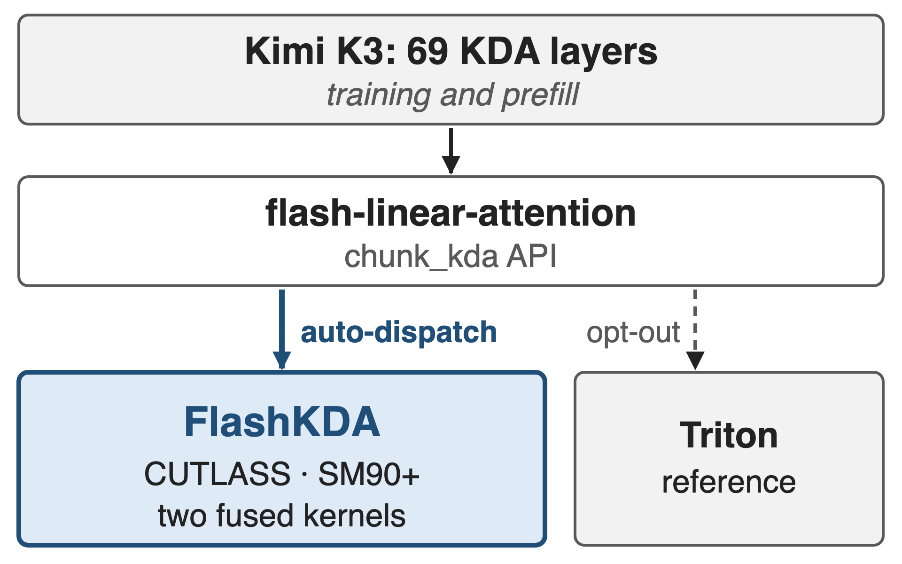{right 50%}
- K3: 69 KDA layers, training and prefill
- Auto-dispatched behind FLA's `chunk_kda`
- KDA math (state update, chunks): deck 05
<!-- notes: Kimi K3 has 69 KDA layers, so the KDA kernel runs on every token of training and prefill. K3 reports FlashKDA, a CUTLASS chunkwise kernel, for both; the open-source v1 plugs in as a flash-linear-attention backend and is picked automatically when chunk_kda is called, with the Triton kernel as fallback. Deck 05 explains what KDA computes; this deck is about how one GPU executes it. Sources: K3 Sec. 5.1.1; FlashKDA README. -->

# The reference KDA kernel trails simpler GDN
%% big: 4.84 ms
%% sub: Triton chunk_kda forward, one 8K-token sequence × 96 heads on H20: about 1.5× the scalar-gate GDN kernel (3.20 ms)
%% source: FlashKDA BENCHMARK_H20.md, T=8192, H=96, D=128, fixed length; 1.5× = 4.84 / 3.20 (derived)
<!-- notes: The pain in one number: the reference Triton kernel needs 4.84 ms for the KDA forward of a single 8K-token sequence with 96 heads on an H20, while the same library's Gated DeltaNet kernel, which has only a scalar gate per head, needs 3.20 ms. KDA's richer per-channel gate looks like it costs about 1.5 times the time. The ratio is derived from the two published numbers. Source: FlashKDA BENCHMARK_H20.md. -->

# Serial state hand-offs leave SMs idle
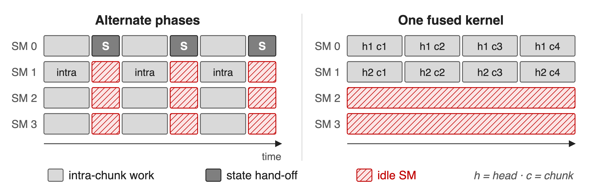{full}
> The recurrence offers only sequences × heads CTAs; the rest could use tiles × heads
<!-- notes: Chunkwise KDA has two phases: dense work inside each chunk, and a serial hand-off of the state from chunk to chunk. Run naively, the two alternate and most SMs idle during each hand-off, as the K3 report notes. Putting everything in one fused kernel is no better: each CTA owns one sequence and head and walks its chunks in order, so the parallel work is throttled to the recurrence's parallelism. Schematic with 4 SMs. Sources: K3 Sec. 5.1.1; FlashKDA deep dive Sec. 2. -->

# Insight: only the state has to wait
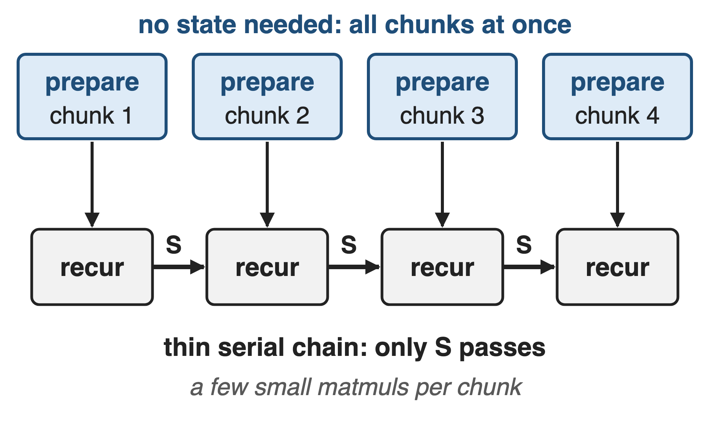{right 50%}
- Decay, L2 norm, inverse, masked QKᵀ: no S needed
- Only a few small matmuls touch S
> Prepare every chunk in parallel; leave a thin serial chain
<!-- notes: Look at what each chunk actually needs. The decayed queries and keys, the normalization, the in-chunk triangular inverse and the masked query-key matrix depend only on the chunk's own tokens. Only a handful of small matmuls read or write the state. So everything else can be computed for all chunks at once, before any state arrives, and the serial part shrinks to a thin chain. Sources: K3 Eq. 4 and Sec. 5.1.1; FlashKDA deep dive Sec. 2; kernel source fwd_kernel2.cuh. -->

# FlashKDA: prepare in parallel, then recur
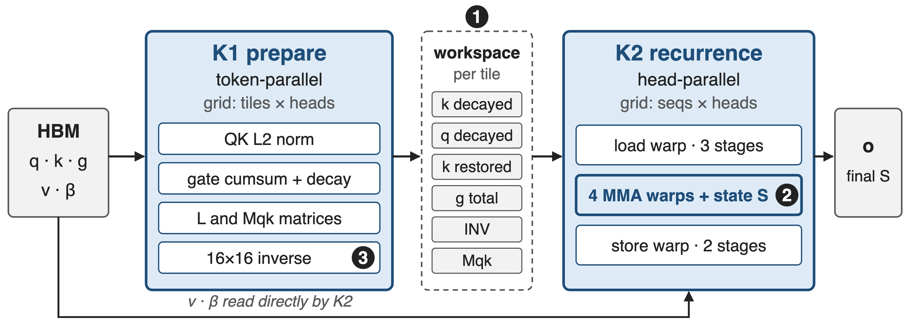{full}
%% caption: ❶ split by parallelism · ❷ warp-specialized recurrence · ❸ 16-token chunks (FlashKDA v1 source, csrc/smxx)
<!-- notes: FlashKDA v1 is two kernels. K1, prepare, is token-parallel: one CTA per 16-token tile and head; it normalizes q and k, activates the gate and takes its cumulative sum, applies the decay, builds the L and Mqk matrices and inverts the 16 by 16 triangular matrix, then writes six per-tile tensors to an HBM workspace. K2, recurrence, is head-parallel: one CTA per sequence and head carries the state through all tiles with a load warp, four MMA warps and a store warp. Sources: FlashKDA deep dive Sec. 2; fwd_launch.cu; fwd_kernel1.cuh; fwd_kernel2.cuh. -->

# ❶ Split the kernel along its parallelism
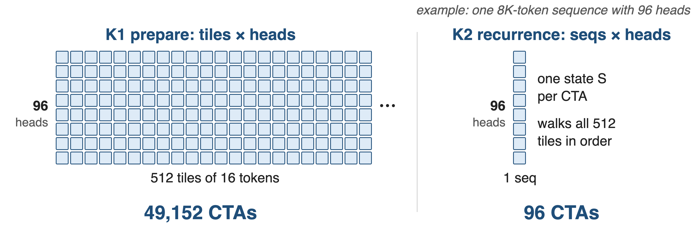{full}
> Two kernels instead of one fused kernel: at least 15% faster end to end
<!-- notes: The split follows the two kinds of parallelism. For the benchmark shape, one 8K-token sequence with 96 heads, K1 launches 512 tiles times 96 heads, about 49 thousand CTAs, while K2 launches only 96, one per head, each walking all 512 tiles in order. Early FlashKDA prototypes fused both into one kernel and the token-parallel work was throttled by the recurrence; splitting gave at least 15 percent end to end and lets each kernel be tuned on its own. CTA counts are derived from the grid definitions in fwd_launch.cu; the 15 percent is from the deep dive Sec. 2. -->

# ❷ Warps overlap memory with the state chain
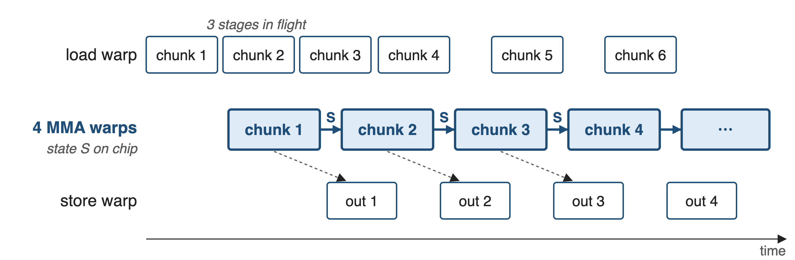{full}
> Per chunk: k·S, q·S → U = INV·β·(v − k·S) → o = q·S + Mqk·U → S ← γ·S + kᵀU
<!-- notes: Inside K2 the warps specialize. One load warp uses TMA to fetch the next chunks' prepared tiles, values and betas into a three-stage shared-memory ring; four MMA warps run the serial chain with the state kept on chip; one store warp drains outputs through a two-stage ring. So memory traffic hides behind the chain. The state lives in BF16 in shared memory but every update uses FP32 FMA, and the intermediate U stays in registers through MOVM transposes. Sources: fwd_kernel2.cuh (warp roles, phases 1-6), fwd_launch.cu (3 input, 2 output stages), deep dive Sec. 3-4. -->

# ❸ 16-token chunks make the inverse cheap
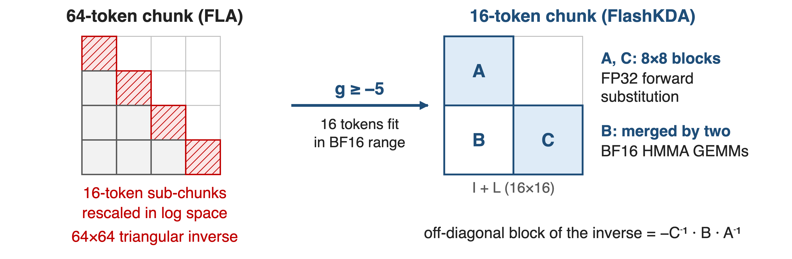{full}
> Bounded decay (g ≥ −5, deck 05) is what makes the small chunk numerically safe
<!-- notes: FLA uses 64-token chunks, which needs secondary 16-token sub-chunks with log-space rescaling and a 64 by 64 triangular inverse. FlashKDA v1 uses 16-token chunks: with K3's lower bound of minus 5 on the log-decay, exp of the cumulative gate stays in BF16 range over 16 tokens. The 16 by 16 inverse is exact: two 8 by 8 diagonal blocks by FP32 forward substitution, the off-diagonal block by two BF16 HMMA GEMMs with FP32 accumulation. All of it maps to SM80 MMA instructions. Other tricks: base-2 exponent, tanh-based sigmoid, 8 K1 blocks per SM. Sources: FlashKDA deep dive Sec. 1, 3, 4; K3 Sec. 2.1.1. -->

# Long prefill also splits one sequence across SMs
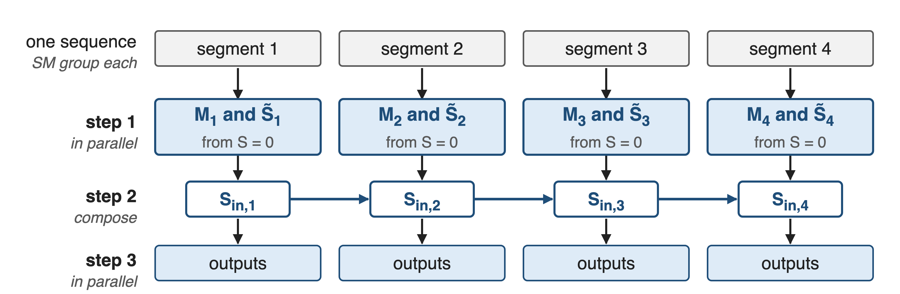{full}
> The same decomposition across GPUs is KDA Context Parallelism: deck 69
<!-- notes: With tensor parallelism each GPU holds only a few heads, so even K2's head-parallel grid cannot fill the GPU when prefilling one very long sequence. K3 adds an automatic SM-level context-parallel planner: it splits the sequence into segments on different SMs, computes each segment's state transition and local state from zero in parallel, composes them in order to recover each segment's exact entry state, and finishes the outputs in parallel. No cross-device communication. Deck 69 applies the same idea across GPUs. Source: K3 Sec. 5.1.1. -->

# 1.85-2.31× faster than the Triton kernel
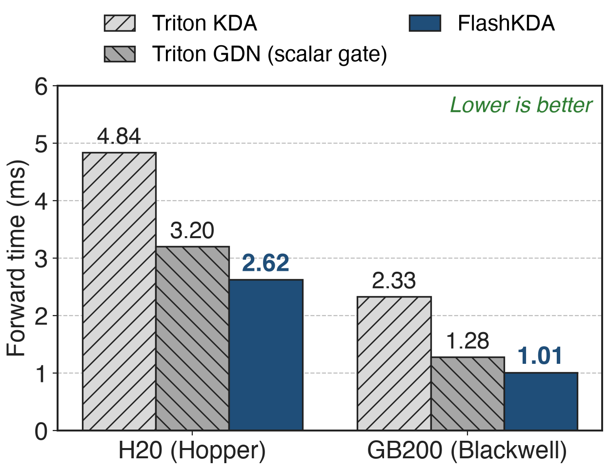{right 55%}
- One 8K-token sequence, 96 heads, head dim 128
- Also beats scalar-gate GDN: **1.22×** H20, **1.27×** GB200
- The per-channel gate no longer costs time
<!-- notes: Headline result, same currency as the pain. For one 8K-token sequence with 96 heads, FlashKDA's forward takes 2.62 ms on H20 versus 4.84 ms for the Triton KDA kernel, 1.85 times faster; on GB200 it is 1.01 versus 2.33 ms, 2.31 times. It is even faster than FLA's scalar-gate GDN kernel, 3.20 and 1.28 ms, so KDA's finer gate no longer costs time. Sources: FlashKDA BENCHMARK_H20.md and BENCHMARK_GB200.md, H=96 tables, Fixed rows. -->

# Variable-length batches gain up to 3.27×
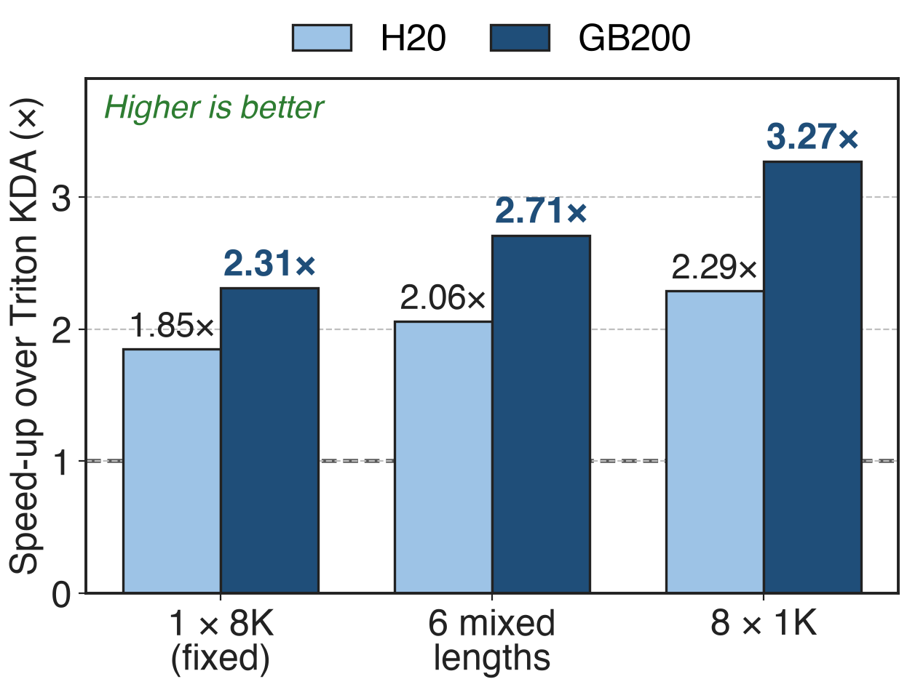{right 55%}
- Same 8K tokens, split into several sequences
- Triton time stays flat; FlashKDA's drops
- 64 heads: 1.70-3.21× on GB200
<!-- notes: Packed training batches and prefill batches contain many sequences. Keeping 8K total tokens and 96 heads, splitting them into six mixed-length sequences or eight 1K sequences leaves the Triton kernel's time almost unchanged, while FlashKDA gets faster because K2 gets one CTA per sequence and head. Speed-ups rise to 2.29 times on H20 and 3.27 times on GB200; with 64 heads the GB200 range is 1.70 to 3.21 times. Sources: FlashKDA BENCHMARK_H20.md and BENCHMARK_GB200.md. -->

# Costs: Hopper+, fixed head size, forward only
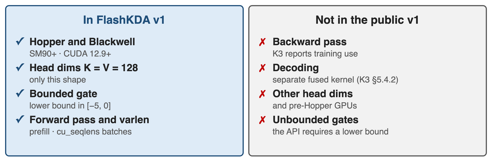{full}
> One regression: 64 heads, fixed length on GB200 runs at 0.96× of GDN
<!-- notes: FlashKDA is specialized. It requires SM90 or newer and CUDA 12.9, supports only key and value head dimensions of 128, and assumes the gate's lower bound lies between minus 5 and 0, which is what makes 16-token chunks safe. The public v1 exposes a forward kernel that FLA dispatches under inference mode; the K3 report says FlashKDA also serves training, but no backward kernel is public. Decoding uses a separate fused kernel with state replay for speculative decoding (K3 Sec. 5.4.2). Published benchmarks cover only T = 8K; at 64 heads, fixed length on GB200, it is 0.96 times the GDN kernel. Sources: FlashKDA README and benchmarks; K3 Sec. 5.1.1, 5.4.2. -->

# Summary
- Triton KDA: **4.84 ms** per 8K × 96-head forward on H20, 1.5× GDN
- ==FlashKDA==: prepare all chunks in parallel, carry only S serially
- **1.85×** (H20) to **3.27×** (GB200, varlen) faster; beats GDN
- Previous: KDA math, deck 05 · Next: cross-GPU KCP, deck 69
%% qr: https://arxiv.org/abs/2607.24653
<!-- notes: The reference kernel made KDA look expensive, 4.84 ms per 8K-token, 96-head forward on H20, 1.5 times the scalar-gate GDN. FlashKDA notices that only the state crosses chunk boundaries: it prepares every 16-token chunk in a token-parallel kernel and carries the state through a thin, warp-specialized chain. Result: 1.85 times faster on H20 and up to 3.27 times on GB200 with variable-length batches, faster than GDN. Code: github.com/MoonshotAI/FlashKDA. Next, deck 69 splits the same recurrence across GPUs. -->
