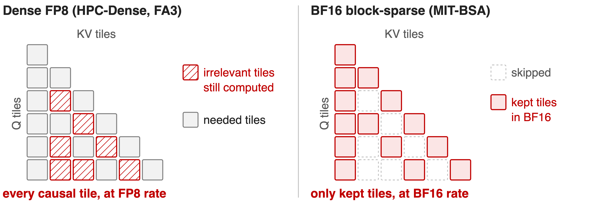
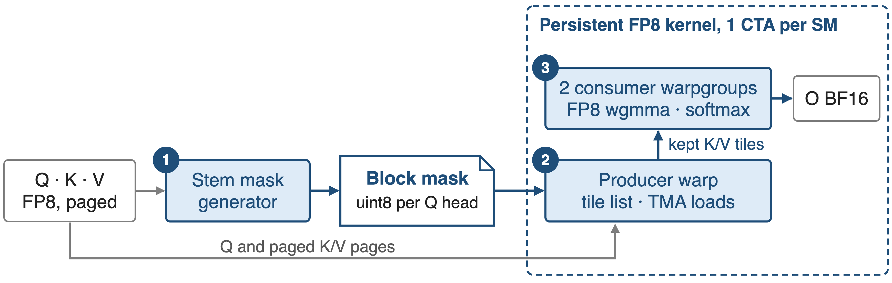
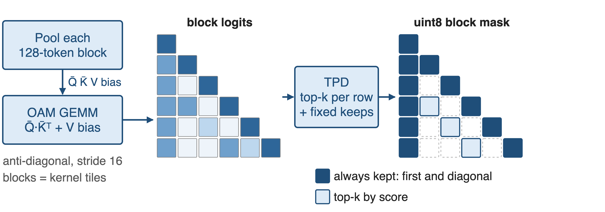
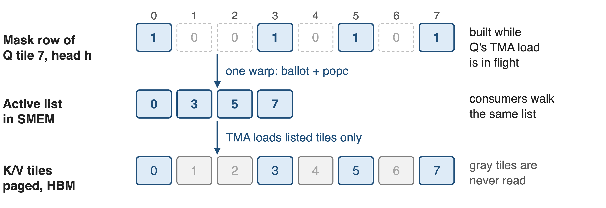
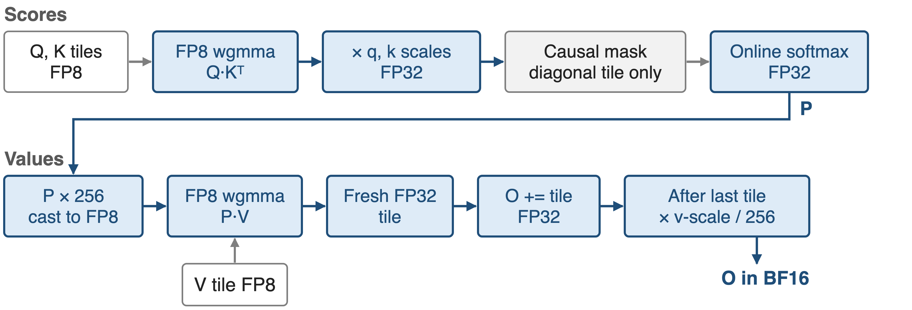
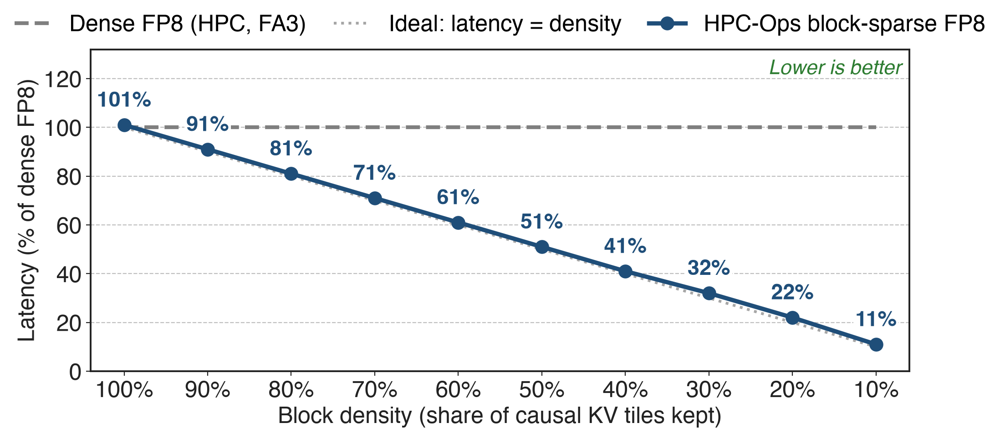
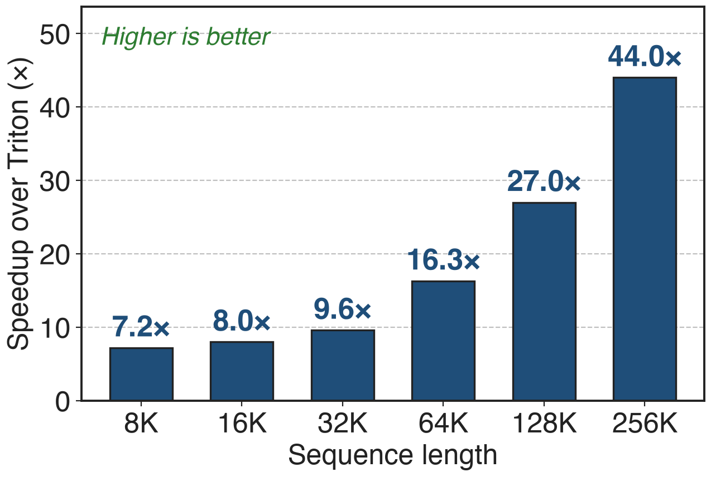

# Long prompts make prefill attention quadratic
- Prefill attends each token to every earlier one: N²/2 pairs
- Long documents, code and agent traces push prompts to 64K–128K
- Block masks such as Stem keep only **25–31%** of causal blocks
<!-- notes: During prefill the whole prompt is processed at once, and causal attention touches every pair of a token and an earlier token, so its cost grows with the square of the prompt length. Block-sparse methods pick, for each 128-token query block, which 128-token key blocks matter. Stem, Tencent's ICML 2026 method that HPC-Ops ships with this kernel, keeps 25 to 31 percent of causal blocks on LongBench. Sources: Stem paper (arXiv 2603.06274) introduction and Table 2. -->

# A 128K prompt spends 1.5 s in dense attention
%% big: 1540 ms
%% sub: dense attention to prefill one 128K prompt (Llama-3.1-8B, H20); 24 ms at 16K, so 64× for 8× the length
%% source: Niu et al., "Stem", ICML 2026 (arXiv 2603.06274), Fig. 1 and §3.4: FlashAttention-2 BF16, batch 1
<!-- notes: On an H20, dense attention for a 128K prompt takes 1540 ms, against 24 ms at 16K: 8 times the length costs 64 times the time (derived ratio). In the same paper, Stem with a BF16 block-sparse kernel brings the 128K case to 420 ms end to end; this deck is about the FP8 kernel HPC-Ops built to run such masks. Source: Stem paper Fig. 1 and Empirical Latency paragraph. -->

# Today: compute every tile, or lose FP8
{full}
%% caption: Dense FP8 visits all causal 128 × 128 tiles; BF16 block-sparse kernels skip tiles but give up FP8 tensor cores
<!-- notes: Two existing options. Dense FP8 kernels, such as HPC-Ops' own dense prefill or FlashAttention-3 in FP8, run each tile fast but compute every causal tile, including the ones a mask would drop. Block-sparse kernels, such as MIT's Block-Sparse-Attention used in the Stem paper or FlashPrefill-BSA, skip tiles but compute the kept ones in BF16. Nobody combined skipping with FP8. Sources: README baselines for the sparse-attention row; Stem paper implementation details. -->

# Insight: most tiles can go, if skipping is free
- Stem at 31% of blocks: LongBench **41.48** vs dense **42.02** (Llama-3.1-8B)
- A Q tile's mask row is known before its KV loop starts
--
> Turn the mask into a work list: skipped tiles cost no bytes and no FLOPs, kept tiles run in FP8
<!-- notes: Accuracy allows aggressive skipping: in the Stem paper, keeping 31 percent of blocks loses about half a point on LongBench for Llama-3.1-8B, and 25 percent costs Qwen3-8B 0.37 points (31.64 vs 32.01). And because the mask is an input, each query tile knows its key tiles before it starts, so the kernel can plan exactly the work it needs. Source: Stem paper Table 2. -->

# A block mask steers one persistent FP8 kernel
{full}
%% caption: Mask = uint8 [batch, Q heads, Q tiles, KV tiles] over 128 × 128-token tiles; paged FP8 K/V cache
<!-- notes: Stem computes the mask on the GPU from the FP8 Q and paged K/V. The attention kernel launches one persistent CTA per SM with 384 threads: a producer warp that turns the mask into a tile list and issues TMA loads, and two consumer warpgroups that do FP8 tensor-core math. CTAs take query tiles longest-causal-range first, in a zig-zag order, so the heavy tiles start early. Sources: hpc/attention.py and hpc/stem.py docstrings; blocksparse kernel launch code and get_next_tile in kernels.cuh. -->

# ❶ Stem builds the mask on the GPU
{full}
%% caption: HPC-Ops defaults keep 4 initial and 4 window blocks; the top-k budget per row depends on prompt length
<!-- notes: Stem pools every 128-token block of Q and K with an anti-diagonal, stride-16 sum, adds a bias from the value norms so blocks with large outputs score higher, and computes block logits with one GEMM. Its top-k step keeps the first blocks and a local window always, which also guarantees the diagonal, and picks the rest by score with a budget set by the prompt length. Toy picture: one initial and one diagonal block shown. Sources: hpc/stem.py; Stem paper method section; PR #50. -->

# ❷ The mask becomes a compact tile list
{full}
%% caption: Producer warp: ballot and popcount compact the row while Q's TMA load is in flight; tiles beyond the mask are appended
<!-- notes: For each query tile and head, the producer warp reads the mask row 32 entries at a time, uses a warp ballot and population count to write the indices of kept tiles into a shared-memory list, then issues TMA loads only for those key and value tiles, page by page through the page table. The consumer warpgroups iterate the same list, so a skipped tile is never loaded and never multiplied. Source: kernels.cuh, blocksparse FP8 kernels, "Build active tile list in SMEM". -->

# ❸ Kept tiles run end to end in FP8
{full}
%% caption: Scales: Q per token and head; K per tensor or per token; V per tensor or per head; P × 256 undone in the epilogue
<!-- notes: Q times K-transpose runs on FP8 tensor cores (wgmma 64 by 64 by 32), then the FP32 scores are rescaled by the query and key scales; the causal mask is applied only on the diagonal tile. After the online softmax, probabilities are multiplied by 256 before the FP8 cast, which keeps small probabilities representable; the epilogue divides by 256 and applies the value scale. Since July 2026 each P times V product goes into a fresh FP32 register tile before being added to the output, to avoid precision loss in the tensor-core accumulator. Sources: kernels.cuh (kFp8PrefillPScale), PR #66. -->

# Latency tracks density: 11% at 10%
{full}
%% caption: HPC-Ops PR #45 benchmark: batch 4, 64K tokens, 4 Q heads / 1 KV head, head_dim 128, H20
<!-- notes: At full density the sparse kernel costs 101 percent of the dense FP8 kernel, so the list machinery is about 1 percent; at 10 percent density it runs in 11 percent of the dense time. The curve sits on the ideal line all the way down, which is exactly what "skipping is free" predicts. Source: labels printed on the PR #45 figure "HPC-BSA Kernel Latency vs Sparsity". -->

# Up to 3.16× over BF16 sparse and dense FP8
%% big: 3.16×
%% tone: ours
%% sub: maximum speedup across sparsity ratios and lengths vs MIT-BSA BF16, FlashPrefill-BSA BF16, HPC-Dense FP8 and FA3-Dense FP8
%% source: HPC-Ops README, Performance table, "Sparse Attention FP8" row (per-case table not published)
<!-- notes: The README reports up to 3.16x against four baselines: two BF16 block-sparse kernels and two dense FP8 kernels, over a sweep of sparsity ratios and sequence lengths. The per-case numbers are not published, so I only quote the maximum. Source: README Performance table. -->

# Stem masks build 7.2–44× faster than Triton
{right 58%}
- **99.9%+** mask match vs FP32, from 14 tokens to 1M
- Gain grows with length: **7.2×** at 8K, **44×** at 256K
<!-- notes: The mask generator must not eat the savings. HPC-Ops' CUDA Stem kernels are 7.2 to 44 times faster than the Triton reference and stay above a 99.9 percent mask match against an FP32 reference at every tested length. In the paper's BF16 setup the metric cost was about 90 ms at 128K. Sources: PR #50 figures; Stem paper Empirical Latency paragraph. -->

# Costs: a good mask, SM90, head_dim 128
- **Accuracy = the mask's**: published accuracy used Stem with a BF16 kernel
- **Scope**: SM90, head_dim 128, page size dividing 128, prefill only
- **Edge case**: an all-skipped Q tile gives NaN; keep the diagonal block
<!-- notes: The kernel computes whatever the mask says; quality comes from the mask method, and the public accuracy numbers were measured with the BF16 MIT kernel, not with this FP8 kernel. Masks are per query head, so heads of one GQA group load their key tiles separately. The kernel never deadlocks on an empty row, but softmax over nothing is NaN, which is why Stem always keeps the diagonal. Sources: entry.cc checks; attention.py docstring; Stem paper. -->

# Summary
- Dense prefill attention: **1540 ms** at 128K on H20, quadratic in length
- ==Insight==: mask → tile list, so skipped tiles are free and kept tiles run in FP8
- Latency **11%** of dense at 10% density; up to **3.16×**; masks **7.2–44×** faster
- Library: deck 26 (HPC-Ops); decode side: deck 07
%% qr: https://github.com/Tencent/hpc-ops
<!-- notes: The takeaway: once skipping costs nothing, prefill time is proportional to the blocks the mask keeps, and FP8 makes each kept block cheap. Sources as on the previous slides. -->
