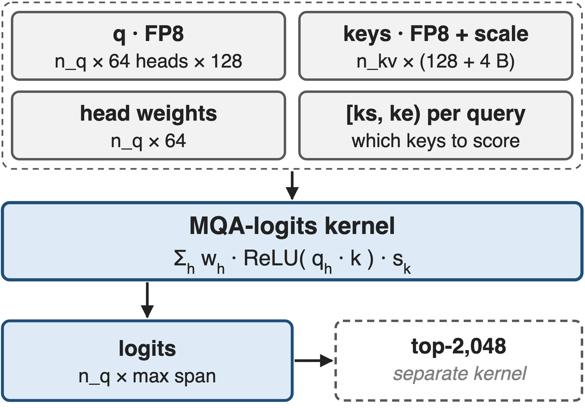
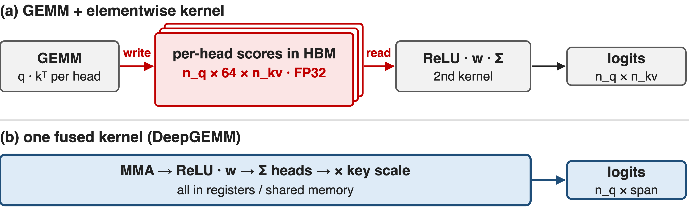
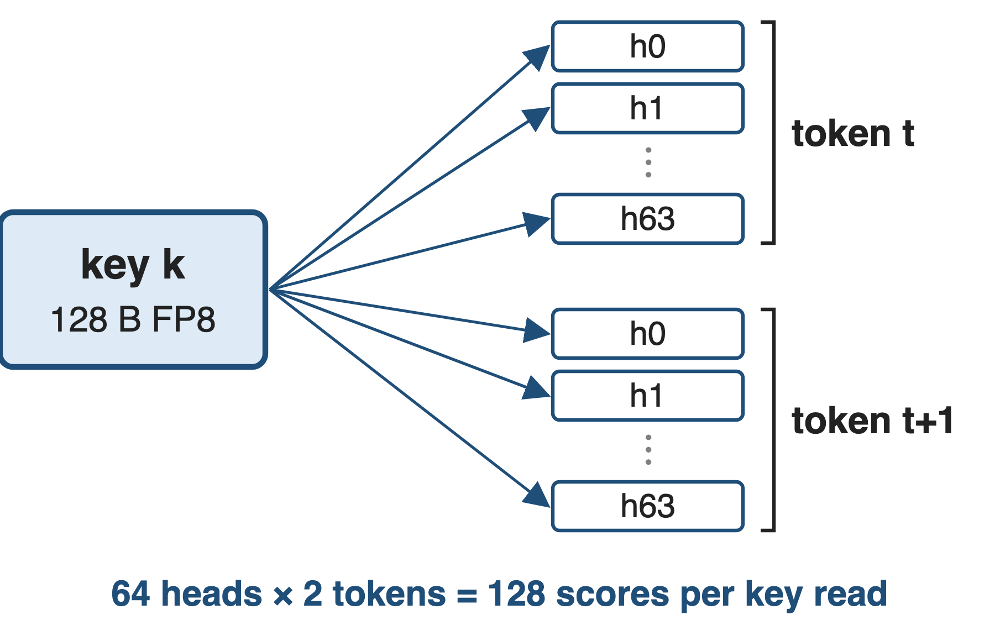
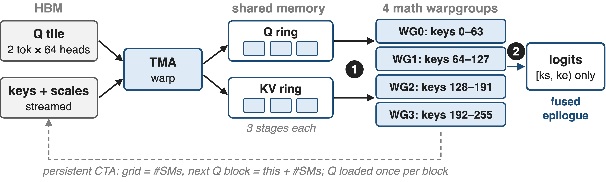
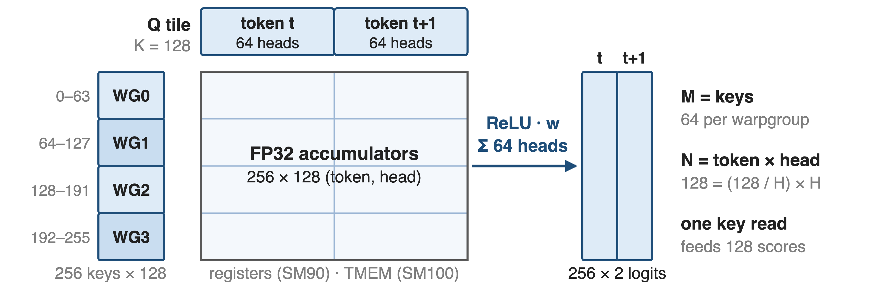
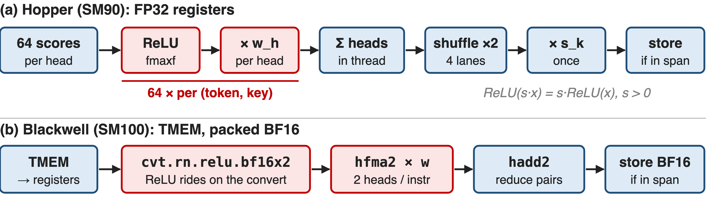
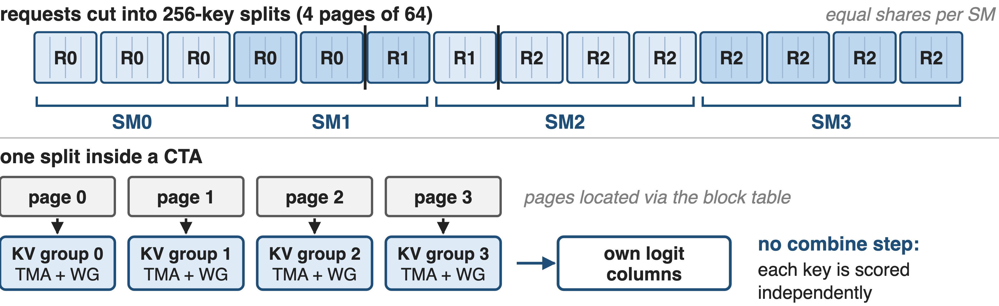
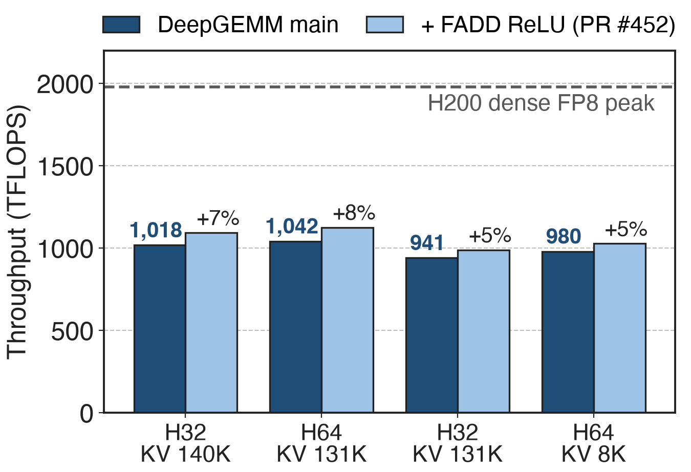
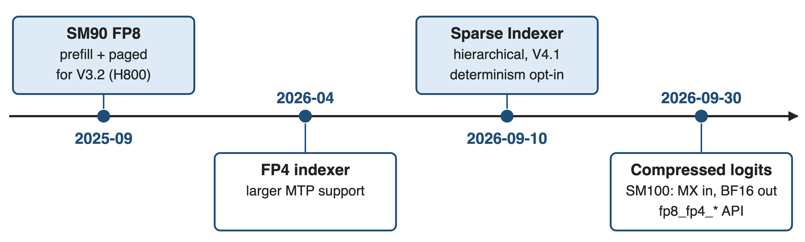

# The indexer is one MQA-shaped kernel call
{right 55%}
- Per query: **64** heads × **128** dims, FP8
- One FP8 key per token, shared by all heads
- Shipped with V3.2: **Sep 2025**, for H800
<!-- notes: DSA's lightning indexer (deck 02) scores every cached key for every query: a weighted sum over 64 heads of ReLU of a 128-dimensional FP8 dot product, times the key's scale. Each token has one indexer key shared by all heads, which makes this a multi-query-attention shape. DeepGEMM released the kernels the day DeepSeek-V3.2-Exp launched, for H800; serving engines call them per layer, and a separate top-k picks 2,048 indices from the logits. Sources: V3.2 Eq. 1; DeepGEMM README news 2025-09-28 and PR #200 merged 2025-09-29; vLLM blog. -->

# At 200K, scoring is 81% of prefill time
%% big: 81%
%% sub: of prefill time goes to the lightning indexer at 200K tokens (27% at 10K): the hot loop of long-context DSA
%% source: IndexCache, arXiv 2603.12201, §1 figure; 30B DSA model on H100 with SGLang
<!-- notes: DSA made the attention cheap but kept a quadratic scorer, so at long context the scorer dominates. On a 30B DSA model, the IndexCache authors measured the indexer at 27 percent of prefill time at 10K tokens and 81 percent at 200K. Deck 04 attacks this by running fewer indexer passes; this deck is about making each pass as fast as the hardware allows. Source: IndexCache §1. -->

# GEMM + epilogue kernels move 64× the bytes
{full}
> ReLU sits between the dot product and the head sum: **256 B** of scores per (query, key) instead of one **4 B** logit (analytic)
<!-- notes: The obvious implementation is a batched GEMM for every head followed by an elementwise kernel. But the ReLU sits between the dot product and the head-weighted sum, so the weights cannot be folded into the GEMM, and the GEMM has to write 64 FP32 scores per query-key pair to HBM for the second kernel to read back: 64 times the bytes of the final logits. For one 4K-query chunk against 128K keys that is 128 GiB of scores versus 2 GiB of logits. Attention kernels do not fit either: their epilogue is softmax and a weighted sum of values, and they never emit per-key scores. Counts are analytic, notes/analytic.py. -->

# Insight: one key serves every head and token
{right 50%}
- MQA: **1** key read feeds **64** heads × several queries
- K = **128** only: short dot products
--
> Put (token × head) on the MMA's N side and finish ReLU · w · Σ in registers: only logits reach HBM
<!-- notes: The structure that saves us is the same one that makes the indexer cheap in the first place: there is a single 128-dimensional key per token, shared by every head. So the kernel treats each pair of query token and head as one row of the MMA's N dimension and each key as a row of M: one key tile, loaded once, is multiplied against 128 token-head rows. The contraction is only 128 long, so the work right after the MMA, ReLU, weighting and the head sum, has to stay in registers. Sources: DeepGEMM sm90_fp8_mqa_logits.cuh, sm100_mqa_logits.hpp ("the Q tile always covers 128 (token, head) rows"). -->

# One persistent CTA per SM streams keys
{full}
%% caption: SM90 non-paged kernel: 1 TMA warp + 4 math warpgroups (128 + 512 threads). ❶ tile mapping · ❷ fused epilogue · ❸ paged decode reuses the core
<!-- notes: One CTA per SM loops over query blocks, stepping by the number of SMs. A TMA producer warp loads the query tile and its head weights once per block and streams key tiles with their FP32 scales through a three-stage shared-memory ring. Four math warpgroups each take 64 keys of a 256-key tile, run FP8 WGMMA, and apply the epilogue in registers; register reconfiguration gives the math warps 112 registers and the producer 32. Only logits inside each query's key range are stored. Sources: sm90_fp8_mqa_logits.cuh and .hpp. -->

# ❶ 128 (token, head) rows meet 256 keys
{full}
> Q tile = 128 / H tokens × H heads: 2 tokens at H = 64, 4 at H = 32; Blackwell uses 384-key splits in TMEM
<!-- notes: Challenge: with a 128-long contraction, a tile does little math per byte, so each key byte must feed as many scores as possible. The Q tile is fixed at 128 token-head rows: two query tokens when there are 64 heads, four when there are 32. Each math warpgroup multiplies 64 keys against all 128 rows, so one key read produces 128 scores. The query span of the block is the union of its rows' key ranges. On Blackwell the same mapping uses 128-key UMMA tiles, three warpgroups, a 384-key split and accumulators in tensor memory. Sources: sm90_fp8_mqa_logits.cuh; sm100_mqa_logits.hpp. -->

# ❷ ReLU, weights and head sum stay in registers
{full}
> The per-head steps run 64× per (token, key); DeepGEMM's own test reports this kernel in ReLUs per cycle per SM
<!-- notes: Challenge: the epilogue touches every score, 64 per query-key pair, so it is as hot as the MMA. On Hopper each thread applies ReLU and the head weight to its accumulators, sums them, finishes the head sum with two warp shuffles, and only then multiplies by the key's FP32 scale, once, which is legal because the scale is positive. It stores only columns inside the query's key range, compressed to start at column zero. On Blackwell, ReLU is fused into the FP32-to-BF16x2 convert and the weighting is a packed BF16 FMA, two heads per instruction. Sources: sm90 and sm100 kernels, ptx/utils.cuh; tests/test_attention.py prints relu/cyc/SM. -->

# ❸ Decode splits keys evenly, with no combine
{full}
> Decode does **124** FLOP per key byte, under H200's **412** ridge: HBM-bound, so up to 2 MTP tokens share each read (analytic)
<!-- notes: Challenge: in decode each request has one or two new tokens and a context of any length in 64-token pages. A tiny metadata kernel cuts every request into 256-key splits, four pages, prefix-sums them and gives each SM an equal share, so a long request spreads over several SMs. Unlike flash-decoding, no combine pass is needed: every key's logit is independent, so each split just writes its own columns. Inside a CTA, four KV groups, each a TMA warp plus a math warpgroup, take one page each, located through the block table. Decode is bandwidth-bound by our count, so batching the MTP draft token with the real one halves bytes per score. Sources: sm90_fp8_paged_mqa_logits.cuh, scheduler/sm90_paged_mqa_logits.cuh; NVIDIA H200 spec; notes/analytic.py. -->

# ~1 PFLOPS FP8 on H200 at production shapes
{right 60%}
- **941–1,042** TFLOPS, about **half** of dense peak
- ReLU instruction swap alone: **+5–8%**
- Community data (PR #452), not DeepSeek's
<!-- notes: DeepSeek publishes no benchmark table for these kernels; the best public data is a community pull request measured on H200 with DeepGEMM's own test harness. At four production shapes, 32 or 64 heads, 128 dimensions, 512 or 2,048 queries against 8K to 140K keys, the shipped kernel runs at 941 to 1,042 TFLOPS, roughly half of H200's 1,979 TFLOPS dense FP8 peak. Replacing only the ReLU, fmaxf by x plus absolute x, which runs at full FP32 rate, adds 5 to 8 percent: direct evidence that the epilogue is on the critical path. Sources: DeepGEMM PR #452 (open); NVIDIA H200 page, 3,958 TFLOPS with sparsity, halved. -->

# The kernel family grew FP4 and sparse variants
{full}
> MXFP4 keys need **68 B** instead of **132 B** (1.9× fewer decode bytes, analytic); V4's CSA indexer also runs QK in FP4 (deck 01)
<!-- notes: The first release was Hopper FP8 for V3.2. In April 2026 DeepGEMM added an FP4 indexer with larger MTP support; the Blackwell path now takes MXFP8 or MXFP4 with packed UE8M0 block scales and returns BF16 logits. In September came a Sparse Indexer that scores only selected key blocks, hierarchical indexing for V4.1, at close to the dense kernel's throughput, and a breaking API change: non-paged logits are now compressed to each row's span and the legacy fp8_mqa_logits names are gone. Key bytes come from the test's cache layouts: 128 plus 4, or 64 plus 4. Sources: DeepGEMM README; PRs #304, #432, #462; tests/test_attention.py. -->

# The cost: dense logits, masks, determinism
%% layout: two-col
- Logits materialized before a separate top-k
- 4K × 128K chunk: **2 GiB** FP32 (analytic)
- Callers mask past each row's span
|||
- Main branch: SM90 / SM100; SM90: 32 or 64 heads
- Since 2026-09: !!non-deterministic!! by default
> For RL, set `use_deterministic_algorithms(True)`: GLM-5 saw unstable top-k derail RL (deck 02)
<!-- notes: The kernel removes the per-head scores but not the logits: a full row per query is written to HBM and read again by top-k, which vLLM calls out as a challenge at high batch and long context; a 4K by 128K chunk is 2 GiB in FP32. Since the September 2026 API change, entries past a row's span are not cleaned, so callers must mask. The main branch supports SM90 and SM100 only, with SM120 work happening outside it, and the SM90 path accepts 32 or 64 heads. And since PR #432 the default trades determinism for speed; RL users should opt back in, given GLM-5's experience with non-deterministic top-k. Sources: vLLM blog; DeepGEMM API and PRs #432, #462; GLM-5 RL insights. -->

# Summary
- DSA's indexer: **81%** of prefill time at 200K
- ==Insight==: one key serves all heads and tokens: fuse MMA → ReLU · w · Σ
- ❶ 128-row Q tile × 256-key tiles ❷ register epilogue ❸ even split-KV decode
- **~1 PFLOPS** FP8 on H200 (community data); no score tensor in HBM
%% qr: https://github.com/deepseek-ai/DeepGEMM
<!-- notes: The MQA-logits kernel is what makes DSA's indexer affordable: by exploiting the single shared key, it turns a 64-head scoring problem into one fused pass that writes nothing but logits. Related decks: 02 (DSA and the lightning indexer), 04 (IndexShare: fewer indexer passes), 01 and 03 (DeepSeek-V4 CSA and HCA), 09 (FP8 block-sparse prefill attention), 25 (DeepGEMM), 39 (DeepJIT runtime compilation). -->
