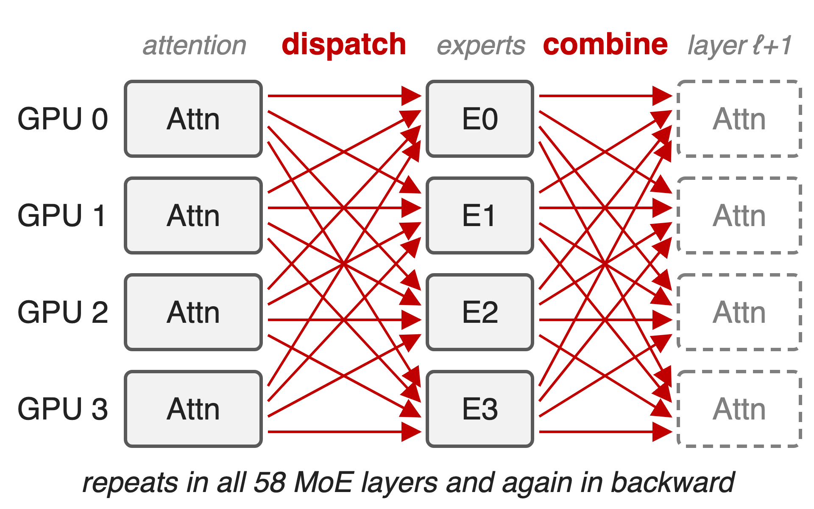
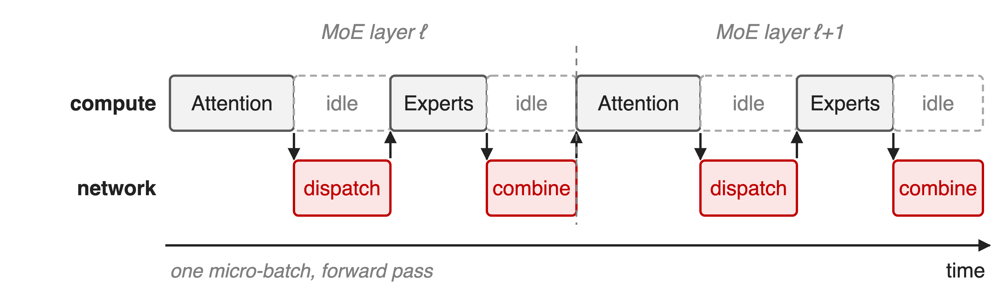
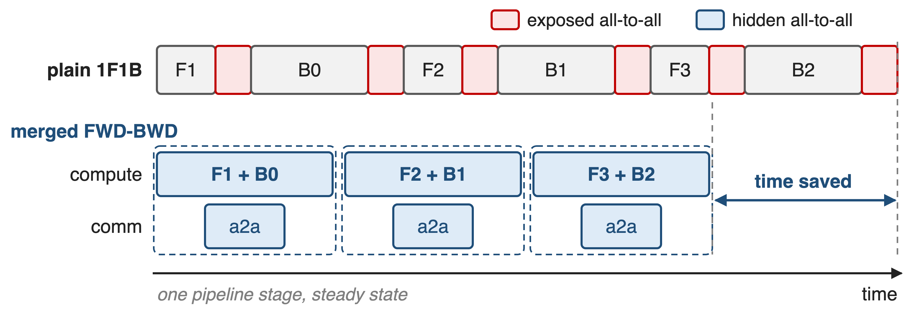
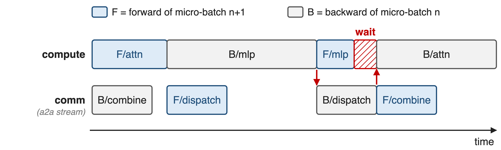
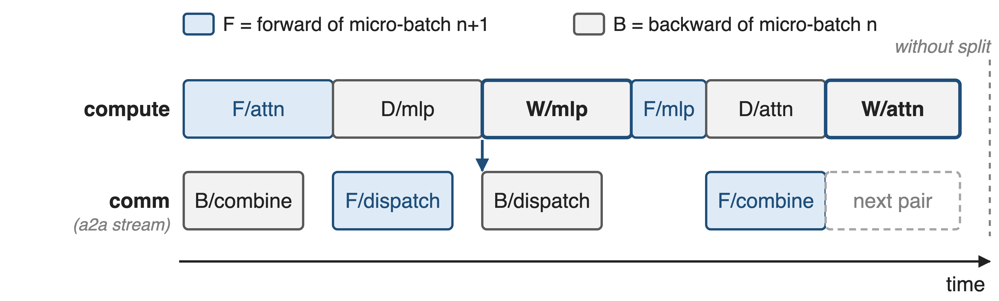
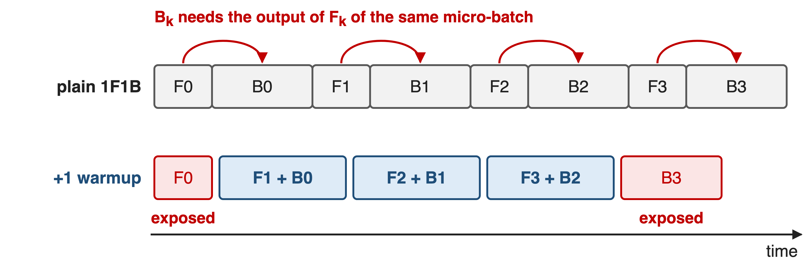
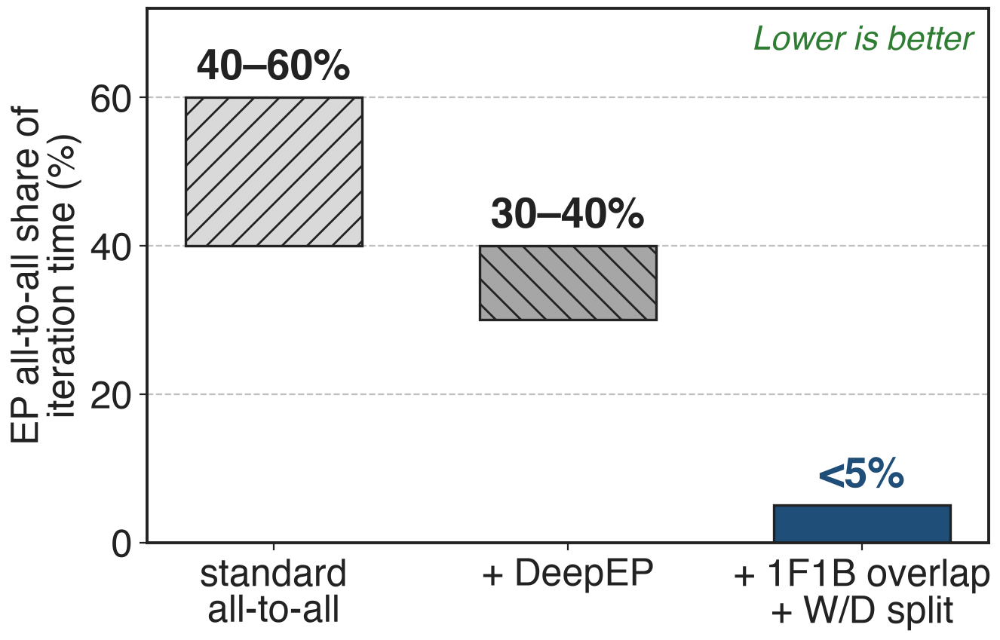
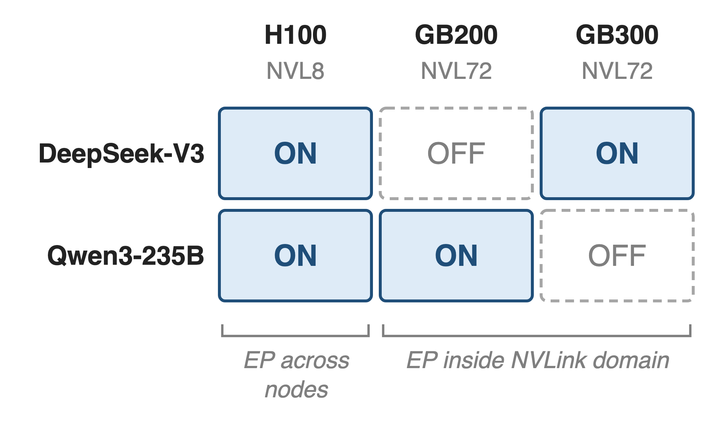

# Fine-grained MoE adds two all-to-alls per layer
{right 55%}
- DeepSeek-V3: **685B** params, **37B** active
- **256** experts, top-8 routing
- **116** dispatch/combine per forward pass; EP64 spans **8** H100 nodes
<!-- notes: Expert parallelism places experts on different GPUs, so every MoE layer sends each token to its experts (dispatch) and brings the results back (combine). DeepSeek-V3 has 58 MoE layers, so a forward pass does 116 of these all-to-alls and the backward pass as many again. On H100 with 8-GPU NVLink, EP64 spans 8 nodes, so most of this traffic crosses InfiniBand. Sources: arXiv 2603.07685 §1.2 (685B/37B), §4.2-4.2.1 (58 layers, 116 ops), §9.2 (256 experts, top-8; EP64 over 8 nodes). -->

# EP all-to-all still eats a third of each step
%% big: 30–40%
%% sub: of DeepSeek-V3 iteration time is EP all-to-all on H100, even with DeepEP (40–60% before)
%% source: Megatron-Core MoE technical report, arXiv 2603.07685, §4.2 (p.29) and §4.2.3 (p.32-33)
<!-- notes: Before any optimization, cross-node EP all-to-all takes 40 to 60 percent of DeepSeek-V3 training time on H100. A token-based dispatcher such as DeepEP cuts the bytes and the latency, yet 30 to 40 percent of every iteration is still spent waiting on all-to-all. That remaining share is what this technique attacks. Source: §4.2 p.29 and §4.2.3 p.32-33. -->

# One micro-batch cannot hide its own all-to-all
{full}
> Every all-to-all sits between two computations that need its result
<!-- notes: Inside one micro-batch the order is fixed: attention produces the tokens dispatch sends, the experts need the dispatched tokens, and the next attention needs the combined output. So whenever the network works, the GPU's compute waits, and vice versa. Cross-node EP communication is about half of the layer time for fine-grained MoE, and the neighboring GEMMs are too short to cover it (§4.2.3 p.32). -->

# Earlier fixes shrink or hide it at a price
%% layout: two-col
- **Faster dispatcher** (DeepEP)
- Fewer bytes, lower latency
- !!Still 30–40%!!, still on the critical path
|||
- **Overlap schedules**
- DualPipe: bidirectional, !!2× parameters!!
- FWD-FWD merge: !!2× activations!!
> Needed: independent work at no memory cost, inside standard 1F1B
<!-- notes: Bandwidth work shrinks the all-to-all but cannot remove it from the critical path (30-40% remains, §4.2.3). DeepSeek's DualPipe overlaps forward and backward chunks, but it is a separate bidirectional schedule that keeps two copies of the parameters (DeepSeek-V3 report, §3.2.1 and Table 2). Merging two forwards (FWD-FWD) doubles peak activation memory, and since forward compute is only about half of backward, there is less to hide behind (§4.2.3 p.32). Dispatcher deep dive: deck 19. -->

# Insight: adjacent 1F1B passes are independent
- Steady state alternates **forward of n+1** and **backward of n**
- They share no data; backward carries ~2× forward compute
--
> Pair them layer by layer: each pass's all-to-all hides under the other's compute
<!-- notes: In the 1F1B steady state every pipeline stage already runs a forward of one micro-batch next to the backward of an earlier one. They are independent, so nothing stops us from interleaving them at layer granularity on two CUDA streams. Megatron-Core calls this merged FWD-BWD; it is the DualPipe idea, built into the existing 1F1B schedule, and it reuses the forward activations the backward needs anyway (§4.2.3 p.32-33). The "forward is roughly half of backward" ratio is from §4.2.3 p.32. -->

# Merge each 1F1B step into one F+B pair
{full}
%% caption: Schematic, not to scale. Flags: --overlap-moe-expert-parallel-comm --delay-wgrad-compute (MCore v0.14)
<!-- notes: Top: plain 1F1B on one stage; each forward and backward exposes its all-to-all. Bottom: the same work as merged steps. The compute stream runs the forward and backward computation; a second stream runs every all-to-all underneath. Three mechanisms make this work: the per-layer two-stream pairing, the weight/data-gradient split, and one extra warmup micro-batch. The flags arrived in Megatron-Core v0.14 (README "What's New"). -->

# ❶ Two CUDA streams swap compute and all-to-all
{full}
> Forward layer i of micro-batch n+1 pairs with backward layer L−1−i of n
<!-- notes: This is the exact order in Megatron-Core's TransformerLayerSchedulePlan. The backward combine overlaps the forward attention; the forward dispatch overlaps the backward MLP; the backward dispatch overlaps the forward MLP; the forward combine overlaps the backward attention. One gap remains: the backward dispatch needs the whole backward MLP first, and the forward MLP of a fine-grained MoE is too short to cover it, so the backward attention waits. Source: model_chunk_schedule_plan.py, TransformerLayerSchedulePlan.run; §4.2.3 p.33. -->

# ❷ W/D split releases backward dispatch early
{full}
> B/dispatch needs only D/mlp; W/mlp and the delayed W/attn fill the gaps
<!-- notes: --delay-wgrad-compute splits each backward GEMM into the data gradient, which the next all-to-all needs, and the weight gradient, which nothing downstream waits for. The backward dispatch now starts right after D/mlp and hides under W/mlp and the forward MLP. The attention weight gradient is also delayed so it can cover the next layer pair's combine, or the pipeline send/receive at the end of the chunk. Source: §4.2.3 p.33 and TransformerLayerSchedulePlan.run. -->

# ❸ One extra warmup forward decouples every pair
{full}
%% caption: Interleaved 1F1B adds one warmup micro-batch when overlap is on; VPP is required whenever PP > 1
> Only the first forward and the last backward keep their all-to-all exposed
<!-- notes: On a stage where a 1F1B step would pair the forward and backward of the same micro-batch, for example the last stage, the backward needs that forward's output, so the two cannot be interleaved. Megatron-Core runs one extra forward in the warmup phase, which shifts every pair to F of k+1 with B of k. The price is that the very first forward and the very last backward run alone. Sources: §4.2.3 p.33; schedules.get_pp_rank_microbatches; combined_1f1b.py docstring; transformer_config asserts VPP when PP > 1. Flexible VPP layout: deck 67. -->

# EP all-to-all drops from 30–40% to under 5%
{right 60%}
- DeepSeek-V3, EP64 across 8 H100 nodes
- **93%** of expert-communication latency hidden
- Whole comm-wall stack: all-to-all **< 10%**
<!-- notes: On DeepSeek-V3 with EP64 on H100, the 1F1B FWD-BWD overlap with the W/D split cuts the exposed expert communication from 30-40% of iteration time (after DeepEP) to under 5%, a 93% overlap ratio. Together with interleaved PP and flexible VPP, the paper reports all-to-all below 10% of training time. Bars show the published ranges; the last bar is an upper bound. Sources: §4.2 p.29; §4.2.3 p.33-34; §4.2.4 p.34. -->

# On H100 always on; on NVL72 a tuning choice
{right 55%}
- H100: cross-node EP; on in the **368** TFLOPS/GPU DeepSeek-V3 run
- NVL72: EP64 stays in NVLink
- GB200 DeepSeek-V3 spends that memory elsewhere
<!-- notes: The paper's best configurations turn the overlap on for every H100 run, where EP crosses nodes; the 1,024-GPU DeepSeek-V3 run at 368 TFLOPS per GPU uses it (Table 17). On NVL72 it is a tuning choice: for DeepSeek-V3 on GB200 the communication wall is already solved by topology, so the buffer memory goes to other optimizations; for Qwen3-235B it is on for GB200 and off for GB300. Sources: Table 17 p.74, §9.2.2 p.75, App. B.2 p.87. -->

# The cost: buffers, SMs, and exposed edges
%% layout: two-col
- !!Extra buffers!!: on H100 only after FP8 freed memory
- !!SM carve-out!!: DeepEP's **20** SMs cost ~**20%** GEMM efficiency
|||
- Needs EP > 1, VPP when PP > 1
- No full or `moe` recompute; MTP ≤ 1 layer
- Both flags off by default
<!-- notes: The overlap needs extra buffers to pipeline dispatch and combine; on H100 it only fits because FP8 halved activation memory (§9.1.4, §9.2.2). Running all-to-all concurrently needs communication SMs: DeepEP's 20 SMs per GPU cost roughly 20% GEMM efficiency in the DeepSeek-V3 benchmark (§4.2.3 p.34). The code asserts EP > 1, an alltoall or flex dispatcher, VPP when PP > 1, no full recompute and no moe recompute, BF16/FP16, at most one MTP layer, and shared-expert overlap off (transformer_config.py). Both flags default to False (README). -->

# Summary
- EP all-to-all: **30–40%** of DeepSeek-V3 iteration time on H100, even with DeepEP
- ==Insight==: 1F1B already runs two independent micro-batches, so pair them
- Two streams, W/D split, one extra warmup micro-batch
- **< 5%** exposed all-to-all (**93%** hidden)
%% qr: https://arxiv.org/abs/2603.07685
<!-- notes: The technique turns the 1F1B schedule's own structure into overlap: no new pipeline schedule, no second copy of the weights. Related decks: 19 (HybridEP / Flex dispatcher), 67 (asymmetric VPP layout), 71 (MoE parallel folding). Source: arXiv 2603.07685 §4.2.3. -->
