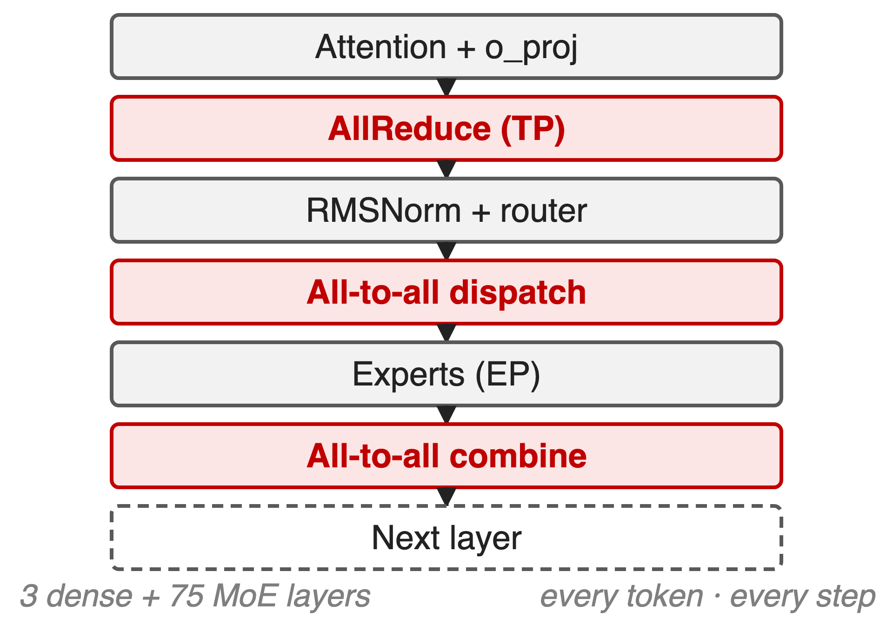
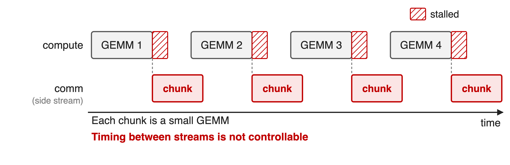
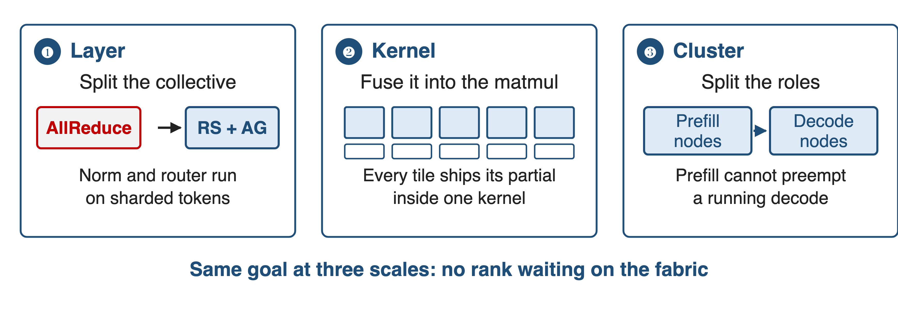
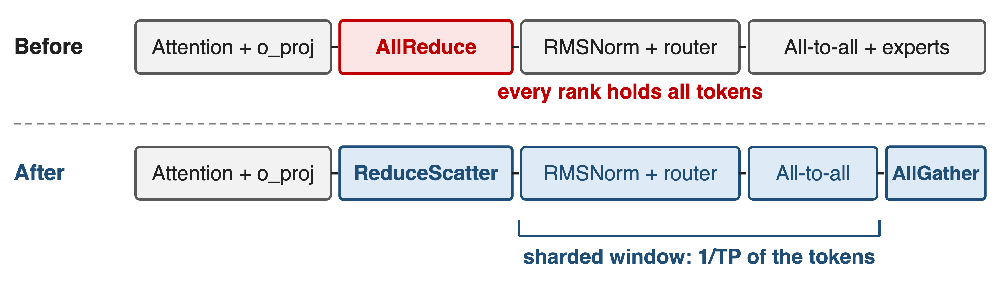
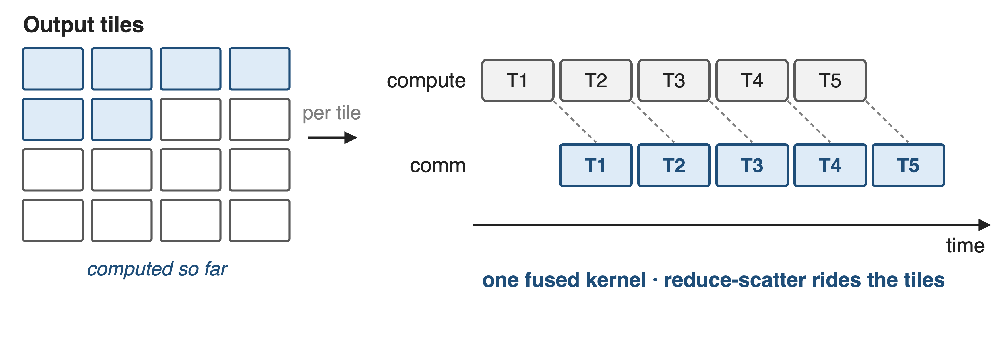
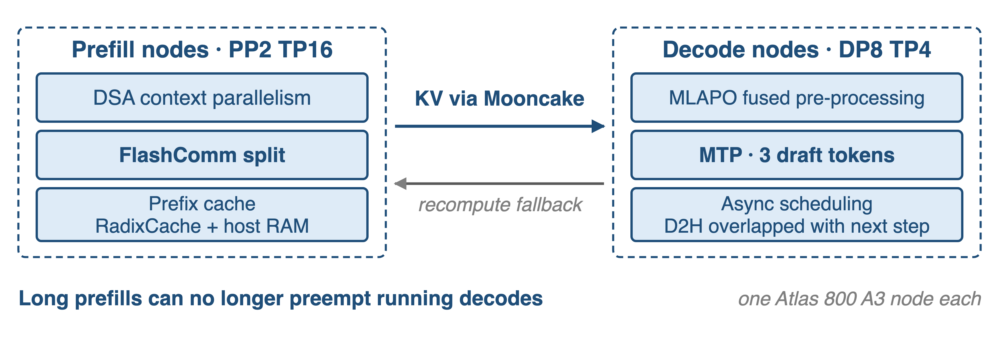
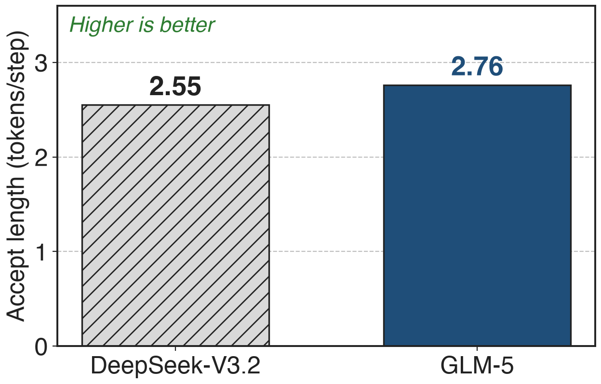

# Every layer ends in a tensor-parallel collective
{right 55%}
- GLM-5: **744B** MoE, **40B** active, **200K** context
- One Atlas 800 A3 node, TP up to **16** inside it
- Attention all-reduces; the MoE all-to-alls
<!-- notes: GLM-5 is served from a single Ascend node with tensor parallelism inside it, attention running data-parallel and the MoE expert-parallel. Every layer therefore ends in a tensor-parallel all-reduce after the attention output projection, and the MoE adds a dispatch and a combine all-to-all around the experts. That pattern repeats across 3 dense and 75 MoE layers, for every token of a 200K prompt. Sources: arXiv 2602.15763 Table 10 p.36 and §5 p.22; vLLM Ascend GLM-5 deployment guide. -->

# Weak links push TP communication to 40–75%
%% big: 40–75%
%% sub: of step time is tensor-parallel communication on an A100 PCIe cluster — only 8–11% on NVLink
%% source: Flux, arXiv 2406.06858, §6 p.15 — GPU clusters, not Ascend; no Ascend percentage is published
<!-- notes: Nobody publishes how much of a GLM-5 step the collectives take on Ascend, so this is the closest measured statement in the literature: with a fast NVLink fabric, tensor-parallel communication is 8 to 11 percent of training step time, but on the PCIe-connected cluster, where the links are much weaker, the same workloads spend 40 to 75 percent of training and prefill time on it. The lesson transfers, the number does not: treat it as the shape of the problem on any weaker interconnect. Source: Flux §6 p.15. -->

# Chunked overlap can be slower than none
{full}
> Measured overlap efficiency: **−125% to 36%** on the weak-fabric cluster
<!-- notes: The standard recipe splits the GEMM into one chunk per rank and pushes each chunk's collective onto a side stream. Three things go wrong: the timing between streams is not controllable, the element-wise work between chunks blocks concurrent execution, and the small GEMMs no longer fill the device. Measured on GPT-3-175B shapes, TransformerEngine's chunked overlap scores between minus 125 percent and 36 percent overlap efficiency on the A100 PCIe cluster — negative means slower than not overlapping at all. Source: Flux §2.2 p.4 and §5.1 p.13. -->

# Insight: AllReduce is ReduceScatter plus AllGather
- Each half now borders a matmul it can ride along with
--
> And between the halves every rank holds only **1/TP** of the tokens
<!-- notes: This is the whole idea. An all-reduce is a reduce-scatter followed by an all-gather, so splitting it costs nothing in bytes and buys two things: each half sits next to a matrix multiply it can be fused with, and the region in between is one where the tokens are sharded across the tensor-parallel group. GLM-5's report calls the mechanism FlashComm and says it "splits AllReduce operations to hide communication latency behind computation". Source: arXiv 2602.15763 §5 p.22. -->

# Hide it at three scales
{full}
%% caption: ❶ FlashComm split · ❷ fused matmul and reduce-scatter · ❸ prefill/decode disaggregation
<!-- notes: The same goal is attacked at three scales. Inside the layer, the collective is split so the work between the halves runs sharded. Inside the kernel, the collective is fused with the matmul that feeds it. Across the cluster, prefill and decode are given separate nodes so that neither waits on the other. The first is in the GLM-5 report; the second and third are how the Ascend engines implement and deploy it. -->

# ❶ The split leaves a sharded window
{full}
> RMSNorm, router and all-to-all then see **1/TP** of the tokens
<!-- notes: The attention output projection ends in a tensor-parallel all-reduce, so every rank holds every token — and under expert parallelism that means the norm, the router and the dispatch all-to-all repeat the same work on every rank. With the split, the reduce-scatter leaves each rank one shard, the norm, router and all-to-all run on that shard, and the all-gather is deferred to where the full tensor is actually needed. Upstream this is the FlashComm switch, enable_flashcomm1, described as splitting AllReduce into reduce-scatter and all-gather and benefiting mainly the prefill path. Sources: arXiv 2602.15763 §5 p.22; vLLM Ascend sequence-parallelism guide and GLM-5 guide Table 2. -->

# ❷ Each matmul tile ships its own partial
{full}
%% caption: Upstream: `fuse_gemm_comms` fuses a row-parallel projection with its reduce-scatter (BF16/FP16, TP 2/4/8)
<!-- notes: Instead of cutting the GEMM into as many kernels as there are ranks, the tiled form keeps one kernel and gives each output tile its own transfer: as soon as a tile is computed, its partial result leaves for the rank that owns it. The compute lane never drains and the collective rides the tiles. The GLM-5 report does not describe this level; the Ascend engine does, with a compilation pass that fuses a sequence-parallel row-parallel projection with its token-dimension reduce-scatter, and the MoE path has its own fused dispatch-FFN-combine operator. Flux is the published study of why tiles beat chunks. Sources: vLLM Ascend sequence-parallelism guide; GLM-5 guide Table 2; Flux §1 p.2. -->

# ❸ Prefill and decode get their own nodes
{full}
%% caption: vLLM Ascend reference configuration for 198K contexts; Mooncake carries the KV cache
<!-- notes: On shared resources a 200K prefill preempts running decodes and wrecks tail latency — the reason GLM-5 gives for splitting the two in its own RL rollouts. Deployed, that means prefill nodes with pipeline and tensor parallelism plus DSA context parallelism, decode nodes with data-parallel attention, expert parallelism, the fused MLA pre-processing kernel and three MTP draft tokens, and a Mooncake KV path between them. A recompute fallback sends requests back to the prefill side when decode KV cache runs short. Sources: arXiv 2602.15763 §3.6.2 p.15 and §5 p.22; vLLM Ascend GLM-5 guide §5.3 and §9.1. -->

# MTP drafts land 2.76 tokens per step
{right 60%}
- GLM-5 shares **3** MTP layers in training, at one layer's memory cost
- Decode nodes speculate **3** tokens; prefill nodes **1**
%% caption: Table 2: 4 speculative steps, the authors' private prompt set
<!-- notes: Speculative decoding is the fourth lever: more tokens per step means more work per collective and higher compute density on the decode side. GLM-5 trains three MTP layers with shared parameters, which keeps the draft model's memory at the cost of a single layer while raising the acceptance rate, and reports an accept length of 2.76 against DeepSeek-V3.2's 2.55 at the same four speculative steps on its own prompt set. The upstream deployment speculates three tokens on decode nodes and one on prefill nodes. Sources: arXiv 2602.15763 §2.1 p.5 and Table 2; vLLM Ascend GLM-5 guide §5.3. -->

# The report claims one node, half the cost
- One domestic node "comparable to dual-GPU international clusters"
- **50%** lower deployment cost in long-sequence scenarios
- !!No per-feature number!! for the split, the fusion or the PD path
> That 50% covers quantization, fused kernels and scheduling together
<!-- notes: This is the only outcome the report gives for the Ascend work, and it is the outcome of the whole stack: quantization, fused kernels and this deck's scheduling layer. No baseline GPU, benchmark, metric or configuration is named, and no feature is credited individually. The container deck 23 has the stack overview; decks 37 and 44 cover the other two pillars. Source: arXiv 2602.15763 §5 p.22. -->

# The fine print on every switch
%% layout: two-col
- FlashComm: mainly **prefill**; not with `o_proj` sharding
- Fused MoE ops: **w8a8**, EP ≤ **32**, no MTP
|||
- Fused matmul + RS: BF16/FP16, **TP 2/4/8**
- PD: extra nodes, a KV path, a recompute fallback
> All of them must be switched on explicitly
<!-- notes: The upstream documentation is blunt about the limits: FlashComm helps the prefill path and cannot be combined with o_proj layer sharding; the fused MoE dispatch operator is for w8a8 with expert parallelism up to 32, excludes MTP and dynamic EPLB, and conflicts with the shared-expert multi-stream overlap; the fused matmul plus reduce-scatter pass covers BF16 and FP16 at tensor parallel 2, 4 or 8; and prefill/decode disaggregation costs dedicated nodes plus a KV transport. None of them is on by default. Source: vLLM Ascend GLM-5 guide §9.1 Table 2 and sequence-parallelism guide. -->

# Summary
- TP communication: **8–11%** on NVLink, **40–75%** on a weak fabric (Flux)
- ==Insight==: AllReduce = ReduceScatter + AllGather, and the gap is sharded
- Split the collective · fuse it into the matmul · split prefill from decode
- GLM-5 claims one node and **50%** lower long-sequence cost, for the whole stack
%% qr: https://arxiv.org/abs/2602.15763
<!-- notes: The through line: stop treating the collective as an atomic barrier. Split it, fuse the halves into the matmuls around them, and stop making prefill and decode share a device. Sibling decks: 23 for the whole Ascend stack, 37 for the fused kernels, 44 for the quantization. Sources: arXiv 2602.15763 §5; Flux arXiv 2406.06858. -->
