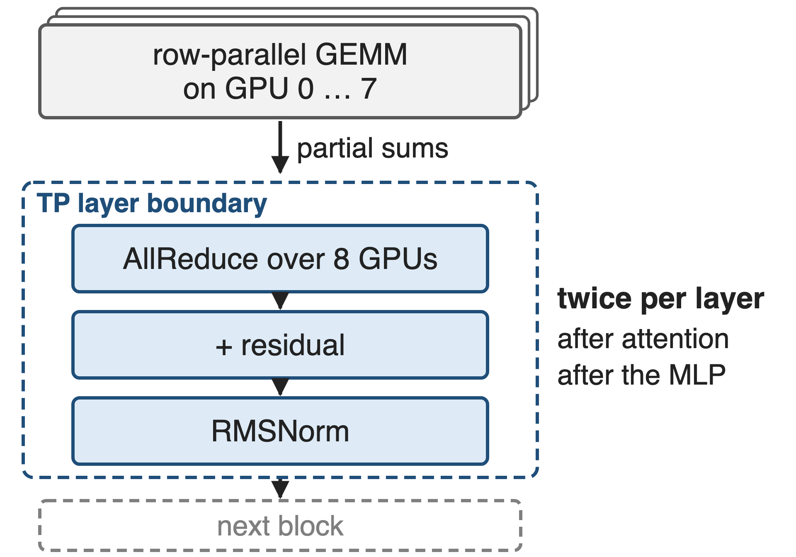
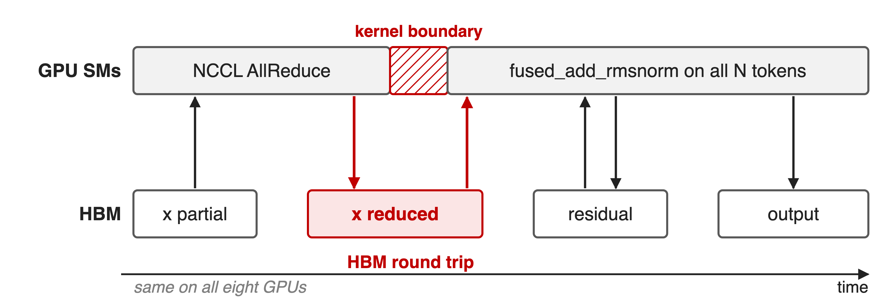
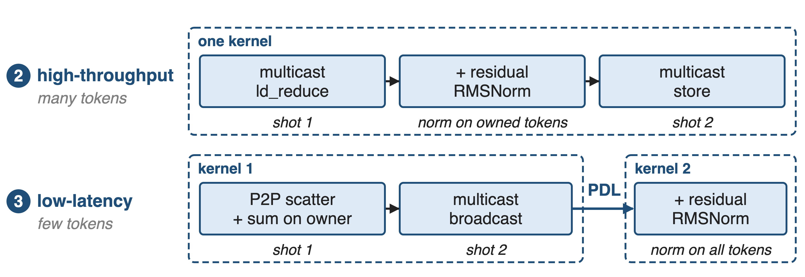
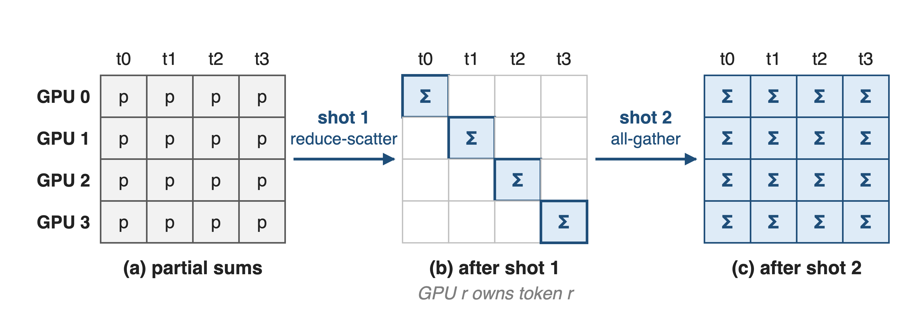
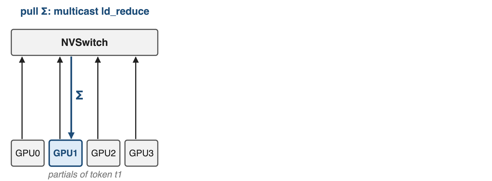
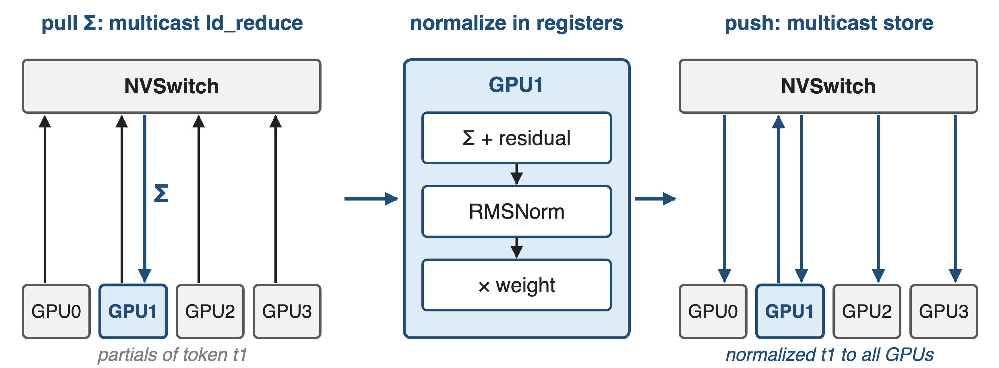
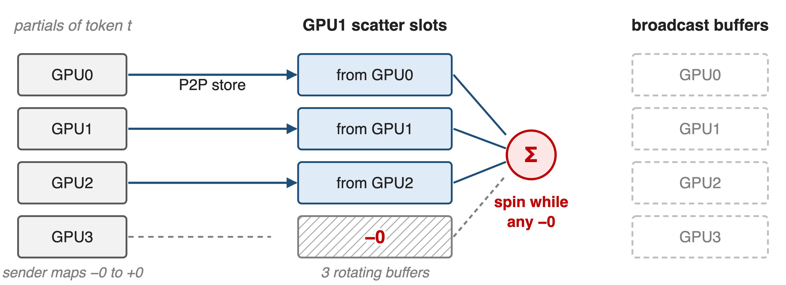
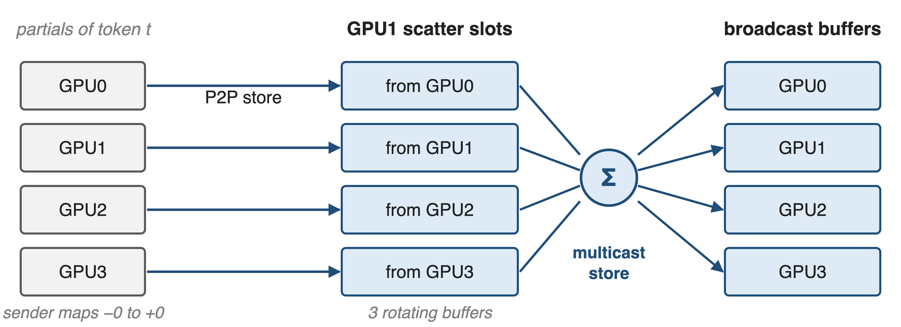
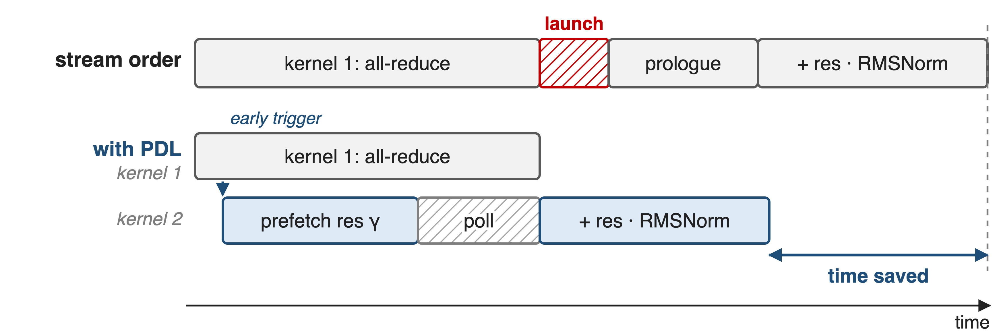
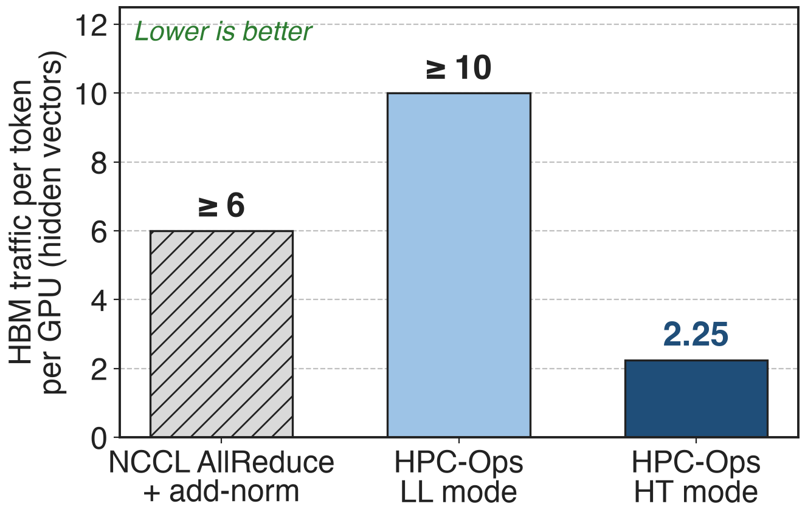

# Every TP block ends in AllReduce, add, RMSNorm
{right 55%}
- Target: TP over one **8×H20** NVLink node
- **2** AllReduces per layer, each followed by add + RMSNorm
- BF16, hidden **4096 / 5120 / 7168**
<!-- notes: In Megatron-style tensor parallelism the row-parallel GEMM at the end of attention and of the MLP leaves each GPU with a partial sum, so every block ends in an AllReduce, then the residual add, then the RMSNorm that feeds the next block. That is two AllReduces per layer in the forward pass. HPC-Ops targets single-node TP inference on 8 H20 GPUs in BF16 at hidden sizes 4096, 5120 and 7168. Sources: Megatron-LM arXiv 1909.08053 §3 p.4 (two all-reduces in the forward pass); HPC-Ops README Performance table and benchmark/fuse_allreduce_rmsorm/README.md (8-GPU SM90/H20 node, BF16, hidden sizes). -->

# This boundary is worth 5–20% end-to-end
%% big: 5–20%
%% sub: end-to-end speedup vLLM lists for fusing just AllReduce + RMSNorm, at small token counts
%% source: vLLM docs v0.19.1, "Fusion torch.compile passes", quick-reference table (indicative, model- and hardware-dependent)
<!-- notes: How much can three small ops matter? vLLM's own fusion guide lists an indicative 5 to 20 percent end-to-end speedup from fusing the TP AllReduce with the residual add and RMSNorm, and it applies that fusion only at small token counts. So the layer boundary is a real slice of decode latency, not noise. Source: docs.vllm.ai v0.19.1 design/fusions, quick-reference table, row "AllReduce + RMSNorm". -->

# Unfused, the sum round-trips through HBM
{full}
> Two kernels, one HBM round trip, and every GPU normalizes all N tokens
<!-- notes: The baseline in HPC-Ops' benchmark is NCCL all_reduce followed by FlashInfer's fused_add_rmsnorm. The collective writes the reduced activations to HBM, the next kernel reads them back with the residual, writes the new residual and the normalized output. All eight GPUs then run the same norm over all N tokens, which is eight-fold redundant work. Sources: benchmark_fuse_allreduce_rmsnorm.py (NcclRunner.step); HPC-Ops README Fused AllReduce + RMSNorm section ("extra kernel launches and repeated HBM reads/writes"). -->

# Prior fused kernels stop at decode sizes
%% layout: two-col
- **NCCL + separate norm**
- Any token count
- !!2 kernels, HBM round trip!!
|||
- **FlashInfer / TRT-LLM fused**
- vLLM fuses !!only small N!!
- mnnvl: ≤ **8,192** tokens on H20
> 8 tokens = 112 KiB, 32K = 448 MiB: no single schedule fits both
<!-- notes: NCCL is general but leaves the norm behind a kernel boundary. The fused FlashInfer and TensorRT-LLM kernels exist, but vLLM enables its fusion only in the low token-count range, and in HPC-Ops' benchmark FlashInfer's mnnvl path is only run up to 8,192 tokens on H20 (it fails beyond), while its trtllm path clamps its Lamport buffer. The structural problem: at hidden 7168 in BF16, 8 decode tokens are a 112 KiB message and 32K prefill tokens are 448 MiB, a 4,096-fold range; small messages are latency-bound, large ones bandwidth-bound. Sources: vLLM fusions doc ("only profitable for small num_tokens"); benchmark_fuse_allreduce_rmsnorm.py fi_max_tokens comments; message sizes derived in notes/sources.md. -->

# Insight: two-shot hands each GPU whole tokens
- RMSNorm needs one token's full hidden vector, nothing more
- Shot 1 (reduce-scatter) leaves each GPU complete sums of its own tokens
--
> Normalize inside the collective, and pick the transport by token count
<!-- notes: RMSNorm is per token: it needs the complete reduced hidden vector of one token and the weight, nothing from other tokens. A two-shot all-reduce, reduce-scatter then all-gather, produces exactly that halfway through: after the first shot each GPU owns fully reduced tokens. So the add and the norm can run inside the collective instead of after it. And because the same schedule can run over two transports, the kernel can pick NVSwitch multicast for large messages or Lamport point-to-point for small ones. Sources: HPC-Ops PR #48 description ("two-shot (reduce-scatter + all-gather) schedule"); README Fused AllReduce + RMSNorm section. -->

# One op, two transports, one two-shot schedule
{full}
%% caption: HT = fuse_allreduce_rmsnorm_high_throughput · LL = fuse_allreduce_rmsnorm_low_latency · BF16, one NVLink node
<!-- notes: Both modes compute RMSNorm(AllReduce(x) + residual) on a two-shot schedule. The high-throughput mode is a single kernel built on CUDA multicast: a multicast load-reduce, the add and norm in registers, and a multicast store. The low-latency mode is two kernels: an all-reduce kernel that scatters partials point-to-point to each token's owner and broadcasts the sum, and an RMSNorm kernel chained with programmatic dependent launch. Sources: hpc/allreduce.py; src/allreduce/*.cu; PR #48. -->

# ❶ Two shots give every token one owner
{full}
> HT: the owner adds the residual and normalizes between the two shots
<!-- notes: Picture four GPUs and four tokens. Before the collective every GPU holds a partial sum of every token. The first shot, reduce-scatter, gives GPU r the full sum of token r. The second shot, all-gather, copies every owner's result to everyone. In the high-throughput mode, each rank is handed its contiguous 1/P slice of tokens and normalizes them before the second shot, so the norm runs once per token instead of eight times. The low-latency mode assigns token t to rank t mod P. Sources: tests/test_fuse_allreduce_rmsnorm_high_throughput.py (start/end slice per rank); twoshotAllreduceKernel (destRank = token % WorldSize). -->

# ❷ HT: the switch sums, the owner normalizes
{full}
--
{full}
> One kernel: the reduced tensor never lands in HBM
<!-- notes: For many tokens HPC-Ops uses NVSwitch multicast. The owner issues multimem.ld_reduce on a multicast address: the switch reads that token from all eight GPUs, adds in FP32 accumulation and returns the sum. The owner adds its residual, computes the sum of squares with a warp and block reduction, scales by rsqrt and the weight, all in registers, then multimem.st writes the normalized token into every GPU's output buffer. Per-block signal flags synchronize ranks at kernel entry and exit. Sources: fuse_allreduce_rmsnorm_high_throughput.cu; src/utils/utils.cuh (multimem.ld_reduce ... add.acc::f32, multimem.st). -->

# ❸ LL: the data is its own ready flag
{full}
--
{full}
> No separate flag write and no barrier before the sum
<!-- notes: For few tokens the cost is synchronization, not bytes. Every rank stores its partial of token t straight into the owner's slot over NVLink peer-to-peer. The slots are pre-filled with negative zero, and senders turn any real negative zero into positive zero, so the owner simply spins until no negative zero is left: the arrival of the data is the signal (a Lamport-style protocol). Then it sums and broadcasts through a multicast store. Three Lamport buffers rotate per call, so clearing the used one happens in a later call. Sources: fuse_allreduce_rmsnorm_low_latency.cu (twoshotAllreduceKernel); fuse_allreduce_rmsnorm_low_latency.h (negZero, LamportFlags, sNumLamportBuffers = 3). -->

# ❸ PDL launches the norm kernel early
{full}
%% caption: Schematic, not to scale. Kernel 2 also polls the Lamport broadcast buffer instead of waiting for kernel 1 to finish
<!-- notes: The low-latency mode keeps the norm in a second kernel but launches it with programmatic dependent launch. Kernel 1 signals launch completion right after setup, so kernel 2 starts while the all-reduce is still running: it prefetches the residual and the weight into shared memory with cp.async, then polls the broadcast buffer, again using the negative-zero sentinel, and normalizes as soon as the sums land. It only waits for kernel 1's grid at the very end, to rotate the buffer flags. PDL in other libraries: deck 39. Sources: fuse_allreduce_rmsnorm_low_latency.cu (cudaTriggerProgrammaticLaunchCompletion, rmsNormLamport, cudaGridDependencySynchronize placement). -->

# HT cuts HBM traffic per token ≥ 2.7×
{right 55%}
- Large N is bandwidth-bound: bytes decide
- LL spends bytes on sentinels to save sync
- So: **HT** for prefill, **LL** for decode
%% caption: Analytic, from kernel code, TP = 8; unit = one BF16 hidden vector; NCCL internals and polling re-reads not counted
<!-- notes: Counting HBM traffic per token per GPU from the code: the unfused path touches at least six hidden vectors (all-reduce in and out, norm reads two and writes two). HT touches 2.25: each GPU's input is read once by the switch, the normalized output lands once, and the residual is read and written only for the owned eighth. LL touches at least ten, because of the extra hop through the owner and the sentinel clears, which is fine when the message is 112 KiB and latency dominates. That is why the library ships both modes: HT for large token counts, LL for small. Derivation in notes/sources.md. -->

# Up to 1.76× over NCCL and FlashInfer
%% big: 1.76×
%% tone: ours
%% sub: best HPC-Ops mode vs best of NCCL + norm and FlashInfer fused AllReduce, BF16 TP on one 8×H20 node
%% source: HPC-Ops README, Performance table (hidden 4096 / 5120 / 7168); benchmark/fuse_allreduce_rmsorm (hpc_best_speedup)
<!-- notes: HPC-Ops reports up to 1.76 times lower latency than the better of NCCL plus a fused add-norm and FlashInfer's fused all-reduce, across single-node BF16 tensor-parallel shapes at hidden 4096, 5120 and 7168. The benchmark replays CUDA graphs on eight local GPUs and reports the best round's median; the speedup is baseline-best divided by HPC-Ops-best. The repository does not publish the per-token-count curve, so only the maximum is shown. Sources: README Performance table; benchmark/fuse_allreduce_rmsorm/README.md. -->

# The price: one node, three shapes, two modes
%% layout: two-col
- One NVSwitch node with multicast
- BF16; hidden **4096 / 5120 / 7168** only
- LL: power-of-two TP, **2–64**
|||
- Inputs live in symmetric multicast buffers
- LL workspace: **6×** the activation
- Caller picks HT or LL; not yet in SGLang
<!-- notes: The kernels need a single NVLink/NVSwitch node with CUDA multicast objects (SM90); they accept only BF16 and hidden sizes 4096, 5120 and 7168, and the low-latency kernel is instantiated for world sizes 2, 4, 8, 16, 32 and 64. Inputs must sit in buffers allocated through hpc.empty_multimem, so the producer GEMM has to write there. The Lamport workspace is two stages times three rotating buffers of the activation size (derived from the tests). There is no automatic mode switch: the benchmark simply reports the faster of the two. The August 2026 SGLang integration covers Attention, Router GEMM and MoE, not this op. Library overview: deck 26. Sources: entry.cc TORCH_CHECKs; low_latency.cu switch on nRanks; tests; LMSYS blog integration table. -->

# Summary
- TP layer boundary: fusion worth **5–20%** end-to-end (vLLM)
- ==Insight==: two-shot gives each GPU whole tokens, so normalize inside the collective
- **HT**: multicast reduce-norm-store · **LL**: Lamport P2P + PDL
- Up to **1.76×** over NCCL / FlashInfer on 8×H20
%% qr: https://github.com/Tencent/hpc-ops
<!-- notes: The AllReduce, residual add and RMSNorm after every tensor-parallel block are one logical operation. HPC-Ops computes it inside a two-shot collective, with NVSwitch multicast for large token counts and a Lamport point-to-point plus PDL path for small ones, and reports up to 1.76x over NCCL and FlashInfer. Related decks: 26 (HPC-Ops overview), 39 (PDL), 29 and 31 (HPC-Ops FP8 grouped GEMM and fused MoE). -->
