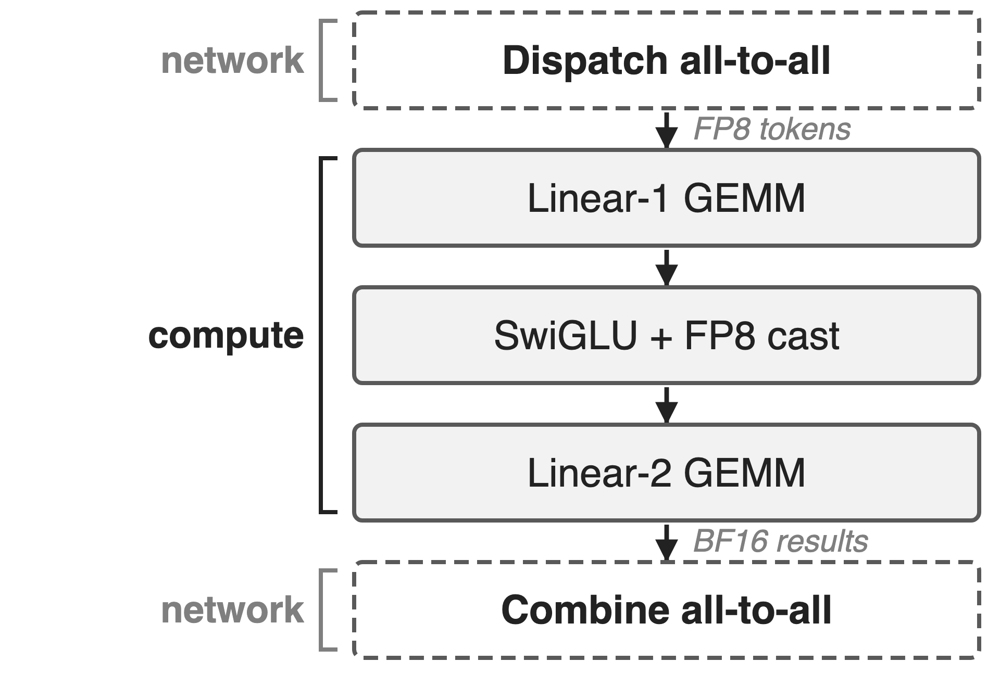
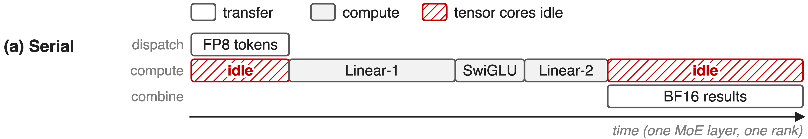
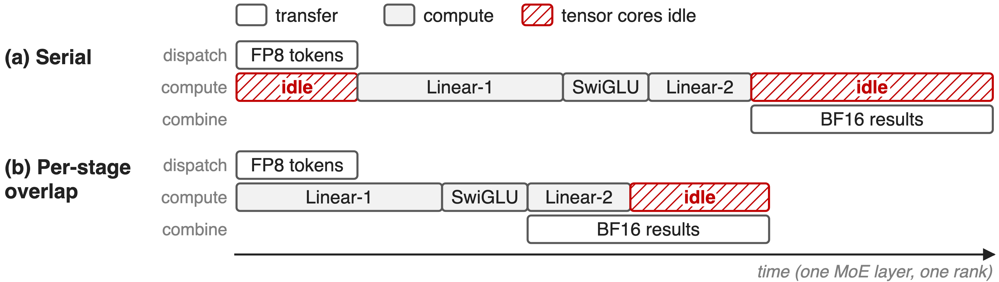
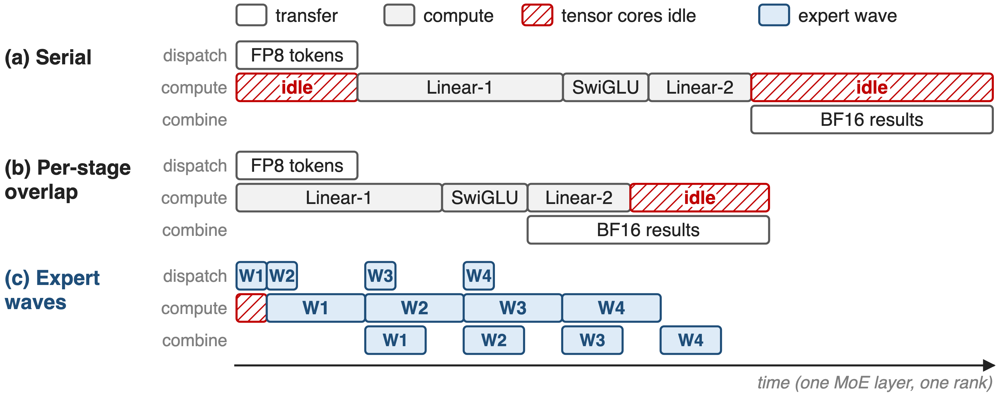
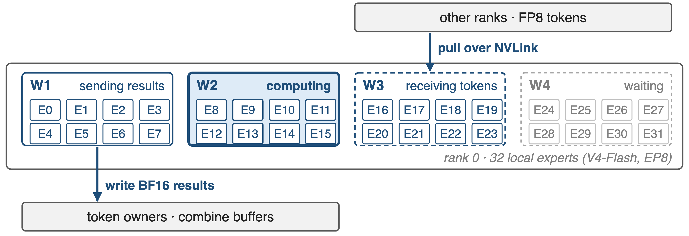
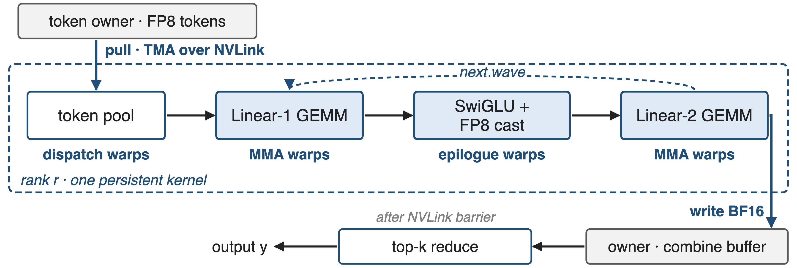
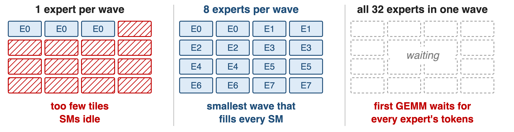
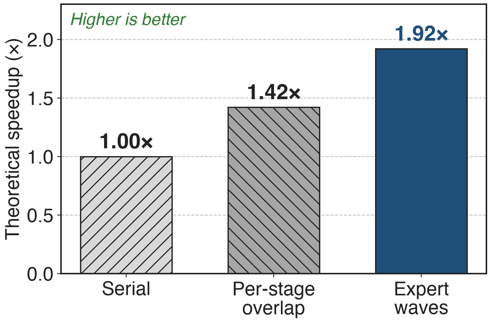
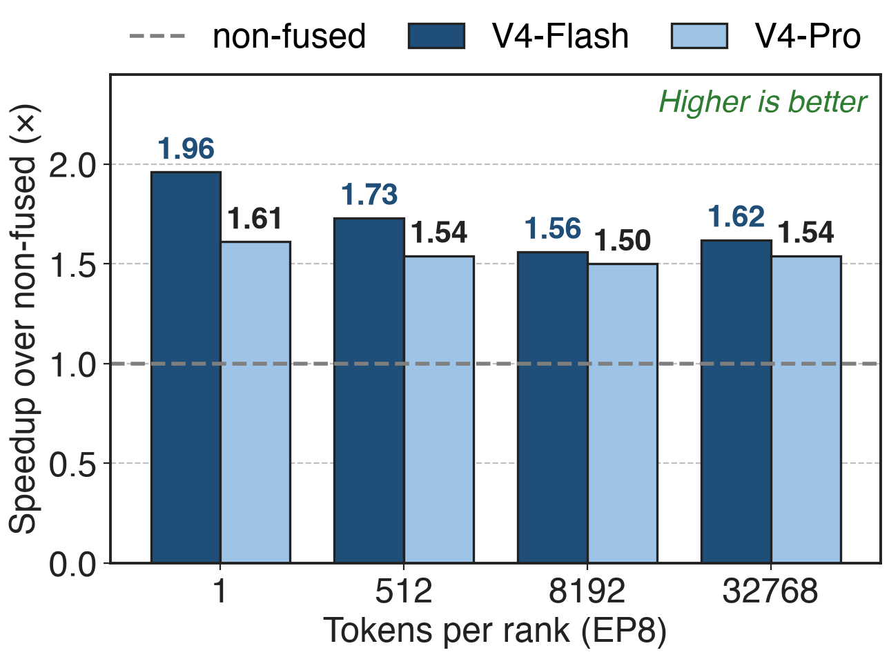
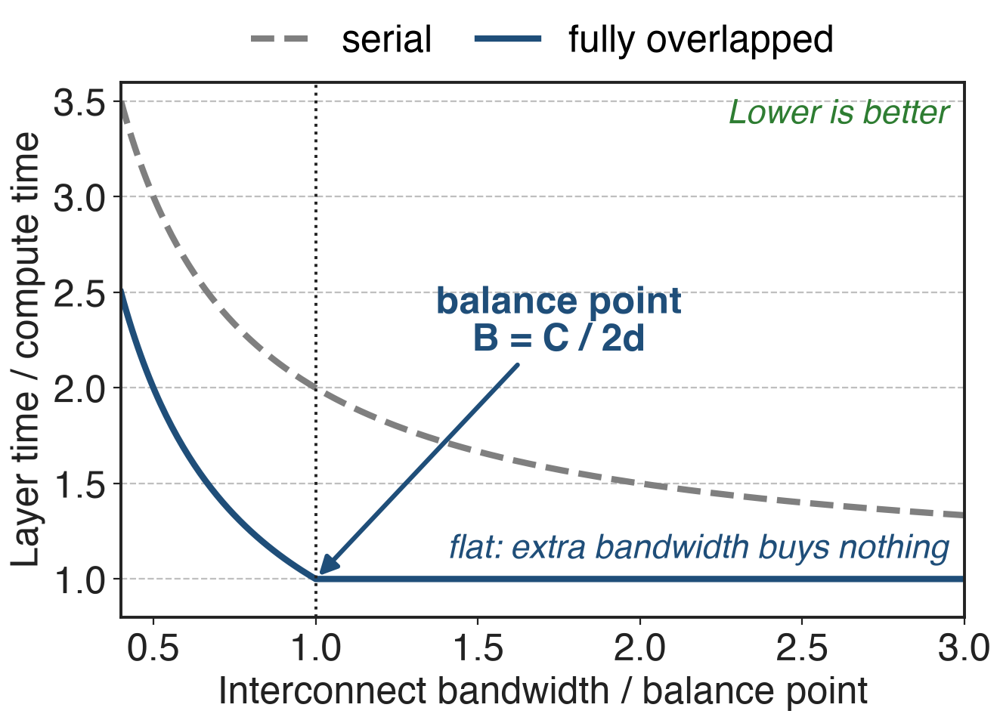

# Each MoE layer wraps GEMMs in two all-to-alls
{right 50%}
- V4-Pro: **1.6T** params, **49B** active, **384** experts
- V4-Flash: **284B** / **13B**, **256** experts
- Each token picks **6** routed experts, mostly on other GPUs
<!-- notes: DeepSeek-V4 keeps the DeepSeekMoE layout. Under expert parallelism every MoE layer first dispatches each token, in FP8, to the GPUs holding its 6 routed experts, runs two GEMMs with a SwiGLU in between, and combines the BF16 results back to the token's home GPU. This happens in every layer, in pre-training, inference and RL rollout. Running example for the deck: V4-Flash under EP8, so 32 experts per GPU. Sources: DeepSeek-V4 abstract, §2.1, §4.2.1, §3.1 Fig. 5. -->

# Communication costs as much as compute
%% big: ≈ 1 : 1
%% sub: computation-to-communication ratio of cross-node expert parallelism in DeepSeek-V3: run serially, a MoE layer waits on the network as long as it computes
%% source: DeepSeek-V3 technical report, arXiv 2412.19437, §3.2.1
<!-- notes: DeepSeek-V3 measured that cross-node expert parallelism gives an inefficient computation-to-communication ratio of about one to one. Executed stage by stage, every MoE layer therefore spends about as long moving tokens as computing on them. V4 even removes V3's limit on how many nodes a token may be routed to (§2.1), so routing no longer caps cross-node traffic. Source: DeepSeek-V3 §3.2.1; DeepSeek-V4 §2.1. -->

# Serial stages leave tensor cores idle
{full}
%% caption: Schematic timeline of one MoE layer on one rank; durations illustrative, not measured
> Every GEMM waits for the whole dispatch; every result waits for the last GEMM
<!-- notes: The structural problem is the stage barrier. Dispatch and combine are treated as collectives over all experts, so no expert may start its Linear-1 until every token for every expert has arrived, and nothing goes back until all GEMMs finish. During both transfers the tensor cores sit idle. Durations are schematic; see notes/sources.md for how they were chosen. -->

# Per-stage overlap pairs mismatched stages
{full}
%% caption: Batch-level overlap (V3 DualPipe, two micro-batches) needs a second, equal batch: see deck 11
> Small FP8 dispatch hides under big Linear-1; big BF16 combine outlasts small Linear-2
<!-- notes: Two families of fixes exist. Batch-level overlap, DeepSeek-V3's DualPipe in training and two micro-batches in serving, hides one batch's all-to-all under another batch's compute, but needs a second independent batch of similar size, and DualPipe keeps two copies of the parameters (V3 §3.2.1, Table 2, §3.4). A single small batch, such as the long tail of an RL rollout, has nothing to pair with. Per-stage overlap such as Comet overlaps dispatch with Linear-1 and Linear-2 with combine, separately (V4 Fig. 5). The pairs are mismatched: Linear-1 does twice the FLOPs of Linear-2, while the BF16 combine moves twice the bytes of the FP8 dispatch (derived from the paper's 6hd FLOPs and 3h bytes). So the combine sticks out past Linear-2. -->

# Insight: communication is shorter than compute
- Profiled V4 MoE layer: total transfer time **<** total compute time
- So the network is not the bound; the stage barriers are
--
> Pipeline at expert granularity and compute becomes the only bottleneck
<!-- notes: DeepSeek's profiling shows that within a single V4 MoE layer the total communication time is less than the total computation time. So the network is not the bound; the schedule is. If transfers and GEMMs are pipelined at the granularity of experts instead of whole stages, compute remains the only bottleneck, and the system can even tolerate a slower interconnect without losing end-to-end speed. Source: DeepSeek-V4 §3.1, "Communication Latency Can Be Hidden". -->

# Pipeline experts in waves inside one kernel
{full}
%% caption: Schematic, 4 waves. Parts: ❶ expert waves, ❷ one fused pull-based kernel, ❸ wave sizing
<!-- notes: Panel c is the technique. Each rank's experts are split into waves. Once a wave's tokens have arrived, its GEMMs start, while the next wave's tokens are already being pulled and the previous wave's results are already being sent back. Only the first wave's dispatch and the last wave's combine remain exposed. The paper fuses all of this into one pipelined kernel, released as Mega MoE in DeepGEMM. The next three slides zoom into the three parts. Source: DeepSeek-V4 §3.1 and Fig. 5. -->

# ❶ A wave computes as soon as its tokens land
{full}
> Steady state: wave k computes while k+1 arrives and k−1 returns
<!-- notes: Here is one rank in steady state. Wave 2's experts are on the tensor cores; wave 3's tokens are being pulled from the other ranks; wave 1's finished results are being written back to the ranks that own those tokens; wave 4 waits its turn. A wave starts as soon as all of its own experts have their tokens, without waiting for any other expert. The fine-grained pipeline keeps both compute and communication busy, which is why it helps most on long-tail small batches such as RL rollout. The 4 waves of 8 experts are schematic; the real wave size is chosen per call (mechanism 3). Source: DeepSeek-V4 §3.1 p.15-16. -->

# ❷ One kernel with three warp roles
{full}
> Dispatch pulls: no per-chunk notification latency as with fine-grained push
<!-- notes: In the open-source Mega MoE kernel each SM runs persistent warps with fixed roles: four dispatch warps pull tokens and their scales from the owners' symmetric buffers with TMA over NVLink; MMA warps run Linear-1 and Linear-2 tiles wave by wave; eight epilogue warps apply the clamped SwiGLU, cast to FP8 with UE8M0 scales, and write Linear-2's BF16 output straight into the owner's combine buffer. After one NVLink barrier each rank reduces its tokens' top-k contributions. DeepSeek chose pull because fine-grained push needs a notification per chunk, and today's cross-GPU signalling is too slow for that. The test suite checks the fused output is bit-identical to the non-fused path. Sources: DeepSeek-V4 §3.1 p.16; DeepGEMM commit 7f2a703 (PR #304), sm100_fp8_fp4_mega_moe.cuh and tests/test_mega_moe.py. Deep dive on the megakernel: deck 35. -->

# ❸ Waves just big enough to fill every SM
{full}
%% caption: Schematic: 16 SMs, one Linear-1 tile per cell. Smaller batches give fewer tiles per expert, so waves grow
> Pick the fewest experts whose tiles cover 2× the SMs (at most 32)
<!-- notes: Wave size is a trade-off. One expert per wave gives too few GEMM tiles, so most SMs idle, especially at small batch sizes. All experts in one wave brings back the stage barrier: the first GEMM waits for every expert's tokens. Mega MoE's heuristic picks the smallest wave whose Linear-1 tiles, after a factor of 2 slack for uneven routing, can keep every SM busy; it caps waves at 32 experts and rounds to a divisor of the experts per rank so all waves are equal. Source: DeepGEMM commit 7f2a703, heuristics get_num_experts_per_wave_for_mega_moe; scheduler/mega_moe.cuh (all Linear-1 tiles of a wave, then its Linear-2 tiles, then the next wave). -->

# Waves raise the overlap ceiling to 1.92×
{right 55%}
- V4-Flash configuration, the paper's model
- Per-stage overlap (Comet): **1.42×**
- Expert waves: **1.92×**
> Theory assumes perfect overlap; fill and drain cost extra
<!-- notes: In DeepSeek's model of a V4-Flash MoE layer, overlapping per stage as Comet does reaches 1.42 times the serial speed, while expert waves reach 1.92 times, close to the 2x that a one-to-one ratio would allow. These are theoretical numbers from Figure 5, not measurements. Source: DeepSeek-V4 Fig. 5. -->

# Mega MoE runs 1.50–1.96× faster than non-fused
{right 55%}
- One MoE layer, EP8, vs DeepEP + separate GEMMs
- Largest at **1** token per rank: rollout tail
- Also validated on Ascend NPUs
> Tiny batches gain most: no second batch needed to hide transfers
<!-- notes: Measured, the fused wave kernel beats a strong non-fused path, DeepEP dispatch and combine around DeepGEMM grouped GEMMs, by 1.50 to 1.73 times on general inference batch sizes and by up to 1.96 times on latency-sensitive tiny batches, the shape of RL rollout tails and fast agent serving. These are MoE-layer kernel speedups, not end-to-end training or RL speedups. DeepSeek reports the scheme on both NVIDIA GPUs and Huawei Ascend NPUs. Sources: DeepSeek-V4 §3.1 p.16; DeepGEMM PR #316 tables (EP8, average of 8 ranks); baseline from tests/test_mega_moe.py. -->

# Bandwidth beyond C/B = 2d buys nothing
{right 55%}
- Per token-expert: **6hd** FLOPs, **3h** bytes
- V4-Pro: C/B ≤ 2d = **6144** FLOPs/Byte
- **1 GB/s** hides **6.1 TFLOP/s** of compute
%% caption: Analytic, from DeepSeek-V4 §3.1; h = hidden size, d = expert width
> Size interconnects to the balance point, not to the maximum
<!-- notes: Once communication hides under compute, what matters is the ratio of compute throughput C to bandwidth B, not bandwidth alone. Each token-expert pair costs 6hd FLOPs for the three SwiGLU projections but only 3h bytes: h for the FP8 dispatch and 2h for the BF16 combine. So communication is fully hidden when C over B is at most 2d, which is 6144 FLOPs per byte for V4-Pro with d = 3072: each GB/s of interconnect covers 6.1 TFLOP/s. Past that point the overlapped curve is flat; DeepSeek asks hardware vendors to target this balance point instead of scaling bandwidth unconditionally. For V4-Flash, d = 2048 gives 4096 (derived). The chart is analytic, not measured. Source: DeepSeek-V4 §3.1 p.16. FP8 dispatch and BF16 combine: deck 18. -->

# The cost: exposed edges, power, prerequisites
%% layout: two-col
- !!Fill and drain!!: first dispatch, last combine stay exposed
- !!Power!!: compute, memory and network all run hot
- SwiGLU's exp and division stall the GEMM pipeline
|||
- Needs symmetric memory, multi-process launch
- Release kernel: SM100, FP8×FP4 only
- "Still under development"
<!-- notes: The pipeline has a fill and a drain, so the first wave's dispatch and the last wave's combine are not hidden. Extreme fusion drives compute, memory and network to high load at once, so power throttling becomes a limiter; DeepSeek asks for more power headroom. SwiGLU's exponential and division slow the post-GEMM epilogue; they propose a cheaper element-wise activation. The released kernel needs PyTorch 2.9 symmetric memory and a multi-process launch, targets SM100, and at release supported FP8 activations with FP4 weights only; DeepGEMM calls it still under development. Sources: DeepSeek-V4 §3.1 p.16; DeepGEMM PR #304 and README. -->

# Summary
- Serial EP: transfers take as long as compute (**≈ 1:1** in V3)
- ==Insight==: a V4 layer communicates less than it computes
- Expert waves in one pull-based kernel
- **1.50–1.96×** over non-fused; balance point **2d** FLOPs/Byte
%% qr: https://arxiv.org/abs/2606.19348
<!-- notes: Wave-based overlap removes the stage barrier inside a MoE layer, so a single small batch can hide its own all-to-alls. Related decks: 11 (batch-level 1F1B overlap), 18 (FP8 dispatch and BF16 combine), 24 (DeepEP v2), 35 (Mega MoE megakernel). Sources: DeepSeek-V4 §3.1; DeepGEMM PR #304 and #316. -->
