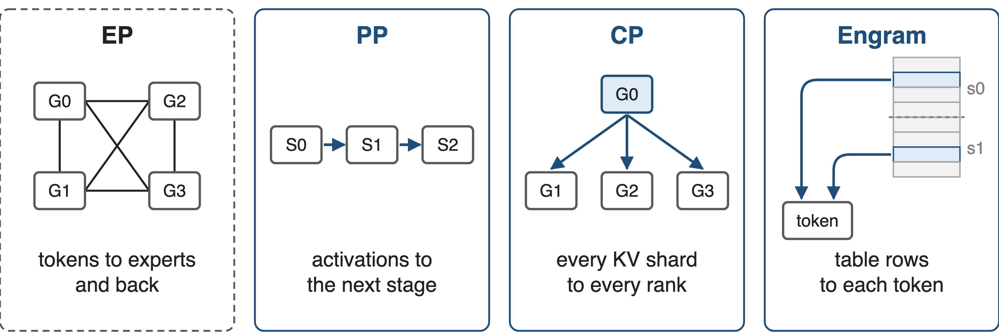
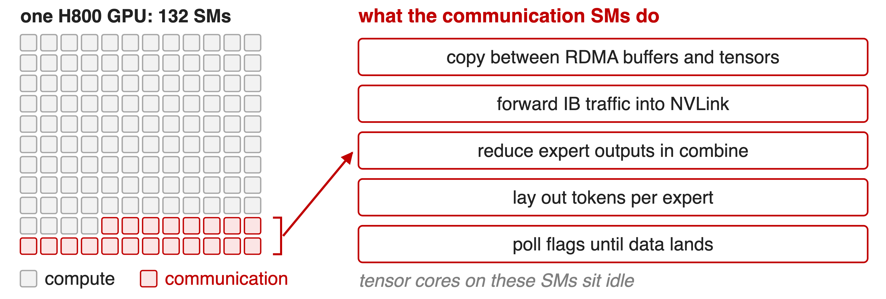
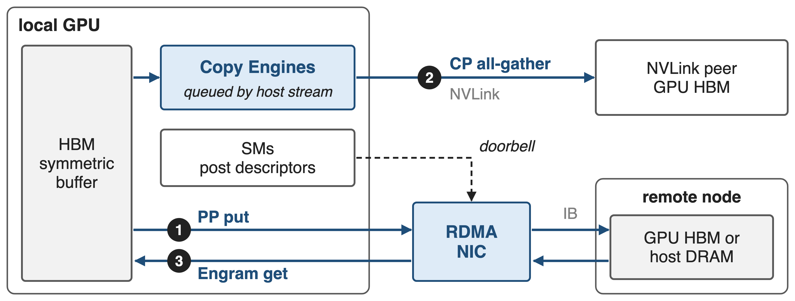
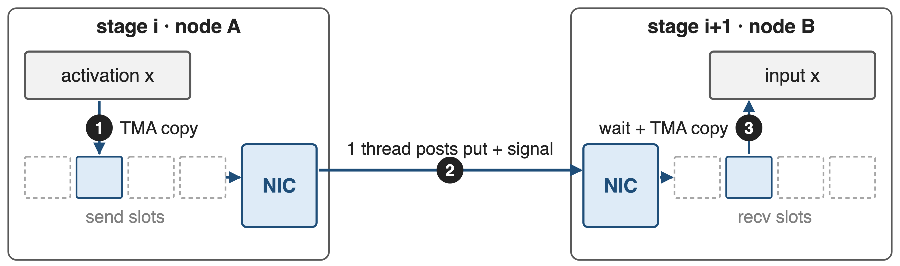
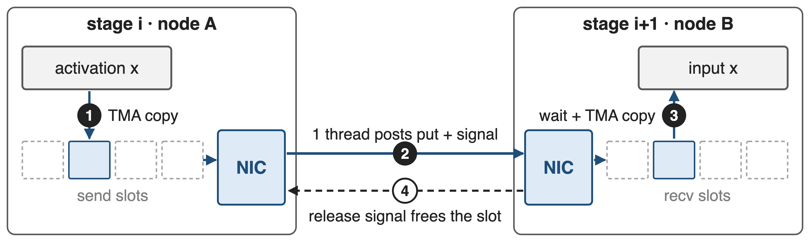
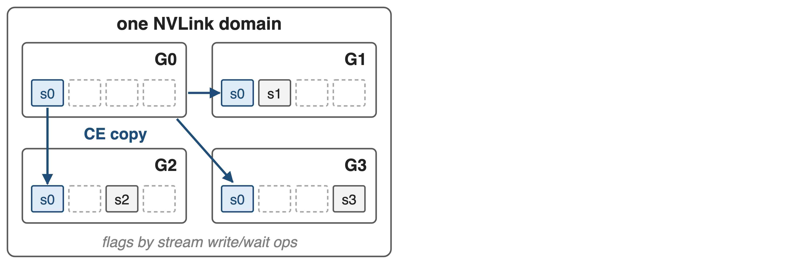
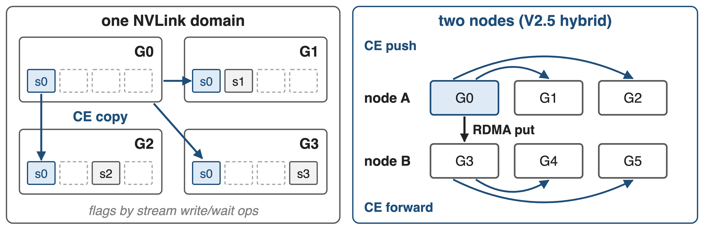
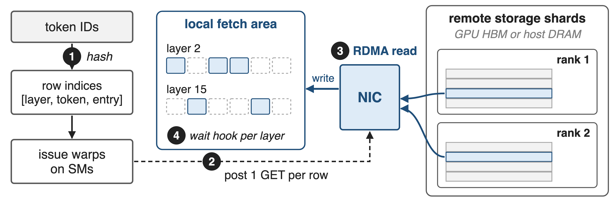
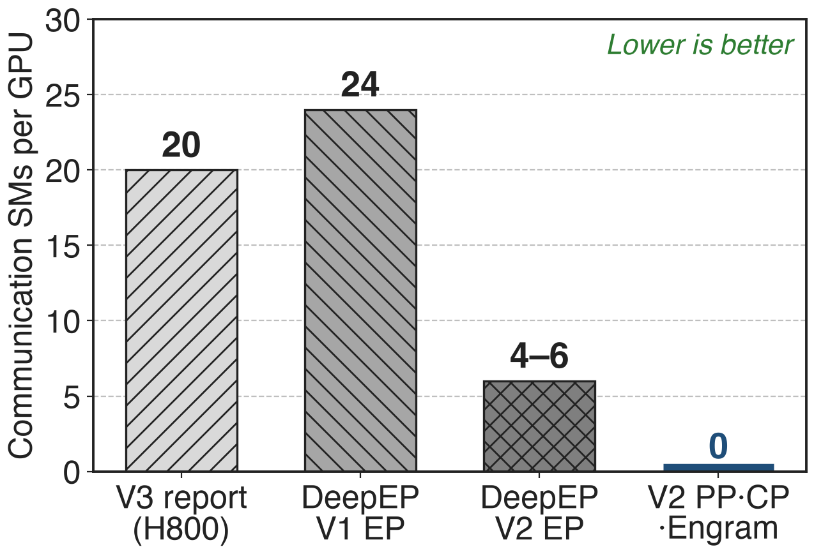
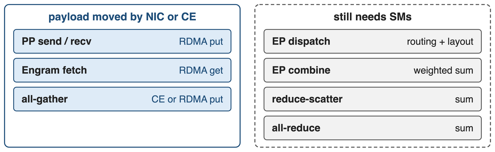

# DeepEP now moves bytes for PP, CP and Engram
{full}
%% caption: Blue: experimental primitives added in DeepEP V2. Engram is DeepSeek's hashed N-gram memory (arXiv 2601.07372).
<!-- notes: DeepEP started as the expert-parallel library behind DeepSeek-V3: dispatch tokens to experts and combine them back. The V2 release in April 2026 added three experimental primitives for other parallel dimensions: point-to-point sends between pipeline stages, an all-gather for context parallelism, and remote lookups for Engram, DeepSeek's conditional-memory module that reads rows of large hashed N-gram tables. V2.5 in September 2026 split them into PPBuffer, BucketBuffer and EngramBuffer. Sources: DeepEP README at b306af06af l.3 and l.23-25; PR #605; PR #763; Engram paper §2.2. Overview of the whole library: deck 24. -->

# Communication holds 15% of the SMs
%% big: 20 / 132
%% sub: H800 SMs that DeepSeek-V3 reserves for communication; DeepEP's 20 SMs cost ~20% GEMM efficiency
%% source: DeepSeek-V3 report, arXiv 2412.19437, §3.5.1 (p.20); Megatron-Core MoE report, arXiv 2603.07685, §4.2.3 (p.34)
<!-- notes: DeepSeek-V3 allocates 20 of the 132 SMs of an H800 to its all-to-all kernels, about 15 percent (20/132, derived). That is SM time the GEMMs cannot use: in Megatron-Core's DeepSeek-V3 benchmark, DeepEP's 20 SMs per GPU introduce roughly 20 percent GEMM-efficiency overhead. Sources: DSV3 §3.5.1 p.20; MC §4.2.3 p.34. -->

# Communication SMs mostly copy and wait
{full}
%% caption: Task list from the DeepSeek-V3 report §3.5.1; flag polling as in DeepEP's kernels
<!-- notes: The DeepSeek-V3 report lists what those 20 SMs actually do: move data between RDMA buffers and input/output tensors, forward InfiniBand traffic into NVLink, reduce expert outputs during combine, and manage the fine-grained token layout. Communication kernels also spin on flags until data arrives. Apart from the combine reduction this is copy work, and the report notes the tensor cores on those SMs stay under-utilized. Source: DSV3 §3.5.1 p.20; DeepEP kernels poll with timeout_while loops. -->

# Fewer SMs is not zero SMs
%% layout: two-col
- **Shrink the kernels** (DeepEP V2 EP)
- 24 → **4–6** SMs
- !!Combine sums, dispatch routes!!: SMs stay
|||
- **Offload to hardware** (V3 wish list)
- Comm co-processor, SHARP-style
- !!Not in today's GPUs!!
> Needed: traffic whose data path has no arithmetic
<!-- notes: V2 rewrote the EP kernels and cut DeepSeek-V3-style training from 24 SMs to 4 to 6, but it cannot reach zero: combine must sum expert outputs, and dispatch decides per token where each copy goes. The V2.5 README says plainly that EP dispatch and combine require SMs. The DeepSeek-V3 report asks vendors for a communication co-processor, in the spirit of NVIDIA SHARP, that would take this work off the SMs; it does not exist on today's GPUs. Sources: README@b306af06af l.22; README@main l.39; issue #178 (combine must be done by the GPU); DSV3 §3.5.1. EP kernels and the analytic SM budget: deck 17. -->

# Insight: moving bytes needs no SM
- PP sends, CP all-gather, Engram lookups only **copy**
- Addresses known before launch: no sum, no routing
- Nodes already have byte movers: **RDMA NIC**, **copy engines**
--
> SMs only post descriptors; the NIC and copy engines move the payload
<!-- notes: Three of the traffic types on slide 2 never combine values: a pipeline stage hands its activation to the next stage, an all-gather replicates shards, and an Engram lookup reads table rows. Every source and destination address is known before the transfer starts. A GPU node already has two engines that can move such bytes without SMs: the RDMA NIC, which reads and writes GPU memory directly via GPUDirect RDMA, and the GPU's copy engines, which can write to NVLink peers. DeepEP V2 builds the three primitives on exactly these engines. Source: README@b306af06af l.3 ("zero or minimal SM occupation") and l.23-25. -->

# Each primitive rides a byte mover
{full}
%% caption: Doorbell = a GPU thread writes the work request and rings the NIC (NCCL Gin, GDAKI). Engram reads are one-sided: the row owner runs nothing.
<!-- notes: One figure for the three mechanisms. The PP send and the Engram fetch use the RDMA NIC through NCCL's GPU-initiated networking (Gin): a GPU thread writes a work request and rings the doorbell, then the NIC reads or writes memory itself. The CP all-gather is enqueued by the host on a stream as a batch of copy-engine transfers into NVLink peers' memory. The SMs never carry the payload. Gin backend deep dive: deck 21. Sources: pp_send_recv.cuh, engram_fetch.cuh, all_gather.hpp (main). -->

# ❶ PP: a thread posts, the NIC sends
{full}
--
{full}
> Kernels exit after posting; a slot ring and credits bound in-flight tensors
<!-- notes: PPBuffer.send first copies the activation into one of num_max_inflight_tensors send slots with TMA, a short kernel with one warp per CTA. Then one elected thread posts an RDMA put into the peer's matching receive slot, with a remote signal-add that bumps an arrival counter; the kernel exits and the NIC moves the bytes. recv waits for the arrival count, TMA-copies the slot out, and signals a release counter back, which frees the slot for the next send. Only the previous and next rank of an RDMA-only pipeline group can be addressed. Sources: deep_ep/include/deep_ep/impls/pp/pp_send_recv.cuh; deep_ep/buffers/pp.py; README@main l.390. -->

# ❷ CP all-gather runs on copy engines
{full}
--
{full}
> NVLink path launches no kernel; across nodes CTAs only post RDMA puts
<!-- notes: Inside an NVLink domain, the all-gather is pure host code: cudaMemcpyBatchAsync with the prefer-overlap-with-compute flag copies the local shard into the same slot of every peer's symmetric buffer, and stream memory operations write a flag to each peer and wait for theirs. No kernel runs. In V2.5's hybrid mode, one CTA per remote node posts RDMA puts to the same-rail GPU, and the copy engines forward each arrived chunk over NVLink; the chunk count comes from a small timeline model of copy-engine and RDMA time. Reduce-scatter and all-reduce still run on SMs. Sources: V2 csrc/elastic/buffer.hpp all_gather; main csrc/kernels/bucket/all_gather.hpp, driver.cpp; README@main l.328. -->

# ❸ Engram lookups become RDMA reads
{full}
> Indices follow from token IDs, so fetches issue early and wait per layer
<!-- notes: Engram hashes each token's suffix N-grams into row indices of large embedding tables, so the indices depend only on the input tokens and are known before the Engram layer runs. EngramBuffer.fetch takes indices of shape layers by tokens by entries; issue warps sort them by owner and post one RDMA GET per row, ringing the doorbell only once per batch. The NIC reads the rows from the owner's storage shard, in GPU memory or host DRAM, and writes them into the local fetch area; fetch returns one wait hook per Engram layer. The test default is 512 tokens times 24 entries times 2 layers, i.e. 24,576 reads of 512 bytes (derived), so QP count and NIC message rate, not SMs, set the speed. Sources: Engram paper §2.2, §2.5; engram_fetch.cuh; buffers/engram.py; tests/engram/test_engram.py. Host-DRAM storage: deck 16. -->

# Transfers drop from 20 SMs to zero
{right 55%}
- V2 EP: **4–6** SMs, down from **24**
- PP, CP, Engram: **0** SMs while bytes move
- No bandwidth numbers published yet
<!-- notes: The release is in the same currency as the pain: SMs. DeepSeek-V3 reports 20 communication SMs; the V2 README says V1 used 24 for V3-like training and V2's EP kernels need 4 to 6. The three new primitives are labelled 0 SM in V2: their payload rides the NIC or the copy engines. The 20 and 24 come from different documents describing similar setups. DeepEP publishes no bandwidth or end-to-end numbers for PP, CP or Engram yet, so this deck claims none. Sources: DSV3 §3.5.1; README@b306af06af l.22-25, l.55. -->

# Only sums and routing still need SMs
{full}
%% caption: DeepEP V2.5: all-gather is copy-engine driven (num_sms=0); reduce-scatter, all-reduce, EP dispatch and combine use SMs
> The 0-SM line is arithmetic: copies offload, sums stay on SMs
<!-- notes: V2.5 makes the boundary explicit. All-gather asserts num_sms equal to zero, while the reduce-scatter and all-reduce code asserts that a 0-SM version is not implemented, and the README says EP dispatch and combine require SMs. This is the insight from slide 6 applied consistently: a copy can go to a DMA engine, a reduction needs arithmetic. Sources: README@main l.39, l.328; csrc/buffers/bucket.hpp (num_sms asserts). -->

# Zero SMs on the wire, not zero cost
%% layout: two-col
- !!Short kernels remain!!: PP staging, Engram issue
- !!Receiver spins!! until the signal lands
- Extra copies through symmetric slots
|||
- **Experimental**; V2.5 drops the "0 SM" label
- PP: RDMA-only group, adjacent ranks
- NCCL ≥ 2.32.3 with Gin; Hopper or newer
<!-- notes: Zero SMs describes the payload path, not the absence of kernels. PP launches short TMA staging kernels, on all SMs by default, one warp each, and the receive kernel spins on the arrival counter. Engram launches issue warps, and the cross-node all-gather launches CTAs that post puts. PP also pays two local copies through the slot ring. All three stay experimental; the V2.5 README now says "with RDMA" instead of "0 SM". Requirements: NCCL 2.32.3 or newer with Gin, Engram needs ncclGinOptFlagsWarpGet, CUDA 13.1, Hopper or newer; PP needs an RDMA-only group and only talks to adjacent ranks. Sources: pp_send_recv.cuh; pp.py; README@main l.33-55, l.101, l.390. -->

# Summary
- DeepSeek-V3 gave communication **20 of 132** SMs
- ==Insight==: copies need no SM; the NIC and copy engines move them
- PP put, CE all-gather, Engram get: **0** SMs on the wire (V2 EP: **4–6**)
- Experimental in DeepEP V2 and V2.5
%% qr: https://github.com/deepseek-ai/DeepEP
<!-- notes: Communication used to rent SMs as DMA engines. DeepEP V2 moves the pure-copy traffic, pipeline sends, context-parallel all-gathers and Engram lookups, onto the RDMA NIC and the copy engines, and keeps SMs only where arithmetic is needed. Related decks: 24 (DeepEP V2 overview), 17 (ElasticBuffer API and analytic SM/QP budgeting), 21 (NCCL Gin backend), 16 (GPU/CPU hybrid buffer for Engram storage), 18 (FP8 dispatch, BF16 combine), 22 (network-side optimization). -->
