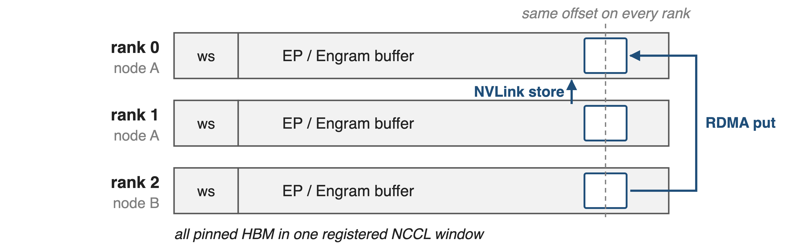
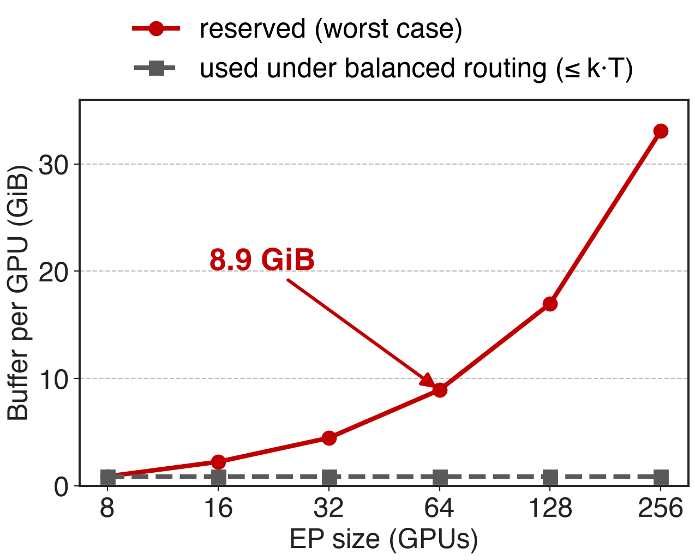
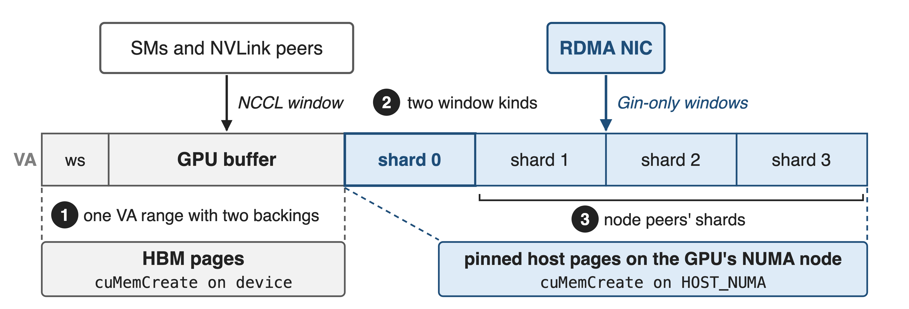
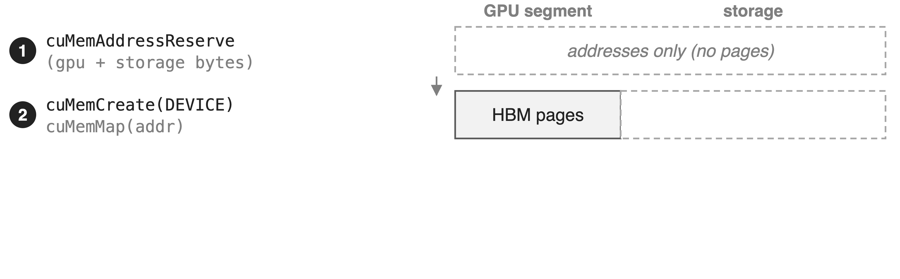
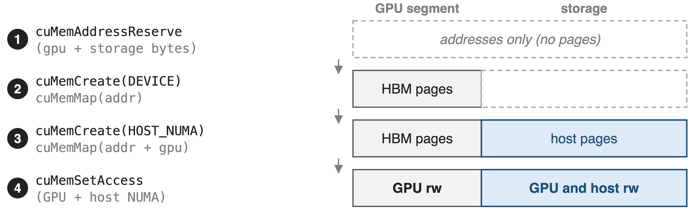
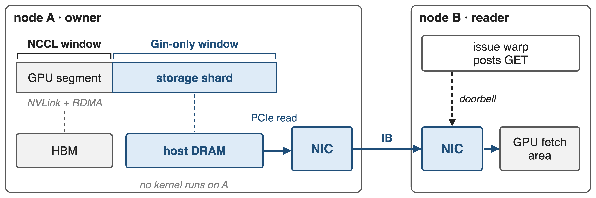
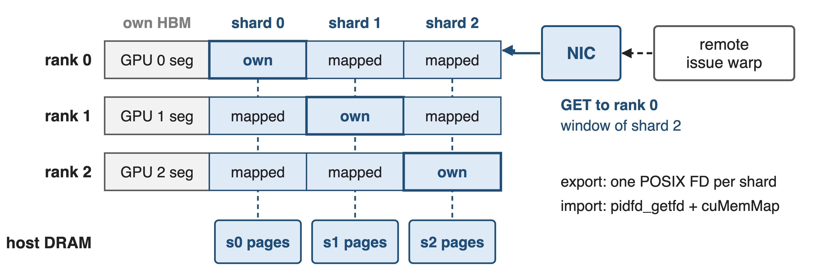
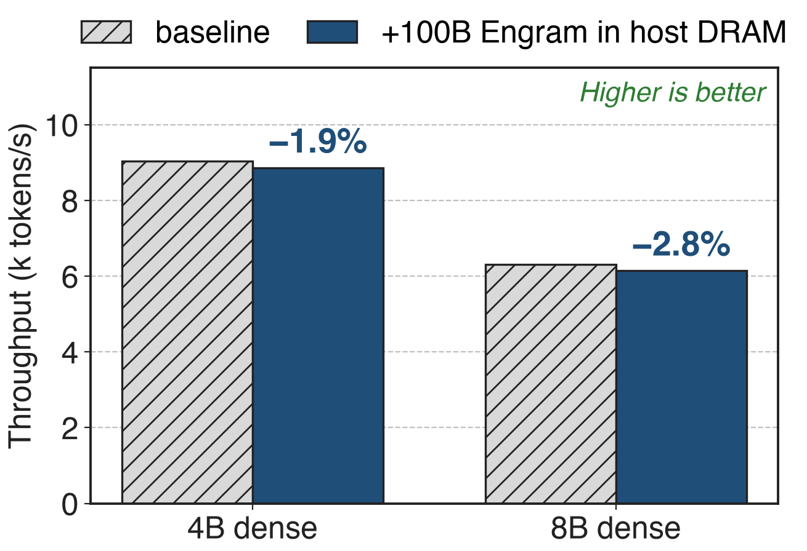

# DeepEP buffers are registered, symmetric ranges
{full}
%% caption: A peer addresses a slot by (rank, offset); the size is fixed when the buffer is built
<!-- notes: Every DeepEP buffer is one pinned allocation registered as an NCCL window, with the same layout on every rank. That symmetry is what lets a kernel write to a peer over NVLink, or a NIC put into a remote GPU, using only a rank and an offset. The size is computed when the buffer is constructed and the memory is HBM. HBM is already the scarce resource in MoE training: Megatron-Core reports DeepSeek-V3 needs 199.5 GB per GPU before memory optimizations, against 80 GB on an H100. Sources: csrc/kernels/comm/symmetric.hpp (GPUSymmetricMemory, ncclMemAlloc); context.cpp l.196-200; Megatron-Core MoE report p.20. API overview: decks 17 and 24. -->

# EP buffers reserve 8.9 GiB per GPU at EP64
%% big: 8.9 GiB
%% sub: per GPU at EP64 with DeepSeek-V3-like settings: about 10× what balanced routing can use (analytic)
%% source: Derived from DeepEP V2.5 EPBuffer size formula (csrc/buffers/ep.hpp) with the README benchmark settings
<!-- notes: This number is analytic: a replica of DeepEP V2.5's calculate_buffer_size, with the README's V3-like benchmark settings read as per rank: 8,192 tokens per rank, hidden 7,168, top-8, FP8 dispatch, BF16 combine, 8 GPUs per node. The formula reserves receive space for every token of every rank, because in the worst case all of them can be routed to one GPU. Under perfectly balanced routing a rank receives at most top-k times its own token count, 0.9 GiB here, so about 10 times less. The V2 README itself notes that V2 buffers are larger than V1's. Sources: ep.hpp l.183-282; token.cuh; README@b306af06af l.29, l.43; tests/ep/test_ep.py l.64; derivation in notes/sources.md. -->

# Worst-case sizing grows with EP size
{right 55%}
- Any rank may receive **N·T** tokens
- Balanced routing delivers **≤ k·T**
- Gap grows linearly with EP size
%% caption: Analytic. T = 8,192 tokens/rank, hidden 7,168, top-8, FP8 dispatch, 8 GPUs per node
<!-- notes: The reserved size scales with the number of ranks N times tokens per rank T, because the receive regions hold N times T token records; the bytes balanced routing can deliver stay at k times T. At EP256 the formula gives 33 GiB per GPU, 38 times the balanced bound. The point is not that DeepEP is wasteful: it must not drop tokens when routing is skewed. But the worst case dictates the HBM budget. Source: charts/ep_buffer.py replicates ep.hpp calculate_buffer_size; settings as on the previous slide. -->

# Engram tables outgrow HBM outright
- Engram-27B / 40B: **5.7B** / **18.5B** table parameters
- Offload test: **100B** parameters, **200 GB** in BF16
- One H100 holds **80 GB**
--
> Each step reads only the activated rows, not the table
<!-- notes: Engram, DeepSeek's conditional-memory module, stores hashed N-gram embeddings in large tables: 5.7 billion parameters in Engram-27B and 18.5 billion in Engram-40B, and the paper's offload experiment uses a 100-billion-parameter table, which is 200 GB in BF16 (derived). Yet each step only touches the rows its tokens hash to; the paper notes the communication volume scales with activated slots, not table size. That is exactly the data you want in big, slow memory. Sources: Engram paper Table 1 p.9, §6.4 p.17; Megatron-Core report p.20 (80 GB). -->

# Today's options cost HBM or add a copy path
%% layout: two-col
- **Keep it in HBM**
- Worst-case EP buffers, sharded tables
- !!Capacity set by HBM!!
|||
- **Copy from host**
- Host prefetches rows over PCIe
- !!Second address space, staging copies!!
> Needed: host capacity behind the same registered range
<!-- notes: Today the EP buffer sits in HBM at its worst-case size, and the Engram paper's training setup shards the tables across GPUs and gathers rows with an all-to-all, so table size is bounded by total HBM. The paper's inference setup instead keeps the table in host DRAM and has the host prefetch rows over PCIe into GPU buffers; that works on one machine, but it is a separate address space with its own staging path, invisible to the symmetric windows that peers and NICs use. Sources: README@b306af06af l.29; Engram paper §2.5 and Fig. 2 p.5-6. -->

# Insight: an address need not imply HBM
- CUDA VMM: reserve addresses first, back them later
- Backing: **HBM** or **pinned host pages**
- GPUDirect RDMA reaches both
--
> Keep one registered range; put only the hot bytes in HBM
<!-- notes: CUDA's virtual memory management API separates a virtual address range from the physical memory behind it. One reservation can be backed partly by device memory and partly by pinned host memory on the GPU's NUMA node, and the NIC can DMA into either. So a communication buffer can keep its one contiguous, symmetric range while only its hot part occupies HBM. DeepEP V2 listed this as an on-going feature: "a contiguous virtual address space that maps to a hybrid of GPU and CPU physical memory". Sources: README@b306af06af l.35; symmetric.hpp l.21-76. -->

# Hot bytes in HBM, bulk in host pages
{full}
%% caption: DeepEP V2.5 symmetric.hpp: ElasticSymmetricMemory (one rank) and HybridElasticSymmetricMemory (node-local shards)
<!-- notes: The whole design in one picture. A rank's VA range starts with the GPU segment, workspace plus fetch or receive buffer, backed by HBM pages and registered as a normal NCCL window that SMs, NVLink peers and the NIC can use. After it come storage shards backed by pinned host pages on the GPU's NUMA node, registered as Gin-only windows for the RDMA NIC. In hybrid mode the shards of the node-local peers are mapped right after the rank's own shard. Sources: symmetric.hpp l.137-300; context.cpp l.185-222. -->

# ❶ Reserve once, map two kinds of pages
{full}
--
{full}
> One pointer and offset space; only the backing differs per range
<!-- notes: ElasticSymmetricMemory reserves one VA range for GPU plus storage bytes, then creates a pinned device allocation, GPUDirect-RDMA capable, and maps it at offset zero. Next it creates the storage allocation on the host NUMA node closest to the GPU, or on the device if CPU storage is off, and maps it immediately after. Finally cuMemSetAccess grants the GPU read/write on everything and adds the host NUMA node on the storage part. All segments are 2 MiB aligned. The constructor asserts that the GPU supports GPUDirect RDMA with CUDA VMM. Sources: symmetric.hpp l.21-76, l.95-109, l.137-179; compiled.cuh kNumAllocationAlignmentBytes. -->

# ❷ Host shards are registered for RDMA only
{full}
> The owner runs no kernel; NICs move host rows into remote HBM
<!-- notes: DeepEP registers the GPU segment as one NCCL window with strict ordering, which gives NVLink peers load/store pointers and the NIC an RDMA target. Each storage shard gets its own window registered Gin-only: no NVLink pointers, only GPU-initiated RDMA. For Engram, a reader's issue warp posts a GET; the owner's NIC reads the row from host DRAM over PCIe and the reader's NIC writes it into the reader's GPU fetch area. Neither the owner's SMs nor its CPU take part. When CPU-backed storage is used, DeepEP turns on NCCL's elastic-buffer registration. Sources: context.cpp l.196-222; symmetric.hpp l.326-328; engram_fetch.cuh l.124-129. Fetch kernel details: deck 15. -->

# ❸ Every rank maps its node's shards
{full}
> One RDMA peer per node serves reads of every local shard
<!-- notes: In hybrid mode each rank creates its storage shard, exports it as a POSIX file descriptor and all-gathers (pid, fd). Every rank then imports the shards of its node-local group with pidfd_getfd and maps them back-to-back after its GPU segment, so the same column in every rank's range is the same physical host pages. A remote Engram GET therefore targets one rank per peer group and names the shard by its window. Because the registered range can exceed GPU memory, DeepEP enlarges NCCL_WIN_STRIDE through an environment variable, sized with EP_NUM_MAX_LOCAL_RANKS, default 16. Sources: symmetric.hpp l.192-300; engram.py l.61-77; engram_fetch.cuh l.91; README@main l.407. -->

# 12 MiB of HBM fronts 514 MiB of rows
%% big: 12 MiB
%% tone: ours
%% sub: of HBM per rank serves 514 MiB of Engram rows kept in host DRAM: 43× (DeepEP V2.5 test defaults, derived)
%% source: EngramBuffer.get_storage_size_hint (csrc/buffers/engram.hpp) with tests/engram/test_engram.py defaults
<!-- notes: What shipped. V2.5's EngramBuffer takes use_cpu_rdma_storage; its size hint splits the bytes into a GPU part, the per-layer fetch area of layers times tokens times entries times row bytes, and a storage part holding every row. With the test defaults, 2 layers, 512 tokens, 24 entries per token and 512-byte BF16 rows, the GPU part is 12 MiB and the host storage is 514 MiB per rank, 43 times more (derived). The GPU part depends on the batch, the host part on the table. Sources: engram.hpp l.251-271; tests/engram/test_engram.py defaults; README@main l.17, l.384-386. -->

# A 100B table in host DRAM costs < 3%
{right 55%}
- Engram paper, inference on H800
- Rows prefetched over PCIe, not DeepEP
- Indices known early hide the latency
<!-- notes: Can a model live with its table in host memory? The Engram paper answers for inference: with a 100-billion-parameter table entirely in host DRAM, nano-vLLM on H800 loses 1.9 percent throughput on a 4B dense backbone (derived from Table 4) and 2.8 percent on 8B. The latency hides because the indices depend only on input tokens, so rows are prefetched while earlier layers compute. This measures the paper's PCIe prefetch path, not DeepEP's RDMA path; DeepEP publishes no Engram performance numbers yet. Sources: Engram paper §6.4 and Table 4 p.17-18. -->

# Engram ships it; EP overflow is roadmap
%% layout: two-col
- **Shipped** (experimental)
- May 2026: first CPU bytes
- V2.5: `use_cpu_rdma_storage`
|||
- **Roadmap** (V2 README)
- !!EP buffers in host pages!!
- !!EP replay to shrink buffers!!
> Needs GPUDirect RDMA on CUDA VMM; window stride set by env var
<!-- notes: CPU-backed bytes first appeared in ElasticBuffer as num_cpu_bytes in May 2026, labelled "e.g. for Engram storage", even though the docstring still said "currently GPU-only". V2.5 moved it to EngramBuffer. EPBuffer, PPBuffer and BucketBuffer still allocate HBM only, so transparent imbalanced EP and EP replay, both promised in the V2 README, are not released. Limits: the GPU must support GPUDirect RDMA with CUDA VMM, NCCL_WIN_STRIDE is set through an environment variable that the code itself calls fragile, host rows cross PCIe so they must be fetched ahead, and Engram itself is experimental. Sources: elastic.py@a422b5a369; README@b306af06af l.35-36; csrc/buffers/ep.hpp constructor; engram.py l.61-65. -->

# Summary
- EP buffers sized for the worst case: **8.9 GiB** per GPU at EP64, ~**10×** balanced use (analytic)
- ==Insight==: one VA range, HBM pages plus pinned host pages
- Engram: **12 MiB** of HBM fronts **514 MiB** of host rows per rank
- 100B table in host DRAM: **< 3%** throughput (Engram paper)
%% qr: https://github.com/deepseek-ai/DeepEP
<!-- notes: A communication buffer has to be one symmetric, registered range, but it does not have to be HBM. DeepEP's elastic buffer reserves the range once and backs the cold bulk with pinned host pages that only NICs touch. Today that serves Engram storage; extending it to EP overflow is still on the roadmap. Related decks: 15 (0-SM Engram fetch over RDMA), 17 (ElasticBuffer API and analytic SM/QP budgeting), 21 (NCCL Gin backend), 24 (DeepEP V2 overview). -->
