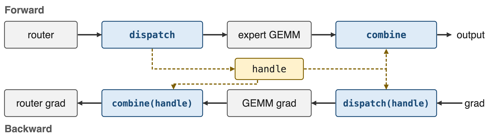
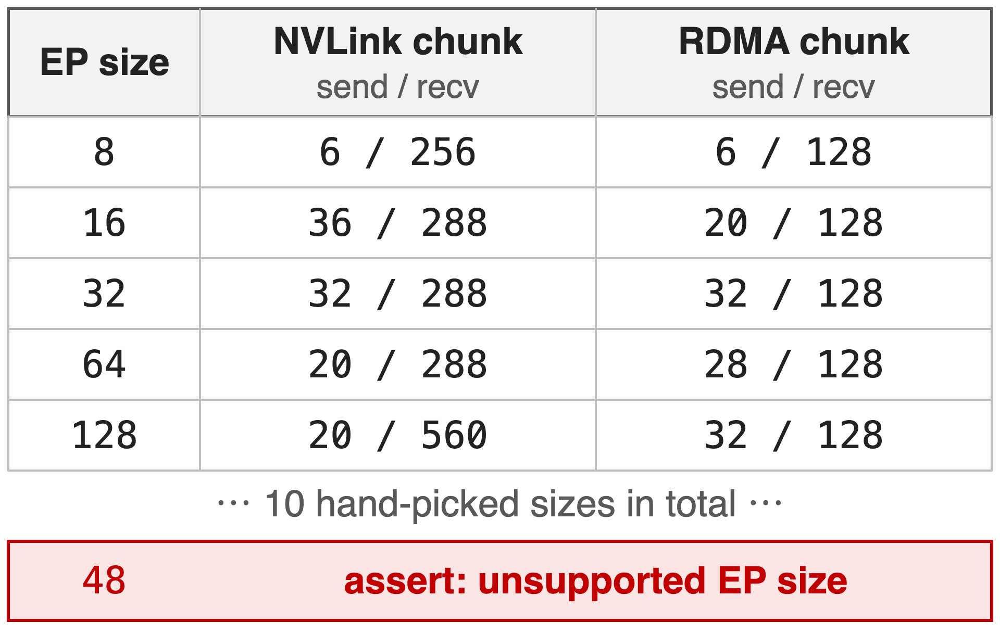
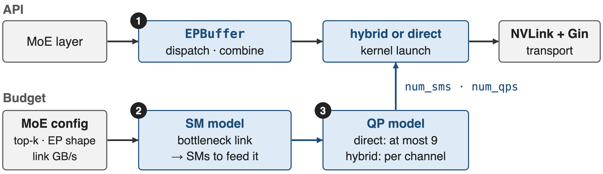
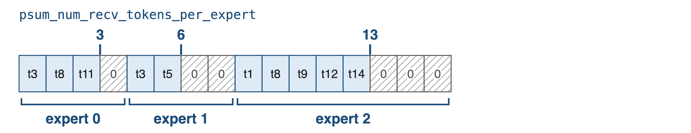
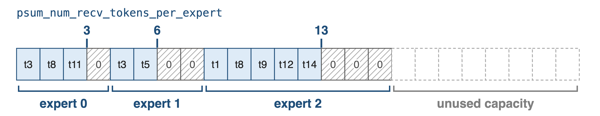
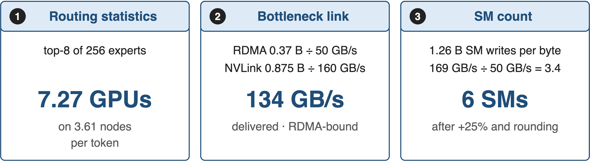
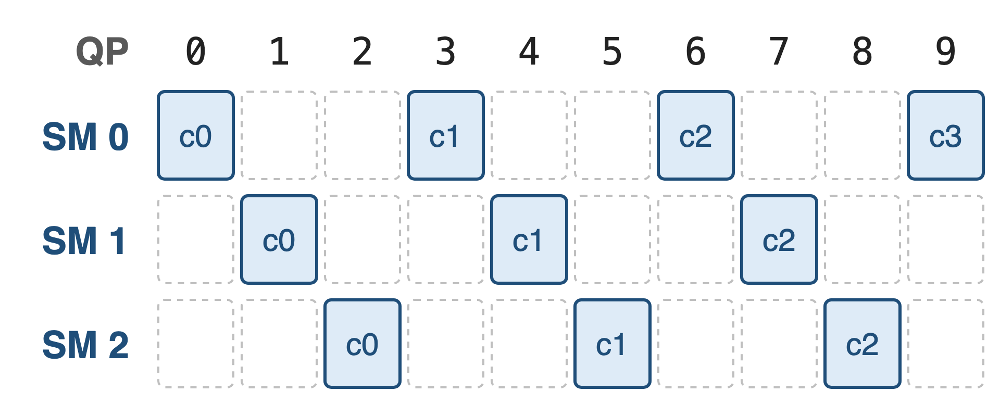
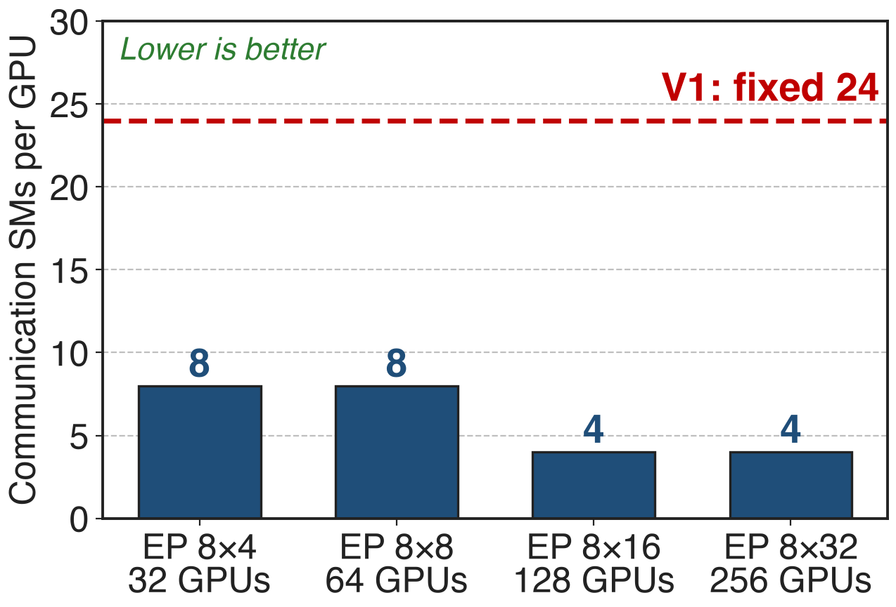

# Every MoE layer calls dispatch and combine twice
{full}
> Same calls for training, prefill and decode; backward reuses the forward routing handle
<!-- notes: In expert parallelism every MoE layer calls dispatch before the expert GEMM and combine after it. In backward the roles swap: the gradient of combine is a dispatch and the gradient of dispatch is a combine, both replaying the routing that the forward dispatch recorded in a handle. DeepEP v2 serves all of this, plus prefill and decode, through one buffer object: ElasticBuffer in V2.0, EPBuffer since V2.5; Megatron-LM exposes it as the deepepv2 dispatcher backend. Sources: DeepEP README examples; Megatron MoE README. -->

# V1 spent 24 SMs per GPU on communication
%% big: 24 SMs
%% sub: per GPU for V3-like training, set by hand, plus a chunk-size table that covers only 10 EP sizes
%% source: DeepEP V2 release notes (README at b306af0, PR #605); V1 README example and deep_ep/buffer.py at v1.2.1
<!-- notes: DeepEP V1 ran V3-like training with 24 SMs per GPU dedicated to the dispatch and combine kernels; the V1 README example sets exactly that with Buffer.set_num_sms(24). Those SMs are taken from the expert GEMMs the communication is supposed to overlap with. And 24 was not derived from anything: it was a global constant next to a hand-tuned table. -->

# V1 looked its chunk sizes up in a table
{right 55%}
- One global SM count: 20 by default
- 5 knobs per EP size, "TODO: automatically tune"
- Decode API apart: QPs = local experts
<!-- notes: In V1 the normal kernels read their configuration from get_dispatch_config and get_combine_config: a dictionary keyed by EP size with NVLink and RDMA chunk sizes, ten sizes from 2 to 160. Any other size fails an assertion, and the README told users to run all the tests on their own cluster and pick the best configuration. The low-latency decode kernels were a separate API and buffer mode, and needed one QP per local expert. The 48 row is an illustrative size outside the table. Source: deep_ep/buffer.py at v1.2.1, lines 30 and 220-270; V1 README. -->

# Insight: SMs only need to feed the slowest link
{right 55%}
- One SM writes ≈ 45–50 GB/s to HBM
- A 400 Gb/s NIC drains 50 GB/s
- Routing fixes the bytes per token
--
> So the SM budget is small, and it can be computed
<!-- notes: Communication SMs never touch the wire. They copy tokens between HBM buffers and post work to the NIC or to NVLink, so they only have to keep pace with the slowest link. DeepEP's model assumes about 45 GB/s of HBM writes per SM (50 in V2.0), the same order as a whole 400 Gb/s NIC. Once routing statistics fix how many bytes each link and each SM must move per token, the SM count is a division. Sources: deep_ep/utils/envs.py; V1 README (CX7 about 50 GB/s). -->

# One buffer, one computed budget
{full}
%% caption: ❶ unified API · ❷ SM model · ❸ QP model; any call can still override num_sms / num_qps
<!-- notes: The design has two lanes. The API lane is one EPBuffer whose dispatch and combine pick the hybrid kernel, RDMA along the rail then NVLink, or the direct kernel within one domain. The budget lane takes the MoE configuration and the detected link bandwidths, computes the SM count, derives the QP count from it, and feeds both into every launch; the result is cached per buffer. Source: deep_ep/buffers/ep.py. -->

# ❶ One dispatch layout serves training and decode
{full}
%% caption: Train / prefill (CPU sync): one row per token–expert pair, padded to the GEMM alignment, exact row count
--
{full}
%% caption: Decode (no CPU sync): rows sized to capacity; the grouped GEMM reads valid ranges from the GPU-side psum
<!-- notes: With do_expand the receive buffer has one row per token-expert pair, so a token routed to two local experts appears twice, and each expert's rows start at a multiple of expert_alignment, which is set to the grouped GEMM's tile alignment, with zero padding in the gaps. For training and prefill a CPU sync returns exact sizes. For decode, do_cpu_sync=False keeps everything on the GPU and CUDA-graph friendly: outputs are sized to capacity and the GEMM masks by psum. The token ids here are a toy example. Sources: README examples; EPHandle docstring in buffers/ep.py. -->

# ❷ The SM count follows the bottleneck link
{full}
> Balanced-gate model in Python; computed once per buffer and cached
<!-- notes: get_theoretical_num_sms first computes how many distinct nodes and GPUs a token reaches under a balanced gate. From that it derives bytes per token on RDMA and NVLink and the bytes the SMs must read and write. The link with the larger bytes-over-bandwidth ratio is the bottleneck and fixes the token rate; SMs equal that rate times SM bytes over per-SM bandwidth, plus 30%, rounded up to a multiple of 4, at least 4. QPs then follow from the SM count. Source: deep_ep/buffers/ep.py lines 431-560. -->

# ❷ Worked example: EP 8×4 needs 6 SMs
{full}
--
{full}
--
{full}
> Matches the 6 SMs of the release table's EP 8×4 row (derived, V2.0 constants)
<!-- notes: Here is the model by hand for 4 nodes of 8 GPUs with DeepSeek-V3 routing, using the V2.0 constants. A token's 8 experts land on 7.27 distinct GPUs and 3.61 distinct nodes on average. For every byte that ends up on a destination GPU, 0.37 bytes cross InfiniBand and 0.875 bytes cross NVLink; at 50 versus 160 GB/s InfiniBand saturates first, which caps delivery at 134 GB/s. The forwarding SMs must write 1.26 bytes per delivered byte, 169 GB/s, which at 50 GB/s per SM is 3.4 SMs; 25% headroom and rounding give 6, the count the release table used for 61 GB/s. V2.5's more conservative constants give 8. All derived; see notes/sources.md. -->

# ❸ QPs follow SMs and channels
{right 55%}
- Direct: min(SMs, 9) QPs, fewer doorbells
- Hybrid: 16 × SMs + 1, one per channel
- Allocated once: 129, or 65 on MT4131 NICs
<!-- notes: QPs are the NIC's parallel queues. In direct mode the model keeps them few, at most 9, to limit doorbell overhead. In hybrid mode every channel, that is every warp, and the notify warps on QP 0 get their own QP, capped by what the buffer allocated at construction: 129, or 65 when ibstat reports an MT4131 NIC with fast RDMA atomics. When SMs do not outnumber QPs, each SM owns a strided set of QPs exclusively, exactly the 3-SM, 10-QP example from the source shown here; otherwise all SMs share all QPs. Sources: buffers/ep.py lines 327-335 and 543-560; comm/barrier.cuh lines 57-86. -->

# V3-style training drops from 24 to 4–6 SMs
%% big: 24 → 4–6
%% tone: ours
%% sub: communication SMs per GPU for V3-like training, at equivalent or better performance
%% source: DeepEP V2 release notes, README at commit b306af0 and PR #605
<!-- notes: This is the headline in the pain's currency. With the analytic budget and the rewritten kernels, V3-like training uses 4 to 6 communication SMs instead of 24, at equivalent or better performance, and nobody has to tune a table per cluster. -->

# 6 SMs sustain 61 GB/s at EP 8×4
{right 60%}
- V3 setup: 8K tokens, hidden 7168, top-8
- FP8 dispatch, BF16 combine, CX7 NICs
- Logical bandwidth incl. local-rank traffic
<!-- notes: These are the release's measured rows. Two nodes reach 90 GB/s dispatch with 12 SMs on Hopper and on Blackwell; four Hopper nodes reach 61 GB/s both ways with only 6 SMs, the case worked through two slides ago. The README notes that these are logical bandwidths that include local-rank traffic. Source: V2 release README performance table. -->

# Larger EP needs fewer SMs, never 24
{right 60%}
- More nodes per token, more RDMA bytes
- Lower token rate, fewer SMs to feed it
%% caption: Analytic: DeepEP V2.5 formula; 256 experts, top-8, 50 GB/s RDMA; RDMA-bound at every size shown
<!-- notes: Running the current formula across EP sizes shows the logic of the design. As EP grows, each token reaches more nodes, so more of its bytes cross InfiniBand; the NIC-limited token rate falls, and fewer SMs are needed to keep it busy: 8 SMs at 32 and 64 GPUs, 4 SMs at 128 and 256. These are model outputs, not measurements: inputs are 50 GB/s RDMA, the code's per-SM constants and a balanced gate. Source: charts/sm_model.py re-implementing buffers/ep.py. -->

# 24 SMs keep 89–91% of NVLink peak
{right 60%}
- SM100, EP8 in one NVLink domain
- Overlap off: the model floors at 64 SMs
- Default: the small, overlap-friendly budget
<!-- notes: Inside one Blackwell NVLink domain the release reports 726 and 740 GB/s with 64 SMs and 643 and 675 GB/s with 24, that is 89 and 91 percent of the bandwidth with 2.7 times fewer SMs. EPBuffer exposes this trade directly: by default it prefers overlapping with compute and returns the small budget; with prefer_overlap_with_compute=False it never returns fewer than 64 SMs. Sources: V2 release README rows 4-5 (percentages derived); buffers/ep.py line 531. -->

# The model trades generality for zero tuning
- !!Balanced gate only!!: not V3's group-limited gate
- Per-SM constants fixed; expand mode not modelled yet
- Bigger buffers than V1; `num_sms` override stays
<!-- notes: The model is simple by design. It assumes a balanced gate and explicitly says not to use it for V3's group-limited gate; it does not yet model the expanded layout or multiple reductions; per-SM bandwidths are fixed defaults with a TODO for architecture-specific values; and link bandwidths come from nvidia-smi and ibstat. Fixed maximum-capacity buffers also cost more memory than V1. Any dispatch or combine call can still pass num_sms and num_qps explicitly. Sources: comments in buffers/ep.py; V2 release Notes. -->

# Summary
- V1: **24 SMs** per GPU, a 10-size tuning table, two APIs
- ==Insight==: SMs only feed the slowest link, so compute them
- One EPBuffer; SMs from the bottleneck; QPs from SMs
- **24 → 4–6** SMs; **6 SMs → 61 GB/s** at EP 8×4
%% qr: https://github.com/deepseek-ai/DeepEP
<!-- notes: EPBuffer replaces V1's two APIs and its tuning table with one interface and a closed-form budget. The model's answer for EP 8x4, 6 SMs, is the configuration that reached 61 GB/s, and V3-like training went from 24 to 4 to 6 SMs. Container overview: deck 24; transport: deck 21. -->
