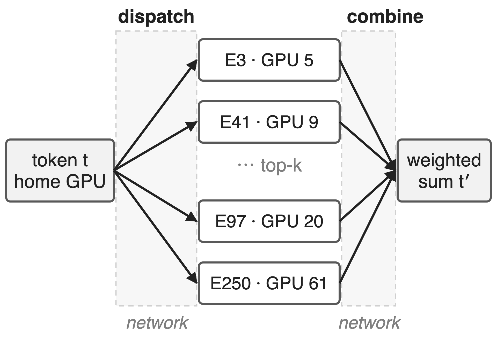
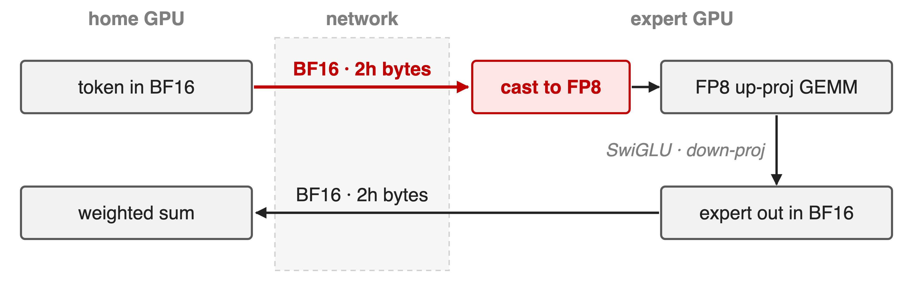
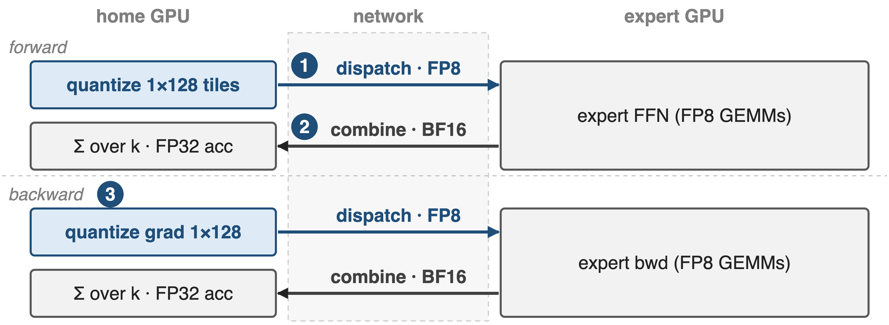
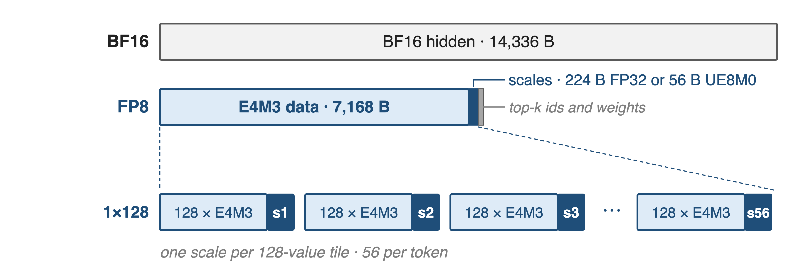
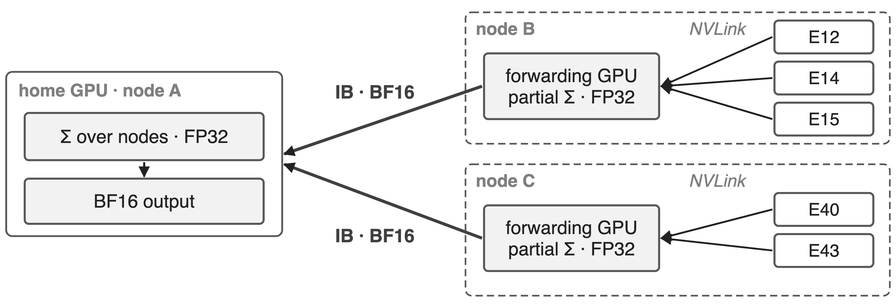
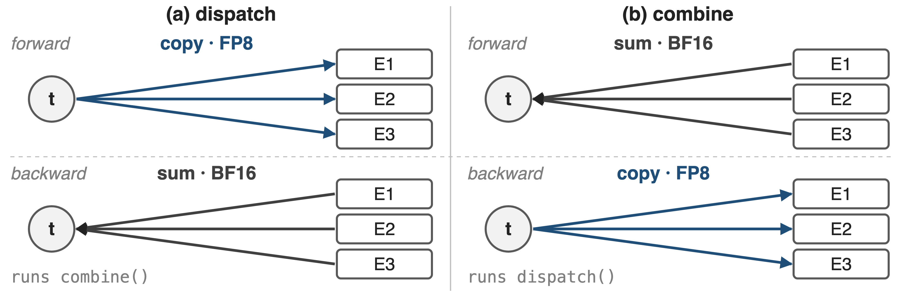
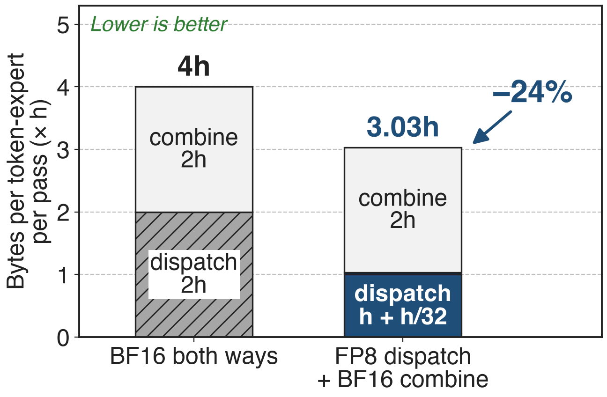
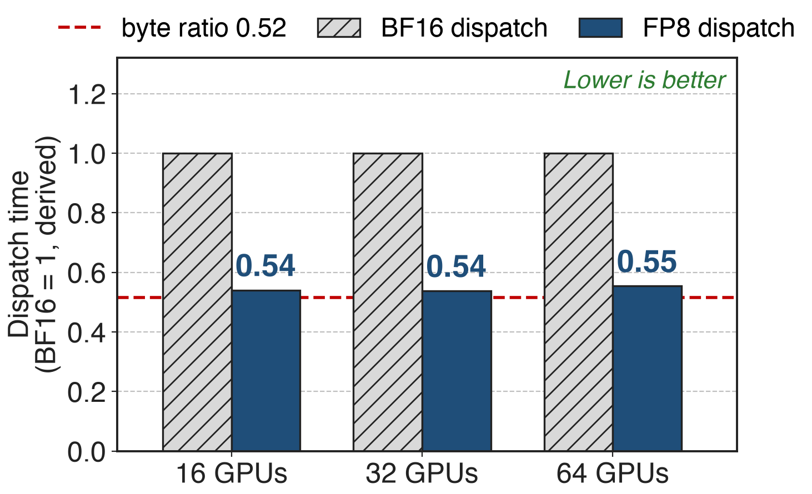

# Every MoE token crosses the network twice
{right 55%}
- DeepSeek-V3: **256** experts, top-**8**, h = **7168**
- **2048** H800: IB **50** GB/s vs NVLink **160** GB/s
- Dispatch copies a token to k experts; combine sums k results
<!-- notes: Expert parallelism places experts on different GPUs, so every MoE layer sends each token to the k experts its router picked (dispatch) and brings the k results back to be summed (combine). In DeepSeek-V3 that is 256 routed experts, top-8, hidden size 7168, trained on 2048 H800s where a GPU's InfiniBand link has 50 GB/s against 160 GB/s of NVLink. Sources: DeepSeek-V3 report §3.1 (2048 H800), §3.2.2 p.13 (160 vs 50 GB/s), §4.2 p.22 (h = 7168, 256 experts, top-8). -->

# Cross-node EP makes V3 communication-bound
%% big: ≈ 1:1
%% sub: computation-to-communication ratio of DeepSeek-V3 training with cross-node expert parallelism
%% source: DeepSeek-V3 Technical Report, arXiv 2412.19437, §3.2.1 (p.12)
<!-- notes: DeepSeek reports that cross-node expert parallelism leaves V3 training with roughly one unit of communication for every unit of computation. Overlap schedules such as DualPipe hide that time; this deck is about the other lever: sending fewer bytes in the first place. Source: DeepSeek-V3 §3.2.1, p.12. Overlap deep dives: decks 11 and 14. -->

# BF16 dispatch ships bits the receiver discards
{full}
> Half of every dispatched byte is precision the FP8 GEMM never reads
<!-- notes: With BF16 on the wire, dispatch sends 2h bytes per token-expert pair. But the expert's up-projection is an FP8 GEMM in DeepSeek's FP8 training recipe, so the first thing the receiver does is cast those values down to 8 bits. The obvious next step, FP8 in both directions, fails on the way back: combine sums k expert outputs into the residual stream, and DeepSeek keeps it in BF16 for accuracy. Sources: DeepSeek-V3 §3.3.3 (FP8 Fprop of the up-projection; BF16 combine), ISCA'25 Insights §3.2. -->

# Insight: dispatch feeds an FP8 GEMM anyway
- Forward: up-projection runs FP8 on dispatched tokens
- Backward: down-projection gradient GEMM consumes FP8 too
- Combine output is summed into the residual stream
--
> Quantize before the wire where the receiver would; keep BF16 where it sums
<!-- notes: The payload's consumer, not its producer, should decide its precision. Everything that travels token-to-expert is the input of an FP8 GEMM: the activation before the up-projection in forward, and the activation gradient before the down-projection in backward. Quantizing before sending costs no precision the receiver would have kept. Everything that travels expert-to-token is summed over k experts and lands in the residual stream, so it stays BF16. Source: DeepSeek-V3 §3.3.3 "Low-Precision Communication". -->

# Precision follows the direction of traffic
{full}
%% caption: Token→expert: FP8 with 1×128 scales (❶). Expert→token: BF16, summed in FP32 (❷). Backward mirrors forward (❸).
<!-- notes: One training step moves four transfers per token-expert pair. The two token-to-expert transfers (forward dispatch, backward gradient dispatch) are FP8 with per-tile scales; the two expert-to-token transfers (forward combine, backward gradient combine) are BF16. The next three slides zoom into the quantized message, the BF16 sum, and why backward reuses the same two kernels. Sources: DeepSeek-V3 §3.3.3; DeepEP README backward helpers. -->

# ❶ Quantize per 1×128 tile, ship scales inline
{full}
> Scales travel with the data; the receiver lays them out for the grouped GEMM
<!-- notes: Each token is cut into 1x128 tiles, one per 128 channels, and every tile gets its own scale, so a single outlier only coarsens its own tile. For h = 7168 that is 56 tiles: 7,168 bytes of E4M3 data plus 224 bytes of FP32 scales, or 56 bytes when the scales are packed UE8M0 (V3 uses power-of-2 scales here). DeepEP takes the pair (FP8 data, scales) as the dispatch input and can write received scales TMA-aligned and column-major so DeepGEMM's grouped GEMM consumes them with no dequantize step. Sources: V3 §3.3.2 p.16 and §3.3.3 p.18; DeepEP EPBuffer.dispatch docstring; csrc/buffers/ep.hpp ("SF must be FP32 or packed UE8M0x4"). UE8M0 layout deep dive: deck 30. -->

# ❷ Combine stays BF16 and sums in FP32
{full}
> Every sum accumulates in FP32; only BF16 crosses the wire
<!-- notes: Combine is a reduction, so its precision matters more than dispatch's. In the hierarchical path the experts on a remote node first send their BF16 outputs over NVLink to the forwarding GPU, which accumulates them; one BF16 vector per node then crosses InfiniBand, and the home GPU accumulates across up to four nodes before writing the BF16 output. DeepEP's reduction accumulates in FP32 and rounds once per stage (a pure BF16 pair-add is used only for two inputs without bias). Combine inputs must be BF16. Sources: V3 §3.2.2 p.13-14; DeepEP README ("Combine inputs must be BF16"); combine_utils.cuh combine_reduce. -->

# ❸ Backward reuses both kernels, mirrored
{full}
> Token→expert traffic is always FP8; expert→token traffic is always BF16
<!-- notes: Dispatch copies a token to k experts, so its gradient sums k gradients back to the token: that is a combine. Combine sums k outputs, so its gradient copies one gradient to k experts: that is a dispatch. DeepEP's training helpers say exactly this and reuse the forward routing handle, so the backward pass needs no new layout and no CPU sync. Because precision follows direction, the backward gradient dispatch is FP8 and the backward combine is BF16. Sources: DeepEP README dispatch_backward / combine_backward docstrings; V3 §3.3.3. -->

# FP8 dispatch moves 3h instead of 4h bytes
{right 60%}
- h = 7168: **28.7** KB → **21.7** KB per pair
- Dispatch alone: about **half** the bytes
- Backward saves the same share
%% caption: Analytic; FP32 scales per 128 channels (UE8M0: 3.008h); top-k metadata excluded
<!-- notes: BF16 both ways moves 2h + 2h = 4h bytes per token-expert pair per pass. FP8 dispatch moves h bytes of data plus h/32 of FP32 scales, combine still moves 2h, so 3.03h: 24 percent fewer bytes. The ISCA'25 paper quotes the dispatch-only cut as 50 percent versus BF16; with scales it is 48 percent. The backward pass has the same two directions, so it saves the same share. Derivation in notes/sources.md; V4 §3.1 rounds the total to 3h. -->

# FP8 dispatch finishes in 54–55% of BF16 time
{right 60%}
- Hybrid-EP kernels on H100 over IB, **16** SMs
- **4096** tokens, h **7168**, top-**8**
- Time tracks bytes: the link stays saturated
%% caption: Derived: published GB/s × the benchmark's FP8 byte count (0.516 of BF16)
<!-- notes: The cleanest A/B is in the Hybrid-EP branch, which benchmarks the same dispatch kernel with BF16 and FP8 payloads. At 16 SMs the FP8 run achieves almost the same GB/s as BF16, so the time falls nearly with the byte ratio: 0.54, 0.54 and 0.55 of BF16 on 16, 32 and 64 H100s. With only 4 or 8 SMs the ratio is 0.55 to 0.70, because the kernel, not the link, becomes the limit. Sources: hybrid-ep branch docs/README_Hybrid-EP.md H100 table (kernel only); tests/test_hybrid_ep.py fp8_factor. HybridEP deep dive: deck 19. -->

# Fewer bytes raise V4's balance point to 6144
%% big: 6144
%% tone: ours
%% sub: FLOPs per byte: 6hd FLOPs vs 3h bytes per token-expert, so EP hides when C/B ≤ 2d (4608 if BF16 both ways, derived)
%% source: DeepSeek-V4, arXiv 2606.19348, §3.1 "Observations and Proposals" (p.16); V4-Pro d = 3072 (§4.2.1)
<!-- notes: DeepSeek-V4 turns the byte count into a hardware target. Each token-expert pair costs 6hd FLOPs in the gate, up and down projections and 3h bytes on the wire, so communication can be fully hidden whenever peak compute over interconnect bandwidth stays below 2d, which is 6144 FLOPs per byte for V4-Pro: each GB/s of link hides 6.1 TFLOP/s of compute. With BF16 both ways the same formula gives 1.5d = 4608, so the link would have to be a third faster. Source: V4 §3.1 p.16; d = 3072 from §4.2.1 p.25; 4608 derived in notes/sources.md. Wave-based overlap that relies on this: deck 14. -->

# The cost: a cast, scales, and BF16 combine
%% layout: two-col
**Costs**
- Quantize step; scales add **3%** of h
- Combine still carries **2/3** of the bytes
- Needs FP8 expert GEMMs and recipe
|||
**Open fronts**
- Low-bit combine: LogFMT codec costs !!50–100%!!
- NVFP4: listed for the Hybrid-EP branch
<!-- notes: The cast is a separate kernel or must be fused into the preceding op. FP32 scales add h/32 bytes (UE8M0 h/128). Because combine stays BF16 it now carries two thirds of the bytes, which is why DeepSeek keeps testing FP8, E5M6 and mixed formats for it; their LogFMT format matched BF16 combine at 10 bits but encode/decode fused into all-to-all cost 50 to 100 percent, so it was dropped. The main README lists NVFP4 for the Hybrid-EP branch, but that branch documents only BF16 and FP8. Prerequisites: an FP8 GEMM consumer and an FP8 training recipe (V3 reports under 0.25 percent loss gap for its whole FP8 framework). Sources: ISCA'25 Insights §3.2-3.2.1; V3 §3.3; DeepEP README; hybrid-ep docs. FP8 training recipe: deck 46. -->

# Summary
- Cross-node EP: compute to communication **≈ 1:1** in V3 training
- ==Insight==: dispatch feeds an FP8 GEMM; combine is a sum
- **3h** not **4h** bytes per pair; FP8 dispatch in **~55%** of BF16 time
- V4 balance point: **6144** FLOPs/Byte
%% qr: https://github.com/deepseek-ai/DeepEP
<!-- notes: Choose each transfer's precision by its consumer: FP8 toward the experts, BF16 back. DeepEP makes this the default in every benchmark it publishes, and DeepSeek-V4 builds its hardware balance point on it. Related decks: 14 (wave-based overlap), 17 (ElasticBuffer API and SM/QP budgeting), 19 (HybridEP), 22 (network-side optimization), 24 (DeepEP v2 overview), 30 (UE8M0 scaling layout), 46 (FP8 training). -->
