# EP64 spans eight NVLink islands or one domain
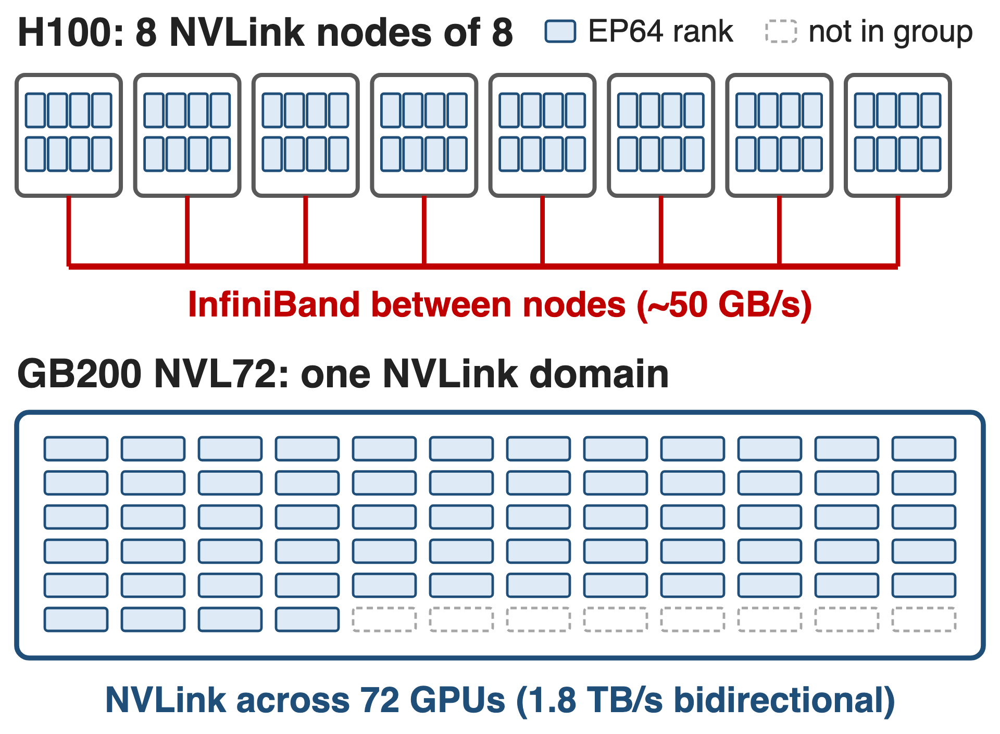{right 55%}
- DeepSeek-V3: **256** experts, top-8
- **116** dispatch/combine ops per forward pass
- One MoE code path must serve both networks
<!-- notes: Every MoE layer sends each token to its experts and brings the results back, so DeepSeek-V3's 58 MoE layers issue 116 dispatch and combine operations per forward pass. Where that traffic goes depends on the machine: on H100 an EP64 group spans 8 NVLink nodes joined by InfiniBand at roughly 50 GB/s, on GB200 NVL72 the same group sits inside one NVLink domain. Megatron-Core has to run the same model code on both. Sources: arXiv 2603.07685 §4.2.1 p.30, §9.2 p.73, §9.2.2 p.75. -->

# Token exchange eats up to 60% of training
%% big: 40–60%
%% sub: of DeepSeek-V3 training time is EP all-to-all when EP64 crosses H100 nodes (≈20% even inside GB200 NVL72)
%% source: Before optimization. Megatron-Core MoE report, arXiv 2603.07685, §4.2 (p.29)
<!-- notes: This is the cost the dispatcher attacks. With the standard all-to-all path, expert-parallel communication takes 40 to 60 percent of DeepSeek-V3 training time when EP crosses node boundaries on H100, and about 20 percent even when it stays inside the NVL72 NVLink domain. Source: arXiv 2603.07685 §4.2 p.29. -->

# All-to-all ships one copy per expert, not per node
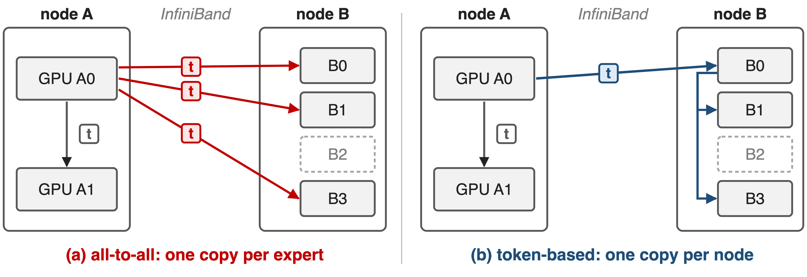{full}
> Plus a host sync for split sizes and separate permute kernels
<!-- notes: Token t on GPU A0 picks four experts: one on A1 and three on node B. The all-to-all dispatcher first permutes, which replicates t once per selected expert, so three identical copies cross InfiniBand. A token-based dispatcher sends one copy to the GPU with the same local index on node B and forwards it over NVLink. The all-to-all path also reads split sizes on the host and runs permutation as separate kernels. Sources: arXiv 2603.07685 §4.2.2 p.30-31; token_dispatcher.py MoEAlltoAllTokenDispatcher docstring and DtoH sync points. -->

# DeepEP drops duplicates but costs SMs
%% layout: two-col
- **NCCL all-to-all**
- !!top-k copies!! on the wire
- Host sync, separate permute kernels
|||
- **DeepEP (v1)**
- !!20 SMs!!/GPU: ~**20%** GEMM efficiency lost
- !!≤ 8 NVLink peers!!: no NVL72 domain
> Needed: one copy per domain, few SMs, any NVLink size, one API
<!-- notes: DeepEP already sends one copy per node and fuses permutation with communication, but its copy kernels run on SMs: in Megatron-Core's DeepSeek-V3 benchmark it takes 20 SMs per GPU and costs roughly 20 percent GEMM efficiency. Its kernels are also written for at most 8 NVLink peers per node, so a 72-GPU NVLink domain is out of reach; Megatron-Core's config says only the hybridep backend supports multi-node NVLink. Sources: arXiv 2603.07685 §4.2.3 p.34; DeepEP csrc/kernels/configs.cuh NUM_MAX_NVL_PEERS 8; transformer_config.py moe_flex_dispatcher_backend docstring. DeepEP v2 is covered in deck 24. -->

# Insight: engines move bytes, SMs only orchestrate
- **TMA**: bulk copies, shared memory ↔ local or peer HBM
- **IBGDA**: a GPU warp posts RDMA work to the NIC itself
--
- Measured: **8** SMs fill NVLink (DGX H100); ~**4** approach a 400 Gb/s NIC
> A few SMs suffice when each runs a whole copy pipeline
<!-- notes: The Tensor Memory Accelerator moves whole tiles between shared memory and global memory, including a peer GPU's memory over NVLink, without threads doing loads and stores. IBGDA lets a warp on the GPU post RDMA work requests directly to the NIC. So the SMs only schedule copies. NVIDIA's measurements confirm it: Hybrid-EP fills NVLink on an 8-GPU DGX H100 with 8 SMs and gets close to the 400 Gb/s ConnectX-7 limit with about 4 SMs on four DGX H100 nodes. Source: NVIDIA technical blog on Hybrid-EP (Feb 2026), test section. -->

# One Flex dispatcher fronts four backends
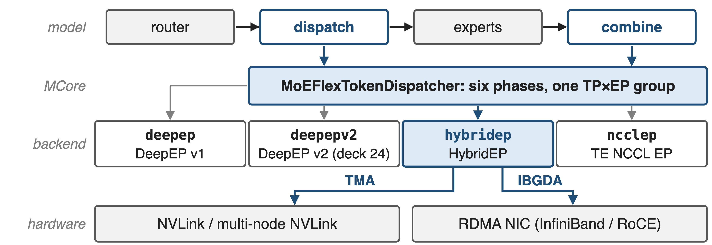{full}
%% caption: --moe-token-dispatcher-type flex --moe-flex-dispatcher-backend deepep | deepepv2 | hybridep | ncclep (HybridEP added in MCore v0.15)
<!-- notes: The MoE layer calls the dispatcher twice, for dispatch and for combine. Megatron-Core's MoEFlexTokenDispatcher implements those calls once and delegates the communication to a backend manager chosen by one flag: the original DeepEP, DeepEP v2 (deck 24), HybridEP, or TransformerEngine's NCCL EP. HybridEP reaches NVLink through TMA and the NIC through IBGDA. Sources: token_dispatcher.py; transformer_config.py; MoE README "What's New" v0.15. -->

# ❶ Six phases stay fixed; only the manager changes
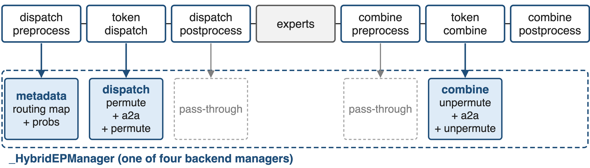{full}
> The routing map spans one TP×EP group: backends never see TP or EP
<!-- notes: Every Megatron-Core dispatcher implements the same six phases. The Flex dispatcher maps them onto three backend calls: setup_metadata in dispatch preprocess, dispatch in token dispatch, combine in token combine. HybridEP's dispatch already permutes tokens for communication, exchanges them and lays them out per expert, so the post-processing phases are pass-throughs. Because the routing map is expanded over one TP-times-EP group, a backend works the same with or without expert TP (Parallel Folding, deck 71). Source: token_dispatcher.py MoEFlexTokenDispatcher and _HybridEPManager. -->

# ❷ Dispatch: a TMA pipeline in every SM
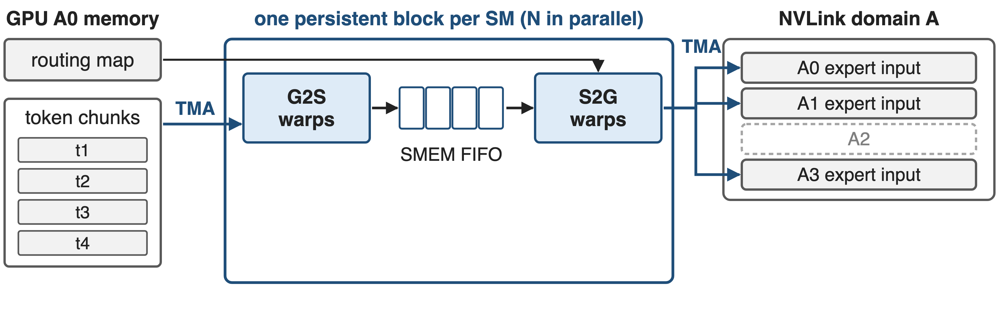{full}
%% caption: One NVLink domain (for example NVL72): G2S loads chunks, S2G stores each token only to ranks the routing map selects
--
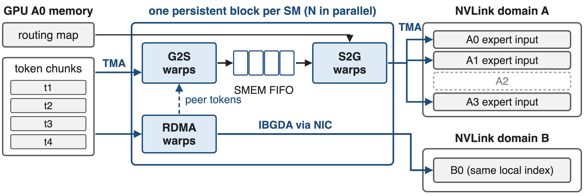{full}
%% caption: Several domains (H100): one RDMA copy per remote domain, sent to the same-index GPU, then forwarded over NVLink
<!-- notes: Each dispatch block is persistent: it owns one SM for the whole kernel and processes its own chunks of tokens. Inside, warp groups form a pipeline. G2S warps load tokens and routing probabilities into a cyclic shared-memory FIFO with TMA; S2G warps store them into the expert-input buffers of exactly the ranks the routing map selects. With several NVLink domains, an RDMA warp group sends tokens to the GPU with the same local index in each other domain using IBGDA, and receives the tokens its peers send, which then flow through the same G2S and S2G stages. Sources: Hybrid-EP_Implementation.md §8.1; NVIDIA blog Fig. 2 description; arXiv 2603.07685 §4.2.2 p.31. -->

# ❸ Combine reduces inside the kernel, twice
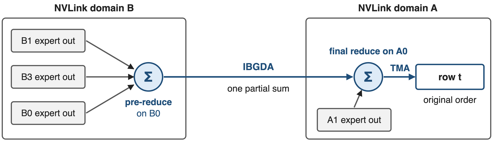{full}
> One partial sum crosses the network per domain; no separate unpermute pass
<!-- notes: Combine is the reverse trip, plus a weighted sum. Instead of communicating first and reducing in a later unpermute kernel, HybridEP reduces inside the communication kernel. Partial outputs for token t inside domain B are first summed on B0, the GPU with A0's local index; one partial sum then crosses the network, and A0's reduce warps add the domain-A partials and write row t back in original order. Accumulation runs on CUDA cores in the SM. Sources: arXiv 2603.07685 §4.2.2 p.31; NVIDIA blog Fig. 3 description; Hybrid-EP_Implementation.md §8.2. -->

# ❹ Buffers sized up front remove the host sync
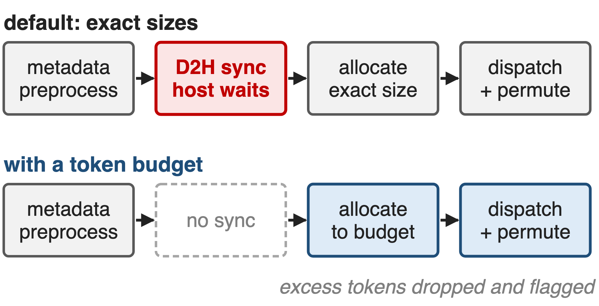{right 55%}
- Init finds NVLink-reachable ranks: NVL72 EP64 is **one** domain
- One worst-case registered buffer per rank
- Token budget: no host sync, graph-capturable (deck 38)
<!-- notes: At initialization HybridEPBuffer probes which ranks it can reach over NVLink, through fabric memory handles when the platform supports them, and treats each NVLink domain as one node, so EP64 on NVL72 is a single domain with no RDMA at all. It allocates one registered buffer sized for the worst case and exchanges handles once. By default Megatron still reads the received-token count on the host to size the expert input; with moe_expert_rank_capacity_factor it passes an upper bound instead, dispatch becomes non-blocking, excess tokens are dropped and flagged, and the layer can be captured in a CUDA graph. Sources: hybrid_ep_buffer.py; allocator.cu; Hybrid-EP_Implementation.md §4.2, §7.2; token_dispatcher.py; arXiv 2603.07685 §4.3.7 p.44. -->

# HybridEP dispatch is 1.3–3.9× faster than all-to-all
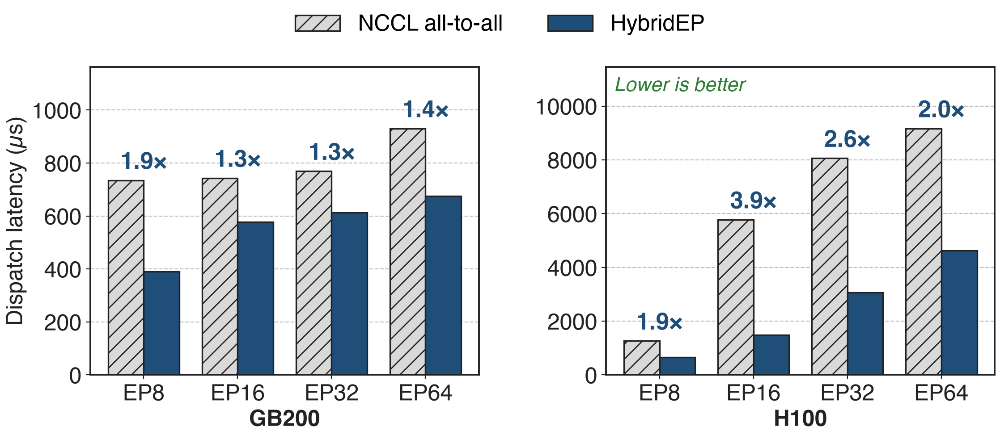{full}
%% caption: arXiv 2603.07685 Table 7, communication latency only; hidden 7168, sequence 4096, 256 experts. Ratios derived. Combine: 1.1–3.3×.
<!-- notes: These are Megatron-Core's own latency measurements of the dispatch kernel against the all-to-all dispatcher. On GB200 HybridEP is 1.3 to 1.9 times faster; on H100, where EP16 and beyond cross InfiniBand, 1.9 to 3.9 times. Combine shows 1.1 to 3.3 times. The paper notes the end-to-end gap is usually larger because the all-to-all path also pays for permutation and host overhead, which this table excludes. Ratios are derived from Table 7 (p.32); see notes/sources.md. -->

# 16 HybridEP SMs match 28–36 DeepEP SMs
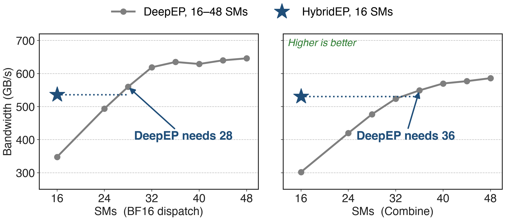{full}
%% caption: B200, EP8 in one NVLink domain, Torch-API bandwidth; 4096 tokens, hidden 7168, top-8 (Hybrid-EP README). SM thresholds derived.
<!-- notes: The SM budget is the second currency. On B200 with 16 SMs, HybridEP reaches 536 GB/s for BF16 dispatch and 531 GB/s for combine; DeepEP at the same 16 SMs reaches 348 and 302. DeepEP needs 28 SMs to match the dispatch number and 36 to match combine. Every SM saved goes back to the expert GEMMs that the communication overlaps with. Source: DeepEP hybrid-ep branch, docs/README_Hybrid-EP.md, B200 table; thresholds derived in notes/sources.md. -->

# HybridEP lifts DeepSeek-V3 1.14× over DeepEP
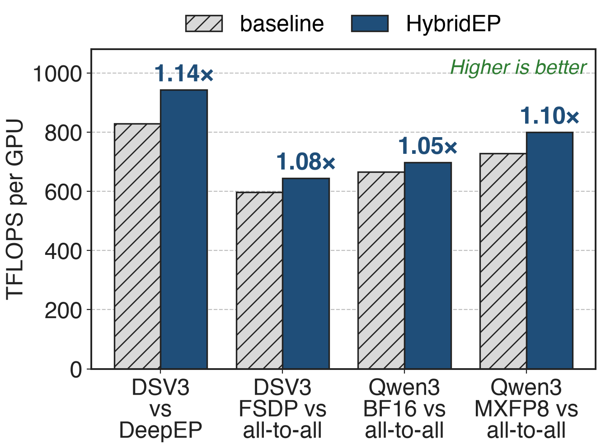{right 60%}
- Megatron Core on Grace Blackwell
- DeepSeek-V3: **829 → 943** TFLOPS/GPU
- vs all-to-all: **1.05–1.10×**
%% caption: NVIDIA Hybrid-EP blog (Feb 2026), Table 1; DSV3 = DeepSeek-V3
<!-- notes: In full training runs on Grace Blackwell, switching DeepSeek-V3 from DeepEP to HybridEP raises throughput from 829 to 943 TFLOPS per GPU, 1.14 times. Against the all-to-all dispatcher, DeepSeek-V3 with Megatron-FSDP gains 1.08 times and Qwen3-235B gains 1.05 times in BF16 and 1.10 times in MXFP8. Megatron-Core's final DeepSeek-V3 configuration on 256 GB200 uses HybridEP plus CUDA graphs and reaches 1,048 TFLOPS per GPU. Sources: NVIDIA blog Table 1; arXiv 2603.07685 Table 17 p.74. -->

# HybridEP pays in memory and maturity
%% layout: two-col
- !!~3.75–4 GB!! registered buffer per rank (EP64)
- Dispatch and combine share it: they cannot overlap
- nvcc JIT compile on first use
|||
- Opt-in, "[Experimental]"; default backend `deepep`
- MCore path: BF16 dispatch, FP32 probs
- H100 best config: DeepEP + overlap (deck 11)
<!-- notes: The worst-case buffer for EP64 with 256 experts, hidden 7168 and 4096 tokens per rank is about 3.75 GB per rank inside one NVL72 domain and about 4 GB across 8 RDMA domains. Dispatch and combine share it by default, so two HybridEP operations on the same buffer cannot run concurrently. Kernels are compiled with nvcc at first use and cached. In Megatron-Core the backend is marked experimental and not the default; it needs FP32 router probabilities, and the integration does not use FP8 dispatch yet. Multi-node builds need rdma-core with DOCA, or the experimental NIXL path. On H100 the paper's best DeepSeek-V3 configuration still uses DeepEP with 1F1B overlap. Sources: Hybrid-EP_Implementation.md §4.2-4.3, §6; README_Hybrid-EP.md; transformer_config.py; fused_a2a.py; arXiv 2603.07685 Table 17. -->

# Summary
- EP all-to-all: **40–60%** of DeepSeek-V3 time across H100 nodes
- ==Insight==: TMA and IBGDA move bytes; a few SMs orchestrate
- One Flex API; one copy per domain, fused reduce, MNNVL
- **1.3–3.9×** faster dispatch; **16** SMs ≈ **28–36**; **1.14×** end to end
%% qr: https://arxiv.org/abs/2603.07685
<!-- notes: The Flex dispatcher keeps the MoE layer independent of the communication library; HybridEP makes that library cheap in SMs and native to large NVLink domains. Related decks: 11 (1F1B all-to-all overlap), 24 (DeepEP v2 backend), 38 (CUDA graphs and sync-free MoE), 53 (memory-efficient permutation), 71 (MoE parallel folding). Sources: arXiv 2603.07685; DeepEP hybrid-ep branch; NVIDIA technical blog (Feb 2026). -->
