# Every GPU must receive exactly S×K token copies
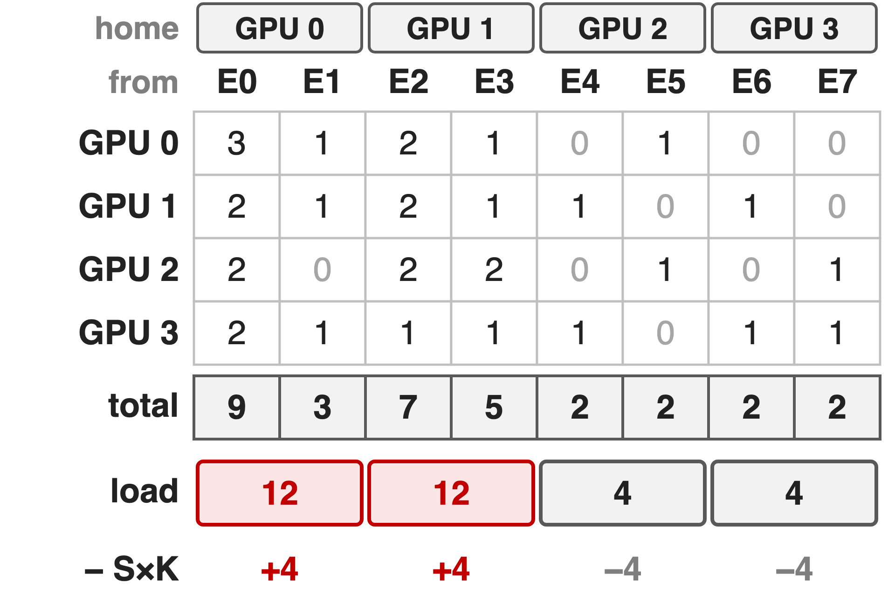{right 52%}
- S tokens per GPU, top-K: S×K copies leave each GPU
- Example: 4 GPUs, 8 experts, S×K = 8
- Benchmark shape: S×K = **65,536**, E/R = **48**
<!-- notes: Notation from the MoonEP README: S input tokens per GPU, K routed experts per token, E experts, R EP ranks, E/R experts per GPU. MoonEP's contract is that every GPU receives exactly S×K token copies, whatever the routing. The table is the running example used throughout (illustrative): each row is what one GPU sends, each column an expert, and experts E0-E1 live on GPU 0, E2-E3 on GPU 1 and so on. GPU 0 and 1 would receive 12 copies, GPU 2 and 3 only 4. At the README benchmark shape (S = 8192, K = 8, E = 384, R = 8) each GPU sends 65,536 copies and hosts 48 experts; Kimi K3 itself routes 16 of 896 experts. This R×E count matrix is the only input the planner needs. -->

# Offline replicas are re-planned every ten minutes
%% big: 10 min
%% sub: how often DeepSeek-V3 re-plans its redundant experts from load statistics, while routing changes every micro-batch
%% source: DeepSeek-V3 technical report §3.4 (serving deployment); DeepSeek EPLB plans from historical load statistics
<!-- notes: Redundant experts are an old idea: duplicate hot experts so their tokens spread over more GPUs. DeepSeek-V3 detects high-load experts from online statistics and adjusts them periodically, for example every 10 minutes; its open-source EPLB packs replicas from estimated loads, typically a moving average of history. That works when loads drift slowly, but routing is decided per micro-batch and per layer, so a plan from history cannot make one micro-batch exactly balanced. -->

# Dynamic counts force a host sync or S×K×R
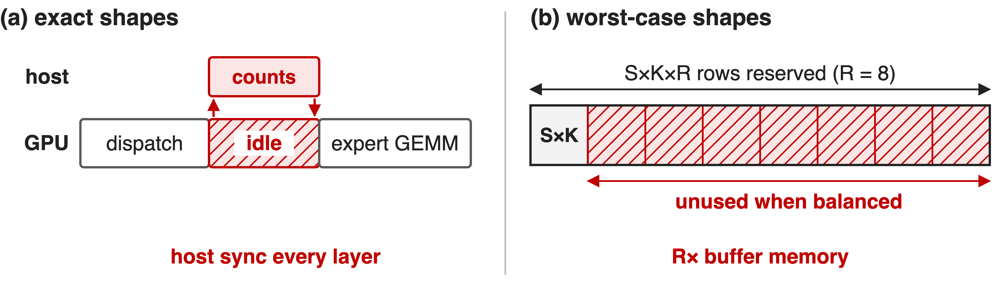{full}
> Per-step replicas need a fast GPU planner fused with dispatch; DeepSeek-V3 deferred them
<!-- notes: Even without replicas, received counts are only known at run time. (a) A library that returns exactly sized tensors must read the counts on the host each layer; DeepEP v2's do_cpu_sync=True mode does this and is the one its README suggests for training and prefill. (b) Sizing buffers for the worst case avoids the sync, but a copy-free path then needs S×K×R rows, R times the balanced need (K3 Sec. 5.2.1; Megatron-Core calls this O(EP size) over-provisioning). DeepSeek-V3 said a dynamic redundancy strategy needs a better global routing algorithm and fusion with the dispatch kernel, and left it as future work. MoonEP's three mechanisms answer exactly these points. -->

# Insight: one-source fills need ≤ E/R replicas
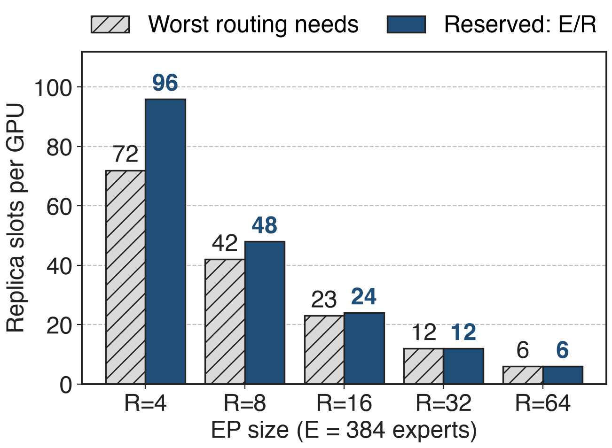{right 55%}
- Fill the emptiest GPU to S×K from the fullest
- ≤ R−1 fills, each from **one** home GPU
- So ≤ E/R replicas; some routings need ≈ E(R−1)/R²
%% caption: Analytic, E = 384 (K3 report, App. E)
> Reserve E/R slots per GPU and a perfect plan always exists
<!-- notes: This is Kimi K3's Appendix E. Start with every GPU holding only its home experts' tokens. Repeatedly take an under-loaded GPU and fill it to exactly S×K from one overloaded GPU; the filled GPU never changes again, so there are at most R-1 fills and every GPU's foreign tokens come from a single home GPU. That GPU owns only E/R experts, so E/R replica slots always suffice (Theorem 1). Theorem 2 builds a routing that needs ceil(E(R-1)/R^2) replicas, which is 42 vs 48 at E = 384, R = 8 and equal from R = 32 on, so the reservation cannot shrink much. With the slots reserved, planning never fails, unlike capped schemes such as ECHO or UltraEP. -->

# Three mechanisms run inside every MoE layer
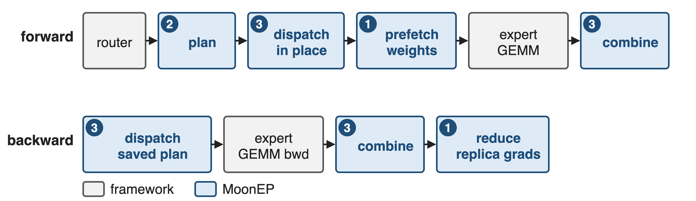{full}
%% caption: ❶ dynamic redundant experts · ❷ online GPU planning · ❸ zero-copy static shapes
<!-- notes: Forward: the router produces top-K ids and per-expert counts; MoonEP's dispatch first runs the planning kernel, then writes every token copy directly into its final slot on the destination GPU; prefetch_weight copies replica weights; the framework runs its grouped expert GEMM; combine brings outputs home. Backward reuses the saved plan: the output gradient is re-dispatched without planning or prefetch, the GEMM backward runs, combine sums each token's K gradient copies, and reduce_grad sends replica weight gradients home (README API walkthrough). -->

# ❶ Fill the emptiest GPU from the fullest
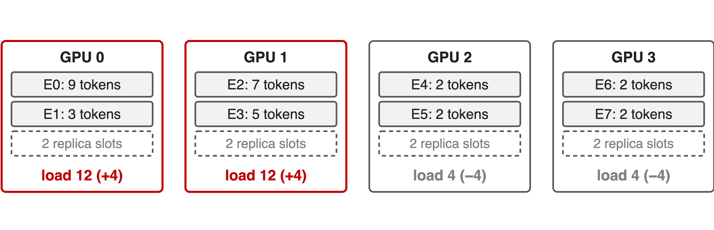{full}
%% caption: Step 1: balance = load − S×K for each home GPU
--
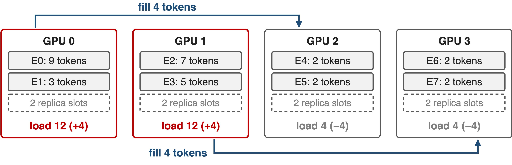{full}
%% caption: Step 2: fill the emptiest GPU from the fullest, exactly to S×K
--
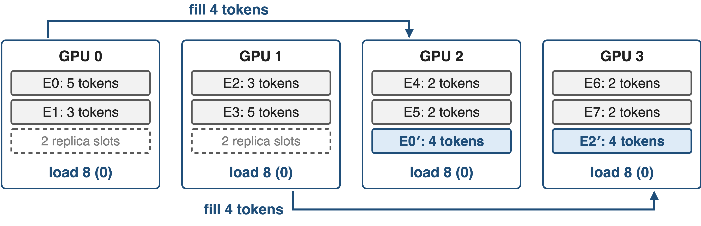{full}
%% caption: Step 3: take each quota from the home expert with the most tokens left
<!-- notes: The kernel's loop, also in tests/planning_reference.py. Step 1: balance is +4, +4, -4, -4. Step 2: pick the largest surplus and the largest deficit (ties to the lower index), move exactly the deficit: GPU 0 fills GPU 2 with 4 tokens, then GPU 1 fills GPU 3; at most R-1 rounds, done by one warp. Step 3: for each home GPU, repeatedly match its largest outstanding quota with its local expert holding the most tokens; taking big experts first keeps the replica count low, here one replica each: E0 on GPU 2 and E2 on GPU 3. Every GPU now computes 8 tokens. -->

# ❶ Expert copies split into contiguous ranges
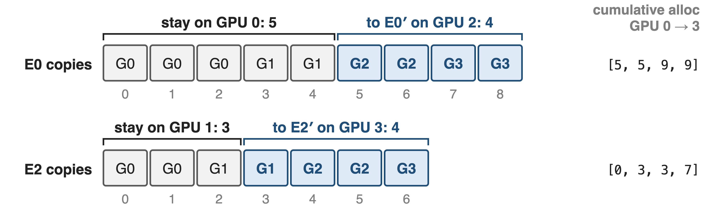{full}
> Copy g goes to the first GPU whose cumulative allocation exceeds g
<!-- notes: Copies of one expert are numbered in a global order: first by source GPU, then by position on that GPU (Gk in a cell means the copy comes from GPU k). The plan gives each expert an allocation per GPU, here E0 keeps 5 at home and sends 4 to GPU 2; its cumulative allocation over GPU 0 to 3 is [5, 5, 9, 9], so copies 0-4 stay and 5-8 go to the replica. Each GPU resolves its own copies with a binary search, in parallel and without talking to anyone. In this example the two copies of E0 that start on GPU 2 land on GPU 2's own replica. -->

# ❷ GPU 0 plans while the others sort
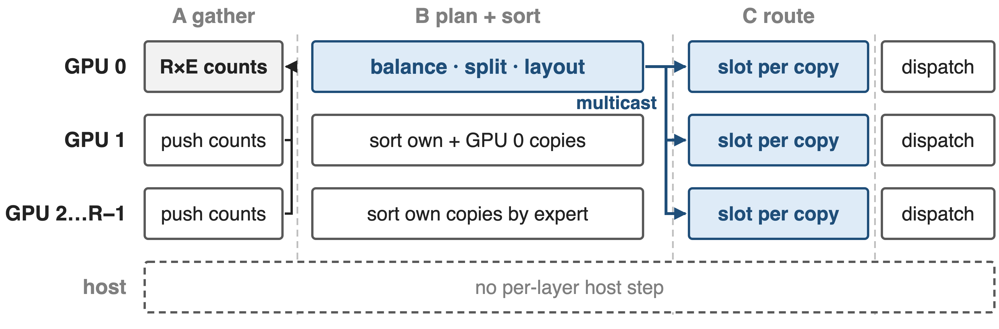{full}
> One launch per micro-batch and layer: ≈2% of dispatch time (≈45 µs)
<!-- notes: Planning is one cooperative CuTe-DSL kernel (planning.py), 32 SMs by default. Phase A: every GPU writes its tokens-per-expert row into GPU 0's buffer over NVLink, then a cross-GPU barrier. Phase B: GPU 0 computes prefix sums, runs the balance loop in one warp, splits quotas over experts and lays out the 2·E/R groups, then writes the plan to all GPUs at once with NVSwitch multicast stores; meanwhile every other GPU counting-sorts its own copies by expert, and GPU 1 also sorts GPU 0's. Phase C: each GPU computes the destination slot of every copy. The 45 µs (about 2% of a 2.4-2.6 ms dispatch) is estimated from the planning segment of the README chart; the README itself says negligible. -->

# ❸ Tokens land in a fixed, expert-grouped buffer
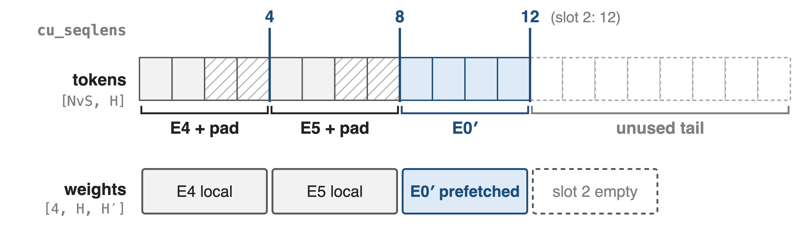{full}
%% caption: GPU 2 in the example: NvS = S×K + padding slack = 20 rows (P = 4); benchmark: 77,824 rows (P = 128)
> The GEMM reads views of this buffer: no permute copy, no host sync
<!-- notes: Every GPU owns one [NvS, H] receive buffer, allocated once: S×K real rows plus slack for padding each non-empty group to a multiple of P (128 by default), NvS = align(S·K + (P-1)·2·E/R, P) (moonep/api.py). Rows are ordered as 2·E/R groups: local experts first, then replica slots, and cu_seqlens gives each group's padded end, here [4, 8, 12, 12]. The weight view lines up row for row: local expert weights followed by this GPU's prefetch slots. The dispatch kernel writes each copy straight into its row on the remote GPU, padding rows are zero-filled, and with zero_copy=True the expert FFN reads and writes the buffer in place. A token that picks two experts on the same GPU crosses NVLink once and is duplicated locally. Because the total is always S×K, no shape depends on the routing. -->

# ❶ Replicas borrow weights and return FP32 grads
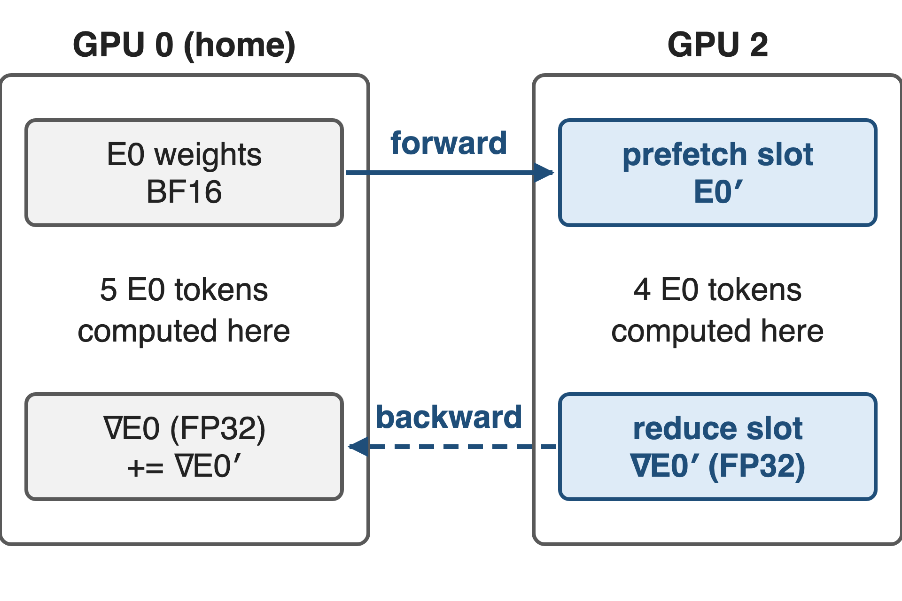{right 50%}
- Forward: home GPU **pushes** BF16 weights
- Backward: home GPU **pulls** FP32 grads, adds them
- Pool: E/R slots per projection, shared by layers
> ∇E0 = home part + replica part: same update as no replicas
<!-- notes: prefetch_weight: each owner pushes the weights (and MXFP4 scales if used) of its replicated experts into the receivers' prefetch slots with TMA copies over NVLink. reduce_grad: after the backward GEMM, the home GPU reads each replica's FP32 gradient from the receivers' reduce buffers, adds it into its own expert gradient, and after a barrier every GPU zeros the slots it consumed (grad_reduce.py). The gradient is the sum over all tokens of E0, wherever they were computed, so training is unchanged. The pools are process-wide and reused by every layer: E/R expert slots per projection, plus an FP32 twin for gradients (README buffer layout). -->

# Plan takes ≈2% of dispatch, prefetch up to 29%
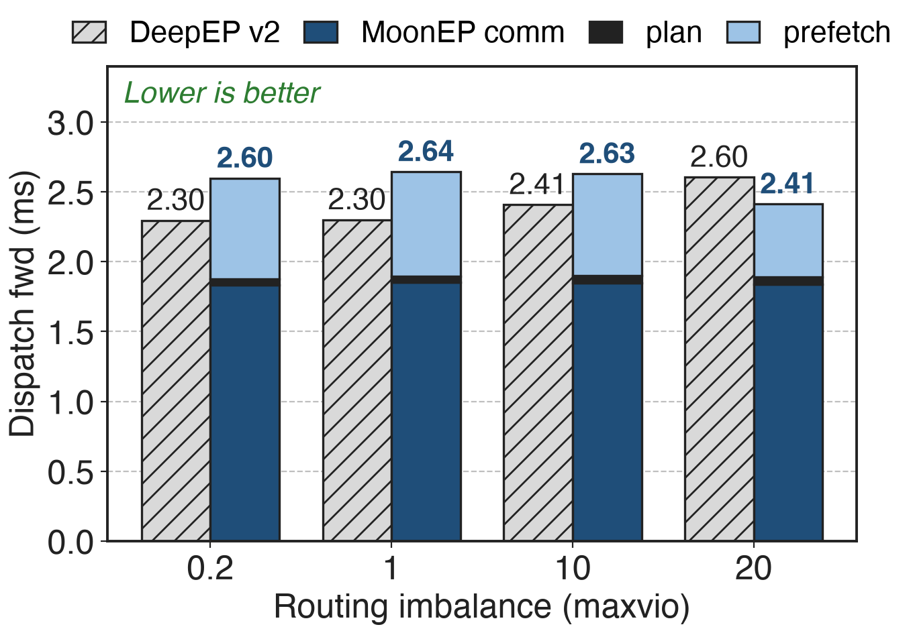{right 58%}
- Plan ≈ 40-50 µs
- Prefetch ≈ 0.5-0.75 ms
- Comm alone ≈ 20-29% below DeepEP v2
%% caption: Totals: README chart labels; MoonEP segments estimated from that chart
<!-- notes: 8×H20, EP = 8, E = 384, H = 7168, K = 8, S = 8192 per GPU, 32 SMs. DeepEP v2 totals and MoonEP totals are the chart's labels (2.30-2.60 vs 2.41-2.64 ms). The split of MoonEP's bar is estimated from pixel heights: about 1.83-1.85 ms of communication, 42-52 µs of planning and 0.52-0.75 ms of weight prefetch. The communication itself is faster than DeepEP v2's dispatch because copies go straight into their final slots and no permute is needed; the prefetch is the price of replicas, which is why MoonEP's dispatch only wins at maxvio 20. -->

# Combine stays flat; DeepEP v2 grows 16%
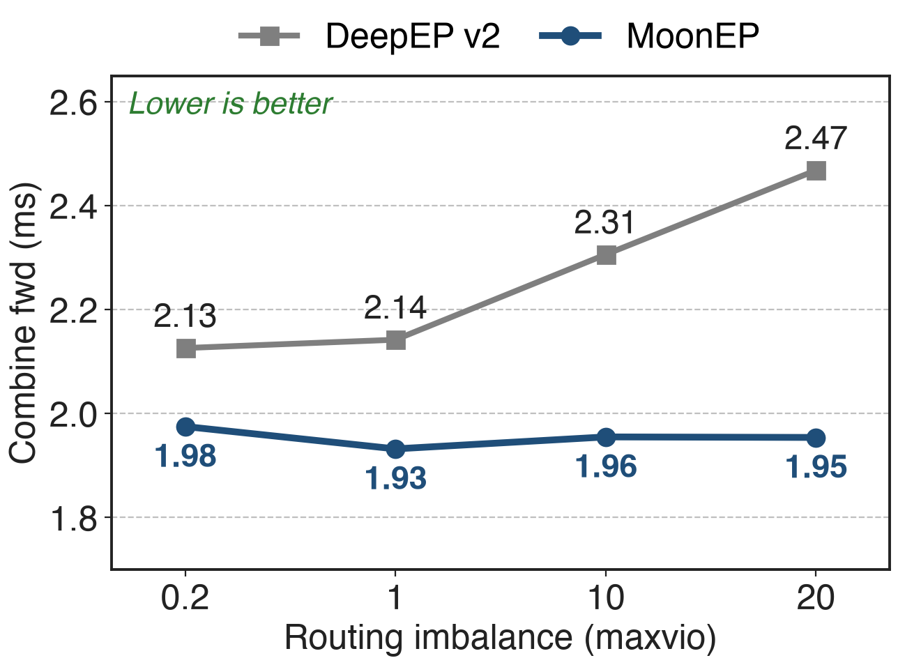{right 58%}
- MoonEP: 1.93-1.98 ms at every maxvio
- DeepEP v2: +16% from maxvio 0.2 to 20
- No hot GPU sets the pace
> −21% combine latency at maxvio 20
<!-- notes: Labeled values from the README chart: MoonEP 1.975, 1.932, 1.955, 1.954 ms; DeepEP v2 2.126, 2.142, 2.306, 2.468 ms at maxvio 0.2, 1, 10, 20. Every GPU holds exactly S×K rows, so the combine moves the same volume on every GPU regardless of skew, and the fused unpermute avoids a separate copy. Combine backward behaves the same way (1.94-1.97 vs 2.14-2.48 ms). End-to-end iteration results are in deck 27. -->

# Limits: prefetch, pool memory, per-expert skew
- **Prefetch**: 22-29% of dispatch time (estimated)
- **Pool**: 4.2 GB BF16 + 8.5 GB FP32 at EP=8
- **Near-optimal** plan; per-expert segments still vary
- **One NVLink domain**; no RDMA path
<!-- notes: Prefetch share is estimated from the README chart. Pool size is derived at the benchmark shape: 48 slots × 3 projections × 7168 × 2048, in BF16 and in FP32. The GPU planner is near-optimal against offline ILP solutions K3 used as references, not exact-optimal, but it always respects the E/R bound. Balance holds per GPU, not per expert: segment sizes in cu_seqlens still change every micro-batch, so K3 adds a workload-aware expert-GEMM scheduler; this also means the grouped GEMM is not fully static, contrary to the Notion row. Buffers are NVLink peer mappings and multicast, so EP must fit one NVLink domain (multi-node NVLink is supported). -->

# Summary
- Offline replicas lag ~10 min; runtime counts force host sync or S×K×R
- ==Insight==: one source per receiver, so ≤ E/R replicas suffice
- ❶ fill + split · ❷ one GPU launch · ❸ fixed S×K buffer
- Plan **≈2%** of dispatch; combine flat, **−21%** at maxvio 20
%% qr: https://github.com/MoonshotAI/MoonEP
<!-- notes: Library view, adoption and end-to-end results: deck 27. Baseline EP library: deck 24 (DeepEP v2, which in V2.5 added replica prefetch and grad-reduce primitives). Router-side balancing that MoonEP complements: deck 55 (loss-free balance routing) and deck 56 (Quantile Balancing). -->
