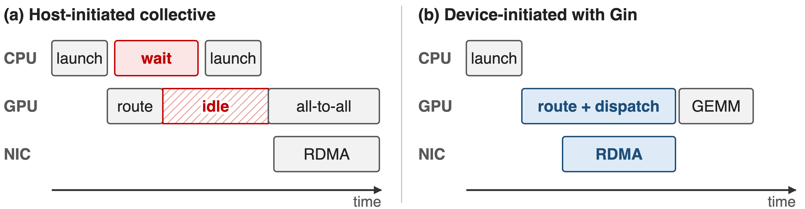
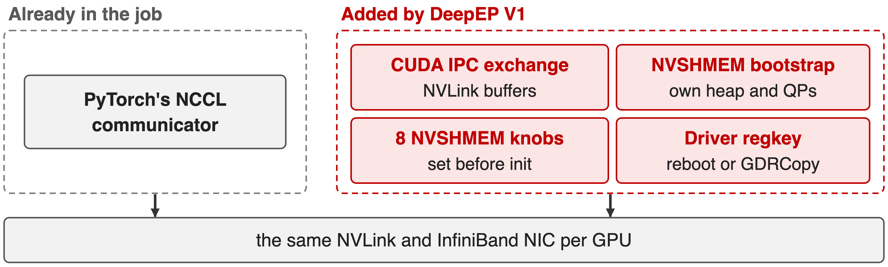
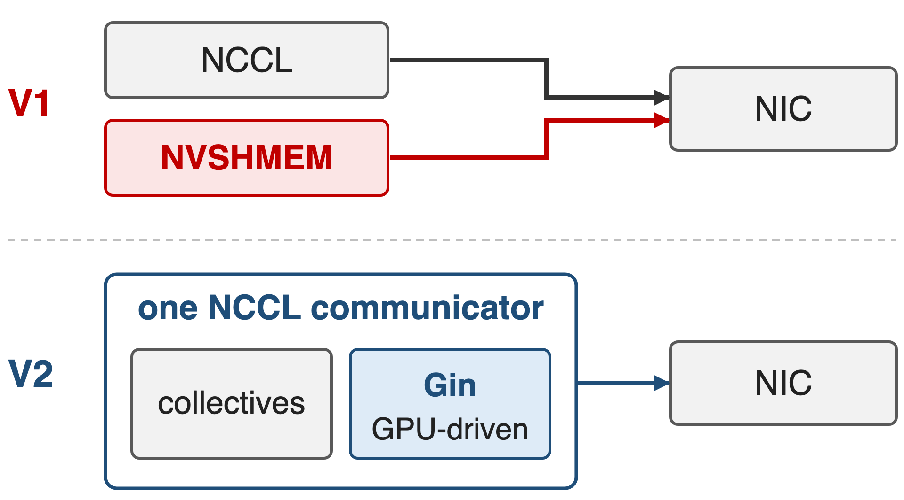
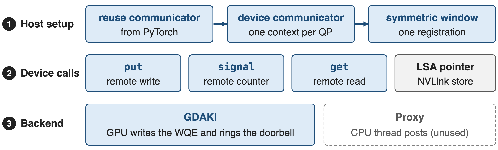
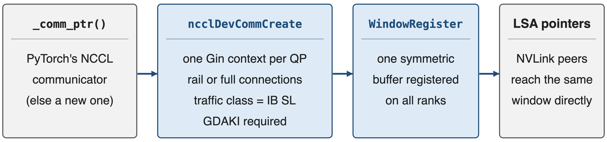
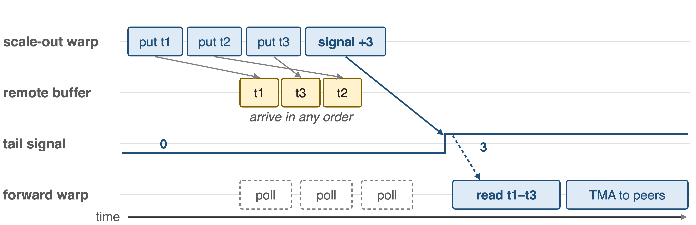
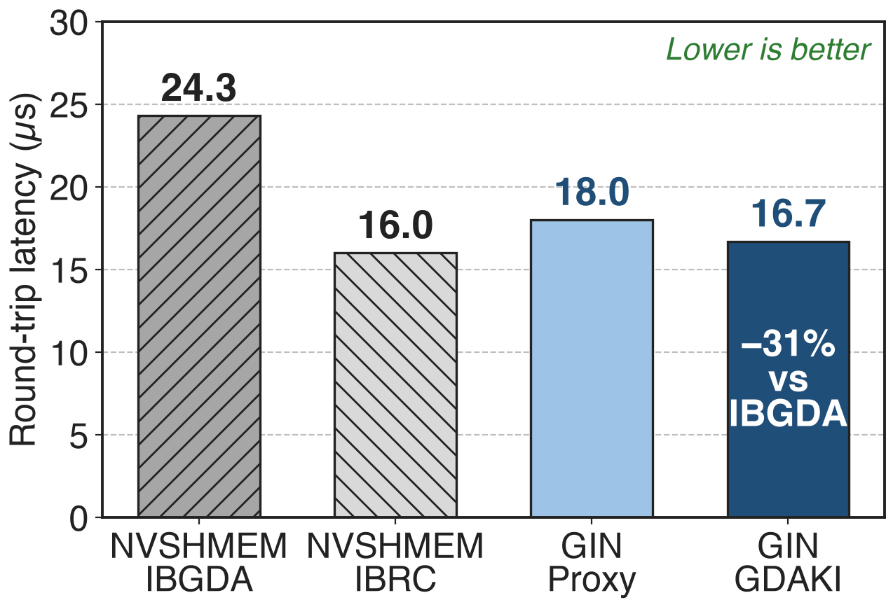
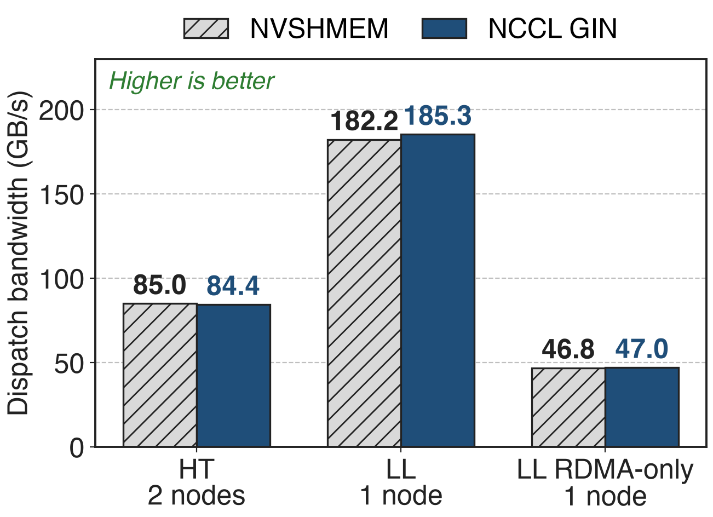
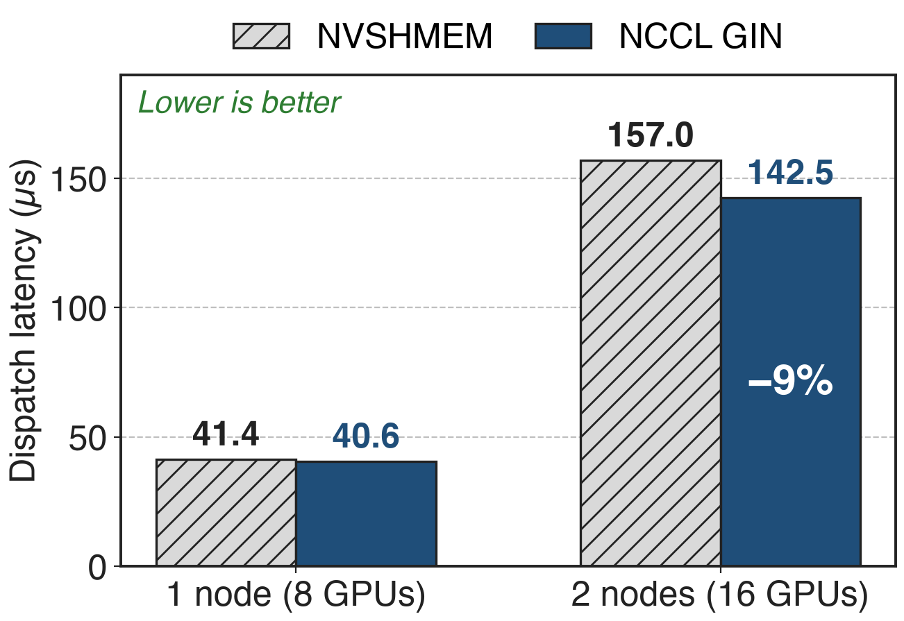

# Token routes are known only inside the kernel
{full}
%% caption: Schematic, not to scale
> Device-initiated RDMA lets the routing kernel post its own network writes
<!-- notes: In MoE dispatch each token's destinations come out of the router inside a GPU kernel. With host-initiated communication the CPU must learn the counts, wait, and launch a separate collective, so the GPU idles in between. Device-initiated networking lets warps post RDMA writes the moment they know where a token goes, overlapping the network with the rest of the kernel. DeepEP has always worked this way; the question is which runtime provides the device-side network calls. Source: NCCL GIN paper arXiv 2511.15076 §I-II. -->

# V1 needed 8 NVSHMEM knobs before one byte
%% big: 8
%% sub: NVSHMEM environment variables DeepEP V1 set before init, plus 3 all-gather handshakes and a driver regkey or GDRCopy
%% source: deep_ep/buffer.py at v1.2.1 (lines 85-115); third-party/README.md at v1.2.1
<!-- notes: DeepEP V1 got its device-initiated RDMA from NVSHMEM with IBGDA. Before the first byte it set eight NVSHMEM environment variables, from the IBGDA switch and QPs per peer to the heap granularity; ran three all-gathers for device ids, CUDA IPC handles and the NVSHMEM unique id; and IBGDA itself needed a driver regkey and a reboot, or GDRCopy. Azure's deployment guide had to add NIC-mapping variables on top. That is the cost this deck is about. -->

# V1 ran a second runtime beside NCCL
{full}
> Two bootstraps, two memory registrations, one NIC
<!-- notes: The training job already had an NCCL communicator from PyTorch for its collectives. DeepEP V1 added its own world on top: CUDA IPC handles for NVLink buffers, an NVSHMEM bootstrap with its own symmetric heap and QPs, its own environment configuration and a driver change, all driving the same NVLink and the same NIC. Two runtimes mean two places to configure, debug and keep in version sync. Sources: v1.2.1 buffer.py; V1 NVSHMEM install guide. -->

# Insight: NCCL can hand GPUs the NIC doorbell
{right 50%}
- A NIC needs only a work-queue entry and a doorbell write
- NCCL 2.28's Device API lets GPU threads do both
- One runtime covers collectives and GPU-driven RDMA
--
> DeepEP v2: reuse PyTorch's communicator and drop NVSHMEM
<!-- notes: GPU-initiated networking is not magic: the GPU writes a work-queue entry into memory the NIC can read and rings the NIC's doorbell; the NIC does the rest. Since NCCL 2.28 the Device API exposes exactly that through GIN, next to load/store access for NVLink and multimem for NVLink SHARP. So the communicator the framework already owns can provide the device-initiated path, and a second runtime is no longer needed. Source: arXiv 2511.15076 §I and §III-C. -->

# Gin has three layers: setup, calls, backend
{full}
%% caption: ❶ host setup once per buffer · ❷ device calls inside DeepJIT-compiled kernels · ❸ GDAKI on the NIC
<!-- notes: GIN has three layers. On the host, NCCL core turns an ordinary communicator into a device communicator and registers memory windows. On the device, kernels call put, signal and get on those windows; NVLink peers in the same node are reached through load/store-accessible pointers into the same window. Underneath, a network plugin backend executes the work: GDAKI lets the GPU drive the NIC directly, while the Proxy backend uses a CPU thread instead. The next slides take the three layers in turn. Source: arXiv 2511.15076 §III-A. -->

# ❶ Reuse one communicator and one window
{full}
%% caption: NCCL 2.28 offered 4 contexts per communicator, so the v1.2.1 port needed ⌈QPs/4⌉ communicators; V2 asks for one per QP
<!-- notes: DeepEP takes the NCCL communicator behind the PyTorch process group via _comm_ptr; only on old PyTorch does it create its own. It then calls ncclDevCommCreate with its requirements: one exclusive Gin context per QP, up to 129, a queue depth of 1024, a few signals per rank, rail connections in hybrid mode or a full mesh in direct mode, and the InfiniBand service level as traffic class. One collective ncclCommWindowRegister makes the buffer symmetric on all ranks, and ncclGetLsaDevicePointer gives NVLink peers direct pointers into it. Sources: csrc/kernels/comm/context.cpp; deep_ep/comm/handle.py; arXiv 2511.15076 §IV-B. -->

# ❷ A warp's put becomes a WQE and a doorbell
{full}
%% caption: Remote nodes: put plus signal through the channel's QP. Same node: plain TMA stores through LSA pointers
<!-- notes: Inside the dispatch kernel a scale-out warp issues gin.put with window offsets instead of raw pointers. With the GDAKI backend the GPU writes the work-queue entry into its own memory and rings the NIC's doorbell; the NIC reads the token straight from the symmetric window, writes it into the peer's window, and then performs the signal add. For a peer in the same NVLink domain the same window is reachable through an LSA pointer, so the warp simply TMA-stores the token there. Sources: impls/ep/hybrid_dispatch.cuh; arXiv 2511.15076 §III-C. -->

# ❷ A signal after the puts replaces a fence
{full}
> Same context, same peer: the signal lands only after every earlier put is visible
<!-- notes: Gin operations are unordered by default, so tokens may land in any order. The one guarantee DeepEP needs is that a signal on the same context to the same peer completes only after all earlier puts are visible. The scale-out warp therefore posts several token puts and then one signal-add on the tail counter, batched every few tokens; the forward warp on the receiving node polls that tail with an acquire load and only then reads the tokens and forwards them. No fence and no CPU are involved. Sources: arXiv 2511.15076 §III-A ordering semantics; hybrid_dispatch.cuh update_scaleout_tail. -->

# ❸ Contexts are QPs; GDAKI is mandatory
- Exclusive context per QP; SMs own disjoint QPs
- Rail links in hybrid mode, full mesh in direct
- Traffic class = InfiniBand service level
|||
- GDAKI: GPU rings the NIC; ConnectX-6 Dx+
- Proxy: a CPU thread posts; V2.5 refuses it
- No other RDMA backend
<!-- notes: Each Gin context is a set of NIC queue pairs, so DeepEP maps its channels onto contexts the way deck 17 describes, with exclusive contexts so SMs do not contend. Hybrid mode only needs connections along the rail, the same local GPU index on every node; direct mode needs a full mesh. The service level for virtual-lane isolation is passed as the traffic class. NCCL also has a Proxy backend that works on any RDMA NIC through a CPU thread, but DeepEP V2.5 explicitly requests GDAKI and asserts if it is unavailable, and it has no other RDMA path. Sources: context.cpp; arXiv 2511.15076 Table I; README env vars. -->

# GDAKI's round trip: 16.7 µs vs IBGDA's 24.3
{right 60%}
- Put-with-signal ping-pong, 4–128 B
- Two H100s; NCCL 2.28, NVSHMEM 3.4.5
- IBRC's 16.0 µs is on par
<!-- notes: NVIDIA's GIN paper measures put-with-signal ping-pong between two H100 GPUs. For small messages GIN with the GDAKI backend takes 16.7 microseconds per round trip and the Proxy backend 18.0, against 24.3 for NVSHMEM's IBGDA transport and 16.0 for NVSHMEM's IBRC transport. So moving to NCCL costs nothing at the primitive level; against IBGDA, which DeepEP V1 used, it is 31% faster (derived). Source: arXiv 2511.15076 §V-A. -->

# Inside DeepEP, GIN matches NVSHMEM within 2%
{right 60%}
- NVIDIA's GIN port of DeepEP v1.2.1
- H100 cluster, BF16, 24 SMs per GPU
- 8 nodes HT: both ≈ 53–54 GB/s
<!-- notes: The same paper ports DeepEP v1.2.1's kernels to GIN and runs them against the NVSHMEM originals on NVIDIA's EOS H100 cluster. High-throughput dispatch over two nodes reaches 84.4 GB/s with GIN against 85.0 with NVSHMEM; low-latency dispatch in one node reaches 185.3 against 182.2 with NVLink and 47.0 against 46.8 over RDMA only. The paper reports the results within 1-2% across scales. These are v1.2.1 kernels; DeepEP V2's rewritten kernels were not part of this comparison. Source: arXiv 2511.15076 §V-B, §V-C. -->

# GIN cuts two-node decode dispatch latency 9%
{right 60%}
- Low-latency kernels with NVLink
- BF16, hidden 7168, 1–128 tokens
- Pure RDMA at 8 nodes: both 219–225 µs
<!-- notes: For decode-style low-latency dispatch with NVLink enabled, GIN is slightly faster: 40.6 against 41.4 microseconds in one node and 142.5 against 157.0 across two nodes, which the paper reports as 9% lower. With NVLink disabled the two stay within 1-2%, about 219 to 225 microseconds at 8 nodes. Again these are the ported v1.2.1 kernels. Source: arXiv 2511.15076 §V-C. -->

# 8 NVSHMEM knobs become zero
%% big: 8 → 0
%% tone: ours
%% sub: NVSHMEM variables: V2 reuses the job's NCCL communicator and V2.5 deletes NVSHMEM; RDMA setup shrinks to a few EP_* flags, e.g. the IB service level
%% source: DeepEP README (V2 release b306af0; V2.5 main) and PR #763
<!-- notes: This is the release in the pain's currency. V2 moved all expert-parallel RDMA to Gin on the communicator PyTorch already has, and V2.5 removed V1, its APIs and the NVSHMEM dependency entirely. RDMA configuration shrinks to a few EP_ flags, chiefly the service level for traffic isolation through sl_idx or EP_DEFAULT_RDMA_SL and EP_OVERRIDE_RDMA_SL, plus switches such as EP_REUSE_NCCL_COMM. -->

# Costs: version lockstep and GDAKI-capable NICs
- !!NCCL ≥ 2.32.3!!, the same library in PyTorch and DeepEP
- !!GDAKI only!!: ConnectX-6 Dx or newer, GPU and NIC on one PCIe root
- Evidence is a v1.2.1 port on H100; InfiniBand only
<!-- notes: The price of riding on NCCL is version coupling: V2 needs NCCL 2.30.4 and V2.5 needs 2.32.3, PyTorch and DeepEP must load the same NCCL library, and builds against NCCL older than 2.31 need an exact compile-time and runtime match. Because DeepEP insists on GDAKI, the NIC must expose GPU-accessible control structures, ConnectX-6 Dx or newer in NVIDIA's implementation, with GPU and NIC co-located. Engram additionally needs a NCCL build with warp-level gets. The published parity numbers come from NVIDIA's port of DeepEP v1.2.1 on H100, and DeepEP is only fully tested on InfiniBand. Sources: README Requirements and Notes; arXiv 2511.15076 §III-C. -->

# Summary
- V1: a second runtime, **8** NVSHMEM knobs, 3 handshakes
- ==Insight==: NCCL can hand GPU threads the NIC doorbell
- One communicator, one window; put, signal, get from warps
- **16.7 vs 24.3 µs** round trip; DeepEP parity **within 2%**
%% qr: https://github.com/deepseek-ai/DeepEP
<!-- notes: Gin lets DeepEP keep fully device-initiated RDMA while living inside the NCCL communicator the job already has: one setup, one symmetric window, puts and signals posted by warps, no proxy and no second runtime. Measured on NVIDIA's port, it matches NVSHMEM inside DeepEP and beats IBGDA at the primitive level. Container overview: deck 24; SM and QP budget: deck 17; network-side settings: deck 22. -->
