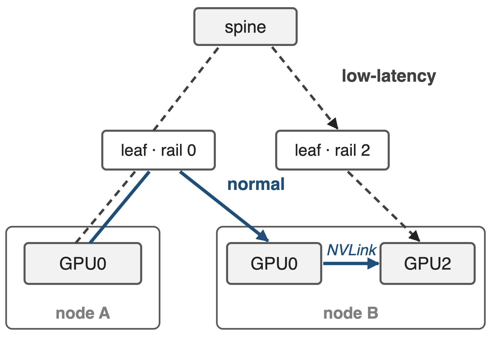
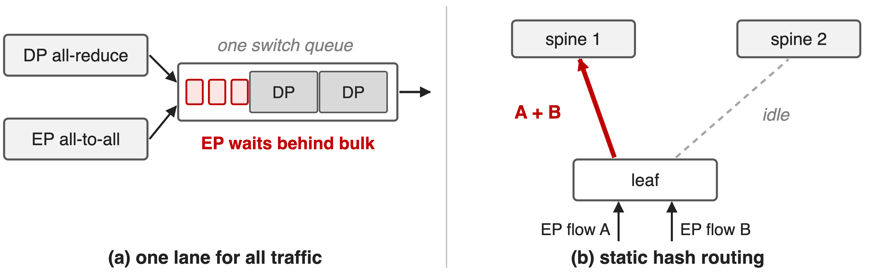
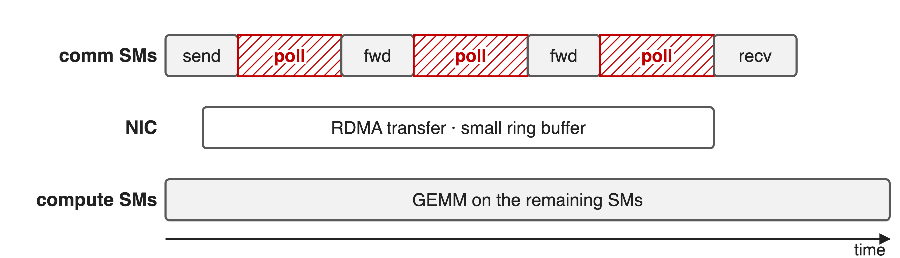
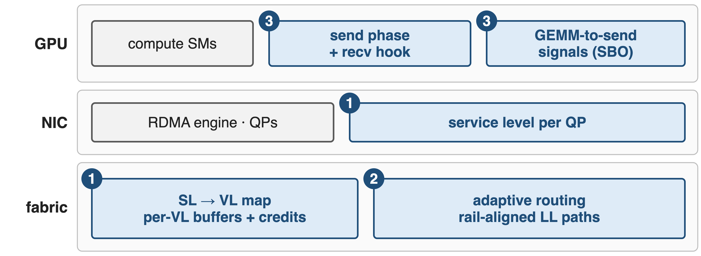
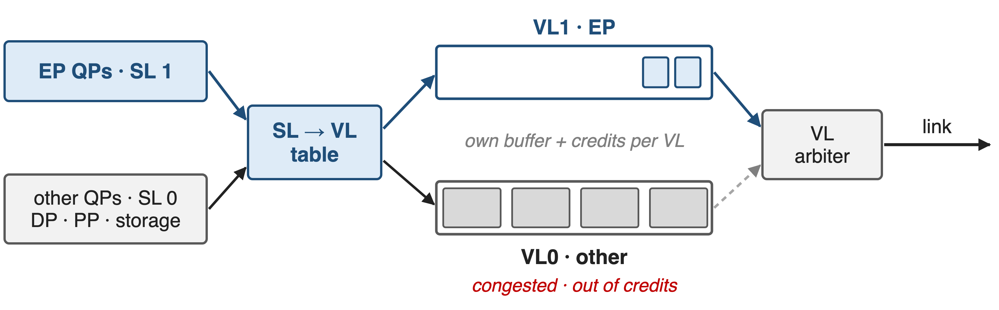
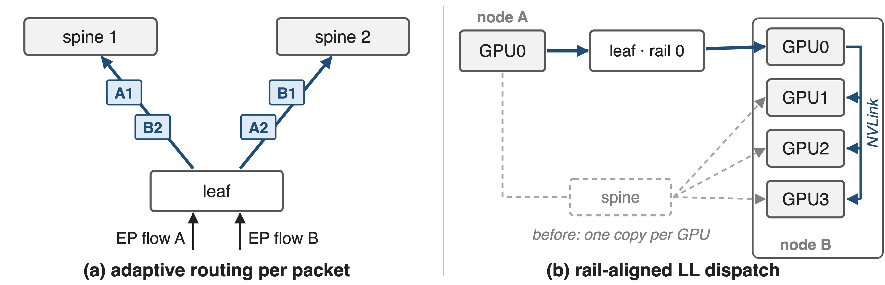
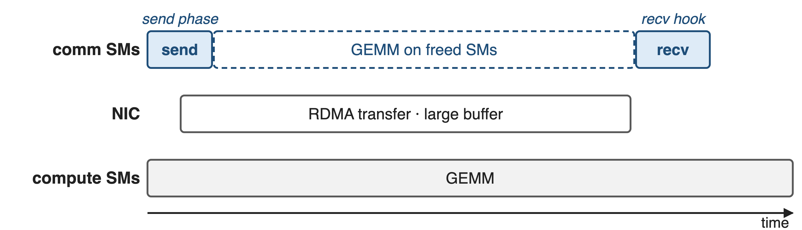
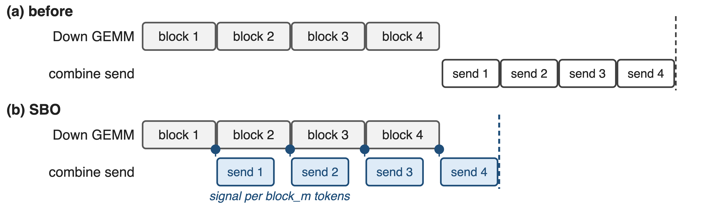
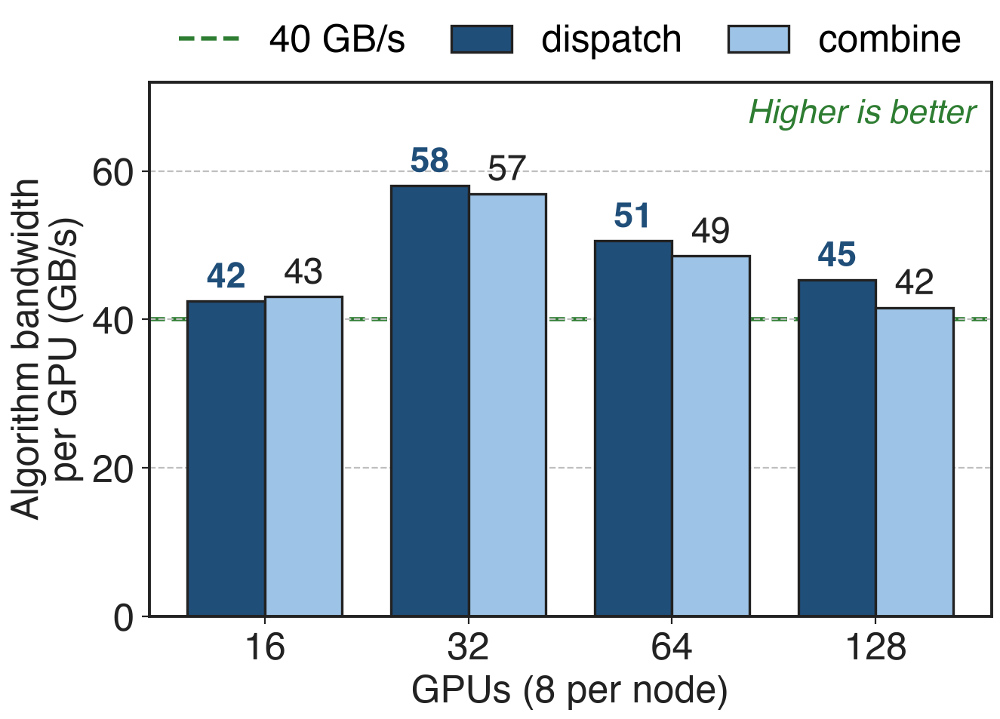
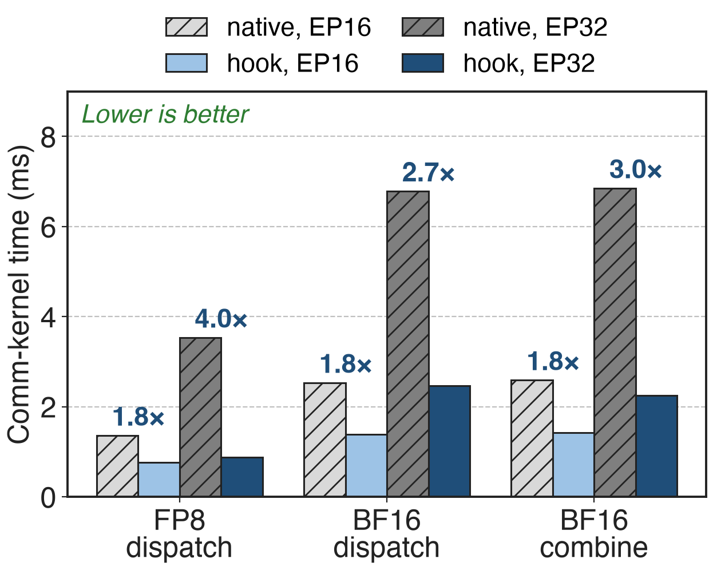

# EP crosses the fabric on two paths
{right 55%}
- Normal (training, prefill): same rail, then NVLink
- Low-latency (decode): direct RDMA, often via the spine
- H800: IB **50** GB/s vs NVLink **160** GB/s per GPU
<!-- notes: In a rail-optimized InfiniBand fabric, NIC i of every node hangs off leaf switch i. DeepEP's normal kernels send a token once over IB to the same-index GPU on the target node and fan it out over NVLink, so IB traffic is deduplicated per node and never leaves the rail. Low-latency kernels for decoding send one copy straight to each destination GPU, which usually means a different rail and therefore a trip through the spine. NVLink is about 3.2 times faster than a 400 Gb/s IB NIC on H800. Sources: DeepSeek-V3 §3.2.2 (paths, 160 vs 50 GB/s) and §3.4.2 (decode via direct IB with IBGDA); ISCA'25 Insights §4.3. -->

# V3 spends 20 of 132 SMs on communication
%% big: 20 / 132
%% sub: H800 SMs DeepSeek-V3 reserves to drive EP traffic: forwarding, buffer copies, reductions, not math (15%)
%% source: DeepSeek-V3 Technical Report §3.5.1 (p.20); ISCA'25 "Insights into DeepSeek-V3" §4.4.1
<!-- notes: EP communication costs twice. On the GPU, DeepSeek-V3 hands 20 of the H800's 132 SMs, about 15 percent, to communication kernels during training: forwarding between IB and NVLink, copying between RDMA buffers and tensors, and running combine reductions. On the network, EP shares links and switch queues with data-parallel, pipeline and storage traffic. No public source puts a number on that collision cost, so the next slide shows the mechanism instead. Source: V3 §3.5.1 p.20; ISCA §4.4.1 p.7-8. -->

# Shared lanes and hashed paths stall EP packets
{full}
> An all-to-all finishes only when its slowest packet lands
<!-- notes: Left: with one lane, EP's small, latency-sensitive packets queue behind bulk data-parallel or storage packets in the same switch buffer, the classic head-of-line blocking that Fire-Flyer cites as its reason to split traffic classes. Right: static or ECMP routing picks an uplink by hashing the flow, ignoring load, so two EP flows can land on one spine uplink while another idles; DeepSeek notes that LLM training traffic lacks the randomness ECMP relies on. Either way one late packet delays the whole layer's all-to-all. Sources: Fire-Flyer (arXiv 2408.14158) §VI-A1; ISCA'25 §5.2.2. -->

# Comm SMs spend the transfer polling
{full}
> A small, reused ring buffer makes SMs wait for free slots
<!-- notes: DeepEP's original normal kernels stream tokens through a small RDMA ring buffer that is reused many times per dispatch. The communication SMs therefore stay resident for the whole transfer, and much of that time they are just polling for a free slot rather than moving data or computing. That observation, from AntGroup's PR #347, is the GPU half of the problem. Schematic, not to scale. Source: DeepEP PR #347 §1 Motivation. -->

# Insight: all-to-all is as slow as its last packet
- One blocked or collided packet stalls the layer
- RDMA is one-sided: the NIC needs bytes, not SMs
--
> Give EP its own lane and every path; hand bytes to the NIC and step away
<!-- notes: Two facts drive every fix in this deck. First, an all-to-all is a barrier: the layer cannot continue until the last token arrives, so the tail matters more than the average, and anything that delays a few EP packets delays everyone. Second, RDMA writes are executed by the NIC; SMs are only needed to prepare data and consume it, not to babysit the wire. So isolate EP in the switch, spread it over every path, and keep SMs out of the transfer. Sources: DeepEP README Network configurations; PR #347; ISCA'25 §4.4. -->

# Three fixes at three layers
{full}
%% caption: ❶ traffic isolation and ❷ adaptive routing: DeepEP README; LL paths and ❸: AntGroup-Opt branch (PR #500, #347, #483)
<!-- notes: Fix one lives in the NIC and the fabric: DeepEP tags its queue pairs with an InfiniBand service level, and the fabric maps that service level to its own virtual lane. Fix two lives in the switches: adaptive routing, plus a rail-aligned path for low-latency dispatch from the AntGroup branch. Fix three lives on the GPU: AntGroup's Normal-SMFree splits the kernel into a send phase and a receive hook, and LL-SBO lets combine sends start block by block behind the Down GEMM. Sources: DeepEP README (Network configurations; Experimental branches). -->

# ❶ A service level puts EP on its own VL
{full}
> Each VL has its own buffers and credits, so congestion in VL0 never blocks VL1
<!-- notes: InfiniBand links carry several virtual lanes, each with its own buffer and credit-based flow control; a VL arbiter shares the link between them. A queue pair's service level selects the lane through the fabric's SL-to-VL table. DeepEP V2 sets the service level through the buffer's sl_idx argument, overridden by EP_OVERRIDE_RDMA_SL or defaulted by EP_DEFAULT_RDMA_SL; the VL mapping and weights are fabric configuration. DeepEP's README recommends EP versus everything else; V1 recommended three classes, normal kernels, low-latency kernels and other. Fire-Flyer used four: HFReduce, NCCL, 3FS storage, other. Sources: DeepEP README (current and Feb-2025 versions); Fire-Flyer §VI-A1. -->

# ❷ Spread EP over all uplinks, or skip the spine
{full}
> DeepEP V2: adaptive routing at every load, despite added latency
<!-- notes: Left: with adaptive routing, the switch chooses an uplink per packet from current port load instead of a fixed hash, so EP flows spread across all spines. DeepEP's advice evolved: in February 2025 it was unsafe for normal kernels; from March 2025 it was recommended only under heavy load, with static routing under light load; since V2 it is recommended under all loads. Packets can now arrive out of order, which matters for overlap designs. Right: AntGroup's LL-Layered sends low-latency dispatch once over the same rail and fans out over NVLink, as normal kernels do, instead of one copy per GPU through the spine; its benchmark chart shows lower latency from batch 32 and EP16 upward, slightly higher at tiny batches and at EP8. Sources: DeepEP README history (ebfe47e, 0eee87b, b306af0); ISCA'25 §5.2.2; PR #500. -->

# ❸ SMs hand bytes to the NIC, then leave
{full}
> Large RDMA buffer: send now, receive later through a hook (Normal-SMFree)
<!-- notes: AntGroup's Normal-SMFree allocates an RDMA buffer large enough for the whole batch. The first call runs only the send phase, copies all tokens into the buffer and returns a receive hook; the NIC transfers in the background while the SMs run compute; the hook later runs the receive phase. Hook mode maps one channel per SM instead of two SMs per channel. Schematic. Source: DeepEP PR #347 §2 (return_recv_hook). -->

# ❸ SBO sends each GEMM block as it lands
{full}
> LL-SBO: +8–10% decode throughput on 16 H20s at batch 20–56
<!-- notes: For decoding, LL-SBO overlaps the expert's Down GEMM with the combine send. Each local expert gets one signal per block_m tokens; the GEMM atomically increments it as tiles finish, and the send side polls and ships each block as soon as it is ready. The receive side is not overlapped with the GEMM because packets arrive out of order (multi-QP scheduling, congestion, multi-path routing), so dispatch receive overlaps the shared expert instead. LMSYS reports +8 to 10 percent decode throughput at batch 20 to 56 on 16 H20 GPUs; the PR's own batch-32 runs show +6.7 and +7.5 percent. Sources: DeepEP PR #390 / #483; LMSYS blog 2025-09-26. -->

# Isolated planes keep EP above 40 GB/s per GPU
{right 60%}
- DeepSeek's 8-plane IB fabric, 400 Gb/s NICs
- **4096** tokens per GPU, **16–128** GPUs
- Storage on its own RoCE plane
%% caption: ISCA'25 Fig. 7: a tuned fabric end to end, not an A/B of VL or AR
<!-- notes: This is what EP sees on a fabric built for it: every GPU-NIC pair in its own plane, storage on a separate Ethernet plane, 64-port 400G switches. DeepEP dispatch and combine stay between 42 and 58 GB/s of algorithm bandwidth per GPU from 16 to 128 GPUs, which the paper calls nearly saturating the 400 Gb/s NIC. No public source isolates the VL or adaptive-routing contribution in an A/B test. Source: ISCA'25 §5.1 and Fig. 7, p.9-10. -->

# Hook mode cuts comm-kernel time 1.8–4×
{right 60%}
- **2–4** nodes × 8 H20, **4096** tokens, top-8
- Transfer overlapped by a GEMM
- Bigger gains at EP32
%% caption: PR #347 (open): hook time counts only the send and receive kernels
<!-- notes: Measured by the PR author on H20: FP8 dispatch drops from 1358 to 765 microseconds at EP16 and from 3535 to 884 at EP32; BF16 dispatch and combine shrink 1.8 to 3 times. These are SM-occupancy times, the time the communication kernels hold SMs, with the network transfer hidden under a GEMM; the end-to-end gain depends on having that much independent compute. Source: DeepEP PR #347 §3. -->

# The cost: fabric work, reordering, memory
%% layout: two-col
**Network**
- SL→VL tables and AR are switch config
- AR reorders packets; Fire-Flyer chose static routing
|||
**SM-free**
- ≈ **270** MB RDMA buffer per rank
- Mainline V2 keeps **4–6** SMs (was **24**)
<!-- notes: DeepEP only sets the service level; operators must program SL-to-VL tables, arbitration weights and adaptive routing on the switches, and DeepEP recommends disabling congestion control for maximum bandwidth, putting unavoidably congested workloads on low-priority lanes. Adaptive routing adds latency and reorders packets; Fire-Flyer saw it spread storage-incast congestion and chose static routing for that network. Normal-SMFree needs about 270 MB of RDMA buffer per rank in the author's setup, makes the NVLink phases the limit, and gives up DeepEP's NVLink/RDMA pipelining; the maintainers preferred to keep a few SMs, and the PR is still open. Mainline DeepEP V2 instead cut SMs from 24 to 4-6 and states that zero-SM RDMA EP is not supported. Sources: DeepEP README (current, V2 release); Fire-Flyer §VI-A2; PR #347 §3.3 and comments. SM/QP budgeting: deck 17; DeepEP v2 overview: deck 24; zero-SM PP/CP primitives: deck 15. -->

# Summary
- EP pays twice: shared fabric and **20 / 132** SMs
- ==Insight==: all-to-all waits for its last packet; RDMA needs no SMs
- Isolated fabric: **> 40** GB/s per GPU at **16–128** GPUs
- SM-free hooks **1.8–4×**; SBO **+8–10%** decode
%% qr: https://github.com/deepseek-ai/DeepEP
<!-- notes: Treat EP all-to-all as a first-class traffic class: its own virtual lane, every path through the spine, and a NIC that moves the bytes while SMs compute. Related decks: 15 (0-SM PP/CP/Engram primitives), 17 (analytic SM and QP budgeting), 18 (FP8 dispatch, fewer bytes per token), 21 (NCCL Gin backend), 24 (DeepEP v2 overview), 14 (wave-based overlap). -->
