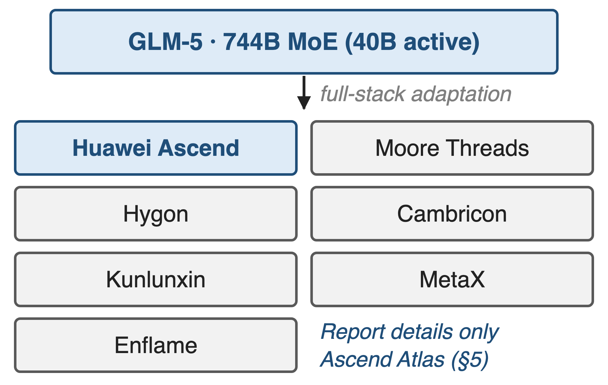
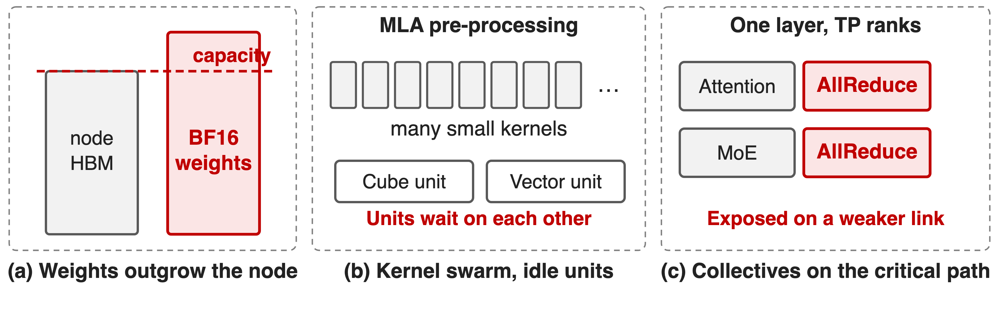
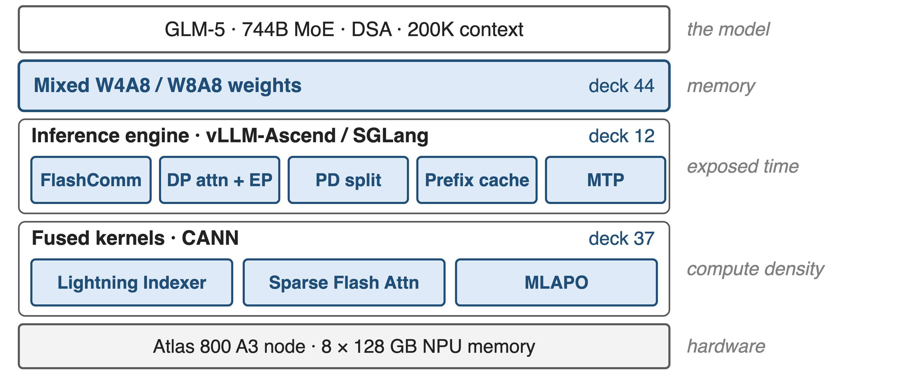
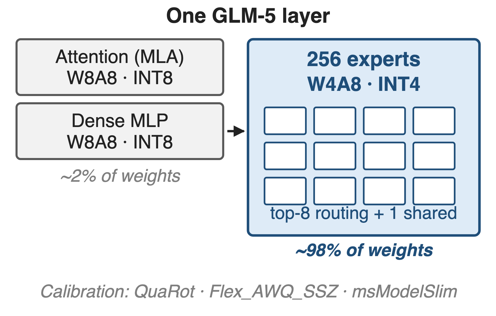
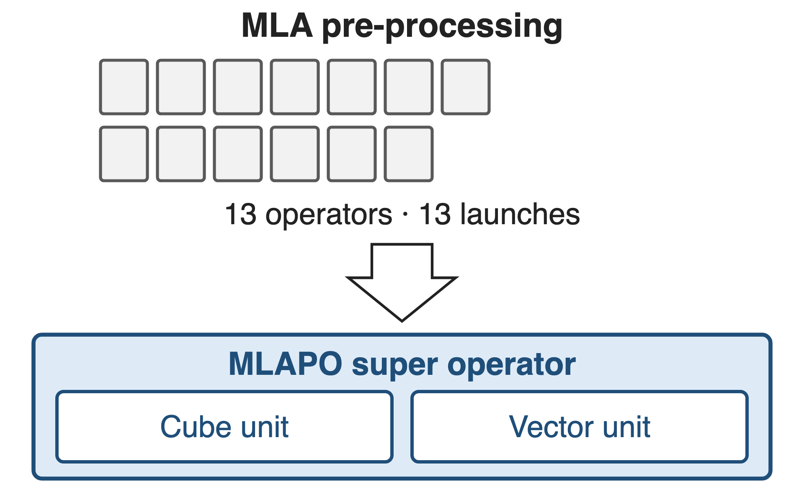
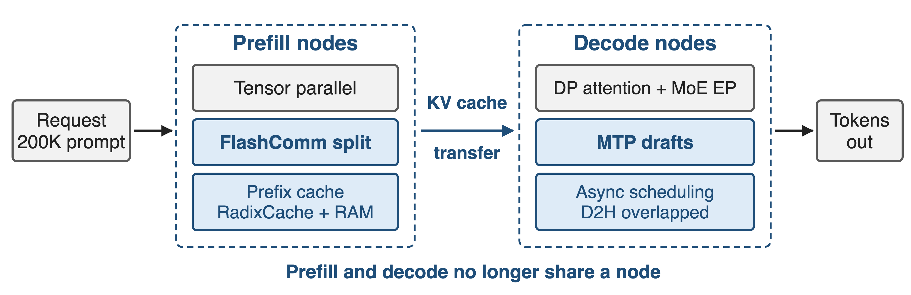
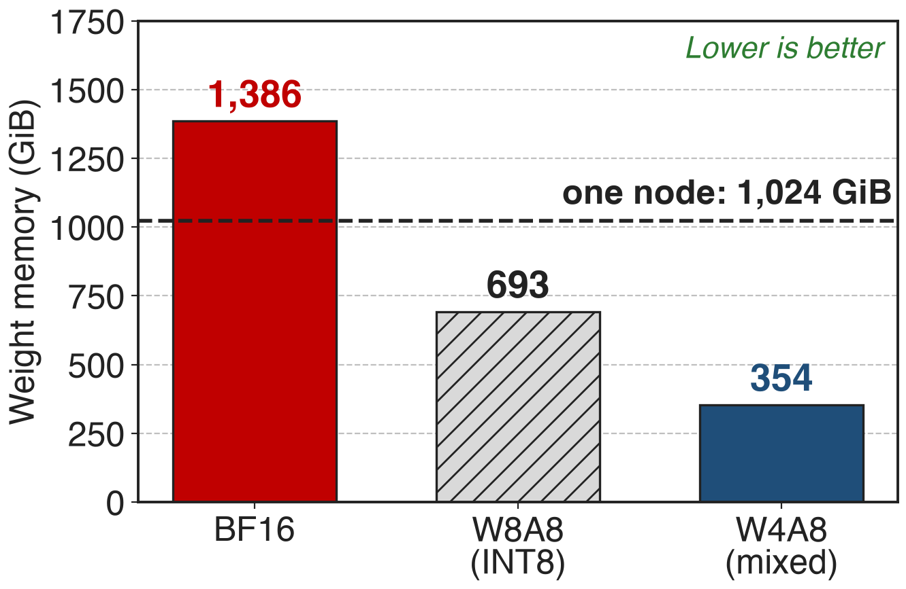

# GLM-5 ships day one on seven domestic platforms
{right 55%}
- **744B** MoE, **40B** active, **256** experts
- DSA sparse attention, mid-trained to **200K** context
- Ascend Atlas is the report's worked example
<!-- notes: GLM-5 is a 744B-parameter mixture of experts with 40B active parameters and DeepSeek Sparse Attention, mid-trained out to a 200K context. Its fourth headline contribution is that it was adapted on day one to seven Chinese accelerator platforms: Huawei Ascend, Moore Threads, Hygon, Cambricon, Kunlunxin, MetaX and Enflame. Only Ascend is described in any detail, as a case study. Sources: arXiv 2602.15763 §1 p.4, §2.1 p.4, Table 10 p.36, §5 p.21. -->

# The weights alone outgrow the node
%% big: 1.4 TiB
%% sub: GLM-5 weights at BF16 — one Atlas 800 A3 node holds 1.0 TiB (8 × 128 GB)
%% source: Analytic, derived from the architecture in arXiv 2602.15763 Table 10 (p.36); node memory from the vLLM Ascend GLM-5 deployment guide
<!-- notes: 744B parameters at two bytes each is 1,386 GiB of weights, and the Atlas 800 A3 node that the report targets holds eight NPUs with 128 GB each, so 1,024 GiB. The weights do not fit, before a single byte of KV cache for a 200K context. This number is analytic: the report publishes no memory breakdown; the derivation is in notes/sources.md. -->

# A GPU-shaped stack does not land unchanged
{full}
> Memory, compute units and the fabric run out at the same time
<!-- notes: Three things break at once. The weights overflow the node. The sparse-attention model arrives as a swarm of small pre-processing kernels that leave the matrix and vector units waiting on each other. And the tensor-parallel AllReduce inside every layer sits on the critical path of a weaker interconnect. The report makes the same point about model shape: DeepSeek-V3's head count follows the H800 roofline and is "inappropriate for other hardware", so GLM-5 raised the head dimension from 192 to 256 and cut the head count by a third to make decoding cheaper (§2.1 p.5). -->

# Insight: three layers, three different resources
- One port cannot fix memory, compute density and exposed time at once
--
> Quantize the weights, fuse the kernels, schedule around what is left
<!-- notes: The report's structure is the insight: its adaptation section has exactly three pillars, and each one attacks a different resource at a different layer of the stack. Quantization buys memory, fused super-operators buy compute density, and engine-level scheduling buys back the time around them. Each pillar is a sibling deck in this series. Source: arXiv 2602.15763 §5 p.21. -->

# The stack: quantize, fuse, schedule
{full}
<!-- notes: From the top: GLM-5 itself is unchanged; its weights are stored in mixed W4A8 and W8A8 precision; vLLM-Ascend or SGLang run it with FlashComm, DP attention plus expert parallelism, prefill/decode splitting, a prefix cache and MTP; underneath, three fused CANN kernels carry the sparse-attention path; and the whole thing targets one Atlas 800 A3 node. The right-hand column names the resource each layer buys back. Deep dives: deck 44, deck 12, deck 37. -->

# ❶ Mixed INT4/INT8 weights fit one node
{right 55%}
- Experts — about **98%** of weights — go to **W4A8**
- Attention and dense MLP stay at **W8A8**
- QuaRot and AWQ-style calibration hold the accuracy
%% caption: Deep dive: deck 44 · expert share derived from Table 10
<!-- notes: The experts dominate the parameter count: 256 experts of three matrices each, over 75 MoE layers, is about 98% of all weights, so compressing them to INT4 is what moves the memory number. Attention and the dense MLP blocks, where outliers hurt most, stay at INT8. The report names msModelSlim as the tool and QuaRot plus Flex_AWQ_SSZ as the algorithms that keep low-bit deployment stable, but publishes no accuracy table. Sources: §5 p.21; expert share derived in notes/sources.md. -->

# ❷ Super-operators replace kernel swarms
{right 55%}
- **MLAPO**: **13** pre-processing operators in one kernel
- **Lightning Indexer**: score, ReLU and TopK fused
- **Sparse Flash Attention**: TopK selection beside the attention
%% caption: Deep dive: deck 37 · the fused kernels of §5
<!-- notes: On the NPU, MLA pre-processing arrives as 13 small operators; MLAPO fuses them into one super operator that keeps the Cube and Vector units busy at the same time. The Lightning Indexer folds score computation, ReLU and TopK into one kernel so that computation overlaps memory access, and the Sparse Flash Attention kernel selects the TopK tokens from the KV cache in parallel with the sparse attention itself. The report gives no per-kernel speedups. Source: §5 p.21-22. -->

# ❸ Scheduling hides what is left
{full}
%% caption: Deep dive: deck 12 · FlashComm splits AllReduce; prefix cache, MTP and async scheduling fill the gaps
<!-- notes: The engine layer does four things: FlashComm splits the tensor-parallel AllReduce so communication hides behind computation; attention runs data-parallel while the MoE runs expert-parallel; RadixCache and a host-RAM prefix cache remove repeated prefill work; and MTP generates several tokens per step to raise compute density on the decode side. Asynchronous scheduling overlaps the device-to-host sampling copy with preparing the next decode step. Prefill/decode disaggregation is the upstream deployment recipe. Sources: §5 p.22; vLLM Ascend GLM-5 guide §5.3. -->

# Only INT4 experts fit 744B on one node
{right 60%}
- BF16: **1,386 GiB** against **1,024 GiB** of node memory
- W4A8: **354 GiB**, leaving room for a 200K KV cache
%% caption: Analytic, from Table 10; excludes quantization scales, KV cache and activations
<!-- notes: Three analytic bars. BF16 weights are 1,386 GiB and overshoot the node. Plain INT8 fits the weights but leaves little for the KV cache of a 200K context. The mixed W4A8 scheme lands at about 354 GiB, which is what makes a single-node deployment with long contexts plausible. These are derived numbers, not measurements; the derivation is in notes/sources.md and the report publishes no memory breakdown. -->

# GLM-5 claims one node and half the cost
- One domestic node reported "comparable to dual-GPU international clusters"
- **50%** lower deployment cost in long-sequence scenarios
- !!No baseline GPU, benchmark or metric is named!!
> Both numbers close §5 with no table behind them
<!-- notes: This is the report's own closing sentence for the adaptation section: through these hardware-level co-optimizations, GLM-5 on a single Chinese node reaches performance comparable to dual-GPU international clusters while cutting long-sequence deployment cost by half. Note what is missing: which GPU, how many of them, which workload, which metric, which serving configuration. Source: arXiv 2602.15763 §5 p.22. -->

# What the report does not tell you
%% layout: two-col
- !!Ascend only!! of the seven platforms
- !!No per-pillar!! attribution of the gain
|||
- Deployment only; training hardware unstated
- No accuracy table for the W4A8 weights
> Read §5 as an engineering recipe, not as an evaluation
<!-- notes: The seven-platform claim is detailed only for Ascend Atlas. The section is about inference: quantization, kernels, engines and deployment cost; nothing in the paper says GLM-5 was pre-trained on domestic accelerators, and the training-infrastructure section talks about GPU memory and pipeline parallelism. And although the experts are pushed to INT4, no accuracy comparison for the quantized weights is published. Sources: §5 p.21-22; §2.4 p.9. -->

# The recipes are upstream already
- vLLM Ascend documents GLM-5 **w4a8** and **w8a8** recipes for one Atlas 800 A3 node
- Reference configs: **198K** context, prefill/decode split, **3** MTP drafts
- Press: a later GLM-5.3-Flash is claimed to run on **100,000** domestic chips
<!-- notes: The engineering is not only in the paper. The vLLM Ascend project publishes GLM-5 deployment guides with the same features switched on by flag: enable_flashcomm1, enable_mlapo, prefix caching, MTP with three speculative tokens, and prefill/decode disaggregation with Mooncake KV transfer. The last line is a company statement relayed by Global Times in August 2026, about a later model in the series, and it names no chip vendor; treat it as an adoption signal, not as evidence. Sources: vLLM Ascend GLM5.md (commit 8194ece); Global Times, 27 Aug 2026. -->

# Summary
- GLM-5 weights: **1,386 GiB** at BF16 against **1,024 GiB** per node (analytic)
- ==Insight==: memory, compute density and exposed time each need their own layer
- **W4A8** experts · **MLAPO** super-operators · FlashComm and PD scheduling
- Report claims one domestic node and **50%** lower long-sequence cost, unqualified
%% qr: https://arxiv.org/abs/2602.15763
<!-- notes: The container story: one quantization pillar, one kernel-fusion pillar, one scheduling pillar, each with its own sibling deck — 44, 37 and 12. The claim that closes the section is strong and completely unqualified, so the honest summary keeps the quotation marks on it. Source: arXiv 2602.15763 §5. -->
