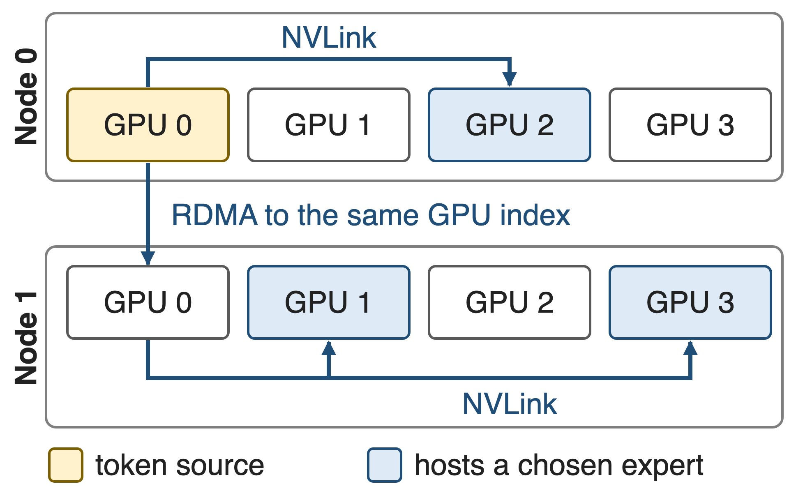
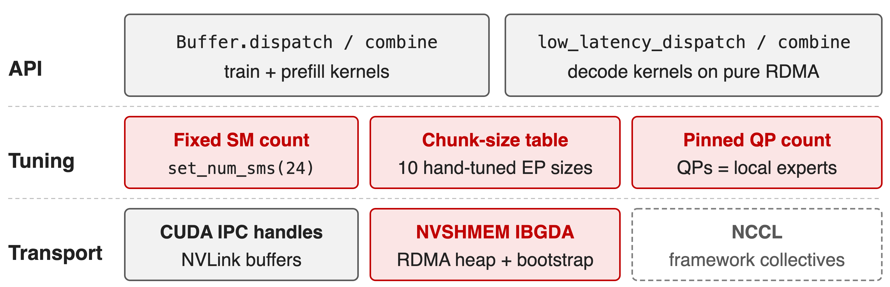
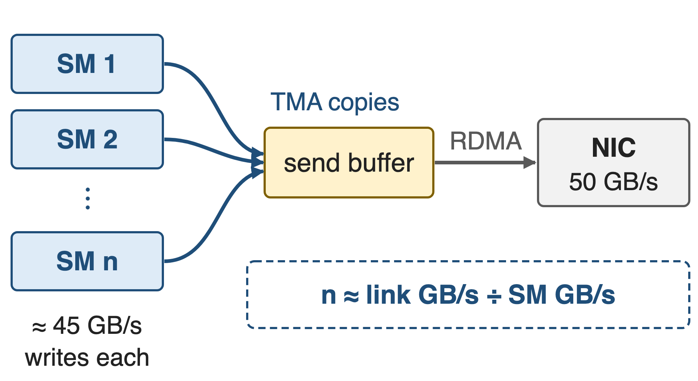
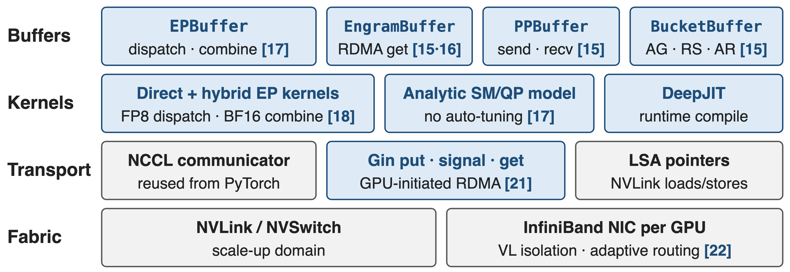
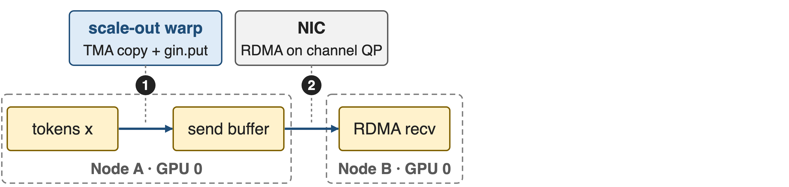
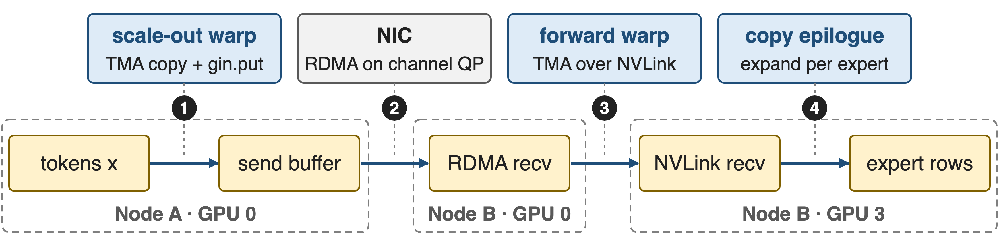
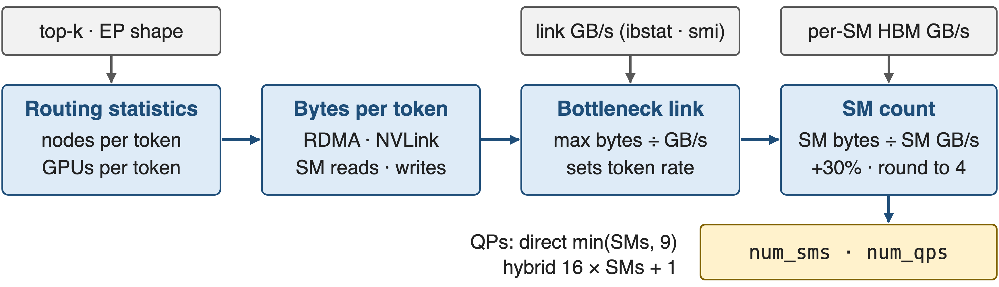
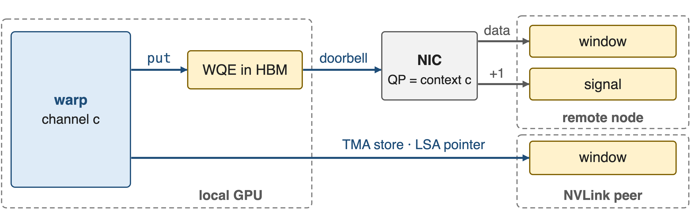
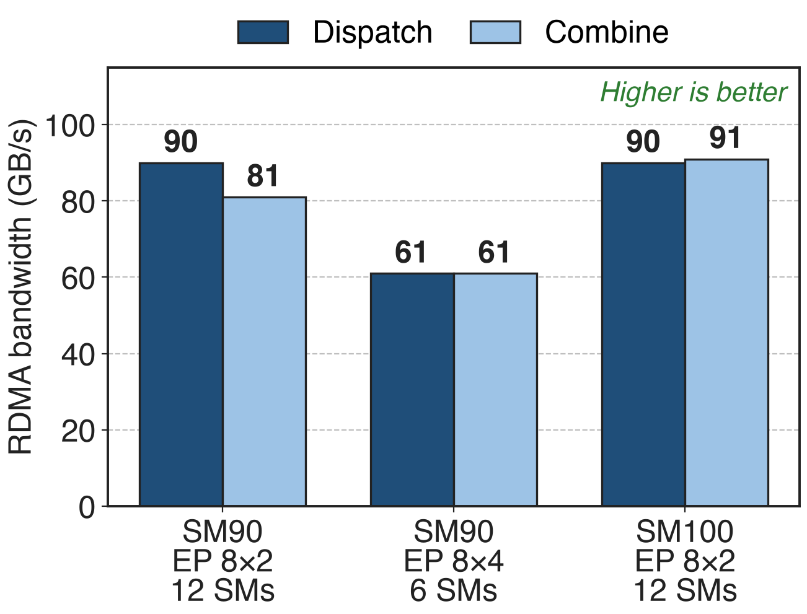
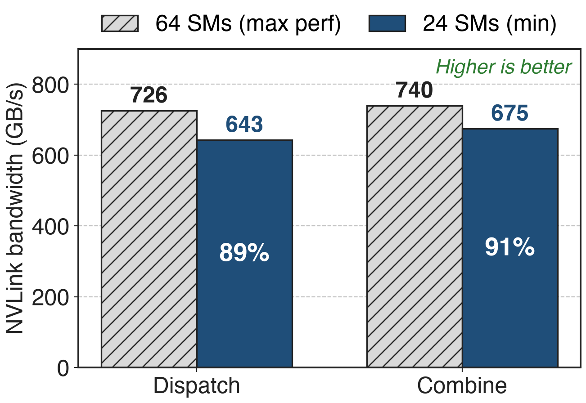

# Tokens cross two networks twice per MoE layer
{right 55%}
- DeepSeek-V3: 256 routed experts, top-8, at most 4 nodes per token
- NVLink 160 GB/s inside a node, InfiniBand 50 GB/s across
- Combine retraces the path in reverse
<!-- notes: Expert parallelism places experts on different GPUs, so every MoE layer needs a dispatch all-to-all that sends each token to the GPUs holding its chosen experts, and a combine that brings the weighted results back. DeepSeek-V3 routes each token to 8 of 256 experts and caps it at 4 nodes; the token first crosses InfiniBand to the GPU with the same local index on the target node, then fans out over NVLink. Sources: DeepSeek-V3 report §3.2.2 and §4.2. -->

# All-to-all takes 15% of every GPU's SMs
%% big: 20 of 132
%% sub: H800 SMs DeepSeek-V3 reserves for all-to-all, at a 1:1 compute-to-communication ratio
%% source: DeepSeek-V3 Technical Report (arXiv 2412.19437) §3.5.1 and §3.2.1; 15% = 20/132 (derived)
<!-- notes: This is the cost DeepEP attacks. To overlap communication with computation at a roughly one-to-one ratio, DeepSeek-V3 dedicated 20 of the 132 SMs of each H800 to the dispatch and combine kernels. Those SMs copy, forward and reduce tokens instead of running GEMMs, and the V3 report explicitly asks hardware vendors to take this work off the SMs. -->

# V1 grew two kernel families and a tuning table
{full}
> New EP size or cluster: re-tune; RDMA: a second runtime beside NCCL
<!-- notes: DeepEP V1 (2025) shipped normal kernels for training and prefill and separate low-latency kernels for decoding, each with its own buffer mode. The SM count was a static class variable (default 20, README example 24); chunk sizes came from a hand-tuned table covering 10 EP sizes from 2 to 160 marked "TODO: automatically tune", and any other size asserted out. Low-latency mode needed QPs equal to the local expert count. RDMA ran on NVSHMEM with IBGDA, NVLink on CUDA IPC handles, both beside the framework's own NCCL. Sources: v1.2.1 buffer.py; V1 README. -->

# Insight: SMs only need to feed the slowest link
{right 55%}
- One SM writes ≈ 45–50 GB/s (model constant)
- A 400 Gb/s NIC drains 50 GB/s
- Routing statistics fix the bytes per token
--
> Compute the SM/QP budget; let the NIC move the bytes
<!-- notes: A communication SM does not move bytes over the wire; it copies tokens between HBM buffers and posts work to the NIC or to NVLink. So it only has to keep pace with the slowest link. DeepEP's model assumes about 45 GB/s of HBM writes per SM (50 in V2.0), the same order as a whole 400 Gb/s NIC. Given the routing statistics, the slowest link fixes the token rate, and the SM count falls out of a division. Sources: deep_ep/utils/envs.py, buffers/ep.py; V1 README (CX7 about 50 GB/s). -->

# Four layers share one NCCL communicator
{full}
%% caption: Accent = DeepEP-owned, gray = NCCL / hardware, [N] = sibling explainer deck. V2.0 had one ElasticBuffer; V2.5 split it.
<!-- notes: This is the map for the rest of the talk. Python buffer objects sit on top: EPBuffer for MoE, plus experimental Engram, pipeline and bucket buffers. Below them are the direct and hybrid EP kernels with FP8 dispatch and BF16 combine, the analytic SM and QP model, and DeepJIT, which compiles kernels at runtime. Everything talks through one NCCL device communicator, reused from PyTorch: Gin for GPU-initiated RDMA and LSA pointers for NVLink. Network-side settings such as virtual-lane isolation and adaptive routing are deck 22. -->

# ❶ One EPBuffer serves training, prefill and decode
- `dispatch` returns expert-major rows plus a `handle`; `combine(y, handle)` reverses it
- Train, prefill: CPU sync for exact sizes; decode: GPU-side counts, CUDA-graph friendly
- Rows aligned for grouped GEMM; backward replays the cached handle
> Deep dive: deck 17. Decode-side GEMM over fixed capacity: deck 34
<!-- notes: V2 replaced V1's two APIs with one buffer whose dispatch and combine serve all three regimes. With do_cpu_sync=True the CPU learns exact receive counts, which training and prefill want; with False the outputs are sized to a fixed capacity and the expert GEMM reads GPU-side prefix sums, which suits decoding and CUDA graphs. The expanded layout gives one row per token-expert pair aligned to the GEMM's tile size, and the backward pass replays the saved handle instead of recomputing routing. Sources: README Interfaces; buffers/ep.py docstrings. -->

# ❷ Hybrid dispatch: rail RDMA, then NVLink
{full}
%% caption: Each warp is a channel with its own QP when enough are allocated; 4 notify warps per SM first exchange per-rank and per-expert counts
--
{full}
%% caption: Forward warps poll Gin tail signals, then TMA-store over NVLink; with one domain, direct mode writes straight to the destination
<!-- notes: Inside one dispatch kernel each SM runs three warp roles. Notify warps count tokens per destination rank and expert and exchange the counts. Scale-out warps TMA-load a token into shared memory, store it to the symmetric send buffer and post a Gin put on their channel's QP; the NIC then writes it into the same-index GPU on the target node. There, forward warps poll the tail signal, TMA-load the token and TMA-store it over NVLink into each expert GPU's buffer; a separate copy epilogue expands it into per-expert rows. NVIDIA's HybridEP branch (deck 19) pushes the TMA approach further. Sources: impls/ep/hybrid_dispatch.cuh, csrc/kernels/ep/dispatch.hpp. -->

# ❸ A formula sets SM and QP counts
{full}
> Computed once per buffer and cached; a worked EP 8×4 example is in deck 17
<!-- notes: get_theoretical_num_sms assumes a balanced gate and computes the expected number of distinct nodes and GPUs per token from the top-k combinatorics. It compares RDMA and NVLink bytes per token against their bandwidths, taken from ibstat and nvidia-smi, to find the bottleneck, then divides the bytes the SMs must read and write at that token rate by per-SM HBM bandwidth, adds 30%, and rounds up to a multiple of 4, minimum 4. QPs follow: few in direct mode to limit doorbell overhead, one per channel in hybrid mode. Source: deep_ep/buffers/ep.py lines 431-560. -->

# ❹ Warps post RDMA writes through NCCL Gin
{full}
%% caption: One symmetric window registered on PyTorch's own NCCL communicator; V2.5 removed NVSHMEM entirely
> The signal lands after the data on the same QP. Deep dive: deck 21
<!-- notes: V2 swapped NVSHMEM for the GPU-Initiated Networking backend of NCCL's device API. DeepEP takes the communicator PyTorch already created, asks NCCL for one Gin context per QP and registers a symmetric window. On a ConnectX-class NIC the GDAKI backend lets the warp write the work-queue entry into GPU memory and ring the NIC doorbell itself; the NIC then performs the RDMA write and the signal add, and a signal on the same context is ordered after the earlier puts, so the receiver just polls it. Same-node peers are reached with plain TMA stores through load/store-accessible pointers into the same window. Sources: README; csrc/kernels/comm/context.cpp; NCCL GIN paper arXiv 2511.15076 §III. -->

# Gin also carries PP, Engram and collectives
- `PPBuffer`: RDMA send and receive between pipeline neighbours (deck 15)
- `EngramBuffer`: RDMA gets from GPU or CPU tables (decks 15, 16)
- `BucketBuffer`: all-gather on copy engines, reduce-scatter on SMs (deck 15)
> V2.5 also adds weight prefetch and gradient reduce for redundant experts
<!-- notes: The V2 release advertised experimental zero-SM primitives for pipeline, context parallelism and Engram; V2.5 gave each its own buffer class. The NIC or the copy engine moves the bytes; SMs only stage data where needed. The transparent GPU plus CPU virtual buffer was listed as on-going in V2; V2.5 ships Engram tables on GPU or CPU. V2.5 also adds lb_prefetch_weights and lb_reduce_grads over NVLink, the primitives behind MoonEP and UltraEP style dynamic redundant experts. Sources: README News, Bucket, Engram, PP sections; PR #763. -->

# 6–12 SMs drive 61–91 GB/s of RDMA per GPU
{right 60%}
- V3 setup: 8K tokens, hidden 7168, top-8
- FP8 dispatch, BF16 combine, CX7 NICs
- Logical bandwidth, local-rank traffic included
<!-- notes: These are the only multi-node numbers the V2 release publishes. On Hopper with ConnectX-7, two nodes reach 90 GB/s dispatch and 81 combine with 12 SMs; four nodes reach 61 both ways with only 6 SMs; Blackwell over two nodes reaches 90 and 91 with 12 SMs. The README notes these are logical bandwidths that include local-rank traffic, so they can exceed the 50 GB/s NIC line rate. Source: V2 release README performance table (commit b306af0, PR #605). -->

# V3-style training drops from 24 SMs to 4–6
%% big: 24 → 4–6
%% tone: ours
%% sub: communication SMs per GPU for V3-like training, at equivalent or better speed; vs V1 up to 1.3× peak with up to 4× fewer SMs
%% source: DeepEP V2 release notes, README at commit b306af0 and PR #605
<!-- notes: This is the headline in the currency of the pain. Under V1, V3-like training ran its communication kernels on 24 SMs; V2 uses 4 to 6 with equivalent or better performance. Across the benchmark table the release reports up to 1.3x peak bandwidth and up to 4x fewer SMs than V1. The freed SMs go back to the expert GEMMs that the communication overlaps with. -->

# 24 SMs keep 89–91% of peak NVLink bandwidth
{right 60%}
- SM100, EP8 inside one NVLink domain
- 64 SMs: the max-performance setting
- 24 SMs: 2.7× fewer SMs (derived)
<!-- notes: Inside one Blackwell NVLink domain, the max-performance setting with 64 SMs reaches 726 GB/s dispatch and 740 combine. The minimum-SM setting with 24 SMs still reaches 643 and 675, that is 89 and 91 percent, with 2.7 times fewer SMs. When the kernel overlaps with computation, the smaller budget is the better trade. Percentages and the ratio are derived from the V2 release table rows 4 and 5. -->

# Adopted widely, but needs bigger buffers
- Megatron-LM FlexDispatcher: `deepepv2` backend
- DeepEP-Ascend: same API on Ascend 950
- Ports: UCCL-EP, Mori-EP for AMD
|||
- !!Larger buffers!! than V1
- !!Hopper+, CUDA 13.1, NCCL 2.32.3!!
- EP needs SMs; Engram, PP, buckets experimental
<!-- notes: Megatron-LM exposes DeepEP v2 as a FlexDispatcher backend, and DeepSeek ships an Ascend version with the same API. Community ports such as UCCL-EP and the Mori-EP branch carry DeepEP's design to AMD GPUs and other NICs. The costs: V2 allocates fixed maximum-capacity buffers, larger than V1's queues; it needs Hopper or newer, CUDA 13.1, NCCL 2.32.3 and PyTorch 2.10; the zero-SM RDMA low-latency EP of V1 is gone; the SM model assumes a balanced gate; and only InfiniBand is fully tested. Sources: Megatron MoE README; DeepEP README Requirements, Notes, Network configurations. -->

# Summary
- DeepSeek-V3 all-to-all: **20 of 132** SMs per GPU
- ==Insight==: SMs only feed the slowest link; compute the budget
- One EPBuffer, analytic SM/QP, NCCL Gin transport
- **24 → 4–6** SMs; **61–91 GB/s** RDMA from 6–12 SMs
- Decks 15–18, 21, 22; related 19, 34
%% qr: https://github.com/deepseek-ai/DeepEP
<!-- notes: DeepEP v2 turns SM and QP counts from tuning constants into a computed budget, unifies the training and decoding APIs, and moves the transport onto the NCCL communicator the framework already has. The result is 4 to 6 communication SMs instead of 24 for V3-like training. The sibling decks go deeper into each component. -->
