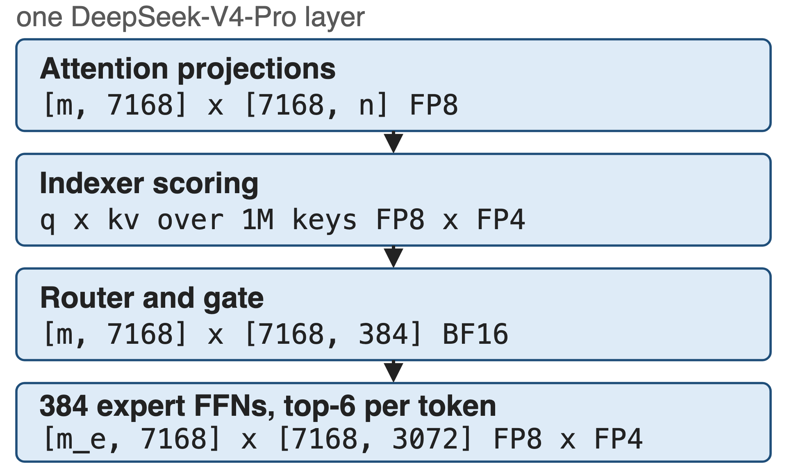
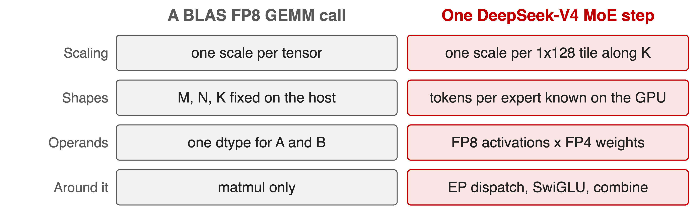
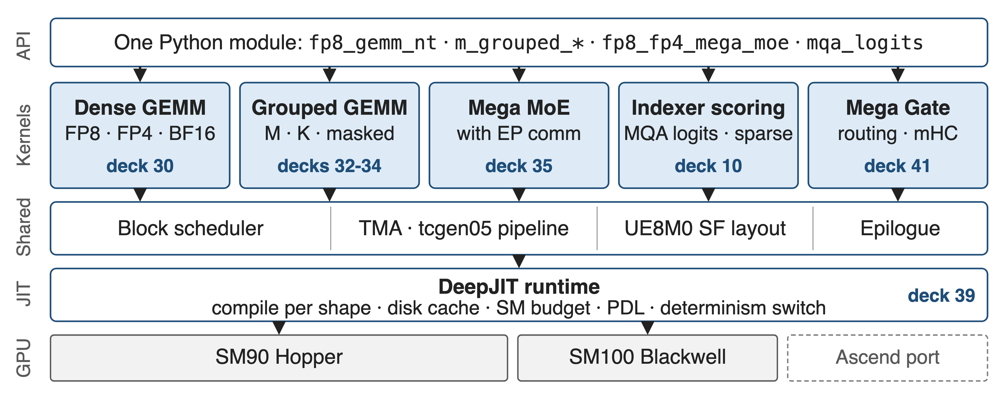
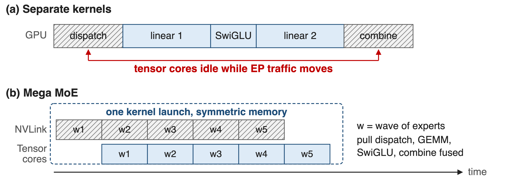
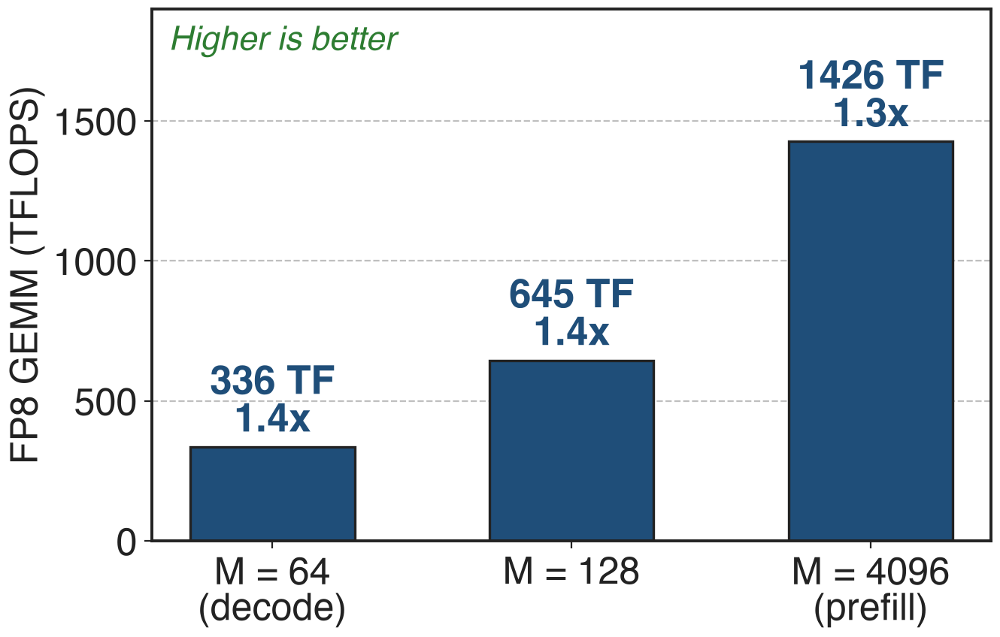
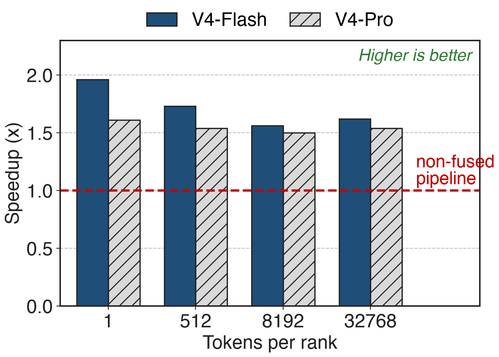
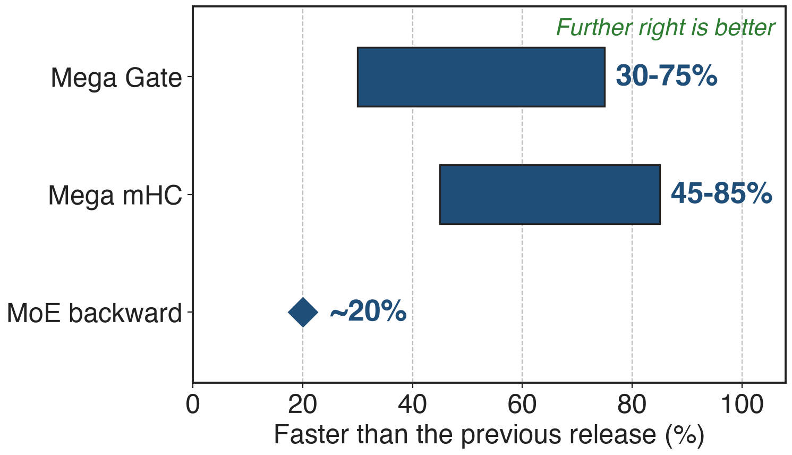

# One MoE layer, four different matmuls
{right 52%}
- DeepSeek-V4-Pro: **1.6T** parameters, 49B active, 1M context
- Each op brings its own dtypes, scales and shapes
<!-- notes: Set the scene. V4-Pro is 1.6T parameters with 49B activated and a one-million-token context (V4 report, abstract); the Pro config is 384 experts, top-6, hidden 7168, intermediate 3072 (DeepGEMM PR #316). The point of the figure: these are all matmuls, but no two of them have the same operand types or shapes. -->

# Expert-tuned FP8 kernels left performance unclaimed
%% big: 2.7x
%% sub: DeepGEMM over an internally tuned CUTLASS 3.6 FP8 GEMM at the V3 decode shape M=64, N=2112, K=7168
%% source: DeepGEMM README @ commit 8002b769 (2025-03-25), H800 SXM5, NVCC 12.8
<!-- notes: The baseline is not a weak one: it is DeepSeek's own carefully optimized CUTLASS 3.6 implementation, measured on the same H800. The gap is largest at small M, which is exactly where decoding lives; at M=4096 the same table shows 1.1-1.3x. -->

# A BLAS call cannot express an MoE step
{full}
> Per-group scaling along K is "not directly supported" by a standard FP8 GEMM (DeepSeek-V3 §3.3.2)
<!-- notes: Four mismatches, all from the primary sources: fine-grained FP8 needs a scale per 1x128 tile along K (V3 §3.3.2); MoE token counts per expert are only known on the GPU once routing has run; V4 runs FP8 activations against FP4 expert weights; and the expert GEMMs sit between EP dispatch and combine. A library whose interface is one dtype, one scale and host-side shapes cannot take these. -->

# Insight: these kernels differ in scheduling, not arithmetic
- Same inner loop: TMA load, tensor-core MMA, scaled accumulate, store
- What differs: tile scheduling, scale layout, what surrounds the GEMM
--
> Write one kernel per family, share scheduler and layouts, and let a runtime JIT burn every shape and switch into it as a constant
<!-- notes: This is the design bet behind the whole library. The first release made the claim concrete: one core kernel function of about 300 lines. Today the SM90 FP8 kernel is 452 lines and the SM100 FP8/FP4 kernel 579 lines - counted from the repository, so a derived number. -->

# DeepGEMM: five kernel families on one runtime
{full}
%% caption: 19 kernel files, 9,593 lines of device code (derived from the repo); each family has its own deck
<!-- notes: Read it bottom-up: DeepJIT compiles and caches one specialization per shape; a shared block scheduler, TMA/tcgen05 pipeline, scale-factor layout and epilogue serve every kernel; five families sit on top, exposed through one Python module. The deck numbers point at the sibling decks in this series. -->

# One GEMM family covers FP8, FP4 and BF16
- `fp8_gemm_{nt,nn,tn,tt}`: SM90 is NT-only, SM100 takes all four majors
- Scales: FP32 on SM90, **4 packed UE8M0** per int32 on SM100, TMA-aligned
- FP8 activations x FP4 weights share the same kernel
> Deep dive: deck 30 (dense GEMM + UE8M0 layout), deck 39 (DeepJIT, PDL, determinism)
<!-- notes: The naming is D = C + A @ B with an NT input layout. On Hopper the scale factors stay FP32 and the kernel promotes to CUDA cores; on Blackwell the scales are packed UE8M0 exponents consumed by the block-scaled tcgen05 MMA. Deck 30 takes this apart. -->

# Grouped layouts carry per-expert token counts
- **M-grouped contiguous**: experts concatenated, each segment aligned to the M block
- **Masked**: fixed slots plus a mask, so CUDA Graph decode needs no host count
- **K-grouped**: the MoE weight-gradient shape, groups along K
> Deep dive: decks 33 (contiguous), 34 (masked), 32 (K-axis)
<!-- notes: Only the M axis is grouped - N and K stay fixed, because experts in an MoE share their shape. That restriction is what makes one kernel enough. The masked variant exists because during decoding with CUDA Graphs the CPU does not know how many tokens each expert received. -->

# Mega kernels swallow what surrounds the GEMM
{full}
%% caption: Mega Gate does the same for routing, Mega mHC for hyper-connections + RMSNorm
<!-- notes: Mega MoE fuses EP dispatch, linear 1, SwiGLU, linear 2 and EP combine into one kernel over symmetric memory, so NVLink traffic for the next wave of experts overlaps tensor-core work on the current one. Deck 35 is the deep dive; deck 41 covers Mega Gate and Mega mHC; deck 10 the indexer scoring kernels. -->

# Dense FP8 reaches 1426 TFLOPS on H800
{right 56%}
- **1.3-1.4x** over the tuned CUTLASS 3.6 implementation
- N=7168, K=16384; peak over all shapes: **1550 TFLOPS**
- Same kernel from decode M=64 to prefill M=4096
<!-- notes: Numbers from the March 2025 README table (H800 SXM5, NVCC 12.8); speedups are against DeepSeek's tuned CUTLASS 3.6 implementation. The 1550 TFLOPS peak is the April 2025 release note. These are Hopper numbers; the library has since added SM100. -->

# Mega MoE runs 1.50-1.96x the non-fused pipeline
{right 56%}
- 8-way expert parallelism, averaged over 8 ranks
- Largest win at **1 token/rank**: RL rollout and agent serving
<!-- notes: From the Mega MoE benchmark PR #316; the V4 report states the same range for the fine-grained EP scheme: 1.50 to 1.73x for general inference and up to 1.96x for latency-sensitive workloads. At 32768 tokens per rank the kernel sustains about 2.0-2.4 PFLOPS. -->

# Fusing the ops around the GEMM pays again
{right 56%}
- **Mega Gate**: routing GEMM plus the routing ops
- **Mega mHC**: hyper-connections plus RMSNorm
<!-- notes: All three from the September 2026 release notes, PR #432. The pattern repeats: the GEMM was never the only cost, the surrounding elementwise and routing work was, and the library keeps absorbing it. -->

# The library is where DeepSeek-class models land
- SGLang and vLLM ship DeepGEMM paths and warm-up passes
- 8.9k stars; an Ascend port now lives in its own repo
> DeepSeek-V4 replaced cuBLAS end-to-end: a BLAS library cannot be batch-invariant (V4 §3.3)
<!-- notes: The batch-invariance claim is from V4 section 3.3: cuBLAS cannot guarantee that a token's output is bitwise independent of its batch position, so DeepGEMM replaced it. SGLang has compile_deep_gemm.py and a deep_gemm_wrapper; vLLM has deep_gemm warmup and MoE paths. Star count from the GitHub API on 2026-10-13. -->

# What it costs you
- SM90 or SM100 only, CUDA 12.9+, CUTLASS 4.0+; Ascend is a separate port
- Casting, transposition and scale production stay the caller's job
- Kernels compile on first use; Mega MoE needs symmetric memory, PyTorch 2.9+
<!-- notes: Be honest about the edges. The library deliberately optimizes GEMMs only - the quantization casts are expected to be fused into your previous kernel. Since the 2026-09 release determinism is opt-in rather than the default, which deck 39 covers. -->

# Summary
- An MoE step is four different matmuls; a BLAS call fits none of them
- ==Insight==: one kernel per family, shapes and switches burned in by the JIT
- Dense FP8 **1426 TFLOPS** (peak **1550**), **1.3-1.4x** over tuned CUTLASS
- Mega MoE **1.50-1.96x**; Mega Gate **30-75%**, Mega mHC **45-85%**
%% qr: https://github.com/deepseek-ai/DeepGEMM
<!-- notes: Leave this up during questions. The sibling decks: 30 dense GEMM and UE8M0, 32-34 grouped GEMMs, 35 Mega MoE, 41 Mega Gate and mHC, 10 indexer scoring, 39 DeepJIT and determinism. -->
