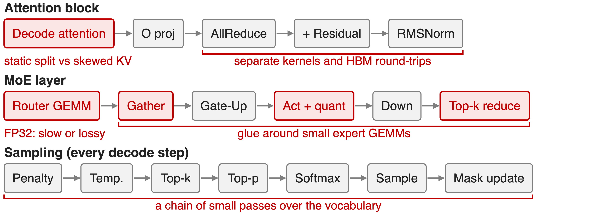
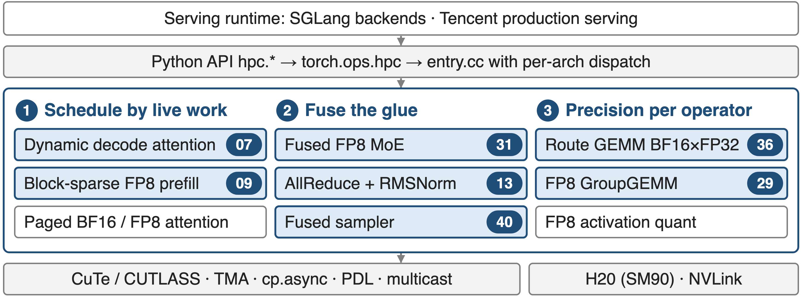
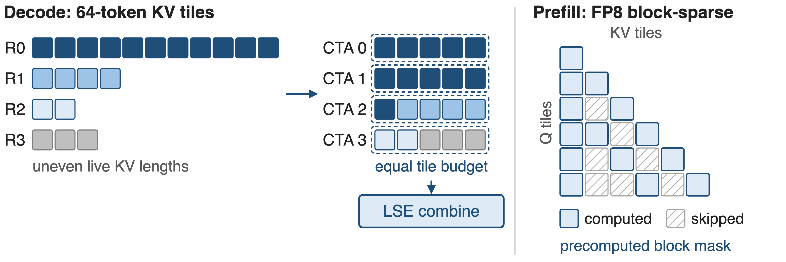
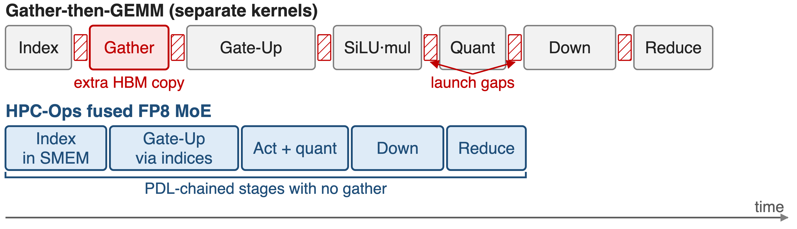
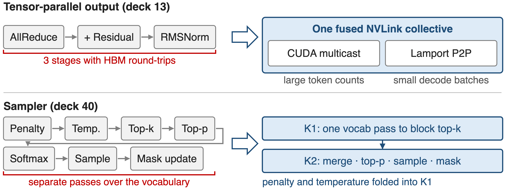
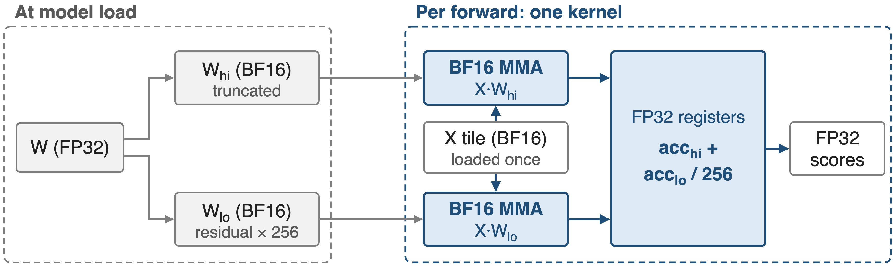
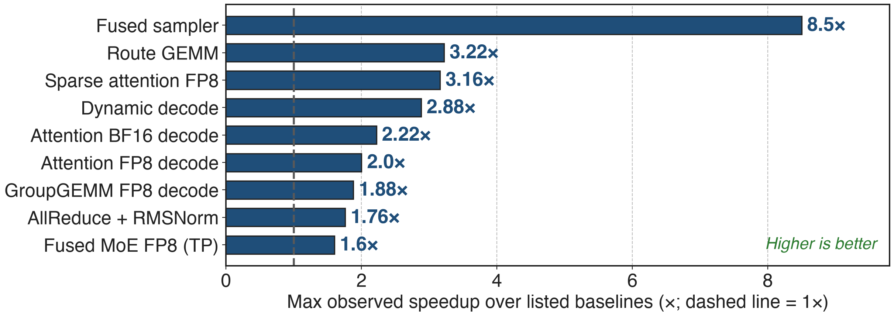
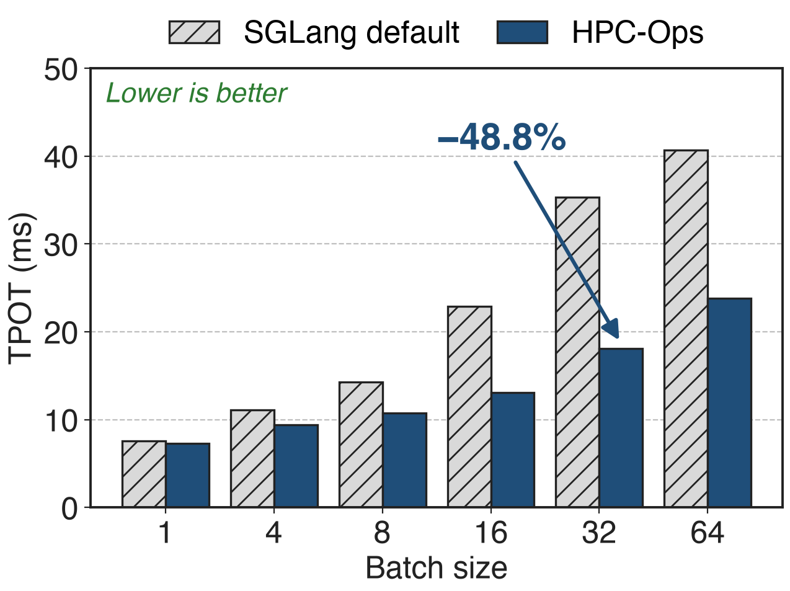

# Tencent serves its Hunyuan models on HPC-Ops
- CUDA operator library from Tencent Hunyuan AI Infra
- Tuned for NVIDIA **H20** (SM90); runs Tencent's large-scale serving
- Open source since Jan 2026 (MIT); in **SGLang** main since Aug 2026
<!-- notes: HPC-Ops is the kernel layer under Tencent's production LLM serving: attention, MoE, GEMM, sampling and the tensor-parallel collective, written in CUDA with CuTe/CUTLASS and tuned for the H20. It was open-sourced in January 2026 and its attention, router-GEMM and MoE kernels were merged into SGLang in August 2026. Sources: README "Why HPC-Ops?" and badges; LMSYS blog "HPC-Ops x SGLang" (2026-08-07). -->

# Skewed batches slow decode attention 2.95×
%% big: 2.95×
%% sub: slower decode attention under a static split-KV schedule when one 128K request joins 31 × 4K requests
%% source: LMSYS / Tencent, "HPC-Ops × SGLang" (Aug 2026), Table 1: H20, FP8 KV cache, 0.186 ms static vs 0.063 ms dynamic
<!-- notes: Production batches mix one very long context with many short ones. With a static split of each request's KV into a fixed number of chunks, the long request's chunks dominate and a few CTAs set the kernel tail: 0.186 ms versus 0.063 ms when work is balanced, on the same H20 and the same FP8 KV cache. Source: LMSYS blog Table 1, last row. -->

# Generic kernels misfit five decode hot spots
{full}
<!-- notes: Walk the decode step. Attention uses one static split for every KV length. The tensor-parallel output runs AllReduce, residual add and RMSNorm as separate stages with HBM round trips. The router GEMM has FP32 weights: run it in FP32 and it is slow, cast to BF16 or TF32 and expert choices can flip. Around the small expert GEMMs, the gather, activation-quant and reduce kernels and their launches rival the math. Sampling is a chain of small passes over the vocabulary (120,832 entries in the sampler benchmark). Sources: README "Updates" write-ups for each operator; LMSYS blog design sections. -->

# Insight: the loss is imbalance and glue, not math
- Uniform 64 × 0.5K batch: static and dynamic schedules tie, **1.00×**
- Skewed 1 × 128K + 31 × 4K batch: same attention math, **2.95×** apart
--
> Tune each hot path for the production shape distribution, not for one benchmark shape
<!-- notes: The two schedules compute exactly the same attention; only the mapping of work to CTAs differs. On a uniform batch they tie, on a skewed batch they are almost 3x apart, so the cost is in scheduling and in the glue around the math. HPC-Ops applies that lesson to every hot path. Source: LMSYS blog Table 1, first and last rows. -->

# HPC-Ops: one tuned operator per hot path
{full}
%% caption: Badges = sibling explainer decks in this series; white chips have no separate deck
<!-- notes: The library sits between the serving runtime and CUDA building blocks. Python wrappers call torch.ops.hpc, whose entry.cc validates inputs and dispatches to a per-architecture module. The operators group into three design principles: schedule by live work, fuse the glue, and choose precision per operator. Each numbered badge is a deep-dive deck. Sources: README operator catalog; repository CLAUDE.md execution path. -->

# ❶ Attention schedules by live KV work
{full}
%% caption: Decode: budget = total 64-token tiles ÷ persistent CTAs (deck 07). Prefill: masked KV tiles never load (deck 09)
<!-- notes: Decode: before each step a small assign kernel cuts every request's live KV into 64-token tiles, divides the total by the number of persistent CTAs (4 per SM for one-token decode) and fills each CTA's bin up to that budget, so a long request spans several CTAs and short ones share one. A combine kernel merges the partial outputs by log-sum-exp. Prefill: given a precomputed block mask, the FP8 kernel skips masked KV tiles entirely. Sources: LMSYS blog "Scheduling around live KV work"; src/attention/decode/sm90/assign_task.cu; README "Sparse Attention". -->

# ❷ Fused MoE removes the gather and launch gaps
{full}
> Gate-Up reads tokens through routing indices; PDL overlaps each launch with the previous stage (decks 31, 29)
<!-- notes: A conventional MoE path copies routed tokens into per-expert buffers, then runs Gate-Up, activation, quantization, Down and a weighted reduce as separate kernels. HPC-Ops builds the indices with a shared-memory counting pass, lets Gate-Up read the original tokens through them, fuses SiLU-mul with FP8 requantization and chains the stages with programmatic dependent launch. The expert GEMMs are FP8 grouped GEMMs with per-tensor or block-wise scales (deck 29). Timeline is illustrative, not to scale. Sources: README "Fused MoE"; LMSYS blog "A fused, latency-oriented MoE pipeline". -->

# ❷ Fusion shrinks AllReduce and sampler chains
{full}
<!-- notes: Top: AllReduce, residual add and RMSNorm become one NVLink-native kernel; large token counts use CUDA multicast, small decode batches use a Lamport point-to-point two-kernel design with PDL, both with a two-shot schedule. Bottom: the sampler becomes two kernels: K1 makes one pass over the vocabulary applying penalty and temperature and keeping a per-block top-k with softmax statistics; K2 merges the candidates, applies top-p, samples and writes the penalty bit. Sources: README "Fused AllReduce + RMSNorm" and "Sampler"; src/sampler/fused_sampler.cu header comment. -->

# ❸ Route GEMM gets FP32 precision from BF16
{full}
> Max error vs FP32 cuBLAS: **0.00177**, versus **0.06464** for TF32 cuBLAS (deck 36)
<!-- notes: Router scores decide which experts run, so some models keep FP32 router weights. HPC-Ops splits each weight into a truncated BF16 high part and a BF16 residual scaled by 256, runs both products on BF16 Tensor Cores inside one kernel that loads the activation tile once, and combines the FP32 accumulators in the epilogue. Error numbers: LMSYS blog, Router GEMM paragraph, FP32 cuBLAS as reference. -->

# Every hot path gains 1.6–8.5× at its best
{full}
%% caption: README maxima per operator vs. the baselines it lists; results vary by shape
<!-- notes: These are the README's "up to" numbers, each against that operator's listed baselines: sampler vs vLLM-style PyTorch and FlashInfer; Route GEMM vs cuBLAS FP32/TF32; sparse attention vs MIT-BSA and FlashPrefill-BSA in BF16 and dense FP8; dynamic decode vs the library's own static split-k; attention vs FlashInfer, FlashAttention and TensorRT-LLM; GroupGEMM vs DeepGEMM; AllReduce+RMSNorm vs NCCL and FlashInfer; MoE vs vLLM and SGLang. They are maxima, not averages. Source: README "Performance" table. -->

# Hy3-FP8 per-token latency drops up to 48.8%
{right 58%}
- HPC-Ops Attention + MoE in SGLang, 8 × H20
- TP8, FP8 KV cache, 8K in / 4K out
- TPOT **−15.1% to −48.8%** at batch 4–64
<!-- notes: End to end, enabling the attention and MoE backends together cuts time per output token from 35.33 to 18.09 ms at batch 32; at batch 1 the gain is only 3.3% because there is little imbalance or glue to remove. TTFT improves 3.3 to 9.0% at batch 1 to 16. Source: LMSYS blog Tables 7 and 8. -->

# Tencent production gains ~30% QPM
- Tencent serving: **~30%** QPM for Hunyuan, **~17%** for DeepSeek models
- SGLang main: `hpc_ops` attention and MoE backends, Router GEMM auto-dispatch
- H200 check: Hy3-FP8 output throughput **+3.7–5.9%** vs FlashAttention
<!-- notes: The QPM numbers are service-level figures Tencent reported at release; they appear in MarkTechPost's January 2026 article, not in the repository README, so treat them as vendor-reported. Upstream, five SGLang pull requests added the attention, router-GEMM and MoE paths, and the SGLang dev images ship HPC-Ops. On H200 the attention path still adds 3.7 to 5.9% output throughput. Sources: MarkTechPost 2026-01-27; LMSYS blog integration table and Table 11. -->

# Gains are H20-tuned and shape-specific
- **Hardware**: tuned for SM90 / H20; Blackwell builds carry few kernels yet
- **Shapes**: head_dim 128 attention; fused AllReduce only for hidden 4096 / 5120 / 7168
- **Not always faster**: MoE **0.98×** at EP8 batch 512; Hy3 MoE on H200 **−4.2%** to +6.3%
<!-- notes: The build system knows SM 90, 100 and 103, but almost every kernel lives under sm90; only a gated MLA GEMM has an sm100 version. Attention kernels are written for head dimension 128, and the fused AllReduce rejects other hidden sizes. The README figures are maxima; the blog shows parity or small losses at some MoE batch sizes, and Router GEMM needs shape-aware dispatch because below a crossover the plain FP32 path wins. Sources: Makefile KNOWN_ARCHS; repo tree; benchmark/fuse_allreduce_rmsorm/README; LMSYS Tables 5 and 11 and Router GEMM section. -->

# Summary
- Production decode shapes are skewed and small: static attention runs **2.95×** slower
- ==HPC-Ops==: schedule by live work, fuse the glue, choose precision per operator
- Hy3-FP8 TPOT **−15.1–48.8%** on 8 × H20; **~30%** QPM in Tencent production
- Deep dives: decks 07, 09, 13, 29, 31, 36, 40
%% qr: https://github.com/Tencent/hpc-ops
<!-- notes: One sentence to remember: production shapes, not peak FLOPs, decide inference kernel speed, and HPC-Ops is a set of kernels built around that fact. Sources as on the previous slides. -->
