# Kimi K3 trains a 2.8T MoE with expert parallelism
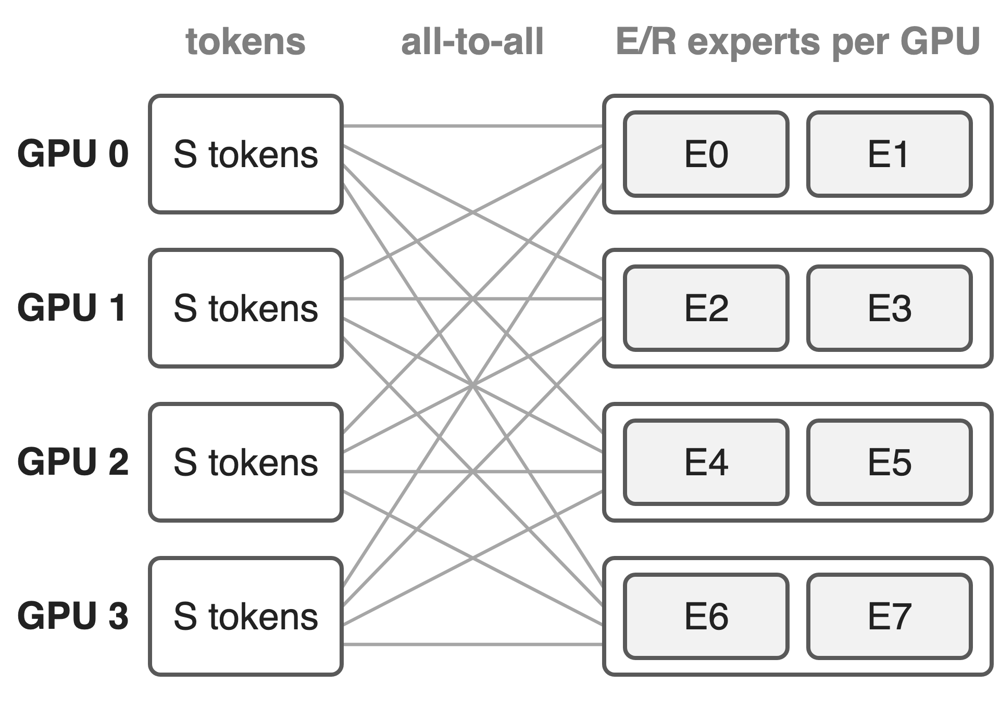{right 50%}
- **896** routed experts, **16** per token
- Each GPU hosts E/R experts
- Two all-to-alls per MoE layer: dispatch, combine
<!-- notes: Kimi K3 is a 2.8T-parameter MoE with 104B activated parameters; each token picks 16 of 896 routed experts (K3 report, abstract and Table 1). Under expert parallelism each of R GPUs hosts E/R experts, so every token copy travels to the GPU that hosts its expert (dispatch) and comes back (combine), in the forward and again in the backward pass. MoonEP is the library Moonshot built for exactly these all-to-alls and open-sourced with K3. -->

# Skewed routing crashes DeepEP v2 training
%% big: OOM
%% sub: DeepEP v2 end-to-end training at maxvio 20, where the hottest expert carries 21× the average load
%% source: MoonEP README, e2e benchmark: 8×H20, EP=8, 9 layers, H=7168, E=256, top-8, seq 16k
<!-- notes: maxvio is max over experts of load over mean load, minus one; maxvio 20 means the hottest expert gets 21 times its fair share (README definition and chart axis). In the README's end-to-end run, DeepEP v2's iteration time climbs with imbalance and at maxvio 20 training runs out of memory, because the hottest GPUs receive more tokens and the ever-changing activation shapes fragment GPU memory. MoonEP passes the same point. The routing here is synthetic (lognormal expert popularity), so read this as a stress test, not a production trace. -->

# The hottest GPU sets every layer's time
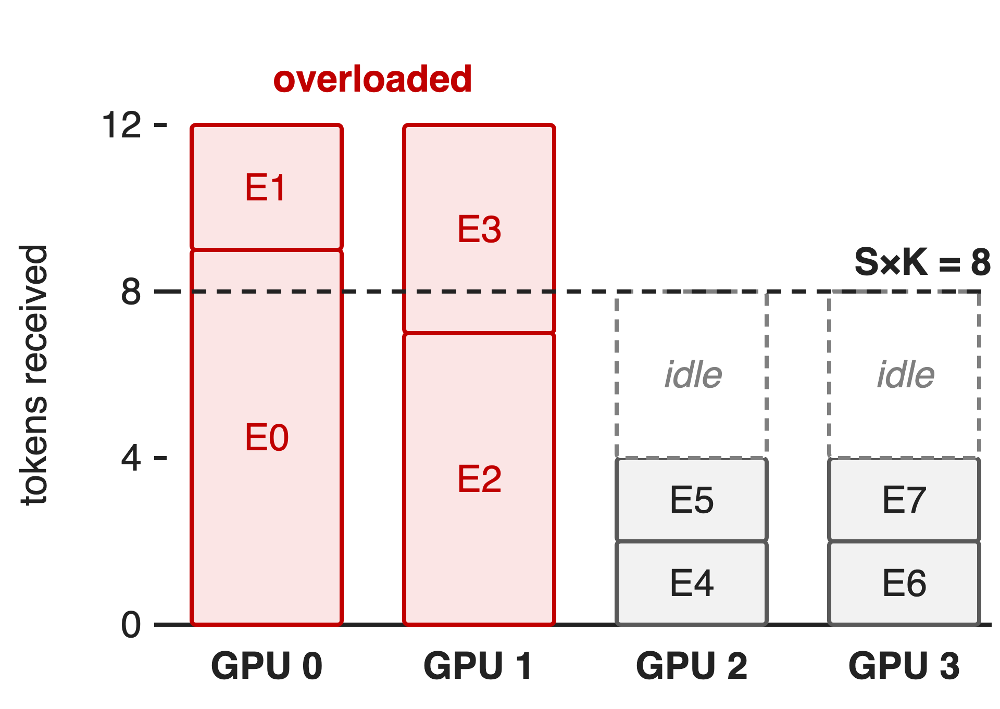{right 55%}
- Example: 4 GPUs, each sends S×K = 8 copies
- GPU 0-1 receive 12, GPU 2-3 only 4
- Counts change per micro-batch: !!host sync!! or !!S×K×R buffers!!
<!-- notes: Running example (illustrative, also used in deck 20): S = 4 tokens per GPU, top-2, so each GPU emits 8 token copies and a balanced GPU would receive exactly 8. Here GPU 0 and 1 receive 12 and GPU 2 and 3 only 4, so the layer waits for the overloaded pair. Worse, the received counts are only known after routing: DeepEP v2's training mode reads them on the host every layer (do_cpu_sync, DeepEP README), and the alternative is a buffer sized for the worst case, S×K×R token slots (K3 report, Sec. 5.2.1). -->

# Balancing on average misses each micro-batch
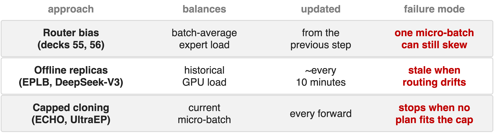{full}
> Needed: exact balance for this micro-batch, always feasible, planned on the GPU
<!-- notes: Three earlier fixes. Router-side balancing (loss-free bias, deck 55; Kimi K3's Quantile Balancing, deck 56) evens loads across the global batch, and the bias computed from one step only applies to the next, so one micro-batch can still be skewed (K3 Sec. 2.3.3). DeepSeek's EPLB replicates heavy experts from historical load statistics; DeepSeek-V3 re-planned its serving replicas periodically, for example every 10 minutes (V3 Sec. 3.4). ECHO (Megatron-Core) and UltraEP do plan from the current load, but into a preset number of slots or under a per-rank token cap; K3 notes that training must stop whenever no feasible plan fits, and the cap needs manual tuning. -->

# Insight: E/R replica slots always suffice
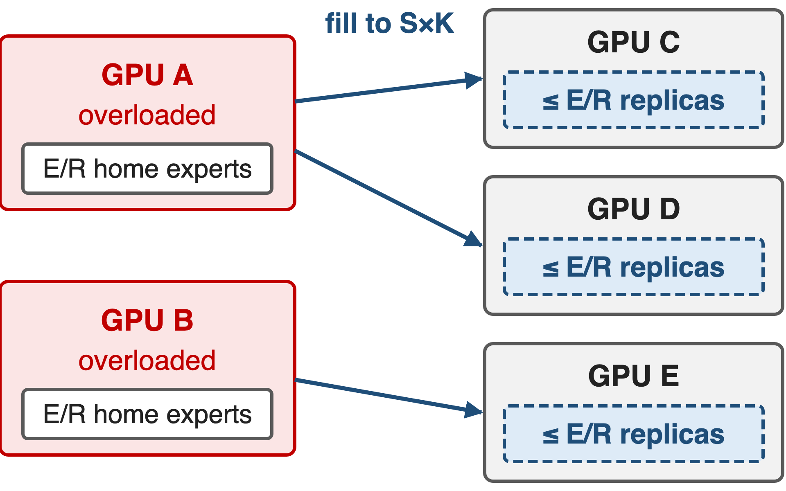{right 50%}
- Fill each under-loaded GPU from **one** overloaded GPU
- Its replicas come from E/R home experts
- Tight: some routings need ≈ E/R
> Every GPU always gets exactly S×K tokens, so every shape is static
<!-- notes: This is the fact the whole library rests on (K3 Sec. 5.2.1 and Appendix E, Theorems 1 and 2). Greedily fill each under-loaded GPU up to S×K from a single overloaded GPU; then every GPU imports tokens from one home GPU only, and that GPU owns just E/R experts, so at most E/R replicas are needed. Some routings need ceil(E(R-1)/R^2) replicas, which approaches E/R, so the bound cannot be improved much. With the slots reserved, a plan always exists, training never stops, and because every GPU receives exactly S×K tokens all shapes are known in advance. Deck 20 walks through the construction. -->

# MoonEP stacks four calls on NVLink buffers
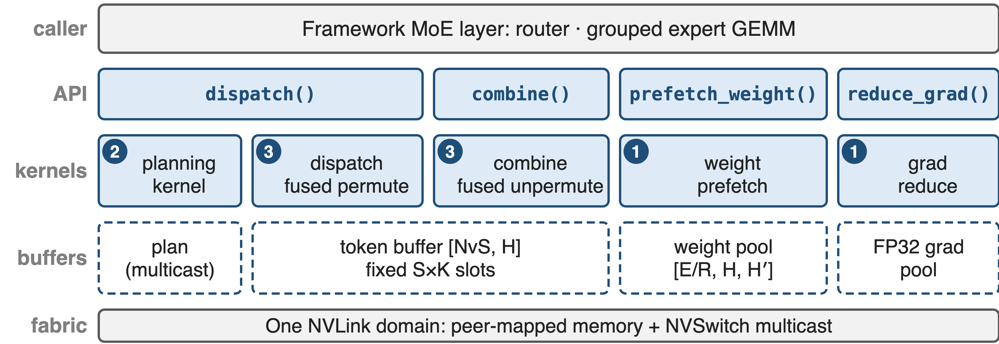{full}
%% caption: ❶ dynamic redundant experts · ❷ online GPU planning · ❸ zero-copy static shapes (deep dive: deck 20)
<!-- notes: The framework keeps its router and grouped expert GEMM and calls four functions per MoE layer. dispatch runs the planning kernel and then a dispatch kernel that writes each token straight into its expert-grouped slot on the destination GPU; combine is the reverse with a fused unpermute; prefetch_weight copies the replicas' weights; reduce_grad sends replica gradients home. Everything sits on NVLink peer-mapped buffers allocated once, plus NVSwitch multicast for the plan (moonep/api.py, planning.py). There is no RDMA path: MoonEP works inside one NVLink domain, which can span nodes on multi-node NVLink systems. -->

# ❶ Hot experts get replicas for one micro-batch
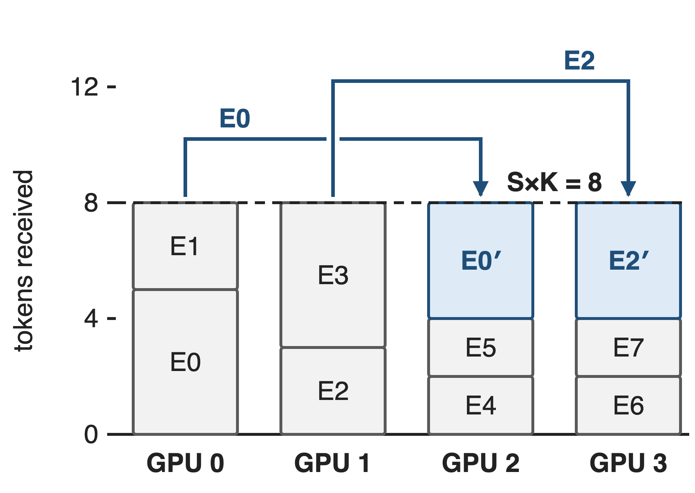{right 55%}
- Plan sends part of E0, E2 to GPU 2-3
- Forward: **prefetch** replica weights
- Backward: **reduce** replica grads home
> Every GPU computes exactly S×K tokens; gradients match the unreplicated model
<!-- notes: Same example after planning. GPU 2 now hosts a temporary replica of E0 and GPU 3 one of E2, and each GPU receives exactly 8 copies. Before the expert GEMM, prefetch_weight pushes the replica weights over NVLink into a pool that all layers share (E/R slots per projection); in the backward pass the replicas' FP32 gradients are read back and added into the home expert's gradient, so the optimizer sees the same gradient as without replication (README, weight and gradient buffers). Deep dive: deck 20. -->

# ❷ One GPU kernel plans every layer
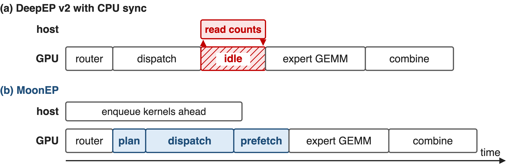{full}
> Planning ≈ 2% of dispatch time (≈ 45 µs), per micro-batch and layer
<!-- notes: Schematic durations. In DeepEP v2's training mode the host reads per-expert counts before it can size outputs and launch the expert GEMM, so the GPU idles. MoonEP's plan is one cooperative GPU kernel: every GPU pushes its token-per-expert counts to GPU 0 over NVLink, GPU 0 solves the plan and multicasts it, and all GPUs compute each token's destination slot (planning.py). Because shapes are fixed, the host just enqueues kernels ahead. The 2% / 45 µs figure is estimated from the green planning segment in the README's dispatch chart (about 40-50 µs of a 2.4-2.6 ms dispatch); the README itself only says negligible. -->

# ❸ Balance pins the token buffer at S×K
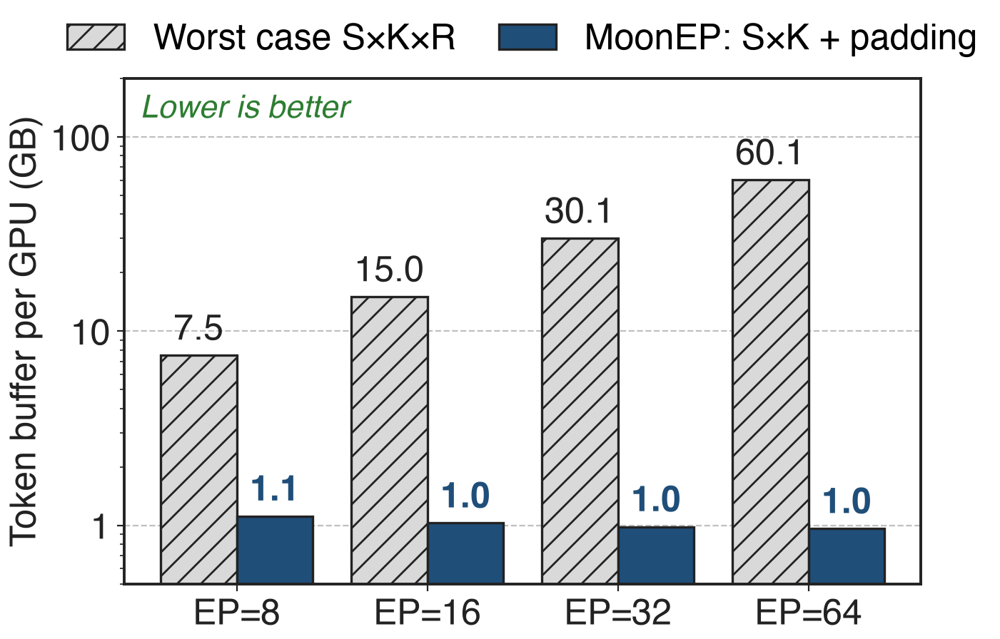{right 58%}
- Tokens land directly in expert-grouped slots
- GEMM reads buffer views: ==no copies==
- Fixed shapes: ==no per-layer host sync==
%% caption: Analytic: BF16, S=8192, K=8, H=7168, E=384
<!-- notes: K3 Sec. 5.2.1: to keep the same copy-free path under worst-case imbalance, a dynamic-shape library needs an S×K×R buffer, while MoonEP needs a fixed S×K one. The chart evaluates both formulas at the README benchmark shape; MoonEP's real allocation adds per-expert padding slack to 128-token multiples (moonep/api.py), so 1.1 GB instead of 0.94 GB at EP=8, against 7.5 GB, and the gap grows linearly with EP size. With zero_copy=True, dispatch returns views of this buffer and the expert FFN writes its output in place. Deep dive: deck 20. -->

# EP comm stays flat; DeepEP v2 grows 15%
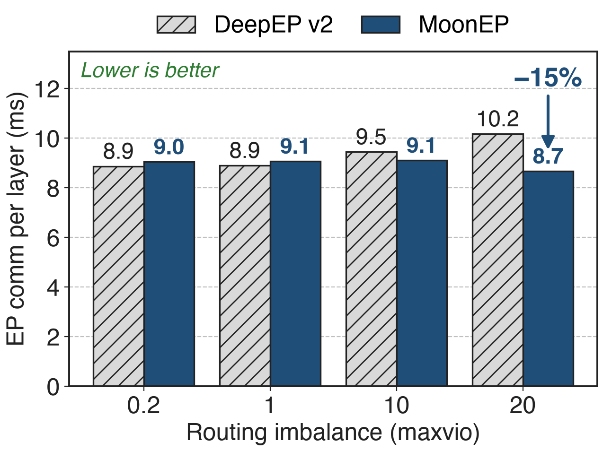{right 58%}
- Dispatch + combine, forward + backward
- MoonEP bars include plan + prefetch
- 8×H20, EP=8, E=384, S=8192
> +2% when balanced (maxvio 0.2), −15% at maxvio 20
<!-- notes: Sums of the 16 labeled bars in the README's MoonEP vs DeepEP v2 chart (dispatch and combine, forward and backward; 32 SMs each; DeepEP v2 elastic path with expanded layout). MoonEP: 9.0, 9.1, 9.1, 8.7 ms; DeepEP v2: 8.9, 8.9, 9.5, 10.2 ms at maxvio 0.2, 1, 10, 20. Combine alone stays at 1.93-1.98 ms for MoonEP while DeepEP's grows from 2.13 to 2.47 ms. MoonEP's dispatch is slower at low skew because it also pays planning and weight prefetch. -->

# Iterations up to 11.1% faster; DeepEP OOMs at 20
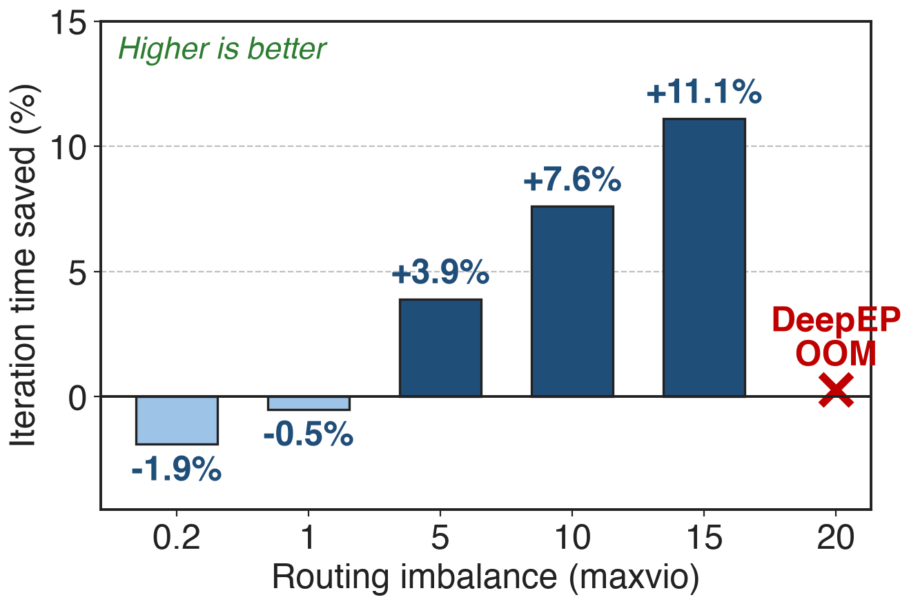{right 58%}
- 9-layer model: E=256, top-8, seq 16k
- MoonEP iteration time flat across maxvio
- Static shapes: no fragmentation, no OOM
> Balance has a small price: −1.9% at maxvio 0.2
<!-- notes: Labeled values of the README end-to-end chart (8×H20, EP=8, H=7168, E=256, top-8, expert hidden 2048). The percentage is DeepEP's iteration time minus MoonEP's, divided by DeepEP's: -1.9% and -0.5% when routing is nearly balanced, then +3.9%, +7.6%, +11.1% at maxvio 5, 10, 15. At maxvio 20 DeepEP runs out of memory and MoonEP still trains. This is a 9-layer benchmark model, not the full K3 run; K3's report gives no end-to-end MoonEP-vs-DeepEP number. For scale, the repo's routing generator calls lognormal sigma = 1 'typical dropless-MoE skew'; re-simulating that generator at E = 384 gives maxvio of roughly 8 to 13 (derived, see sources), so the winning region is not exotic for that generator, though it is still synthetic. -->

# Kimi K3 runs on it; DeepEP added its primitives
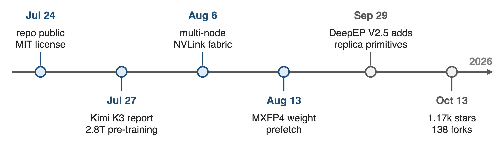{full}
> K3's 2.8T pre-training runs on MoonEP; DeepEP V2.5 ships its replica prefetch and grad reduce
<!-- notes: K3's report (Sec. 5.2.1) describes MoonEP as its perfectly balanced EP scheme for 2.8T pre-training. DeepEP V2.5, released 2026-09-29, added lb_prefetch_weights and lb_reduce_grads, which its README says support the expert-replication approach explored by MoonEP and UltraEP; the planning stays with the caller (DeepEP README; DeepEP v2 is deck 24). The MoonEP repo was created on 2026-07-24, three days before the K3 report appeared on arXiv (2026-07-27); it had 1,170 stars and 138 forks on 2026-10-13, added multi-node NVLink fabric support on 2026-08-06 and MXFP4 expert-weight prefetch on 2026-08-13; a Zhenwu PPU port is listed as under review. -->

# Costs: prefetch time, a weight pool, NVLink only
- **Prefetch**: ≈0.5-0.75 ms per dispatch
- **Pool**: E/R experts + FP32 grads: 4.2 + 8.5 GB at EP=8
- **Scope**: one NVLink domain; per-expert skew remains
> Pays off under skew; near balance, DeepEP v2 is slightly faster
<!-- notes: The prefetch range is estimated from the purple segments of the README dispatch chart. The pool size is derived: E/R = 48 experts per projection times three projections times 7168 x 2048, in BF16 (4.2 GB) plus the FP32 reduce buffer (8.5 GB), shared by all layers (README buffer layout). Buffers are NVLink peer mappings plus NVSwitch multicast, so there is no RDMA path. Balance is per GPU, not per expert: inside a GPU, expert segment sizes still vary, so K3 adds a workload-aware expert-GEMM scheduler (K3 Sec. 5.2.1). Benchmarks are 8×H20 with synthetic lognormal routing. -->

# Summary
- Skew overloads the hottest GPU; DeepEP v2 OOMs at maxvio 20
- ==Insight==: ≤ E/R replicas per GPU give exactly S×K tokens
- ❶ per-micro-batch replicas · ❷ GPU planning · ❸ zero-copy buffer
- **−15%** EP comm, **11.1%** faster steps under skew
- **1.1 GB** vs **7.5 GB** token buffer at EP=8
%% qr: https://github.com/MoonshotAI/MoonEP
<!-- notes: Deep dive into the three mechanisms: deck 20. Related: deck 24 (DeepEP v2, the baseline and now a host of the replica primitives), deck 55 (loss-free balance routing) and deck 56 (Quantile Balancing), which balance the router on average while MoonEP balances each micro-batch exactly. Numbers: comm and e2e from the README charts at maxvio 20 and 15; buffer sizes analytic at EP=8. -->
