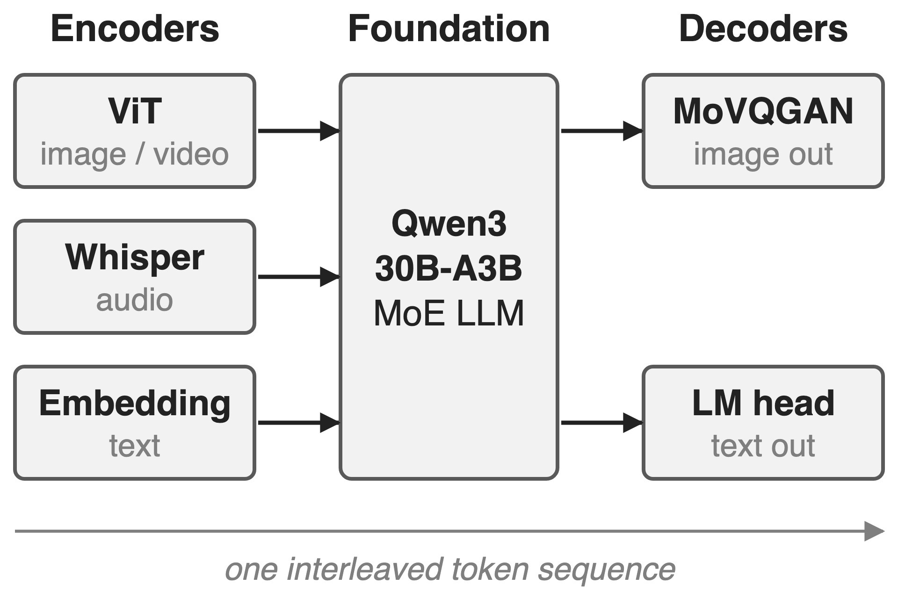
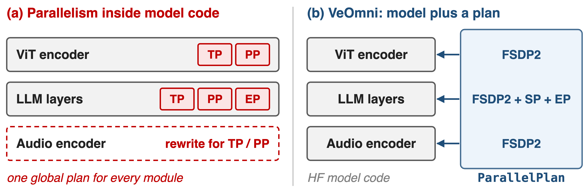
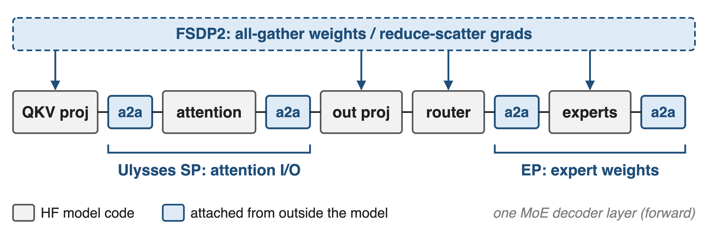
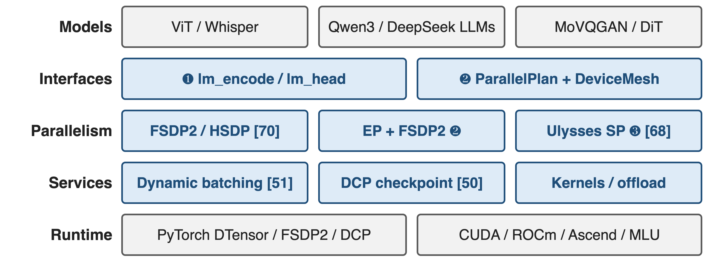
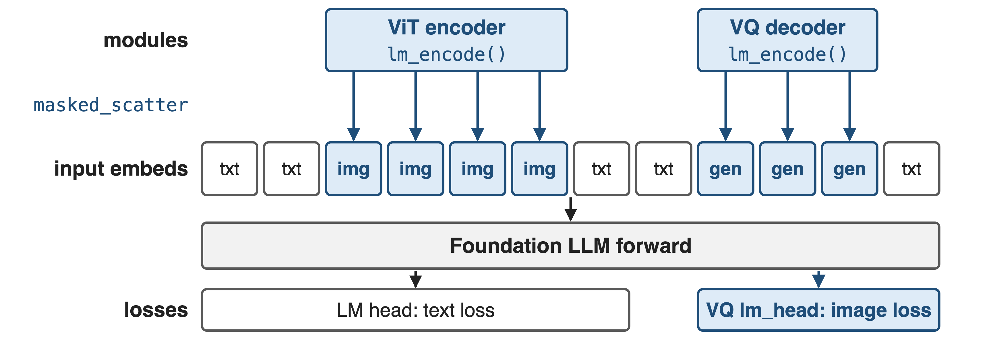
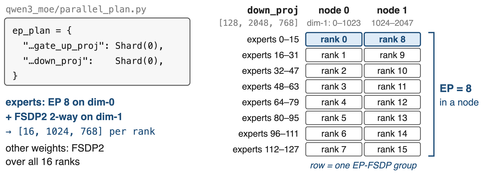
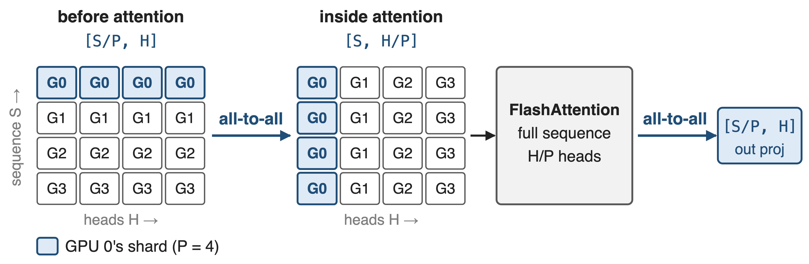
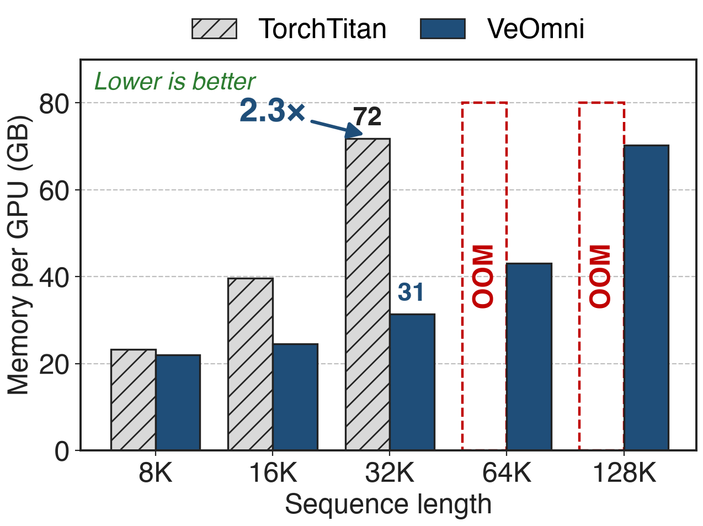

# Omni models = encoders + LLM + decoders
{right 55%}
- Each part pretrained separately, with its own shape
- One sequence mixes text, image, video, audio
- Goal: train any-to-any, end to end
<!-- notes: An omni-modal LLM is a composite: modality encoders such as a ViT or Whisper turn raw inputs into token embeddings, an LLM backbone (the paper calls it the foundation) processes one interleaved sequence, and decoders such as an image tokenizer turn hidden states back into images. The example is the paper's Qwen3-MoE#Omni: Qwen2.5-Omni ViT and Whisper encoders, a Qwen3-30B-A3B backbone and a MoVQGAN image decoder. Source: VeOmni arXiv 2508.02317 §3.1 and §4.3. -->

# 3D parallelism wastes half the GPU cycles
%% big: > 48%
%% sub: of GPU cycles idle: >100B ViT+GPT model, Megatron-LM, 3,000+ GPUs
%% source: Optimus (ByteDance, ATC'25), arXiv 2408.03505 §2.2; cited by VeOmni as its evidence [17]
<!-- notes: This is the cost of training a multimodal model with a framework built for text LLMs. ByteDance's Optimus paper profiled an internal multimodal model with a ViT encoder and a GPT backbone of over 100B parameters on Megatron-LM across more than 3,000 GPUs: over 48 percent of GPU cycles were idle, even with MegaScale, zero-bubble pipelining and fine-grained overlap, because one uniform plan stages a small encoder and a huge LLM together. VeOmni cites this work for exactly that imbalance. Source: Optimus §1 and §2.2, Table 1 (5.12 s average step). -->

# In-model parallel code blocks new modalities
{full}
> Each new modality means new parallel code, and one global plan fits no module well
<!-- notes: Megatron-style frameworks get their speed from model blocks rewritten around tensor and pipeline parallelism, and they apply one plan to every module. A new encoder must first be ported into those blocks. Multimodal systems such as DistMM, DistTrain and Optimus fix parts of the efficiency problem for any-to-text models, but VeOmni argues they still couple communication with computation and none trains any-to-any end to end. Source: VeOmni §1, §2.2, Fig. 1. -->

# Insight: each strategy touches one boundary
{full}
> So parallelism can be a per-module plan, applied from outside the model
<!-- notes: Look at where each strategy actually touches a layer. FSDP only needs the parameters: gather them before a module runs, reduce-scatter the gradients after. Ulysses sequence parallelism only needs the attention boundary: one all-to-all before the attention core and one after. Expert parallelism only needs the expert weight tensors, plus the token all-to-all inside the fused MoE op. None of them needs to rewrite the rest of the model, so the model can stay a plain HuggingFace definition. Source: VeOmni §3.2.1-3.2.3, App. B.5-B.7. -->

# VeOmni puts recipes under unmodified models
{full}
%% caption: Accent = VeOmni-owned; gray = HF models, PyTorch, hardware; [N] = sibling explainer deck
<!-- notes: This is the map for the rest of the talk. HuggingFace modules on top; VeOmni adds two interfaces: the omni protocol for plugging modalities in, and a declarative parallel plan over one global DeviceMesh. Below that are the recipes: FSDP2 or HSDP everywhere, EP combined with FSDP2 for experts, and Ulysses sequence parallelism. Services such as dynamic batching (deck 51) and distributed checkpointing (deck 50) also live outside the model. The runtime is plain PyTorch DTensor, FSDP2 and DCP, on CUDA, ROCm, Ascend or Cambricon. Sources: VeOmni §3, App. B; README; hardware docs. -->

# ❶ Modalities plug in via lm_encode and lm_head
{full}
> Encoders and decoders extend HF PreTrainedModel plus a mixin, with no parallel code
<!-- notes: Each encoder implements lm_encode, which turns raw pixels or audio into token embeddings; masked_scatter writes them into the positions that the per-modality input mask marks in the foundation's input embeddings. For generation, the decoder's lm_encode embeds the target image tokens for teacher forcing, and its lm_head computes the image-token loss next to the text loss. At inference, lm_embed and lm_generate close the loop. Source: VeOmni §3.1, Fig. 2, Listing 3. -->

# ❷ A two-entry plan shards experts on a 2D mesh
{full}
%% caption: Worked example from VeOmni's EP+FSDP2 docs: Qwen3-30B-A3B (128 experts) on 2 × 8 GPUs; EP size × EP-FSDP size = world size
<!-- notes: The whole expert-parallel plan of Qwen3-MoE is two wildcard entries mapping the fused expert weights to Shard(0). On 16 GPUs with EP 8, each GPU in a node holds 16 of the 128 experts; ranks holding the same experts on the two nodes form an EP-FSDP group that shards dimension 1, so each rank stores 16 by 1024 by 768 of down_proj. Sharding FSDP on dimension 1 means EP times FSDP size need not equal the expert count. Everything else is FSDP2 over all 16 ranks. The price: separate optimizers, LR schedulers and grad clipping for expert and non-expert parameters. Sources: docs/key_features/ep_fsdp2.md; qwen3_moe/parallel_plan.py. -->

# ❸ Ulysses re-shards attention with two all-to-alls
{full}
> Only attention sees the full sequence; norms and MLPs keep S/P tokens per GPU
<!-- notes: With Ulysses size P, each GPU holds S over P tokens with all heads. Before attention, an all-to-all gathers the sequence and scatters the heads, so each GPU runs ordinary FlashAttention over the whole sequence for H over P heads; a second all-to-all restores the sequence sharding. VeOmni wraps HuggingFace's flash-attention forward, so model code does not change, and Async-Ulysses overlaps the all-to-alls with the linear projections. Communication volume stays constant when sequence length and P grow together; the head count must be divisible by P. Ring-style context parallelism: deck 68. Sources: VeOmni §3.2.2, App. B.6; docs ulysses.md. -->

# Batching and checkpoints stay outside too
%% layout: two-col
- **Dynamic batching** (deck 51)
- Pack samples to a token budget
- `cu_seqlens` keeps attention per sample
|||
- **DCP checkpoints** (deck 50)
- Weights and optimizer saved as shards
- Reload under a different mesh
> Neither service touches the model definition
<!-- notes: Two more services follow the same rule. Dynamic batching buffers samples and packs them to a target token budget instead of padding; FlashAttention's cumulative sequence lengths keep attention inside each sample (deck 51). Checkpoints are written with PyTorch Distributed Checkpoint, weights and optimizer as separate sharded directories, and VeOmni supports resharding loads across parallelism patterns, so a job can resume on a different mesh (deck 50). The paper used ByteCheckpoint; the open-source repo uses DCP. Sources: VeOmni §3.2.5; docs data_packing_and_dyn_bsz.md, checkpoint.md, extra_parallel.md. -->

# A 30B omni MoE trains at 2,800+ tokens/s/GPU
%% big: 2,800+
%% tone: ours
%% sub: tokens/s/GPU: 30B omni-modal MoE, FSDP + SP + EP on 128 GPUs
- Context reach: **160K** (30B MoE), **192K** at 61.5% MFU (7B), **96K** at 54.82% MFU (72B)
%% source: VeOmni arXiv 2508.02317, Abstract and §4.2 (Fig. 4-6)
<!-- notes: The headline number: a 30B mixture-of-experts omni-modal model built on Qwen3-30B-A3B trains at over 2,800 tokens per second per GPU with 3D parallelism on 128 GPUs. Context is a separate claim: with more SP and EP the same model reaches 160K tokens, at lower throughput. Dense Qwen2-VL models reach 192K tokens at 61.5 percent MFU for 7B on 8 GPUs and 96K at 54.82 percent for 72B on 128 GPUs. Encoders and decoders were frozen in these runs. Sources: Abstract; §4.1-4.2. -->

# Same recipe, 2.3× less memory than TorchTitan
{right 60%}
- Qwen2-7B text model, FSDP, 128 GPUs
- Both with full activation checkpointing
- TorchTitan OOMs at 64K and 128K
<!-- notes: No other framework trains any-to-any models, so the paper compares against TorchTitan on text-only models. Same model, same 128 GPUs, micro-batch 1, global batch 128: at 32K VeOmni needs 31.41 GB per GPU against 71.81 GB, 2.3 times less (derived), and it is also faster, 5,315 versus 4,878 tokens per second per GPU. At 64K and 128K TorchTitan runs out of memory while VeOmni needs 43 and 70 GB. Source: App. A Table 1. -->

# VeOmni spans model families and accelerators
%% layout: two-col
- **Models**: DeepSeek-V3/V4, Qwen3-VL MoE, Qwen3-Omni, Wan 2.1
- **Hardware**: CUDA, ROCm, Ascend, Cambricon MLU
|||
- **Users**: UI-TARS-2, LMMs-Engine, dFactory, LingBot-VLA
- Open since 2025/04; v0.1.0 in 2025/09
> The ROCm port adds no HIP code: the training path is device-agnostic
<!-- notes: The model zoo now covers text LLMs up to DeepSeek-V3 and V4, vision-language MoE, omni models and video diffusion transformers. On AMD the repo has been validated end to end on 8 MI308X GPUs; on Ascend it supports A2, A3 and 950 series; on Cambricon MLU most of the device-agnostic path, FSDP2, Ulysses, EP and checkpointing, runs as is. Public users include UI-TARS-2, LMMs-Engine, dFactory and LingBot-VLA. Ascend adaptation in a production stack: deck 23. Sources: README (News, Supported Models, Awesome work); docs/hardware_support. -->

# The cost: no PP, per-model patches, low MoE MFU
%% layout: two-col
- !!No pipeline parallelism!!: listed as future work
- !!Per-model files!!: omni MoE needs `__init__.py` + 4 more
|||
- Text MoE runs: **7–18%** MFU
- Only text baselines; encoders frozen in eval
- Ulysses: heads divisible by SP size
> Decoupled is not free: a plan per model, a patch per architecture
<!-- notes: VeOmni avoids pipeline parallelism entirely; the paper names non-intrusive PP as future work, so very large dense models lean on FSDP plus SP. Decoupling is not zero-code: the integration guide lists only an init file for a dense text model but an init file plus four more for an omni-modal MoE, covering SP position slicing, fused MoE and the EP plan. The text-only Qwen3-30B-A3B runs report 7.45 to 17.92 percent MFU. All comparisons are against TorchTitan on text models, and the omni runs freeze encoders and decoders. Sources: §5; docs guide_and_checklist.md; App. A Table 4; §4.1; docs ulysses.md. -->

# Summary
- Uniform LLM parallelism: **> 48%** GPU cycles idle on a large MLLM
- ==Insight==: FSDP, SP, EP each touch one boundary, so plan them per module
- **2,800+** tokens/s/GPU 30B omni MoE; **160K** context; **2.3×** less memory than TorchTitan
- Deep dives: decks 50, 51; related 68, 70, 11
%% qr: https://arxiv.org/abs/2508.02317
<!-- notes: VeOmni's bet is that omni-modal training needs the model and the parallel plan to be separate objects. Because FSDP, Ulysses and EP each touch one narrow boundary, a two-entry plan and a device mesh replace rewritten model code. The children decks cover checkpoint resharding (50) and packing (51); related decks cover context parallelism (68), Megatron-FSDP (70) and pipeline-level EP overlap (11), the approach VeOmni deliberately avoids. -->
