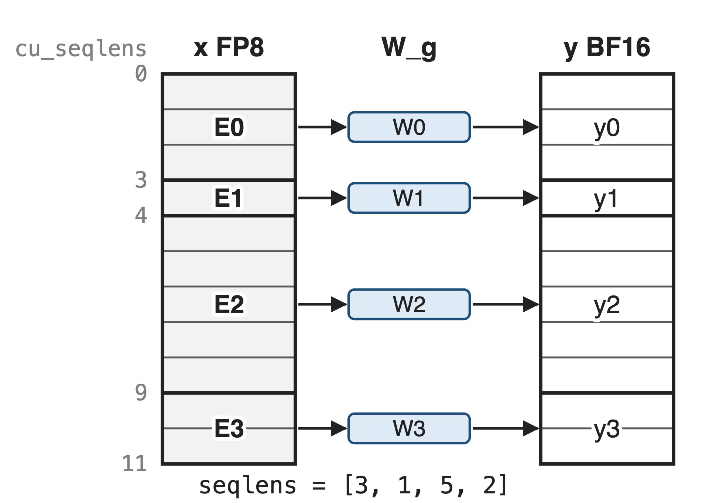
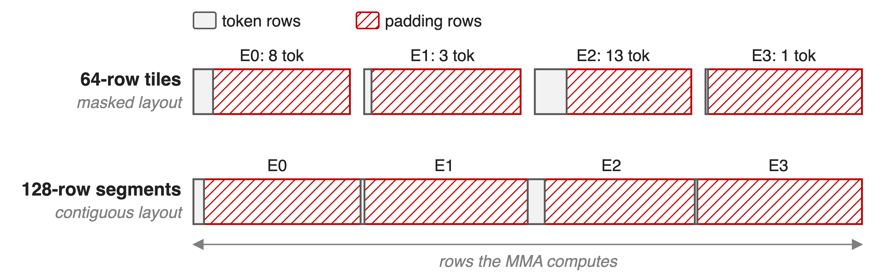
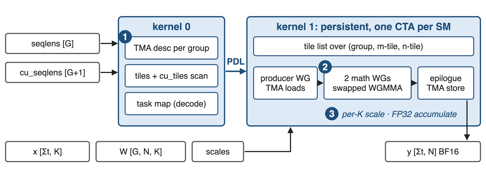
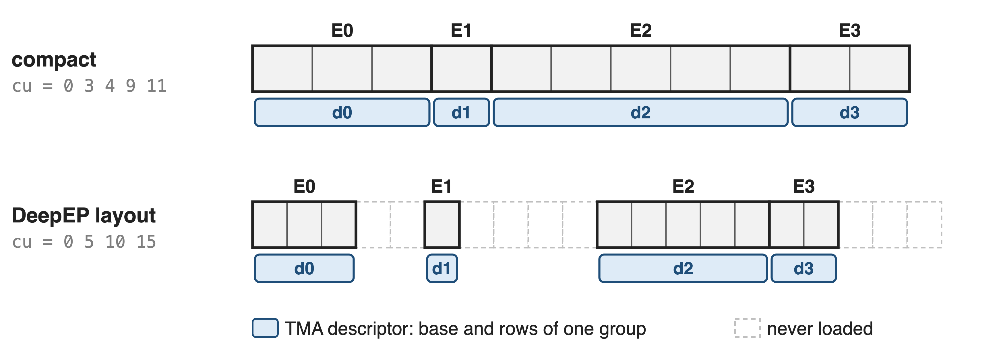
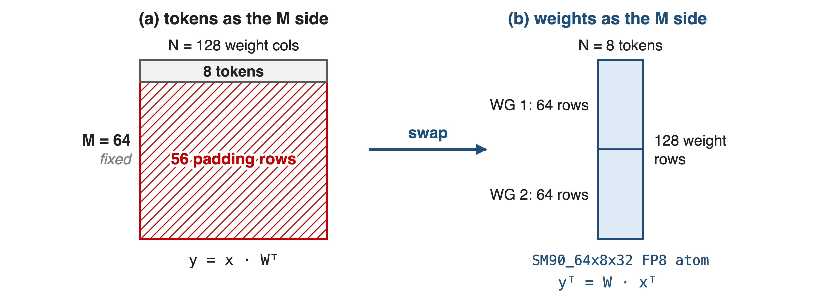
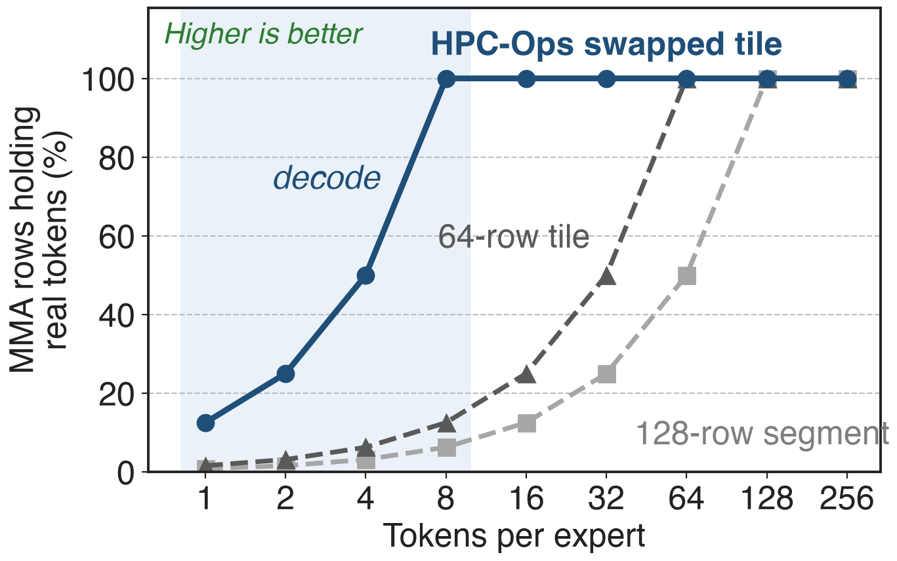
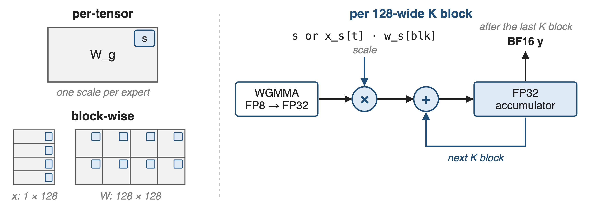
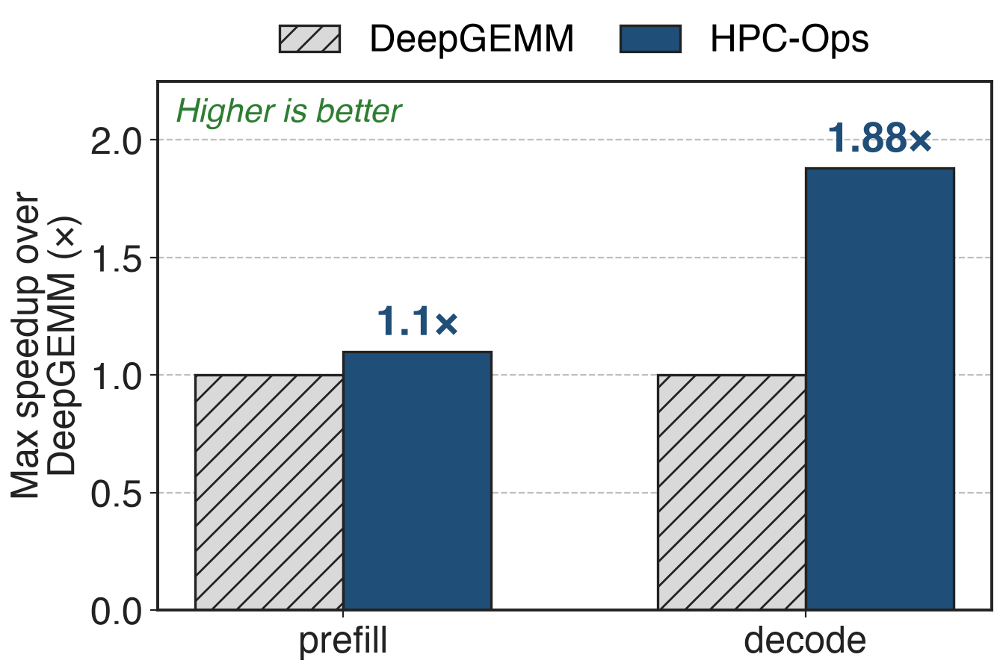

# MoE layers multiply every expert's tokens at once
{right 55%}
- One group per expert: y_g = x_g · W_gᵀ
- Group sizes change every step
- FP8 e4m3 in, BF16 out, on H20 (SM90)
<!-- notes: After routing, each expert owns a contiguous slice of the token matrix, and the grouped GEMM multiplies every slice by its own expert weight in a single launch. HPC-Ops takes the token counts as seqlens and the start offsets as cu_seqlens, both on the GPU; the README calls them num_tokens_per_group and cu_num_tokens_per_group. Inputs are FP8 e4m3, the output BF16, and the kernels are SM90-only and tuned for H20. Running example: four experts with 3, 1, 5 and 2 tokens. Sources: hpc/group_gemm.py docstrings; src/group_gemm/entry.cc dtype checks; README Basic Usage. -->

# Decode experts fill one-eighth of a tile
%% big: 87.5%
%% sub: of a 64-row MMA tile is padding when an expert receives 8 decode tokens (analytic)
%% source: Hopper FP8 WGMMA atoms are 64×N×32 (CUTLASS cute SM90 GMMA); DeepGEMM SM90 grouped BLOCK_M ≥ 64; 8 tokens per group as in the HPC-Ops README example
<!-- notes: During decode each expert sees only a handful of tokens; the HPC-Ops README's own example uses 8 per group. Grouped GEMMs that tile along tokens inherit Hopper's fixed 64-row MMA height: DeepGEMM's smallest grouped tile on SM90 is 64 rows, so 8 real tokens leave 56 of 64 rows, 87.5 percent, as padding. Padded rows still cost load, issue and register space. Derivation: 1 − 8/64, in notes/sources.md. -->

# Token-major tiles pad every small expert
{full}
> The contiguous layout also forces each expert onto a 128-row boundary
<!-- notes: Two common layouts, both token-major. With the masked layout used for CUDA-graph decode, every expert gets at least one 64-row tile. With the contiguous layout every expert segment must start on the GEMM's M-block boundary, 128 rows by default, so the producer has to emit padded, aligned segments. The red area is computed but thrown away. Sources: DeepGEMM README "Grouped GEMMs (contiguous layout)" and "(masked layout)"; DeepGEMM csrc/jit_kernels/heuristics/sm90.hpp (masked BLOCK_M 64 or 128; contiguous BLOCK_M = alignment) and runtime.hpp (alignment 128). Deep dives: decks 33 and 34. -->

# Insight: put tokens on the MMA's narrow side
- Hopper FP8 MMA: M fixed at **64**; N from **8** to **256** in steps of 8
- Weights always fill 64 rows; decode tokens rarely do
--
> Compute yᵀ = W · xᵀ: weights take M, tokens take N, and the tile shrinks to 8
<!-- notes: Every SM90 FP8 warpgroup MMA has a fixed M of 64 but a flexible N, from 8 to 256 in steps of 8. Expert weights have thousands of output rows, so they always fill the fixed side; tokens are the small, variable dimension. Swapping the operands, so the kernel computes y transposed equals W times x transposed, puts tokens on the flexible side, where a tile can be as narrow as 8. Sources: 3rd/cutlass cute/arch/mma_sm90_gmma*.hpp (MMA_64xNx32 E4M3 atoms, N = 8..256); src/group_gemm/sm90/config.h mma_selector (64x8x32 … 64x64x32 atoms). -->

# Kernel 0 describes groups, kernel 1 streams tiles
{full}
%% caption: Same structure for per-tensor and block-wise scaling; the per-tensor path launches kernel 1 with PDL
<!-- notes: A tiny first kernel with one CTA per group turns seqlens and cu_seqlens into per-group TMA descriptors, counts each group's tiles and scans them into cu_tiles; for decode-sized groups it can also write an explicit task map. The main kernel is persistent, one CTA per SM, with a producer warpgroup issuing TMA loads into an 8-stage shared-memory ring and two math warpgroups running the swapped WGMMA, then a TMA store of BF16 output. Each CTA walks a flattened list of (group, m-tile, n-tile) tiles. Sources: src/group_gemm/sm90/group_gemm_pertensor_fp8.cu; kernels.cuh (update_grouped_tma, group_gemm_fp8_kernel). -->

# ❶ cu_seqlens become per-group TMA descriptors
{full}
> No padding copy, no host sync: seqlens = how many, cu_seqlens = where
<!-- notes: For every group, kernel 0 rewrites a TMA descriptor whose base is x plus cu_seqlens of g times K and whose row count is seqlens of g, and does the same for the output. TMA then zero-fills loads past the group's last row and clips stores, so tiles never mix experts and the input never has to be padded. Because "how many" and "where" are separate tensors, the same kernel reads a compact layout or DeepEP's strided per-expert buffers, where cu_seqlens is simply g times the slot size; the tests use 30 valid tokens in 1,280-row slots. Sources: kernels.cuh update_grouped_tma; tests/test_group_gemm_blockwise.py (DeepEP input format). -->

# ❷ Swapping operands lets the tile shrink to 8
{full}
> Token tile follows the average group size: 8, 16, 32, 48 or 64
<!-- notes: In HPC-Ops the weight tile, 128 rows, is the MMA's A operand split over two math warpgroups of 64 rows each, and the token tile is the B operand. The host passes num_seq_per_group_avg, the only size the CPU needs, and the launcher picks a token tile of 8, 16, 32, 48 or 64; the table is deliberately non-monotonic above 64 (for example 128 tokens per group uses 32-wide tiles) to balance tile counts across SMs. Sources: kernels.cuh (partition_A(sB) = weights, partition_B(sA) = tokens); group_gemm_pertensor_fp8.cu tile table; config.h. -->

# At decode sizes, 8× more MMA rows do work
{right 55%}
- 8 tokens: **100%** vs **12.5%**
- 1–4 tokens: still **8×** a 64-row tile
- Equal from 64 tokens up
%% caption: Analytic, uniform group sizes; tile rules from HPC-Ops and DeepGEMM source
<!-- notes: This is arithmetic, not a measurement: the fraction of computed rows that hold real tokens, for equal-sized groups, using HPC-Ops' tile table and the 64-row and 128-row token tiles of the token-major designs. At 8 tokens per expert the swapped tile is fully used while a 64-row tile is one-eighth used; below 8 tokens the ratio stays 8 to 1; by 64 tokens per expert the designs converge, which matches the small prefill gain on the next slides. Derivation in notes/sources.md. -->

# ❸ One mainloop handles both FP8 scalings
{full}
> Every 128-wide K block is scaled and promoted into FP32 registers
<!-- notes: The per-tensor kernel takes one FP32 scale per expert; the block-wise kernel takes a scale per token per 128 columns of K for activations and one per 128 by 128 block for weights, the DeepSeek-V3 recipe. Both run the same loop: each K block's WGMMA starts from zero, its FP32 result is multiplied by the scale and added into a separate FP32 accumulator, and the BF16 output is written once at the end. In the block-wise path TMA brings the scale slices into shared memory with each stage. Sources: kernels.cuh (tDr = tCr * scale + tDr; block-wise tCS = x_scale × w_scale); hpc/group_gemm.py shapes. -->

# Up to 1.88× over DeepGEMM at decode
{right 55%}
- Prefill: up to **1.1×**
- Expert grouped matmul, H20
- Consistent with the tile analysis: gains where groups are small
%% caption: Maximum observed speedups as published in the HPC-Ops README; per-shape data not released
<!-- notes: HPC-Ops reports up to 1.88 times DeepGEMM's speed for decode-shaped grouped GEMMs and up to 1.1 times for prefill, on H20. These are maxima; the repository publishes no per-shape table or benchmark script for the standalone grouped GEMM, so the exact shapes are unknown. The pattern fits the mechanism: large gains when groups are small, little gain once tiles are full. Sources: README Performance table (current) and the January 2026 README "Maximum observed speedup per operator" table. -->

# The price: Hopper only, one shape per call
%% layout: two-col
- SM90 only, tuned on H20
- Same N and K for every group
- One tile size from the average
|||
- Block-wise: x_scale transposed and padded per group
- DeepEP input: reformat, K = **2048 / 4096 / 7168**
- Max-only results published
<!-- notes: The kernels dispatch only on SM90 and are tuned for H20. All groups share N and K, as in MoE. The token tile comes from the average group size, so a very skewed batch gets one tile size for all experts. The block-wise path needs x_scale transposed and padded per group to the tile; for DeepEP-format input HPC-Ops ships reformat_x_scale, which accepts K of 2048, 4096 or 7168. Results are published as maxima only, and the tile tables must agree across kernels: a mismatch hung the block-wise fused MoE for some sizes until PR 53 (June 2026). Sources: entry.cc; hpc/group_gemm.py; PR #53. -->

# Summary
- Decode experts get few tokens: a 64-row tile is **87.5%** padding at 8
- ==Insight==: swap operands so tokens take the MMA's 8-wide side
- cu_seqlens → per-group TMA descriptors; per-tensor and block-wise FP8
- Up to **1.88×** (decode) and **1.1×** (prefill) over DeepGEMM on H20
%% qr: https://github.com/Tencent/hpc-ops
<!-- notes: HPC-Ops' grouped GEMM keeps decode-sized expert GEMMs efficient by putting tokens on the flexible side of Hopper's MMA and by describing groups with device-side TMA descriptors instead of padding. Related decks: 26 (HPC-Ops overview), 31 (fused FP8 MoE built on these kernels), 33 and 34 (DeepGEMM's contiguous and masked grouped GEMMs), 25 (DeepGEMM). -->
