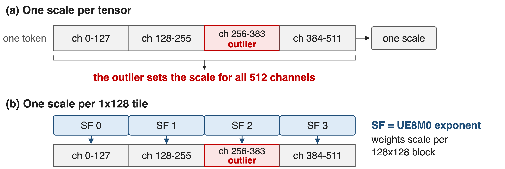
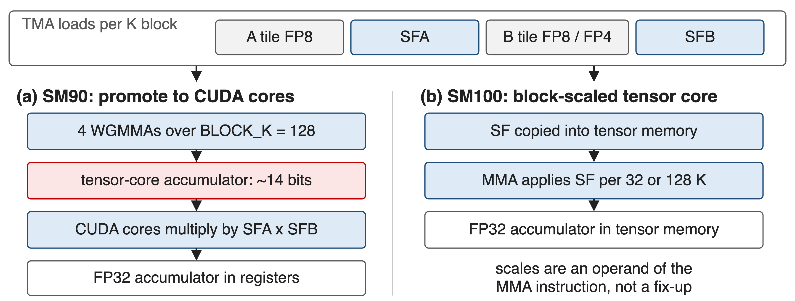
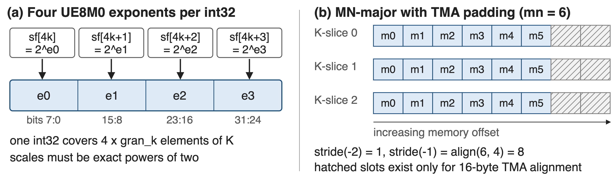
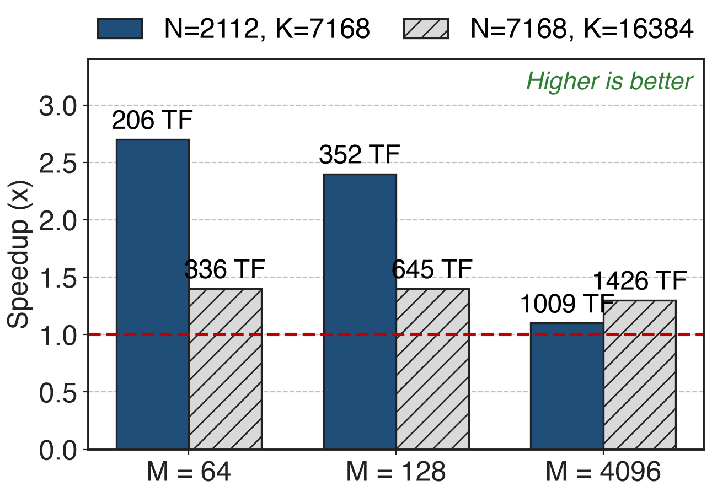

# FP8 is the training format, and it is narrow
- DeepSeek-V3 pre-trained **14.8T** tokens with FP8 linear layers
- E4M3 carries **3 mantissa bits**: max 448, min normal 2⁻⁶
- Every projection and expert FFN is one of these GEMMs
<!-- notes: The format numbers are Table 1 of the FP8-formats paper: E4M3 has a 4-bit exponent, 3-bit mantissa, max normal 448 and 18 binades of range. Narrow enough that how you scale matters more than that you scale. -->

# The tensor core's own accumulator loses precision
%% big: ~2%
%% sub: maximum relative error of an FP8 GEMM at K = 4096 — H800 tensor cores keep only about 14 bits of the accumulation
%% source: DeepSeek-V3 technical report, §3.3.2 (p. 17); error measured on two random matrices
<!-- notes: This is before any quantization error. The partial products are right-shifted to a common exponent and only the top ~14 bits are kept, so the error grows with K, exactly where large models live. FP32 accumulators in registers do not help: the truncation is inside the MMA. -->

# One scale per tensor cannot survive outliers
{full}
> Per-group scaling along K is "not directly supported" by a standard FP8 GEMM (DeepSeek-V3 §3.3.2)
<!-- notes: V3 calls FP8 training highly sensitive to activation outliers. Their fix is to scale per 1x128 activation tile and per 128x128 weight block, with the max-abs computed online rather than from a history. The catch is in the callout: a scale that changes along K has to be applied inside the GEMM's K loop, which a standard FP8 GEMM does not offer. -->

# Insight: make every scale an exact power of two
- A power-of-two scale is exactly representable and costs an exponent add
- It fits in **8 bits**: UE8M0, no sign, no mantissa
--
> Then the scale becomes an operand the TMA streams and the MMA consumes, not a fix-up outside the GEMM
<!-- notes: DeepGEMM asserts this on device: a scale factor whose sign or mantissa bits are non-zero trips an assert, and the cast kernels round scales to powers of two. That constraint is what makes packing into UE8M0 lossless. -->

# Scales ride with the tiles into the inner loop
{full}
%% caption: Same kernel family, two ways to apply the scale: CUDA-core promotion (SM90) or block-scaled MMA (SM100)
<!-- notes: Per K block the kernel TMA-loads the A tile, the B tile and both scale-factor blocks. On Hopper the WGMMA accumulator is the imprecise one, so the kernel promotes. On Blackwell the scale factors go into tensor memory and the tcgen05 MMA applies them itself. -->

# ❶ The recipe fixes the scale-factor shapes
- `recipe = (gran_m, gran_n, gran_k)`: one SF per `gran_m x gran_k` block of A
- `SFA: [ceil(M/gran_m), ceil(K/gran_k)]`, FP32 before transform
- V3 uses **1x128** activations, **128x128** weights; SM100 also takes 1x32
<!-- notes: The recipe describes storage granularity, not compute granularity. gran_k must be 128 on SM90; SM100 accepts 32 or 128, which is how MX-style FP4 weights fit in. On SM90, gran_n = 1 selects the 1d1d kernel and gran_n = 128 the 1d2d kernel. -->

# ❷ SM90 promotes to CUDA cores every 128 elements
- 4 WGMMAs fill the tensor-core accumulator, then CUDA cores apply `SFA x SFB`
- Partial sums land in **FP32 registers**; N_C = 128 is the minimal interval
- Two warpgroups overlap: one promotes while the other issues MMA
<!-- notes: V3 section 3.3.2 reports 128 elements, equivalent to four WGMMAs, as the smallest interval that fixes the precision without substantial overhead. The scale multiply is nearly free there because dequantization has to happen anyway. On SM100 this step disappears into the instruction. -->

# ❸ The layout contract: packed, MN-major, aligned
{full}
%% caption: packed_sf_k = ceil(K / (gran_k x 4)); pre-transformed factors are validated, not rebuilt
<!-- notes: Two ways to supply scale factors: FP32 and let DeepGEMM launch a transform kernel on every call, or hand over the packed int32 layout and have it only validated. Weights are transformed once and cached; activation scales come straight out of the quantization cast kernel in this layout. -->

# FP4 and BF16 ride the same path
- FP8 x FP4 weights: 1x32 scales, BLOCK_K = 256, two values per byte
- BF16 GEMM dispatches to cuBLASLt unless determinism is requested
- Epilogues can emit FP8 directly, with per-32 UE8M0 output scales
<!-- notes: The FP4 path is what V4 uses for routed expert weights. The BF16 note matters for reproducibility: with use_deterministic_algorithms(True) the library stays on its own kernels, which deck 39 covers. -->

# 2.7x at decode shapes, 1.3x at prefill
{right 60%}
- Red line: tuned CUTLASS 3.6 build, H800 SXM5
- At M = 64 the kernel is bandwidth-bound at **2.6 TB/s**
- Peak across shapes: **1550 TFLOPS**
<!-- notes: The gain is largest where the GEMM is small and memory-bound, which is decoding; at M=4096 with a big K the kernel is compute-bound and the margin narrows to 1.1-1.3x. All numbers from the March 2025 README table; the 1550 TFLOPS peak is the April 2025 release note. -->

# Fine-grained FP8 trains within 0.25% of BF16
%% big: <0.25%
%% tone: ours
%% sub: relative training-loss error of the FP8 recipe against a BF16 baseline, two model scales, about 1T tokens
%% source: DeepSeek-V3 technical report, §3.3.1 (p. 16) and Appendix B.1
<!-- notes: This is the number that justifies the whole scheme: the scaling layout is not just fast, it keeps FP8 training on the BF16 loss curve. V3 also reports no irrecoverable loss spikes across the full 14.8T-token run. -->

# What it costs you
- SM90: NT layout only, FP32 scale factors; SM100: all majors, packed UE8M0
- Scales must be exact powers of two; unpacked ones cost a transform per call
- Casting, transposition and scale production stay in your kernels
<!-- notes: The library optimizes the GEMM and expects the quantization cast to be fused into whatever produced the activations. If you hand it FP32 scale factors it will still work, but you pay a transform kernel launch on every GEMM call. -->

# Summary
- FP8 tensor cores keep ~**14 bits**: up to **~2%** error at K = 4096
- ==Insight==: power-of-two scales fit in 8 bits and stream with the tiles
- 1x128 and 128x128 scaling, promotion on SM90, block-scaled MMA on SM100
- **2.7x** over tuned CUTLASS at decode shapes, **1550 TFLOPS** peak, **<0.25%** loss error
%% qr: https://github.com/deepseek-ai/DeepGEMM
<!-- notes: Related decks: 25 is the DeepGEMM library overview, 32-34 the grouped GEMM layouts, 39 the JIT and determinism switches, 35 Mega MoE. -->
