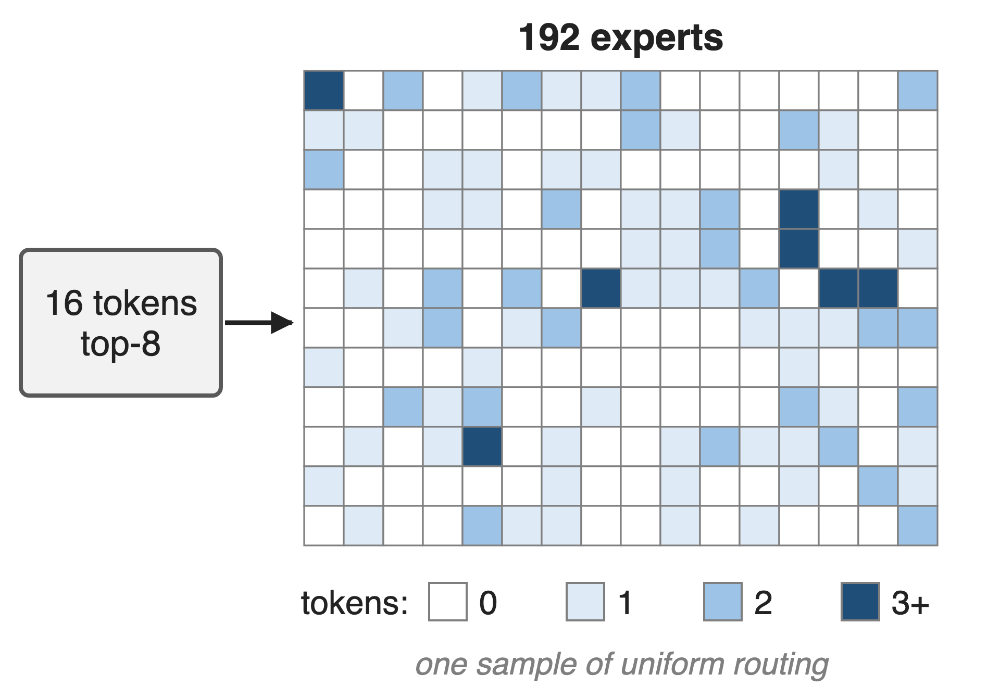
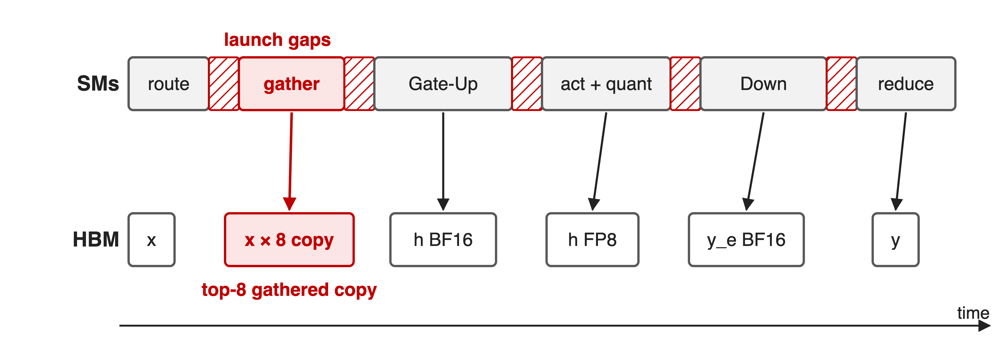
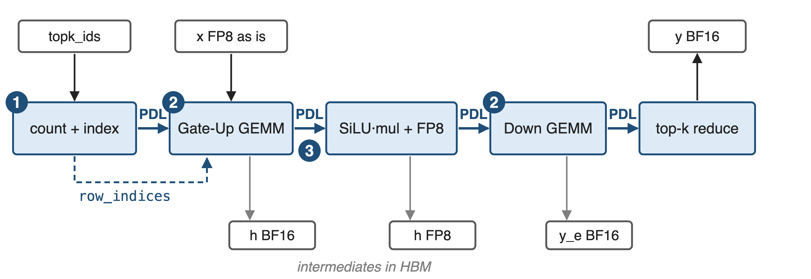
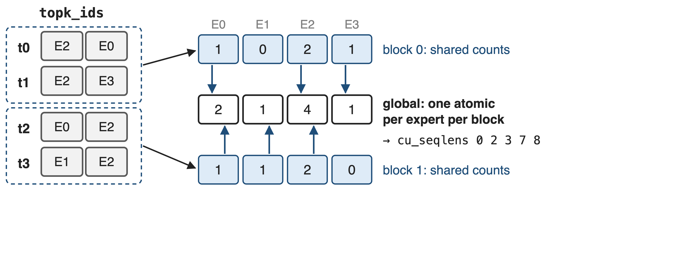
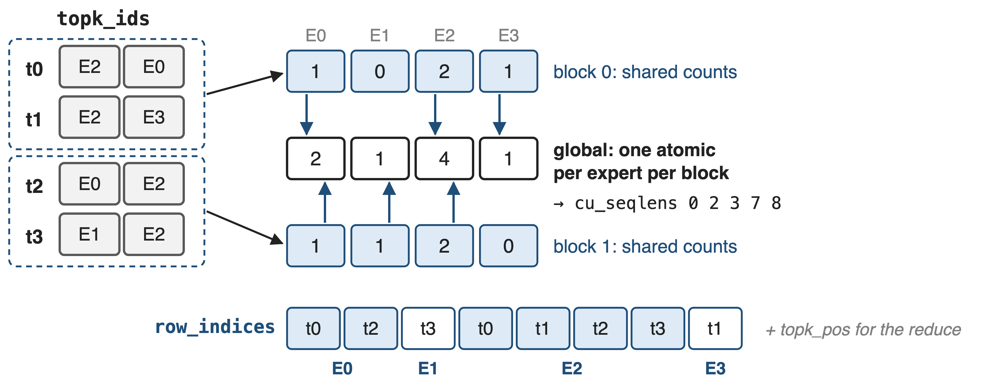
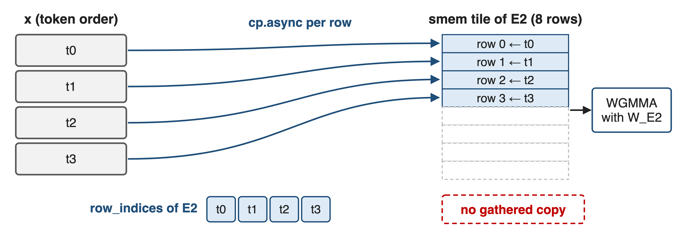
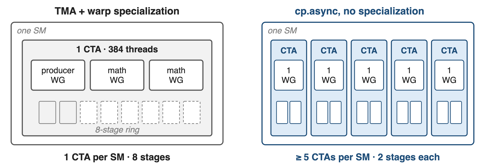
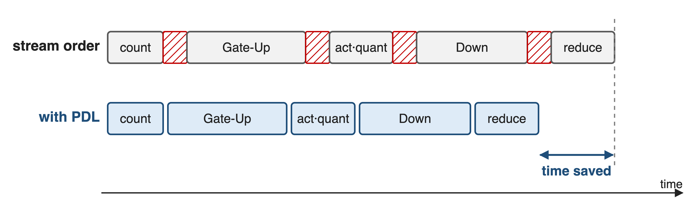
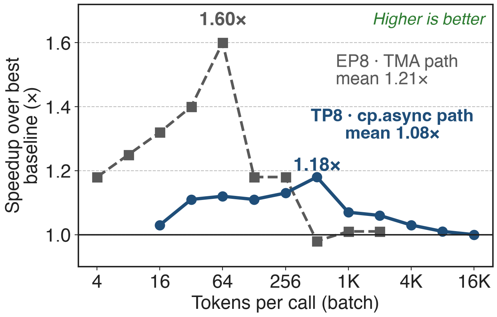
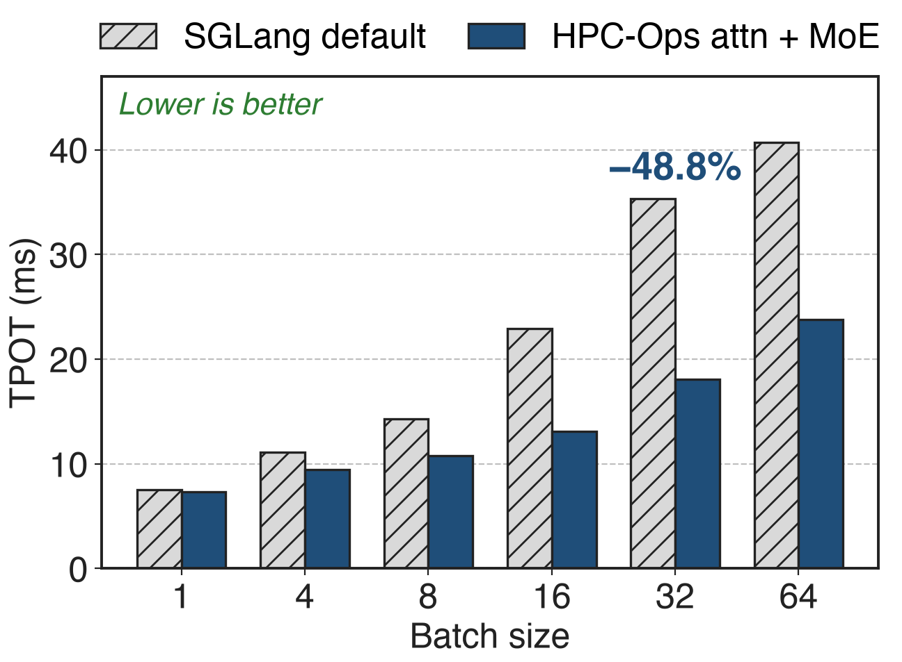

# Decode spreads a few tokens over many experts
{right 55%}
- Hunyuan-V3 shape: **192** experts, top-**8**, hidden **4096**
- TP8, batch 16: **0.67** tokens per expert
- FP8 e4m3 weights and activations, H20
<!-- notes: In a decode step the MoE layer gets a small batch, and top-8 routing scatters it across a large expert set. With the Hunyuan-V3 benchmark shape, 192 experts and top-8, a batch of 16 tokens under TP8 gives 128 routed pairs, about two-thirds of a token per expert on average, so most experts get zero or one token. The figure is one sample of uniform routing, like the benchmark's own. Sources: benchmark/fused_moe/README.md (model presets; avg/group = bs × topk / experts_per_rank); derivation 16 × 8 / 192 in notes/sources.md. -->

# A top-8 gather copies every token 8 times
%% big: 8×
%% sub: token rows a gather-then-GEMM MoE writes to HBM before its first expert GEMM can start (top-8)
%% source: Gathered buffer has num_seq × top-k rows (HPC-Ops default path, src/fuse_moe/entry.cc); gather-then-GEMM design per HPC-Ops PR #49 and the LMSYS blog
<!-- notes: The common design sorts token-expert pairs by expert and gathers each expert's tokens into a contiguous buffer before the grouped GEMM. With top-8 routing that buffer has eight rows per token, so the layer copies its whole input eight times, behind an extra kernel, before any matmul begins. The HPC-Ops authors note that at decode sizes this plumbing, together with index construction, intermediates and launches, rivals the expert GEMMs themselves. Sources: entry.cc (gate_up_input of num_seq × num_topk rows); PR #49; LMSYS blog MoE section. -->

# Six kernels, a copy and five launch gaps
{full}
%% caption: Schematic, not to scale
> Routing pays a global atomic per pair; every later stage waits for a copy or a launch
<!-- notes: Routing sorts token-expert pairs by expert, usually with a global atomic per pair; the gather then materializes a contiguous per-expert buffer, which with top-8 holds eight copies of every token; the Gate-Up GEMM can start only after that. Every later stage writes its intermediate to HBM and the next kernel launches behind it. The eight-fold copy follows from the gathered buffer's shape, num_seq × top-k rows. Sources: LMSYS blog MoE section; PR #49 ("gather-then-GEMM design"); src/fuse_moe/sm90/count_and_gather.cu (global atomicAdd per pair; gathered buffer [num_seq·topk, hidden]). -->

# Insight: pass indices, not copies
- Routing already fixes every token's slot in its expert
- An 8-row tile leaves room for many CTAs per SM
--
> Read tokens through indices, hide latency across CTAs, and butt the stages together
<!-- notes: Once routing is known, the position of each token inside its expert's work is just an index, so the Gate-Up GEMM can fetch the original rows directly instead of waiting for a copy. And because a decode tile is only eight tokens wide, a GEMM CTA needs few registers and little shared memory, so many CTAs can be resident per SM, which hides memory latency better than a deep pipeline inside a single CTA. The remaining kernel boundaries are shortened with programmatic dependent launch. Sources: PR #49 description; README Fused MoE section. -->

# Five stages, chained with PDL
{full}
%% caption: Path taken for per-tensor FP8 when the per-rank intermediate size is ≤ 512 and a multiple of 64
<!-- notes: The low-latency path has five stages: count and index (two or three small kernels), Gate-Up GEMM, SiLU-and-mul with FP8 requantization, Down GEMM, and the top-k weighted reduce that also adds the shared-expert output. Mechanism one is the index build plus the gather-free Gate-Up; mechanism two is the cp.async GEMM design used by both GEMMs; mechanism three is the PDL chaining. Intermediates still go through HBM. The dispatcher picks this path when intermediate per rank is at most 512, which covers TP8 shards of Hunyuan-V3, Qwen3-235B and DeepSeek-V3. Sources: src/fuse_moe/sm90/cp_async/fuse_moe.cu; src/fuse_moe/entry.cc (fuse_moe_entry dispatch condition). -->

# ❶ Count in shared memory, reserve once
{full}
--
{full}
> row_indices tells the Gate-Up GEMM which token each tile row is
<!-- notes: Each thread block counts its token-expert pairs in a shared-memory histogram, then reserves a contiguous range per expert with a single global atomic add per expert, instead of one global atomic per pair. A prefix sum gives cu_seqlens, and every pair's slot becomes row_indices, the token id at that slot, plus topk_pos, the slot of each token's k-th expert, which the final reduce uses. For up to 128 tokens a single block does count, scan and index build in one kernel. The same stage writes the task maps for both GEMMs. Sources: src/fuse_moe/sm90/cp_async/count.cu (count_seq_kernel, build_indices_kernel, count_and_build_kernel). -->

# ❶ Gate-Up reads tokens in place
{full}
> The gathered copy and its kernel disappear; x is read once per routed row
<!-- notes: The Gate-Up GEMM tile for one expert first loads its slice of row_indices into shared memory, then issues one cp.async per row chunk from the original activation tensor into the tile, padding unused rows. Nothing is written back before the matmul, so the separate gather kernel and its eight-fold copy are gone. The GEMM itself is the swapped-operand FP8 design from deck 29: weights on the 64-row MMA side, tokens on the narrow side. Sources: src/group_gemm/sm90/cp_async/group_gemm_fp8_scatter.cu; config.h (SM90_64x{8..64}x32 atoms, swapAB). -->

# ❷ Many small CTAs beat one deep pipeline
{full}
> Latency hiding moves from inside one CTA to the SM's warp scheduler
<!-- notes: The default Hopper design, also used by HPC-Ops' TMA path, runs one persistent 384-thread CTA per SM, with a producer warpgroup feeding an 8-stage TMA ring for two math warpgroups. With eight-token tiles that pipeline is mostly idle. The cp.async kernels use one 128-thread warpgroup that both loads and multiplies, a 2-stage buffer, launch bounds that request at least five resident CTAs, and a grid of five to nine CTAs per SM, so stalls in one CTA are covered by the others. Sources: kernels.cuh (launch_bounds(384, 1), grid = SM count); cp_async/group_gemm_fp8*.cu (launch_bounds(128, 5 or 7), kStage 2); cp_async/common.cuh grid_multiplier. -->

# ❸ PDL hides the gaps between stages
{full}
%% caption: Schematic, not to scale
<!-- notes: Every kernel of the five stages is launched with programmatic stream serialization. Each one starts with cudaGridDependencySynchronize, so it can be scheduled and set up while its predecessor drains, and each ends with cudaTriggerProgrammaticLaunchCompletion to release the next. The launch latency between stages overlaps the previous stage's tail instead of adding to it. PDL is covered in more depth in deck 39. Sources: cp_async/count.cu, group_gemm_fp8_scatter.cu, activation.cu, reduce.cu (PDL launch attributes and grid-dependency calls); LMSYS blog. -->

# 1.08× mean over the best baseline at TP8
{right 55%}
- Hy3 shapes, H20, best baseline per batch
- TP8: up to **1.18×**, never slower
- EP8 (TMA path): up to **1.60×**
<!-- notes: Against the best of SGLang, vLLM Triton and vLLM CUTLASS at each batch size, HPC-Ops' fused MoE is on average 1.08 times faster at TP8 and 1.21 times at EP8 on Hunyuan-V3 shapes, with the largest gains at small and mid batches. TP8 shards have intermediate 192 per rank and take the cp.async pipeline; EP8 keeps intermediate 1536 and takes the TMA path, which shares the PDL chain and reduce. Against the median baseline the PR reports 1.5 to 1.6 times at TP8. Sources: LMSYS blog Tables 4 and 5; PR #49; entry.cc dispatch. -->

# Hy3 TPOT drops up to 48.8% end-to-end
{right 55%}
- 8×H20, TP8, FP8 KV cache
- 8K input, 4K output
- Attention + MoE together
<!-- notes: End to end, SGLang serving Hy3-FP8 on eight H20 GPUs with HPC-Ops attention and MoE enabled together cuts time per output token by 15.1 to 48.8 percent at batch sizes 4 to 64, and 3.3 percent at batch 1. This number mixes both operators; the blog does not isolate the MoE share. Source: LMSYS blog Table 7. -->

# The price: narrow fast path, honest ceilings
%% layout: two-col
- cp.async path: per-tensor FP8, intermediate/rank ≤ **512**
- Wider experts, block-wise: TMA path
- Intermediates still round-trip HBM
|||
- Not always faster: **0.98×** (EP8, 512)
- H200 Qwen3 kernel: **0.89–4.21×**
- H200 Hy3 serving: **−4.2%** to **+6.3%**
<!-- notes: The gather-free, specialization-free pipeline is only selected for per-tensor FP8 with a per-rank intermediate of at most 512 that is a multiple of 64, hidden a multiple of 64, at most 512 local experts and top-k up to 128; wider experts and the block-wise recipe run the TMA warp-specialized path with a gather. Gate-Up output, the requantized activation and the Down output still go through HBM; the roadmap lists a megakernel. Results are not uniformly positive: 0.98 times at EP8 batch 512, 0.89 to 4.21 times against SGLang's Triton kernel on H200 for Qwen3, and minus 4.2 to plus 6.3 percent Hy3 serving throughput on H200. Sources: entry.cc checks; LMSYS Tables 5, 6, 11; README Roadmap. Related: deck 35 (DeepGEMM Mega MoE). -->

# Summary
- Decode MoE: **0.67** tokens per expert; a top-8 gather copies each token **8×**
- ==Insight==: pass indices, not copies; many small CTAs; PDL between stages
- **1.08×** (TP8) and **1.21×** (EP8) mean over the best baseline; up to **1.60×**
- Hy3 TPOT **−48.8%** with HPC-Ops attention + MoE
%% qr: https://github.com/Tencent/hpc-ops
<!-- notes: HPC-Ops' low-latency MoE path keeps the five-stage structure but removes the gather, replaces global per-pair atomics with shared-memory counting, trades warp specialization for CTA residency and chains the stages with PDL. Related decks: 26 (HPC-Ops overview), 29 (the FP8 grouped GEMM underneath), 35 (DeepGEMM Mega MoE, the single-kernel extreme), 39 (PDL). -->
