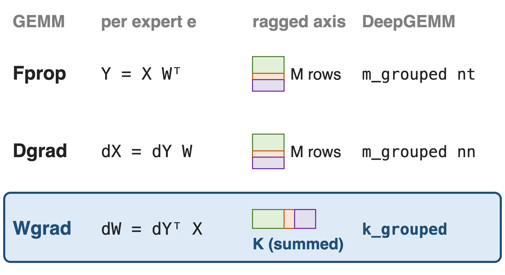
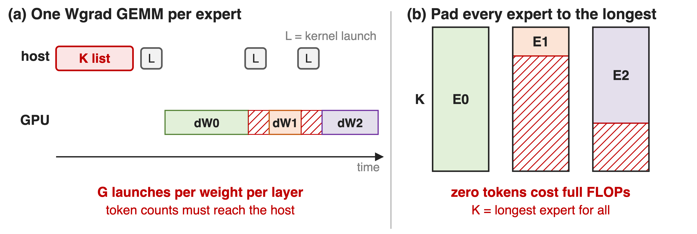
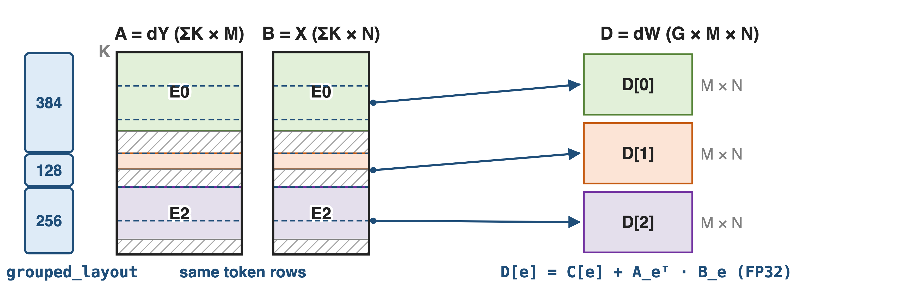
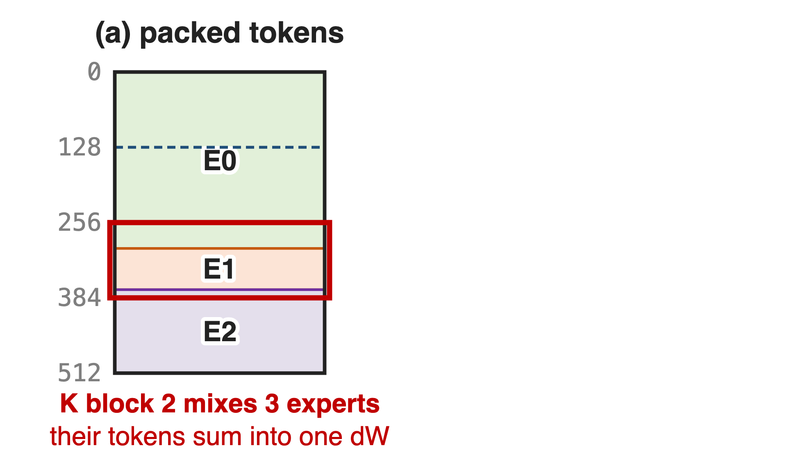
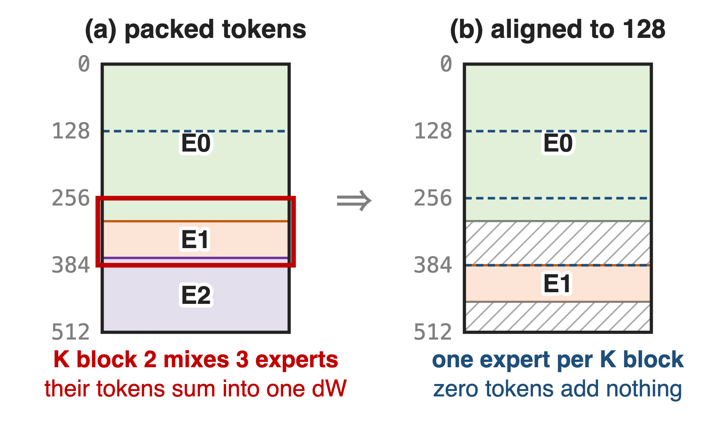
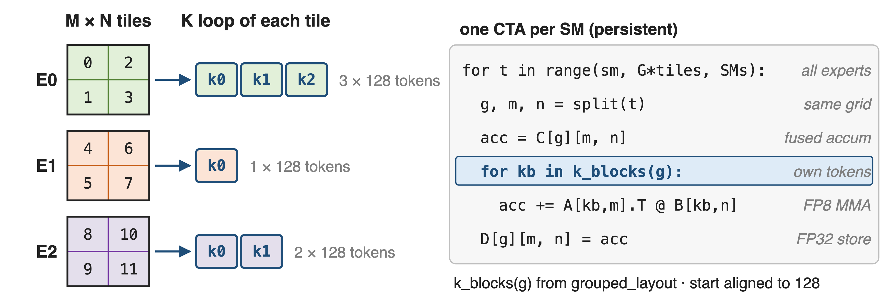
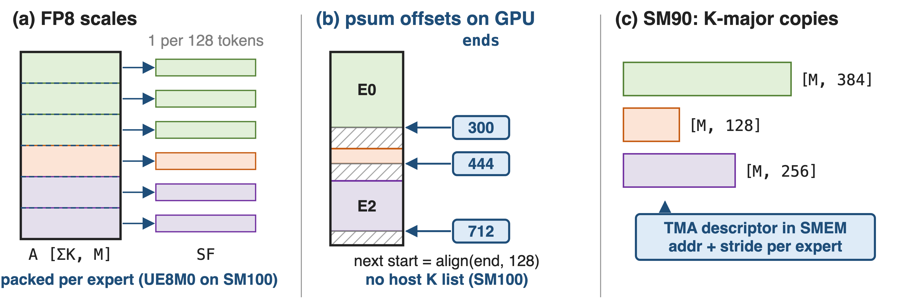
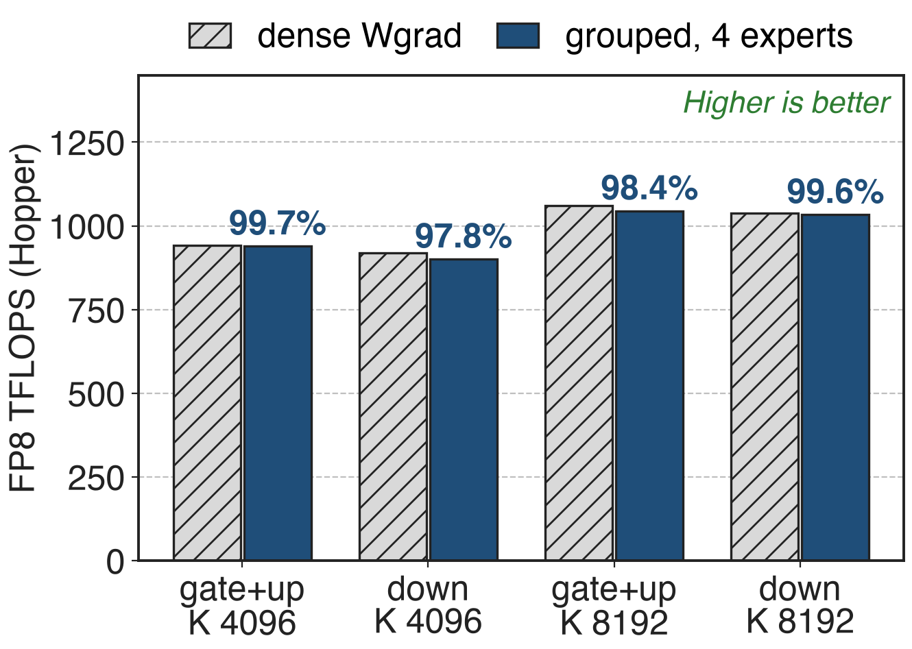
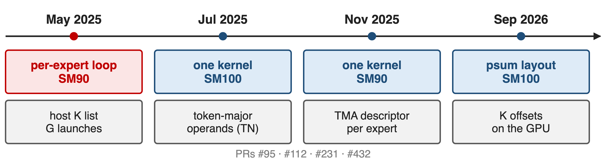

# Each expert trains with three FP8 GEMMs
{right 60%}
- DeepSeek-V3: all three in FP8
- Fprop, Dgrad: ragged M rows (deck 33)
- Wgrad: ragged K, the summed axis
<!-- notes: Every linear layer in training runs three GEMMs: the forward pass, the activation gradient and the weight gradient, and DeepSeek-V3 runs all three in FP8 with fine-grained scaling. For the routed experts, the forward and data-gradient GEMMs have a ragged number of output rows per expert, which DeepGEMM's M-grouped contiguous kernels handle (nt for Fprop, nn for Dgrad, deck 33). The weight gradient dW = dY transpose times X sums over the expert's tokens, so the ragged axis becomes the reduction axis. Sources: DeepSeek-V3 report §3.3.1 p.15; DeepGEMM README (grouped GEMM sections). -->

# Wgrad is a third of expert GEMM work
%% big: 1 / 3
%% sub: of each expert's training GEMM FLOPs is the weight gradient, the one GEMM that sums over the ragged token count
%% source: Analytic: Fprop, Dgrad and Wgrad each cost 2·M·N·K FLOPs. DeepSeek-V3 runs all three in FP8 (arXiv 2412.19437 §3.3.1)
<!-- notes: Fprop, Dgrad and Wgrad of a linear layer each do 2 times M times N times K floating-point operations, so the weight gradient is a third of the expert GEMM work in training. DeepSeek-V3 runs it in FP8 too, which it says theoretically doubles GEMM speed over BF16 and lets activations be cached in FP8 for the backward pass. If the MoE weight gradient fell back to BF16 or to many small launches, a third of the expert math would miss that. The one-third is derived, not measured. Source: DeepSeek-V3 §3.3.1 p.15. -->

# Ragged K defeats per-expert loops and padding
{full}
> The ragged axis is the one Wgrad sums over, so M-grouping cannot express it
<!-- notes: Panel a is how DeepGEMM itself shipped MoE weight gradients in May 2025: a Python loop over experts that launches the dense weight-gradient kernel once per expert, with the list of token counts on the host. Panel b pads every expert's tokens to the longest one; zero tokens still cost full FLOPs. The M-grouped kernel of deck 33 does not apply, because here every expert has its own output and the varying dimension is summed. Megatron-Core notes that in the weight-gradient GEMM the token dimension is the dot-product dimension and needs padding for FP8 alignment anyway. Sources: DeepGEMM wgrad_gemm.py @ 04278f6dee l.135-175; Megatron-Core MoE report §5.4.1 p.54-55. -->

# Insight: in Wgrad, experts differ only in K
- Every expert: same output `dW_e`, `M × N`
- Only its token count `K_e` varies
--
> Stack tokens along K, align each expert to the 128-token block, let each tile sum only its expert
<!-- notes: The weight shape is fixed by the model, so every expert's gradient has the same M by N tile grid. What changes is how many tokens each expert saw, and that is the reduction dimension. So DeepGEMM keeps M and N fixed and groups along K: the tokens of all experts are stacked, each expert's segment is aligned to the 128-token K block, and a tile of expert g only reduces over expert g's segment. Source: DeepGEMM README l.80 ("K-axis-grouped API for MoE weight backward (with M and N must remain fixed)"). -->

# Stack experts along K, one output per expert
{full}
%% caption: k_grouped_fp8_gemm_tn_contiguous((A, sfa), (B, sfb), D, ks_cpu, grouped_layout, c=C) · A FP8 [ΣK, M] · B FP8 [ΣK, N] · D FP32 [G, M, N] · SM100
<!-- notes: A is the output gradient dY and B the expert input X, both in the token-sorted order the forward pass already used, so they share the same row segments. grouped_layout holds each expert's padded token count. The kernel writes one M by N result per expert, D[e] = C[e] + A_e transpose B_e, in FP32, which also folds gradient accumulation into the GEMM. On SM100 the operands are read token-major (the TN variant); Hopper uses the NT variant with K-major copies. Sources: csrc/apis/gemm.hpp l.320-371 and l.373-427; tests/generators.py generate_k_grouped_contiguous. Running example (300, 60, 200 tokens) is illustrative. -->

# ❶ Align each expert to the 128-token K block
{right 60%}
- A K block feeds one dot product
- Packed tokens mix experts' gradients
--
{right 60%}
- Pad each expert to **128** tokens with zeros
- Same alignment as the forward (deck 33)
<!-- notes: Each step of a tile's K loop multiplies one 128-token block of A by the same block of B and adds it into one expert's gradient. If expert segments were packed back to back, a block at the boundary would add another expert's tokens into this expert's dW, which is wrong, not just slow. DeepGEMM requires each segment to start on a multiple of the K alignment, a multiple of BLOCK_K = 128, and the padding to be zero; zero tokens add nothing to the sum. The same 128-row alignment is what the forward M-grouped layout uses, so the token buffer can be shared. Sources: scheduler/gemm.cuh l.40-43; csrc/apis/gemm.hpp l.333-345 ("All A/B padding must be zero"); heuristics/runtime.hpp. -->

# ❷ Every expert gets the same tile grid
{full}
> One launch for all experts, and C + AᵀB folds gradient accumulation into the FP32 output
<!-- notes: Because M and N are fixed, every expert has the same number of output tiles. One CTA per SM walks the tiles expert by expert; for tile (g, m, n) it starts from C[g], loops only over expert g's 128-token blocks, and stores FP32. Experts with zero tokens are skipped. Sources: scheduler/gemm.cuh l.63-82, l.101-104, l.157-168, l.226-246; sm90_fp8_gemm_1d1d.cuh l.179 (empty groups); tests/test_fp8_fp4.py test_k_grouped_gemm_contiguous (accumulate into FP32, or plain FP32 and BF16 outputs on SM100). -->

# ❸ Scales and offsets follow the token axis
{full}
> Recipe (1, 1, 128): one scale per channel per 128 tokens on both operands
<!-- notes: In the weight gradient the scaling group must run along the reduction axis, which is now the token axis: one scale per output channel per 128 tokens on both operands, the DeepSeek recipe turned around (the report converts some cached activations from 1x128 to 128x1 tiles for the backward pass). Scale rows are grouped per expert and padded to the alignment; on SM100 the K-grouped packing kernel turns FP32 scales into packed UE8M0. Since Sept 2026 the psum layout gives one end offset per expert on the GPU, and the host token list becomes optional on SM100. On Hopper, each expert's operands are K-major copies, and each CTA rewrites the address and stride of its TMA descriptor in shared memory when it moves to the next expert. Sources: csrc/apis/layout.hpp l.89-116; README l.162; csrc/apis/gemm.hpp l.55-76; sm90_fp8_gemm_1d1d.cuh l.193-201; DeepSeek-V3 §3.3.3 p.18. -->

# Grouped Wgrad keeps ≥ 97.8% of dense speed
{right 60%}
- **900–1044** TFLOPS on V3 expert shapes
- **~20%** over internal CUTLASS
- May 2025 loop, kernel time only
<!-- notes: These are the only published per-kernel numbers, from DeepGEMM PR #95 in May 2025 on Hopper: with 4 experts of 4096 or 8192 tokens each, the grouped weight gradient runs at 900 to 1044 TFLOPS, 97.8 to 99.7 percent of a dense weight gradient with the same per-expert shape (ratios derived; 8 experts give 942 and 902 TFLOPS). The PR reports about 20 percent over DeepSeek's internal CUTLASS implementation. Caveat: that version looped over experts and the benchmark summed kernel time, so launch gaps are not included; the single-kernel versions have no published table, and the Sept 2026 release only states about 20 percent faster MoE backward GEMMs. Sources: PR #95; tests/test_core.py @ 04278f6dee l.270-297; PR #432. -->

# From a host loop to one GPU-driven kernel
{full}
> Sept 2026 release: MoE backward GEMMs about **20%** faster
<!-- notes: The repo history shows the mechanism arriving in steps: a host loop over experts on Hopper in May 2025 (PR #95); a single SM100 kernel on token-major operands in July 2025 (PR #112, contributed by NVIDIA with the Blackwell port); a single Hopper kernel that rewrites TMA descriptors per expert in November 2025 (PR #231); and in September 2026 the psum layout with per-expert offsets on the GPU, released with "faster MoE backward GEMMs, with ~20% gains" (PR #432). Sources: wgrad_gemm.py @ 04278f6dee; python_api.cpp @ 9da4a23561 l.293-330; gemm.hpp @ 38f8ef73a4 l.293-337; gemm.hpp @ main l.55-76; PR #432. -->

# The cost: token-axis casts and shared shapes
%% layout: two-col
- !!Token-axis FP8 casts!!: X and dY per 128 tokens
- Shared M, N; ≤ **127** pad tokens per expert
|||
- SM90: K-major copies, host K list, FP32 C
- No public numbers for the one-kernel versions
> Megatron-Core also pads tokens per expert to 128 for FP8 Wgrad and CUDA Graphs
<!-- notes: The weight gradient needs its operands quantized along the token axis, which is a different cast from the forward's per-token, per-128-channel one, so X and dY need a separate column-wise FP8 pass (Megatron-Core makes the same point for FP4 Wgrad, which needs transposed operands). All experts must share M and N, and each expert pays up to 127 zero tokens. The Hopper path needs per-expert K-major copies, a host list of token counts and accumulation into FP32. Megatron-Core independently pads tokens per expert to 128 for FP8 weight gradients, grouped quantization and CUDA Graphs (deck 38). Sources: csrc/apis/gemm.hpp l.373-427; Megatron-Core MoE report §5.4.1 p.54-55 and §5.4.3 p.55. -->

# Summary
- Wgrad: **1/3** of expert GEMM FLOPs, summed over ragged tokens
- ==Insight==: experts differ only in K: stack tokens, align to **128**
- One kernel: same tile grid per expert, FP32 accumulate
- **900–1044** TFLOPS, **≥ 97.8%** of dense; **~20%** faster in 2026
%% qr: https://github.com/deepseek-ai/DeepGEMM
<!-- notes: K-grouping is the backward twin of the contiguous M-grouped layout: the same 128-aligned token buffer, read along the other axis. Related decks: 33 (M-grouped contiguous, forward and Dgrad), 34 (masked layout for decode), 38 (CUDA Graphs), 25 (DeepGEMM overview), 29 (HPC-Ops FP8 grouped GEMM), 46 (FP8 training and activation compression). Sources: DeepGEMM README; PR #95; PR #432. -->
