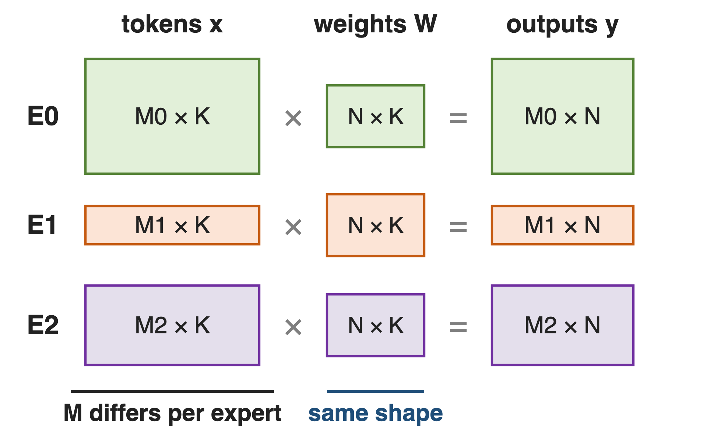
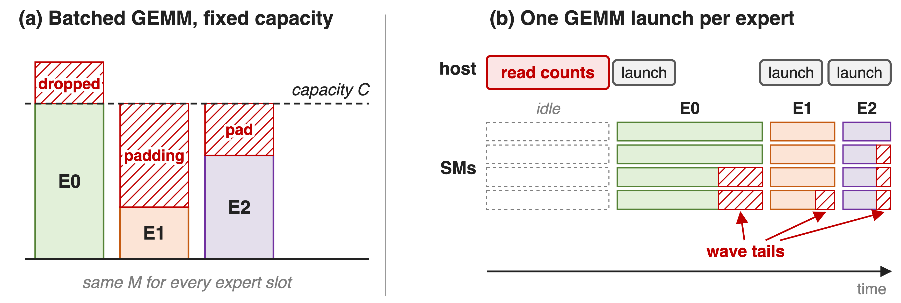
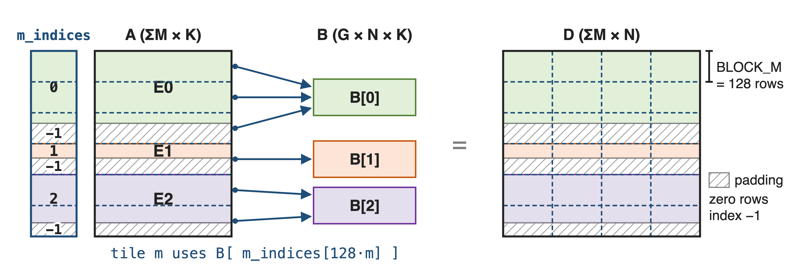
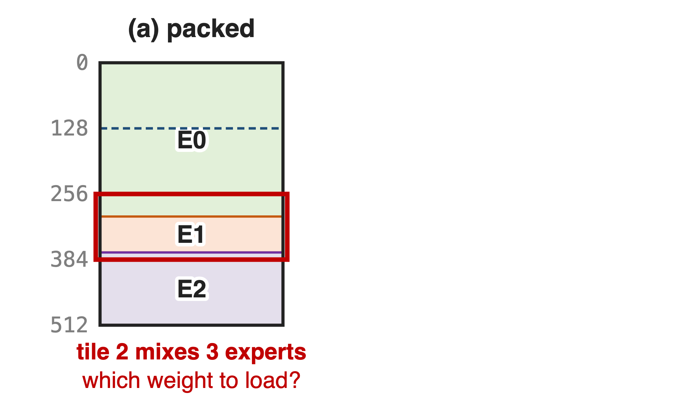
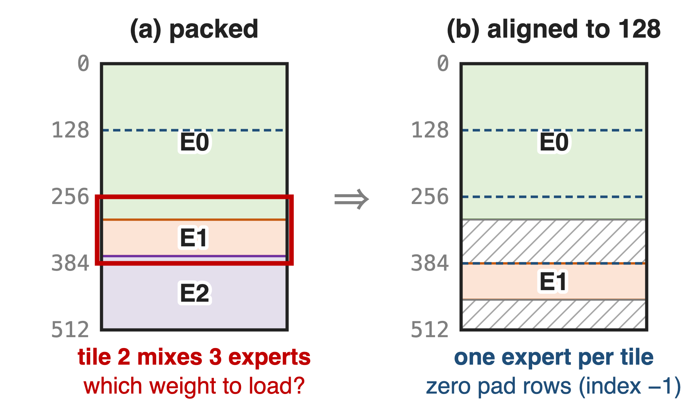
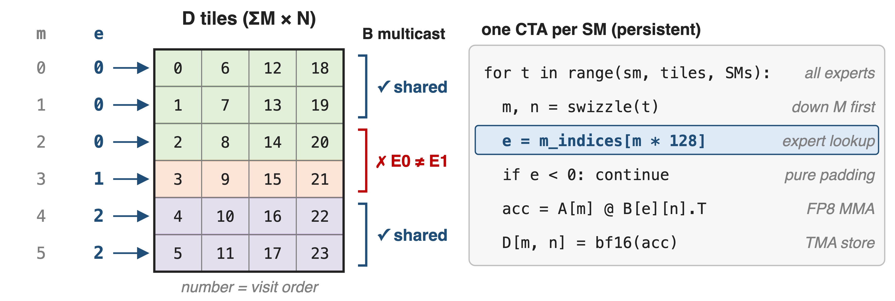
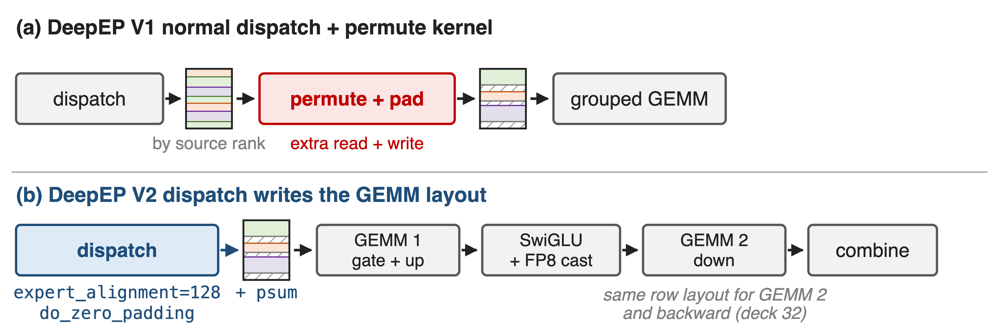
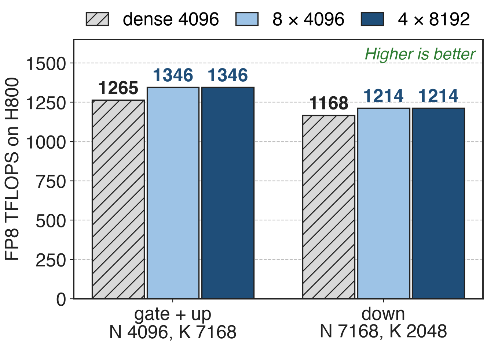
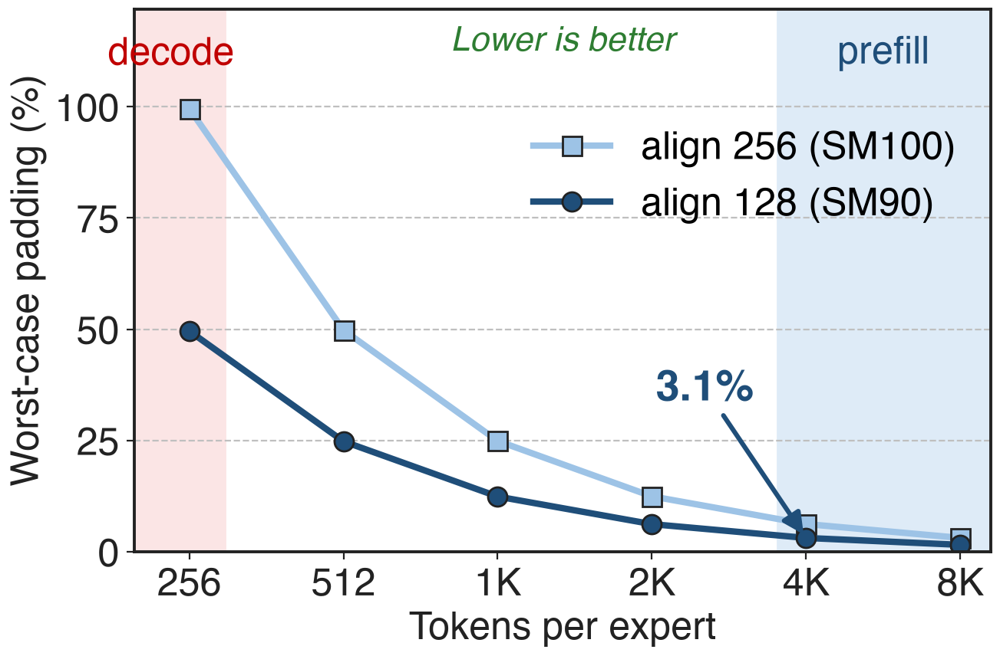

# Every MoE layer runs one GEMM per expert
{right 60%}
- DeepSeek-V3: **256** routed experts, top-**8**, **58** MoE layers
- Prefill on EP32: **8 + 1** experts per GPU
- Same weight shape, different token count
<!-- notes: After dispatch, each GPU holds a ragged batch of tokens for each of its local experts. Every expert is the same small MLP, so the gate-plus-up GEMM is M_e by 7168 times 7168 by 4096 and the down GEMM is M_e by 2048 times 2048 by 7168; only M_e changes from expert to expert and from step to step. Sources: DeepSeek-V3 report §4.2 p.22 (256 routed experts, top-8, hidden 7168, expert width 2048, first three layers dense of 61), §3.4.1 p.19 (prefill EP32, 8 experts plus 1 redundant per GPU); Megatron-Core MoE report §4.2.1 p.30 (58 MoE layers). -->

# Fixed-shape expert GEMMs pay over 2× the math
%% big: > 2×
%% sub: MoE-layer math needed to stop dropping tokens when every expert gets a fixed-capacity batch
%% source: MegaBlocks (MLSys 2023), arXiv 2211.15841, §3 p.4; the same section cites capacity factors as high as 11
<!-- notes: The classic way to run experts is a batched GEMM with a fixed capacity per expert. If an expert overflows, tokens are dropped; to avoid dropping, the capacity factor goes up and every under-full expert is padded. MegaBlocks measured that avoiding drops this way increased MoE-layer math by over two times, and cites models that needed capacity factors as high as 11. Source: MegaBlocks §3 p.4. -->

# Fixed shapes pad, drop, or launch per expert
{full}
> Capacity batches waste math or tokens; per-expert launches waste SMs and need counts on the host
<!-- notes: Panel a: one batched GEMM over fixed-size expert slots; E0 overflows and drops tokens, E1 and E2 compute padding. Panel b: one GEMM per expert; each small GEMM ends in a partial wave where some SMs idle, and the host must read every expert's token count before it can launch. Megatron-Core notes that grouping beats sequential GEMMs by overlapping these wave tails, and that host-launched grouped GEMMs need a CPU-side list of per-expert counts. Sources: MegaBlocks §3 p.4; Megatron-Core MoE report §4.3.2 p.36 and §4.3.7 p.43-44. -->

# Insight: experts differ only in M
- Every expert: same weight shape `[N, K]`, only `M_e` varies
- Generic grouped GEMMs carry per-problem `(M, N, K)`: unused generality
--
> Stack all tokens along M; if no M tile straddles two experts, one GEMM serves every expert
<!-- notes: CUTLASS-style grouped GEMMs accept an arbitrary shape and pointer per problem, which costs per-precision and per-shape engineering. An MoE layer does not need that: N and K are fixed by the model. DeepGEMM therefore groups only the M axis. Once every expert's rows are stacked in one tensor and no 128-row tile mixes two experts, the layer is a single dense-looking GEMM whose tiles each read a different weight. Sources: DeepGEMM README (contiguous layout section); Megatron-Core MoE report §4.3.2 p.36. -->

# One contiguous layout serves all experts
{full}
%% caption: m_grouped_fp8_gemm_nt_contiguous((A, sfa), (B, sfb), D, m_indices) · A FP8 with 1×128 scales, B FP8 with 128×128 scales, D BF16
<!-- notes: A is one FP8 tensor of shape sum-of-M by K, holding each local expert's tokens back to back; B is the stack of G expert weights, G by N by K; D is sum-of-M by N in BF16. m_indices gives the expert of every row, with -1 for padding rows. Each 128-row tile of A and D reads the weight slab its first row names. The scaling recipe is DeepSeek-V3's: 1x128 tiles for activations, 128x128 blocks for weights. Sources: DeepGEMM 2025 API docstring of m_grouped_gemm_fp8_fp8_bf16_nt_contiguous; csrc/apis/gemm.hpp (shape [M, K] @ [G, N, K].mT); DeepSeek-V3 §3.3.2 p.16. Running example (300, 60, 200 rows) is illustrative. -->

# ❶ Align every expert segment to the M tile
{right 60%}
- An M tile can load only one weight
- Packed rows put **3** experts in tile 2
--
{right 60%}
- Round each expert up to **128** rows (**256** on SM100)
- Pad rows: zero data, index **−1**
<!-- notes: A tile loads one B tile per K step, so it can serve only one expert. If segments are packed back to back, a tile at a boundary mixes experts. DeepGEMM requires every expert segment to start on a multiple of the alignment, get_mk_alignment_for_contiguous_layout, which is 128 by default; on SM100 the theoretical alignment is 256 because UMMA_N = 256. Padding rows are zero and carry index -1. Sources: DeepGEMM README (segments aligned to the M block); heuristics/runtime.hpp l.12 and l.57-64; tests/generators.py generate_m_grouped_contiguous. -->

# ❷ Each M tile looks up its own expert
{full}
> One launch and one tile grid: the host needs only ΣM, never per-expert sizes
<!-- notes: The JIT compiles N, K, block sizes and the group count into the kernel; only M is a runtime argument. One CTA per SM walks the ceil(sum M / 128) by ceil(N / BLOCK_N) tile grid in a swizzled order that goes down M first, so a B tile stays hot in L2. For each tile it reads e = m_indices[128 m] and offsets B by e times N; blocks whose first row is -1 are skipped. On Hopper, two M tiles share one TMA multicast of B only if both belong to the same expert. Sources: scheduler/gemm.cuh l.92-94, 151-153, 275-300; DeepGEMM PR #103; 2025 m_grouped_gemm.py launch code. -->

# ❸ Dispatch writes the GEMM-ready layout
{full}
> One aligned buffer feeds gate+up, down, and the backward pass with no extra copy
<!-- notes: In 2025, SGLang ran DeepEP's normal dispatch, whose output is ordered by source rank, and then a custom Triton kernel permuted it into the contiguous format. DeepEP V2 takes expert_alignment, which for DeepGEMM is get_mk_alignment_for_contiguous_layout, and writes the expanded, zero-padded layout plus per-expert prefix sums directly; DeepGEMM's psum layout takes one int per expert instead of one per row. Sources: LMSYS large-scale EP blog (2025-05-05), DeepGEMM Integration; DeepEP README l.17, l.161-163, l.198-200; DeepGEMM csrc/apis/gemm.hpp use_psum_layout; DeepGEMM PR #304 (DeepEPv2 MoE GEMM layout). Backward use: deck 32. -->

# Grouped GEMM matches dense: 1346 TFLOPS
{right 60%}
- **1214–1346** TFLOPS on H800
- **1.2–1.3×** over a tuned CUTLASS 3.6 kernel
- Legend: experts × rows per expert
<!-- notes: These are the last published grouped-GEMM numbers, from the DeepGEMM README of March 2025 on H800 SXM5 with NVCC 12.8. With 4 experts of 8192 rows or 8 experts of 4096 rows, the grouped kernel reaches 1346 TFLOPS on the gate-plus-up shape and 1214 on the down shape, slightly above a dense GEMM with 4096 rows and the same N and K (1265 and 1168, ratios 1.06 and 1.04, derived). Speedups of 1.2 to 1.3 times are against DeepSeek's internal CUTLASS 3.6-based implementation. Source: DeepGEMM README @ 8002b769 (2025-03-25), dense and contiguous tables. -->

# Alignment padding stays ≤ 3.1% at prefill scale
{right 60%}
- Worst case **127** pad rows per expert (**255** on SM100)
- **≤ 3.1%** at 4K tokens per expert
- Capacity padding: **> 2×**
%% caption: Analytic: (alignment − 1) / tokens per expert. Decode: ≤ 256 tokens per expert (DeepSeek-V3 §3.4.2)
<!-- notes: Padding is bounded by one tile per expert: at most 127 rows with 128 alignment, 255 with 256. At prefill-scale batches of 4096 tokens per expert that is at most 3.1 percent extra rows; compare the more-than-2x of capacity padding. At decode scale, where DeepSeek-V3 sees at most about 256 tokens per expert, the same bound reaches 50 to 100 percent, one reason decode uses other layouts. Derivation in notes/sources.md; sources: heuristics/runtime.hpp; DeepSeek-V3 §3.4.2 p.20; MegaBlocks §3 p.4. -->

# Contiguous needs host-side counts and one shape
%% layout: two-col
- !!ΣM is a host shape!!: counts go to the CPU
- No CUDA Graph: decode uses masked (deck 34)
|||
- One N, K for all experts
- Weight grads group along K (deck 32)
- SM90 FP8: K-major only
> FP8×FP4 EP inference: fused Mega MoE replaces this pipeline (deck 35)
<!-- notes: The output and the A tensor are sized by sum of M, so the plain layout needs the token counts on the host after dispatch; DeepEP's normal dispatch makes the CPU wait for them, which is not CUDA-Graph compatible (CUDA Graph background: deck 38), so decoding uses the masked layout (deck 34). The kernel assumes one N and K for all experts. In the backward pass the ragged token axis becomes the reduction axis, so weight gradients need the K-grouped variant (deck 32). On SM90 the FP8 kernels take only NT, K-major operands. DeepGEMM's Mega MoE fuses dispatch, both GEMMs, SwiGLU and combine for FP8 x FP4 inference (deck 35); library overview in deck 25, HPC-Ops' grouped GEMM in deck 29. Sources: DeepEP README @ 2be0d4f8e9 l.173-174; DeepGEMM README l.63, l.80, news 2026.04.16. -->

# Summary
- Fixed-capacity expert GEMMs: **> 2×** math or dropped tokens
- ==Insight==: experts differ only in M, so stack rows aligned to **128**
- **1214–1346** TFLOPS on H800, **1.2–1.3×** over CUTLASS
- Padding ≤ one tile per expert: **≤ 3.1%** at 4K tokens
%% qr: https://github.com/deepseek-ai/DeepGEMM
<!-- notes: The contiguous M-grouped GEMM turns a pile of ragged expert GEMMs into one persistent FP8 GEMM by fixing N and K and aligning each expert's rows to the tile. Related decks: 25 (DeepGEMM overview), 34 (masked layout for CUDA-Graph decode), 32 (K-grouped weight gradients), 29 (HPC-Ops FP8 grouped GEMM), 35 (Mega MoE), 24 (DeepEP V2). Sources: DeepGEMM README; README @ 8002b769; MegaBlocks §3. -->
