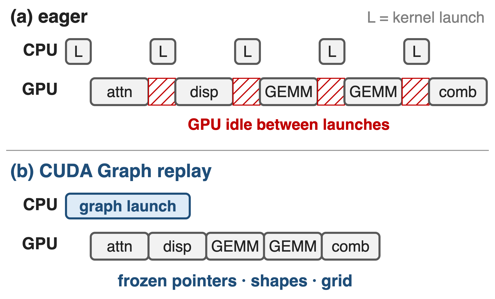
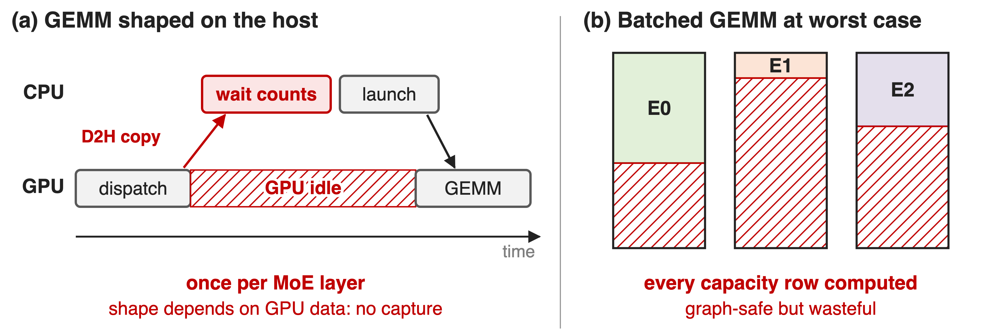
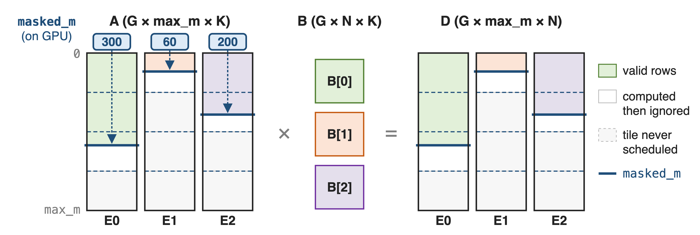
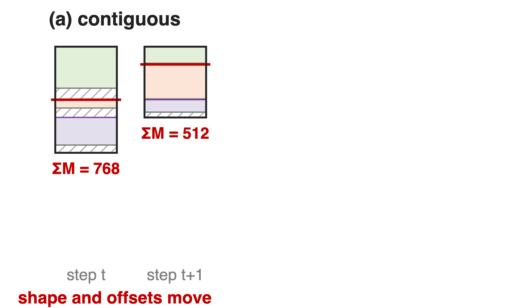
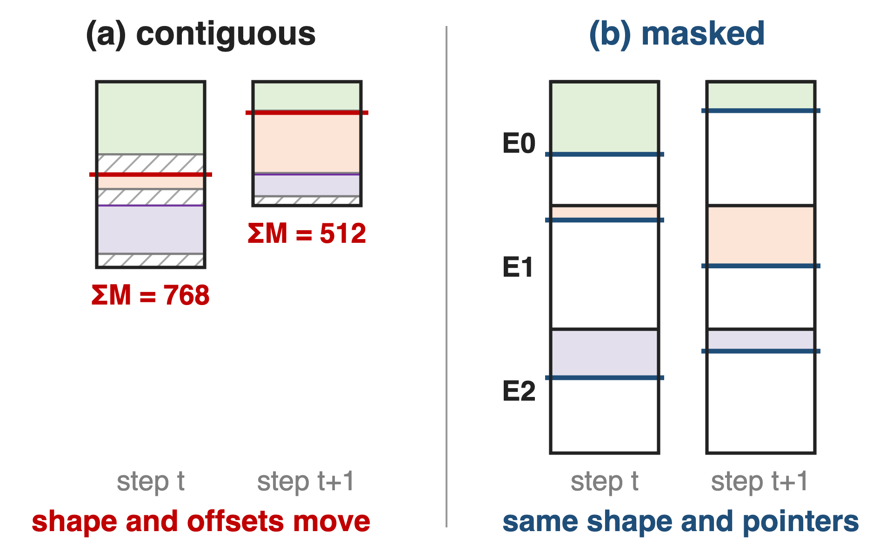
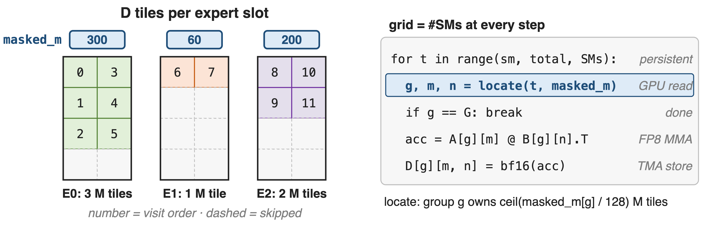
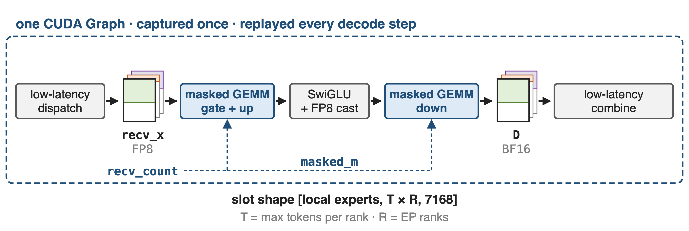
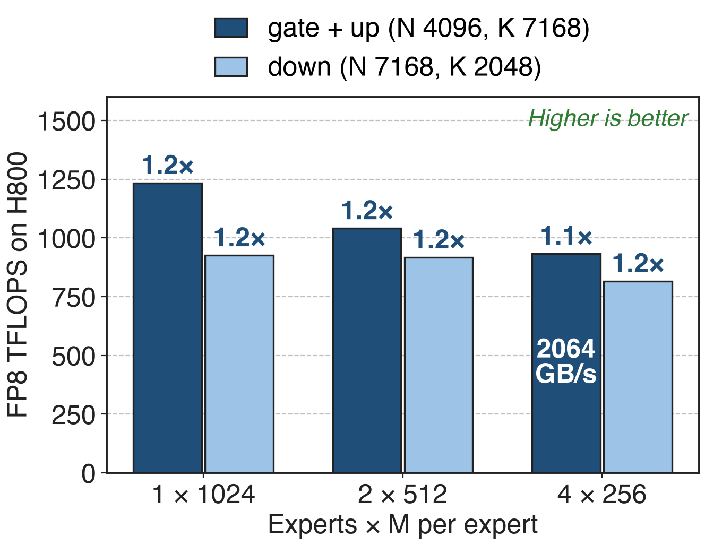

# Decode runs tiny MoE layers as CUDA Graphs
{right 60%}
- DeepSeek-V3 decode: EP320, **≤ 256** tokens per expert
- Memory-bound kernels; each launch costs CPU µs
- A graph replays a whole step with one launch
<!-- notes: In decoding, every MoE layer processes a handful of tokens per expert, so its kernels are short and memory-bound, and CPU-side launch cost starts to show as GPU idle time. CUDA Graphs capture the kernel sequence once and replay it with a single launch, but they freeze each kernel's pointers, shapes and grid size. Sources: DeepSeek-V3 report §3.4.2 p.19-20 (EP320, one expert per GPU, batch per expert usually within 256 tokens, memory-bound); Megatron-Core MoE report §4.3.6 p.38-39 (several microseconds of CPU cost per launch; graphs need static shapes); LMSYS large-scale EP blog (launch overhead is a significant bottleneck in decode). CUDA Graph strategies in general: deck 38. -->

# Host-shaped GEMMs cost 58 syncs per step
%% big: 58
%% sub: blocking reads of expert token counts per DeepSeek-V3 decode step, one per MoE layer, if the GEMM is shaped on the host
%% source: Derived: 58 MoE layers (DeepSeek-V3 §4.2; MCore report §4.2.1) × one count read per layer (MCore §4.3.7 p.43; DeepEP README: normal dispatch makes the CPU wait)
<!-- notes: A grouped GEMM whose shape lives on the host needs each layer's per-expert token counts on the CPU before it can be sized and launched. DeepSeek-V3 has 58 MoE layers, so that is 58 device-to-host round trips per decode step, each one stalling the launch pipeline, and a shape that depends on GPU data makes the step impossible to capture as a CUDA Graph. This is a derived count, not a measured latency; no source reports the time per sync. Sources: DeepSeek-V3 §4.2 p.22; Megatron-Core MoE report §4.2.1 p.30 and §4.3.7 p.43; DeepEP README (V1) l.173. -->

# Host shapes stall; worst-case shapes waste
{full}
> Either the CPU waits every layer, or every slot row is computed
<!-- notes: Panel a: with DeepEP's normal dispatch and a contiguous grouped GEMM, the CPU waits for the counts, then sizes and launches the GEMM; the GPU idles meanwhile, and DeepEP documents that this path is not CUDA-Graph compatible. Panel b: a plain batched GEMM over fixed worst-case slots is graph-safe but multiplies every capacity row, valid or not. Sources: DeepEP README (V1) l.173; LMSYS blog dispatch-mode table; Megatron-Core MoE report §4.3.7 p.43. Contiguous layout: deck 33. -->

# Insight: graphs freeze arguments, not memory
- Captured: pointers, shapes, grid size
- Not captured: what kernels read from GPU memory
--
> Keep shapes at a fixed capacity, keep per-expert counts on the GPU, let the kernel skip invalid rows
<!-- notes: A CUDA Graph fixes every kernel argument at capture time: pointers, scalars and the launch grid. It does not fix the contents of device memory. So the per-expert token counts, the only quantity that changes from step to step, can stay in a device tensor that the kernel reads at run time, as long as every shape is sized for the worst case and the launch grid does not depend on the counts. FlashInfer makes its attention kernels graph-safe the same way: persistent kernels with a fixed grid and capacity-sized buffers. Sources: FlashInfer (MLSys 2025) §3.3 p.7 and App. D.1 p.19; DeepGEMM README (masked layout). -->

# Masked layout: fixed slots, counts on the GPU
{full}
%% caption: m_grouped_fp8_gemm_nt_masked((A, sfa), (B, sfb), D, masked_m, expected_m) · A FP8 [G, max_m, K] · B FP8 [G, N, K] · D BF16 [G, max_m, N]
<!-- notes: A holds one slot of max_m rows per local expert, B the expert weights, D one output slot per expert. masked_m is an int32 tensor on the GPU with the valid row count of each slot; expected_m is a plain host integer used only as a hint. Only 128-row tiles that contain valid rows are scheduled; rows past masked_m inside the last tile are computed and ignored. Sources: DeepGEMM 2025 docstring of m_grouped_gemm_fp8_fp8_bf16_nt_masked; csrc/apis/gemm.hpp l.269-318. Running example (300, 60, 200 of 512) is illustrative. -->

# ❶ Fixed slots keep every pointer and shape static
{right 60%}
- Contiguous: ΣM and offsets change each step
- A captured kernel would read stale shapes
--
{right 60%}
- Masked: slot g starts at **g × max_m**, always
- Only `masked_m` changes between steps
<!-- notes: In the contiguous layout the total row count and every expert's offset depend on the routing of this step, so a graph captured at one step would replay wrong shapes at the next. The masked layout gives each local expert a fixed slot of max_m rows; with DeepEP's low-latency dispatch, max_m is the maximum tokens per rank times the number of ranks, because one expert can receive at most every token of every rank. When G > 1, max_m must be a multiple of the M block. Sources: DeepGEMM 2025 m_grouped_gemm.py l.114-136 and l.166-168; DeepEP V1 buffer.py low_latency_dispatch docstring. -->

# ❷ The scheduler reads masked_m on the device
{full}
> The launch never changes; how much work each CTA finds does
<!-- notes: The kernel always launches one CTA per SM. Each CTA walks the experts in order, computes from masked_m[g], read from device memory, how many 128-row tiles expert g owns, and takes its share of tiles in a swizzled order; tiles with no valid rows are never visited, and on Hopper even 64-row sub-blocks past masked_m are skipped. Sources: scheduler/gemm.cuh l.188-204 and l.301-302; DeepGEMM 2025 launch code (grid = num_sms); PR #103 (skipping useless M computation). -->

# ❸ DeepEP low-latency buffers plug straight in
{full}
> recv_count becomes masked_m; expected_m is the only host input, a hint for the JIT config
<!-- notes: DeepEP's low-latency dispatch returns recv_x already in the masked layout, local experts by tokens-per-rank times ranks by hidden, FP8 with TMA-aligned scales, plus recv_count on the GPU; it deliberately does not sync the counts to the CPU. Both expert GEMMs take recv_count as masked_m, and low-latency combine reads the BF16 output in the same layout. expected_m is a host integer chosen once, for example the average load; DeepGEMM uses it to pick block sizes, and its test notes that performance can drop when real counts exceed it. Sources: DeepEP V1 buffer.py l.554-650; DeepEP README (V1) l.7, l.265, l.281; DeepGEMM README (masked layout); sm90 heuristics l.202-207; tests/test_fp8_fp4.py l.181. -->

# Masked GEMM keeps 1.1–1.2× at decode sizes
{right 60%}
- **815–1233** TFLOPS on H800
- vs a tuned CUTLASS 3.6 kernel
- At **4 × 256**: weight-streaming, **2064** GB/s
<!-- notes: Last published masked-layout numbers, DeepGEMM README of March 2025, H800 SXM5, NVCC 12.8: 1233 down to 932 TFLOPS on the gate-plus-up shape and 925 down to 815 on the down shape as the rows per expert shrink from 1024 to 256, 1.1 to 1.2 times DeepSeek's internal CUTLASS 3.6-based kernel. At 256 rows per expert the kernel moves 2064 GB/s, so decode-size expert GEMMs are bandwidth-bound, matching DeepSeek-V3's description of decode. Source: DeepGEMM README @ 8002b769, masked table; DeepSeek-V3 §3.4.2 p.20. -->

# Prefill takes contiguous, decode takes masked
%% layout: two-col
- **Prefill**: normal dispatch
- Contiguous layout (deck 33)
- !!Host counts, no CUDA Graph!!
|||
- **Decode**: low-latency dispatch
- ==Masked layout==
- ==Fixed buffers, CUDA Graph==
> SGLang runs both via PD disaggregation: 22,282 decode tokens/s per H100 node (EP72, full stack)
<!-- notes: SGLang's large-scale EP deployment uses DeepEP's normal dispatch with the contiguous DeepGEMM kernel for prefill, and low-latency dispatch with the masked kernel for decode, and separates the two phases with prefill-decode disaggregation because one communication group cannot serve both modes. Its decode reached 22,282 tokens per second per node on 9 nodes of 8 H100 with EP72; LMSYS attributes most of the gain over TP16 to the larger batches EP allows, so this is a system number, not the masked kernel's speedup. Source: LMSYS blog 2025-05-05, dispatch modes, DeepGEMM integration, decode results. -->

# Static slots cost memory: 32× the balanced load
%% layout: two-col
- !!Slots sized for the worst case!!: **32×** the balanced load
- Overflow past capacity is an error
- DeepEP: keep tokens per rank **< 256**
|||
- Low `expected_m`: slower config
- Successor: psum layout in DeepEP V2.5
- SM100 small batches: Mega MoE (deck 35)
<!-- notes: A slot must hold the worst case: T tokens per rank times R ranks. With balanced routing an expert gets T times R times k over E rows, so the slot is E over k times larger: 256 over 8 = 32 for DeepSeek-V3 (derived). Megatron-Core describes the same O(EP size) worst-case buffer problem. LMSYS notes that exceeding the preallocation is a runtime error, and DeepEP recommends fewer than 256 tokens per rank in low-latency mode. DeepEP V2.5 removed the V1 low-latency API; its decode path keeps capacity-sized buffers but emits a 2D layout with per-expert prefix sums on the GPU, which DeepGEMM consumes through the psum contiguous layout with expected_m. On SM100, DeepGEMM points small workloads to Mega MoE. Sources: DeepEP V1 buffer.py, README l.249-250; DeepEP README V2.5 l.19, l.163; LMSYS blog; MCore §4.3.7 p.43; DeepGEMM heuristics/runtime.hpp l.57-64. -->

# Summary
- Host-shaped expert GEMMs: **58** count syncs per decode step
- ==Insight==: graphs freeze arguments, not memory: counts stay on the GPU
- Fixed slots + `masked_m` + persistent grid: graph-safe
- **815–1233** TFLOPS on H800, **1.1–1.2×** over CUTLASS
%% qr: https://github.com/deepseek-ai/DeepGEMM
<!-- notes: The masked grouped GEMM trades memory for static shapes: every expert gets a fixed slot, the real counts stay on the GPU, and a persistent kernel decides at run time how many tiles to compute, so the whole MoE layer can live inside a CUDA Graph. Related decks: 33 (contiguous layout), 32 (K-grouped weight gradients), 25 (DeepGEMM overview), 24 (DeepEP V2), 38 (CUDA Graphs), 35 (Mega MoE), 20 (MoonEP static shapes). -->
