# Each V4 MoE layer crosses GPUs twice
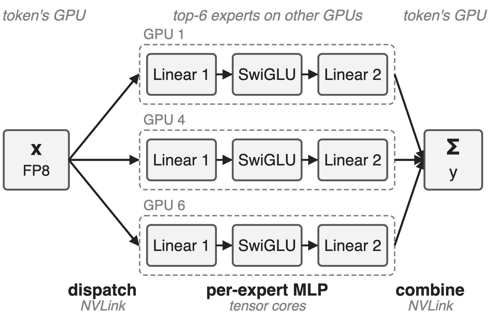{right 60%}
- V4-Flash: **256** experts, top-**6**
- V4-Pro: **384** experts, top-**6**
- EP over NVLink: tokens out, results back
<!-- notes: Every DeepSeek-V4 MoE layer is five stages. Dispatch sends each FP8 token to its six experts on other GPUs, each expert runs linear 1, SwiGLU and linear 2, and combine brings the six results back and sums them. Two of the five stages are NVLink all-to-alls, three are per-expert tensor-core work. Both models also have one shared expert per layer. Sources: V4 report §4.2.1 p.24-25 (expert counts, top-6, d; I = 2048 / 3072), §3.1 p.15 (stage decomposition); DeepGEMM PR #316 (same dims). -->

# One token per rank still costs about 111 µs
%% big: ≈ 111 µs
%% sub: per V4-Flash MoE layer (routed experts, EP8) when dispatch, two GEMMs, SwiGLU and combine run as five kernels
%% source: Derived: 56.5 µs × 1.96 from DeepGEMM PR #316 (fused time × speedup vs the five-kernel "legacy" path)
<!-- notes: This is the latency-bound case that matters for decoding, RL rollouts and agent serving: with one token per rank there is almost no arithmetic, yet the conventional five-kernel pipeline (DeepEP dispatch, DeepGEMM grouped GEMM, a TileLang SwiGLU-plus-FP8 kernel, another grouped GEMM, DeepEP combine, replayed as a CUDA graph) needs about 111 microseconds per layer. The number is derived from PR #316: the fused kernel's 56.5 µs times its 1.96x speedup over that baseline. Baseline definition: tests/test_mega_moe.py at the PR #316 merge commit. -->

# Every kernel boundary is a layer-wide barrier
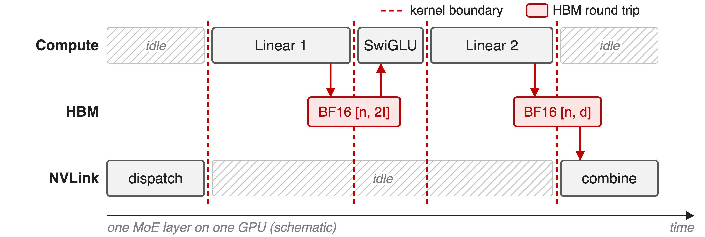{full}
> No expert starts before every token lands; intermediates round-trip HBM
<!-- notes: Run as five kernels, each stage waits for the whole previous stage. Linear 1 cannot start any expert until dispatch has delivered every token for every expert; combine cannot start until linear 2 is done everywhere. Meanwhile one resource is always idle: tensor cores during the all-to-alls, NVLink during the GEMMs. And every hand-off is a full tensor in HBM: the BF16 linear-1 output of shape [n, 2I] is written and read back by the SwiGLU kernel, and the BF16 linear-2 output is written and read back by combine. I is the expert's intermediate width (2048 on V4-Flash, 3072 on V4-Pro), d the hidden size. Source: run_baseline in tests/test_mega_moe.py (tensor shapes); schematic, not to scale. -->

# Earlier overlap fixes fall short inside one batch
%% layout: two-col
**Batch-level overlap**
- One batch's all-to-all hides under another's GEMMs
- !!Needs a second batch!!; RL-rollout tails have one
|||
**Per-stage overlap** (Comet)
- Dispatch with linear 1, linear 2 with combine
- !!1.42× ceiling!! vs 1.92× with expert waves
> Needed: overlap inside one batch, tile by tile, in one stream
<!-- notes: Two-micro-batch schemes such as DualPipe-style or two-stream overlap hide one batch's communication behind the other's compute, but they need two independent, equally sized batches; the long-tail small batches of RL rollout have one (V4 §3.1 p.16). Comet overlaps dispatch with linear 1 and linear 2 with combine; on the V4-Flash configuration its theoretical speedup is 1.42x, against 1.92x for pipelining experts in waves (V4 Fig. 5, p.15). The wave idea itself is deck 14; batch-level overlap is deck 11. -->

# Insight: NVLink all-to-all is just loads and stores
- Symmetric memory: peer address = own address + fixed offset
- V4 profiling: a MoE layer communicates less than it computes
--
> So GEMM-kernel warps can move tokens themselves, tile by tile, and compute stays the only bottleneck
<!-- notes: PyTorch symmetric memory allocates the same buffer on every GPU of the NVLink domain and hands each rank all base pointers; DeepGEMM's SymBuffer maps a local pointer to a peer by adding that peer's offset. A remote token row is therefore an ordinary address that TMA can load from, and a remote combine slot is an address a store can hit. Add the V4 profiling result that, within one MoE layer, total communication time is below total computation time, and the conclusion follows: put the communication inside the compute kernel's pipeline and the layer costs about its compute. Sources: deep_gemm/mega/__init__.py (symm_mem.empty, rendezvous), layout/sym_buffer.cuh; V4 §3.1 p.15. -->

# One persistent kernel runs all five stages
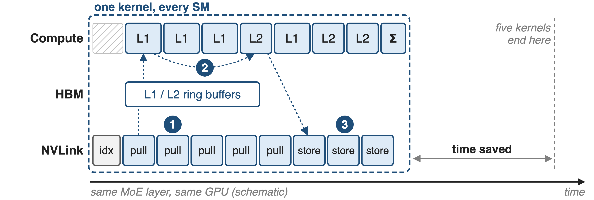{full}
%% caption: Schematic. ❶ pull dispatch · ❷ counter-gated linear-1/linear-2 tiles · ❸ epilogues: SwiGLU + FP8 cast, stores to peers, final Σ
<!-- notes: Mega MoE launches one CTA per SM on every SM, in 2-CTA clusters, 512 threads each: four dispatch warps, a TMA warp for activations, a TMA warp for weights, an MMA warp, a scheduler warp and two epilogue warpgroups. Dispatch warps pull token rows over NVLink while the MMA warp already runs linear-1 tiles for blocks that are complete; linear-2 tiles interleave with linear-1 tiles; linear-2 epilogues store results straight into the token owner's combine slots; a final local sum writes y. Only the first pull and the last sum remain exposed. Sources: csrc/jit_kernels/heuristics/mega_moe.hpp (thread layout), impls/sm100_fp8_fp4_mega_moe.hpp (grid = all SMs, cluster 2), the kernel .cuh warp-role branches. -->

# ❶ Dispatch warps pull tokens into expert tiles
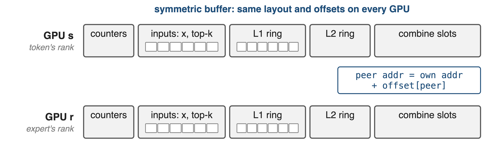{full}
> Pull, not push: the expert's GPU fetches each row it needs; no per-token notification
--
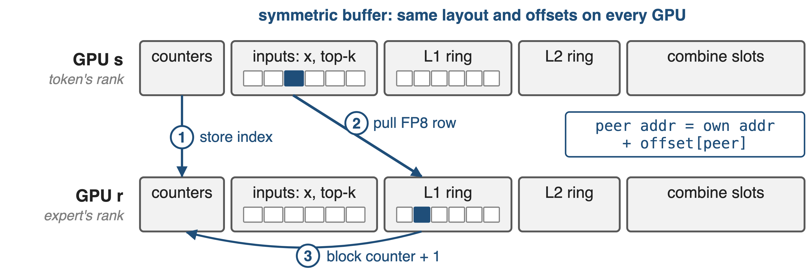{full}
<!-- notes: Every GPU holds the same symmetric buffer: counters, the inputs x with scales and top-k, ring buffers for linear-1 and linear-2 activations, and the combine slots. Step 1: the token's GPU counts tokens per expert and stores each token's index into the expert GPU's counters. After one NVLink barrier, step 2: each dispatch warp on the expert's GPU takes a slot, TMA-loads the FP8 row from the peer address into shared memory and stores it into its local L1 ring, in expert-major order, together with its scale factors and routing weight. Step 3: it bumps that M-block's arrival counter. V4 §3.1: pulling avoids the notification latency of fine-grained push. Sources: kernel .cuh lines 346-620; layout/mega_moe.cuh MegaMoEBuffer. -->

# ❷ Counters, not kernel ends, order the tiles
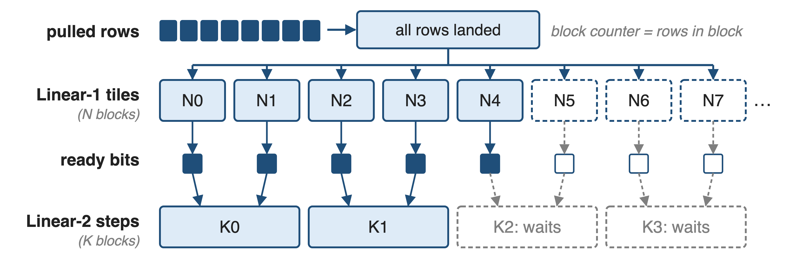{full}
> Linear 2 of a block starts while its last linear-1 tiles still run
<!-- notes: There are no kernel boundaries left, so global-memory counters with acquire/release semantics carry every dependency. A linear-1 tile of an M-block waits until all of that block's rows have arrived. Each finished linear-1 N-block flips one bit in a ready mask, and a linear-2 K-step waits only for the two bits whose outputs it reads. A persistent scheduler hands out linear-1 tiles a few waves ahead, then interleaves linear-2 and linear-1 tiles; ring-slot counters recycle the buffers, which keeps memory bounded. Sources: scheduler/mega_moe.cuh (MegaMoEScheduler, L2KBlockDependency, get_num_l1_warmup_waves); PR #377 ("interleaving L1/L2 blocks"); PR #364 (ring buffer). -->

# ❸ Epilogues fuse SwiGLU, FP8 cast, combine
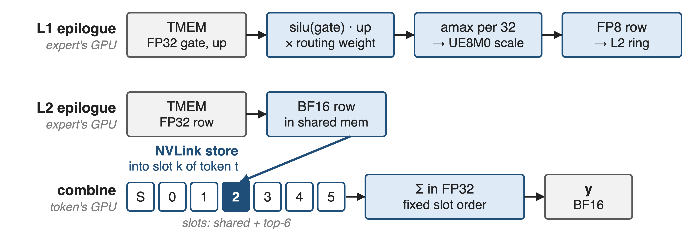{full}
> Linear-1 → linear-2 hand-off: 10·I → 2·I bytes per routed token (analytic)
<!-- notes: The linear-1 epilogue reads FP32 accumulators from tensor memory, applies clamp and silu(gate) times up, multiplies by the routing weight, computes a UE8M0 scale per 32 values and writes FP8 into the L2 ring. The five-kernel path instead writes a BF16 [n, 2I] tensor and has a separate kernel read it: 4I + 4I + I + I = 10I bytes per routed token versus 2I here; scale bytes ignored, so this is an analytic count. The linear-2 epilogue converts to BF16 and stores each row over NVLink into slot k of its token on the token's GPU; that GPU then sums the shared and top-6 slots in FP32 in a fixed order. Sources: kernel .cuh lines 1066-1525; run_baseline tensor shapes; derivation in notes/sources.md. -->

# One kernel runs 1.50–1.96× faster than five
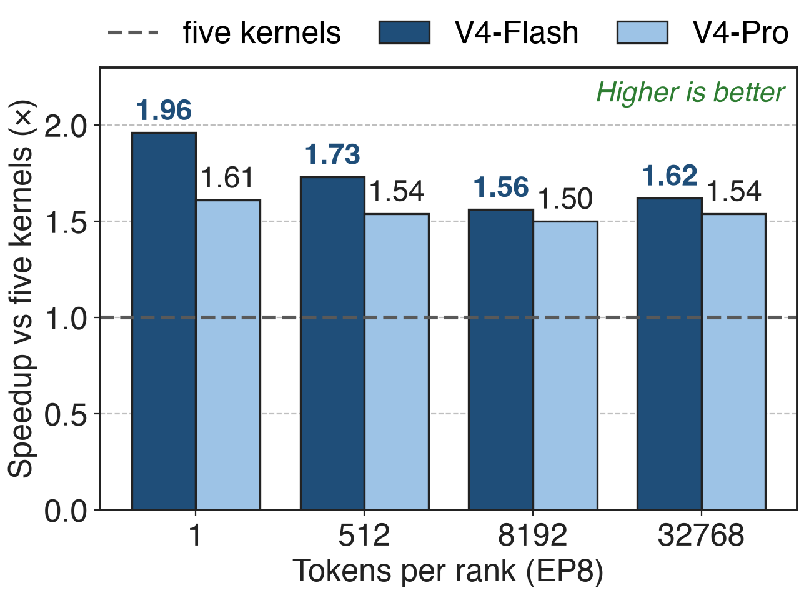{right 60%}
- EP8 on SM100, both V4 models
- Biggest win at **1** token/rank: **1.96×**
- Baseline: DeepEP + DeepGEMM + TileLang, CUDA graph
<!-- notes: DeepGEMM PR #316 benchmarks the fused kernel against the five-kernel path on 8 GPUs, averaged over the ranks. V4-Flash: 56.5, 146.5, 1283.1 and 4855.5 microseconds at 1, 512, 8192 and 32768 tokens per rank, 1.96, 1.73, 1.56 and 1.62x faster. V4-Pro: 108.1 to 10655.2 microseconds, 1.50 to 1.61x. The V4 report quotes the same kernel as 1.50-1.73x for general inference and up to 1.96x for latency-sensitive cases such as RL rollout. So at one token per rank the 111 microseconds become 56.5. Sources: PR #316 tables; V4 §3.1 p.16. -->

# Big batches run 2+ PFLOPS while NVLink streams
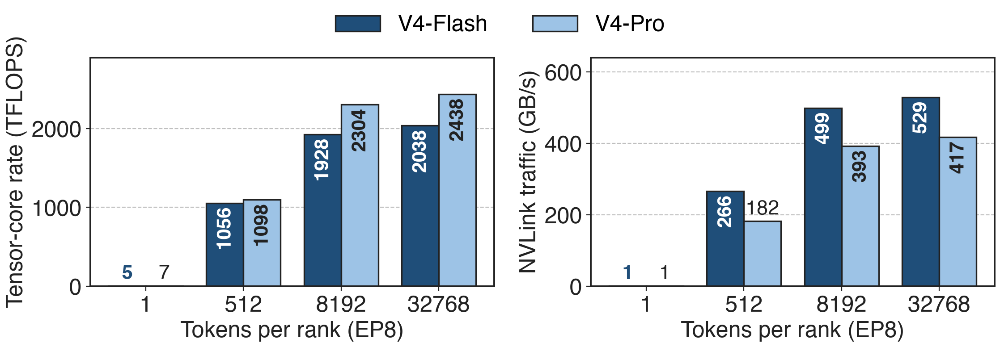{full}
> V4-Flash, 32768 tokens: 2038 TFLOPS and 529 GB/s NVLink, both averaged over one 4.86 ms kernel
<!-- notes: The same PR reports what the kernel sustains. At one token per rank it is memory-bound: 5 TFLOPS, but 1311 GB/s of HBM traffic for V4-Flash. At 32768 tokens per rank V4-Flash averages 2038 TFLOPS and V4-Pro 2438, while 529 and 417 GB/s cross NVLink. Both rates are averages over a single kernel's duration, so the tensor cores and the links are busy during the same few milliseconds: that is the overlap. Source: PR #316 tables (Compute, Global Memory, Interconnect columns); NVLink bytes = 3·d per routed token (tests/test_mega_moe.py; V4 §3.1). -->

# Fused output matches five kernels bit for bit
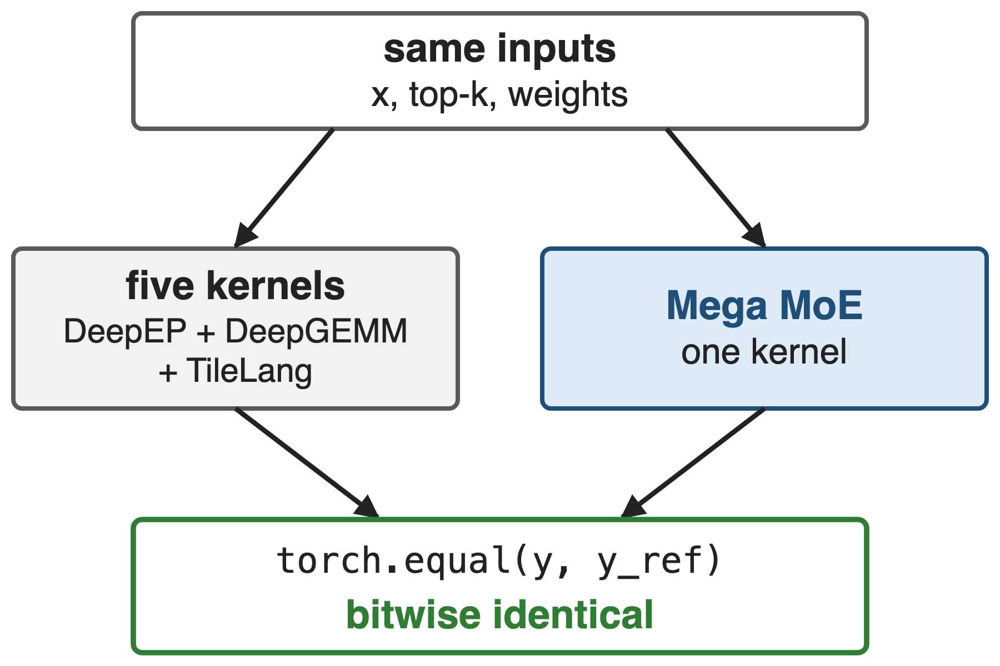{right 50%}
- Test asserts `torch.equal` on y and expert counts
- Combine sums shared + top-6 slots in FP32, fixed order
> Determinism is opt-in since 2026-09: `use_deterministic_algorithms` (deck 39)
<!-- notes: tests/test_mega_moe.py turns on deterministic algorithms, runs the fused kernel and the DeepEP plus DeepGEMM plus TileLang baseline on the same inputs, and asserts that both the output y and the cumulative per-expert token statistics are bitwise equal; the PR #316 version comments "must be bitwise identical". PR #462 fixed the combine reduction order for bitwise agreement with the shared-expert reference. PR #432 made determinism and batch invariance opt-in through deep_gemm.use_deterministic_algorithms, default off. Deck 39 covers the determinism switch. -->

# Later releases fused more and ran faster
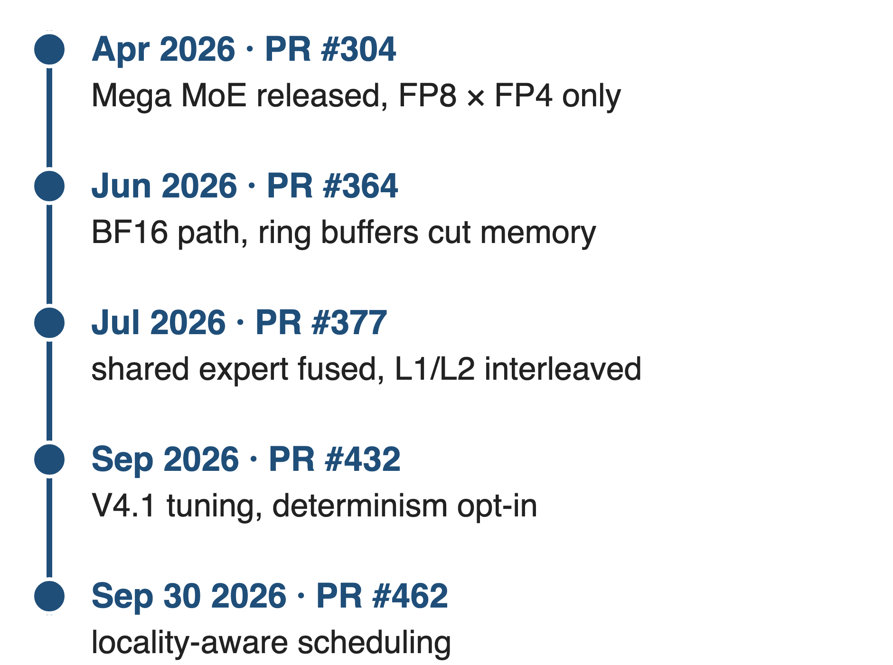{right 50%}
- Jul: shared expert in, **11** kernels into **1**, **+20%**
- V4.1: **~15%** faster at low latency, **~4%** at high throughput
- Locality-aware: **100 W** saved, **5–10%** higher clock
<!-- notes: Mega MoE kept evolving after the April release, which supported only FP8 x FP4 and was marked "still under development". June added a BF16 path and ring buffers that substantially reduce memory. July fused the shared expert and a new scheduler that interleaves linear-1 and linear-2 blocks: 11 kernels into 1, 20% faster than the previous version and over 10% end-to-end for inference. September brought V4.1 tuning, about 15% at low latency and 4% at high throughput, and locality-aware scheduling that saves 100 W and lifts GPU clocks 5-10% on heavy workloads. Sources: PRs #304, #364, #377, #432, #462. -->

# The cost: whole GPU, one NVLink domain, power
%% layout: two-col
**Prerequisites**
- SM100 only; PyTorch ≥ **2.9** symmetric memory
- One NVLink domain (code caps at **72** ranks)
- SwiGLU only; occupies every SM
|||
**Costs**
- Worst-case-sized buffer; inputs copied in first
- !!Power!!: compute, HBM and NVLink all run hot
- First pull and last sum stay exposed
<!-- notes: The kernel dispatches only on compute capability 10 and needs a multi-process launch with PyTorch 2.9 symmetric memory; every peer must be reachable by load and store, so EP must stay inside one NVLink domain, and SymBuffer caps ranks at 72. The activation is fixed to SwiGLU, and the grid takes every SM, so nothing else overlaps with it. The symmetric buffer is sized for the worst-case token count and ring occupancy, and callers copy x, scales and top-k into it before each call unless a previous kernel writes them there. V4 §3.1 warns that extreme fusion drives compute, memory and network at once, making power throttling a limiter, and that SwiGLU's exponent and division can stall the GEMM pipeline. Sources: csrc/apis/mega_moe.hpp, heuristics/mega_moe.hpp, layout/sym_buffer.cuh, README lines 114-137, V4 §3.1 p.16. -->

# Summary
- Five-kernel EP MoE: **≈ 111 µs** at 1 token/rank (V4-Flash)
- ==Insight==: over NVLink, all-to-all is loads and stores
- Pull dispatch, counter-gated tiles, fused epilogues
- **56.5 µs**: **1.50–1.96×** faster, bitwise-equal output
%% qr: https://github.com/deepseek-ai/DeepGEMM
<!-- notes: Mega MoE removes the kernel boundary, not the communication: tokens are pulled into expert tiles over NVLink, tiles start the moment their inputs exist, and the epilogues do SwiGLU, quantization and the combine send. Related decks: 25 (DeepGEMM overview), 14 (wave-based overlap model), 18 (FP8 dispatch and BF16 combine), 39 (determinism switch), 31 (HPC-Ops fused FP8 MoE, a single-GPU contrast), 41 (Mega Gate and Mega mHC). Sources: DeepGEMM PR #316, V4 §3.1. -->
