# Router scores pick each token's experts
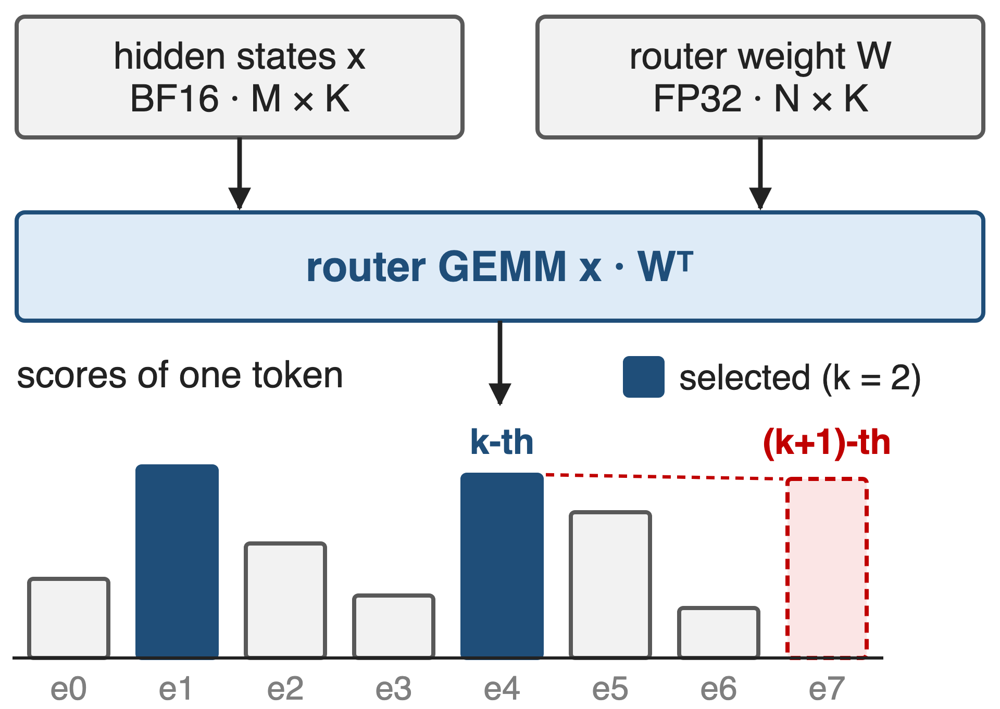{right 55%}
- Router GEMM: BF16 tokens × **FP32** weights
- LongCat-Flash router: K = **6144**, N = **768**
- Same shape of problem: state-compress GEMMs in sparse and linear attention
<!-- notes: Every MoE layer projects the token's hidden state onto the router weights, and the top-k of those scores picks the experts. When the k-th and (k+1)-th scores are close, a small numerical error flips which expert runs, so some production models keep the router weights in FP32 while activations are BF16. In SGLang, LongCat-Flash's router is K=6144 by N=768 (512 routed plus 256 zero experts); the Lite model is 3072 by 384. HPC-Ops names the state-compress GEMMs of sparse and linear attention as the other user. Sources: LMSYS blog "HPC-Ops x SGLang" (2026-08-07) Router GEMM section; SGLang PR #30247 diff (router shapes); HPC-Ops README Route GEMM entry. Library overview: deck 26. -->

# Exact FP32 weights cost 1.96× TF32's time
%% big: 1.96×
%% sub: FP32 cuBLAS takes 403.7 µs, TF32 cuBLAS 205.8 µs, for the same router GEMM (M = K = 4096, N = 192, H20)
%% source: Derived from LMSYS "HPC-Ops × SGLang" (Aug 2026), Table 2; both baselines include the x.float() cast
<!-- notes: Hopper Tensor Cores have no FP32-input mode, so an exact FP32 GEMM runs on the CUDA cores. On H20, at four thousand tokens, the FP32 cuBLAS router GEMM takes 403.7 microseconds against 205.8 for TF32: precision costs about 2x. And TF32 is the fast option only because it already rounds the weights, as the next slide shows. 1.96 = 403.728 / 205.760, derived from LMSYS Table 2. -->

# Tensor-Core formats drop the weight's low bits
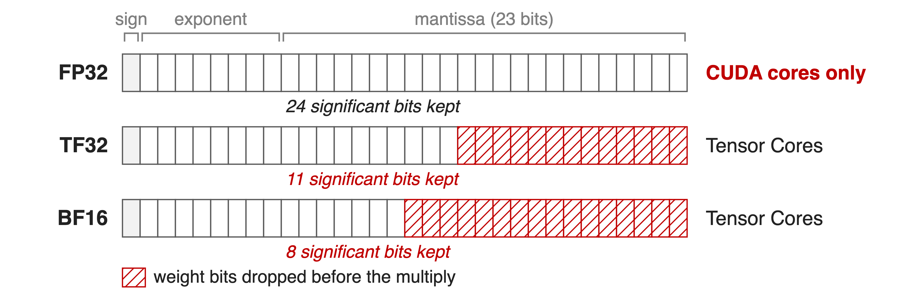{full}
> Exact but slow, or fast but rounded: cuBLAS offers nothing in between
<!-- notes: FP32 keeps a 24-bit significand (23 stored bits plus the implicit 1) but only runs on CUDA cores. TF32 keeps 11 significant bits and BF16 keeps 8, so before the multiply each weight loses 13 or 16 bits. The activations are BF16 already and lose nothing in any of these formats; all the damage is on the FP32 weight. Source: format definitions; HPC-Ops README and PR #47 describe exactly this dilemma ("naive FP32 GEMM falls back to CUDA cores, while BF16 or TF32 introduce accuracy degradation"). -->

# Insight: one FP32 weight is two BF16 weights
- w ≈ w_hi + w_lo / 256, both stored in BF16
- A GEMM is linear: x·w = x·w_hi + (x·w_lo) / 256
--
> Two BF16 Tensor-Core GEMMs recover 16 of the weight's 24 bits
<!-- notes: BF16 keeps 8 significant bits. The residual w minus w_hi is about 256 times smaller than w, so scaling it by 256 and rounding it to BF16 captures the next 8 bits. Because a matrix product is linear in the weight, the FP32-weight GEMM becomes two BF16 GEMMs over the same activations, combined with a 1/256 scale. Source: HPC-Ops README Route GEMM entry; hpc/gemm.py docstring (scale = 1/256, w_high = w.to(bf16), w_low = ((w - w_high)/scale).to(bf16)). -->

# Split once, multiply twice, store once
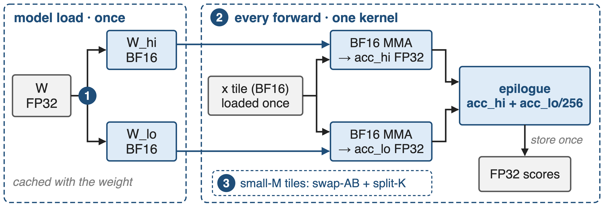{full}
%% caption: API: hpc.gemm_bf16xfp32(x, w_high, w_low, scale) · kernel: src/gemm/sm90/gemm.cu
<!-- notes: Three pieces. One: the split happens once at model load and is cached next to the weight; w_hi plus w_lo take the same 4 bytes per weight as FP32. Two: every forward runs one kernel that loads each activation tile once and feeds two BF16 matrix multiplies, each into its own FP32 accumulator, then combines them in the epilogue and stores once. Three: tile mapping for tiny token counts. Sources: hpc/gemm.py; src/gemm/sm90/gemm.cu; LMSYS Router GEMM section; SGLang PR #30247 (weight split cached at load). -->

# ❶ The split keeps bits 1–16 of the weight
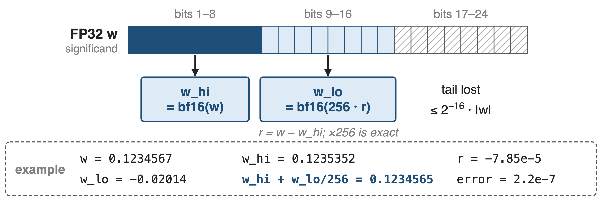{full}
> 256 = 2⁸ lifts bits 9–16 into BF16's 8-bit window
<!-- notes: w_hi is the BF16 rounding of w, carrying the top 8 significant bits. The residual r = w - w_hi is exact in FP32; multiplying by 256 is exact because it is a power of two, and rounding 256r to BF16 keeps the next 8 bits. In the example, w_hi rounds up, so w_lo is negative; the sum is off by 2.2e-7, against 1.7e-5 for TF32. The bit picture is schematic, since rounding can carry. Example values computed with notes/split_sim.py (round-to-nearest BF16, as in the reference code); the LMSYS blog says the high part is truncated, which gives the same 2^-16 bound (see sources.md, Discrepancies). -->

# Only the dropped tail bits cost accuracy
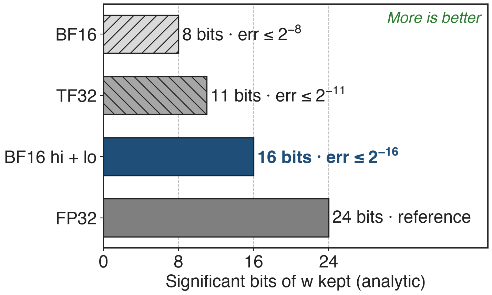{right 55%}
- x is BF16: no input rounding
- BF16 × BF16 products exact; FP32 accumulators
- ×1/256 is exact (power of two)
> Weight error ≤ 2⁻¹⁶·|w|: 32× finer than TF32
<!-- notes: Walk the error ledger. The activations are already BF16, so nothing is lost on x. A product of two BF16 numbers has at most 16 significant bits and is exact in FP32, and both halves accumulate in FP32. The 1/256 scale is a power of two, so it is exact too. The only approximation is the tail, bits 17 to 24 of the weight: relative error at most 2^-16, versus 2^-11 for TF32 and 2^-8 for BF16. That is close to FP32, not bit-identical. Analytic; checked by simulation on 2 million random weights (notes/sources.md). -->

# ❷ One kernel feeds both GEMMs from one tile
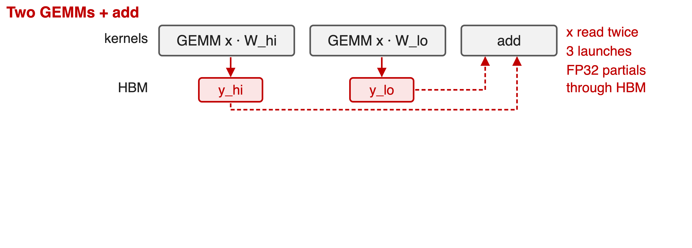{full}
--
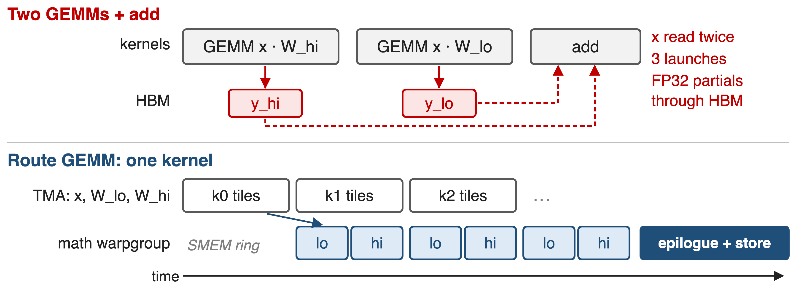{full}
> Two FP32 accumulators stay in registers until one final store
<!-- notes: The naive version runs two GEMM kernels and an add: it reads x twice and pushes two FP32 partial outputs through HBM. HPC-Ops uses one warp-specialized kernel. A TMA producer warpgroup streams the x tile and the W_lo and W_hi tiles of each K step into a three-stage shared-memory ring; the math warpgroup runs the low WGMMA, then the high WGMMA, on the same x tile, into two register accumulators. The epilogue computes acc_lo times 1/256 plus acc_hi and stores once. Schematic, not to scale. Source: src/gemm/sm90/gemm.cu lines 165-364; README Route GEMM entry. -->

# ❸ Swap-AB and split-K fill the GPU at small M
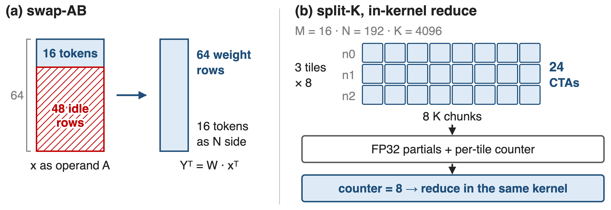{full}
%% caption: Picker (entry.cc): split-K 8 / 4 / 2 / 1 as normalized M grows; 64-token tiles above it
<!-- notes: In decode, M is a handful of tokens. A Hopper WGMMA has a 64-row side; putting 16 tokens there would leave 48 rows idle, so the kernel computes Y-transpose = W times x-transpose: 64 weight rows on the 64-row side, 16 tokens on the narrow side. With N = 192 that is only 3 output tiles, so the picker also splits K, here 8 ways, giving 24 CTAs. Each writes an FP32 partial and bumps a per-tile counter; when the counter reaches 8 the same kernel reduces, with no extra launch. Sources: src/gemm/sm90/gemm.cu (partition_A on W, 64x16x16 atom, split_flag counters); src/gemm/entry.cc select_config. -->

# Beats FP32 cuBLAS by 1.30–3.22× on H20
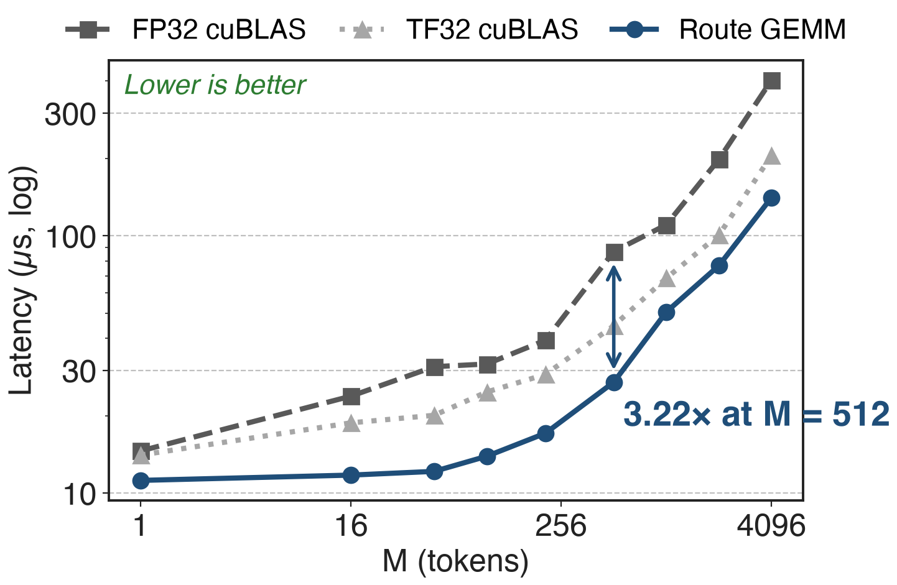{right 60%}
- H20 · router shape K = 4096, N = 192
- **1.25–1.78×** faster than TF32 cuBLAS too
- Baselines include the `x.float()` cast
<!-- notes: Across the whole sweep from one token to 4096, Route GEMM beats FP32 cuBLAS by 1.30 to 3.22x, peaking at M = 512, and even beats the less accurate TF32 cuBLAS by 1.25 to 1.78x. The baselines time torch.matmul(x.float(), w.t()), so they include casting the BF16 activations, which is what SGLang's default path does. Source: LMSYS blog Table 2 and operator-benchmark paragraph; benchmark/route_gemm/benchmark_gemm_bf16xfp32.py. -->

# Error stays 36× below TF32 at higher speed
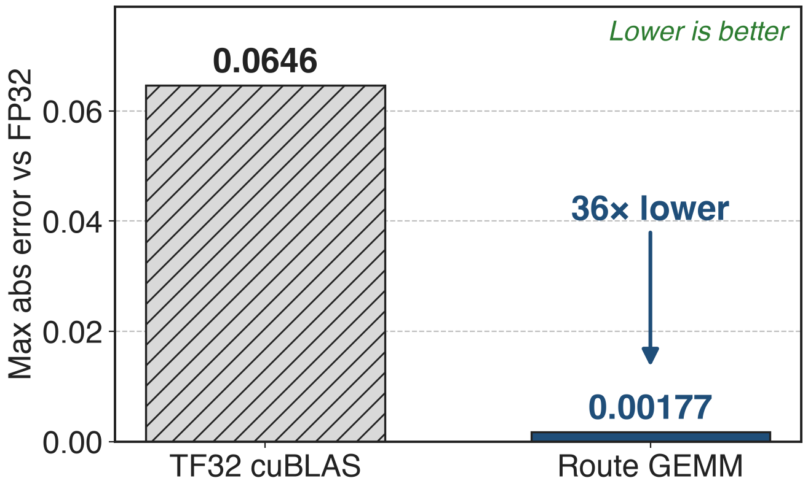{right 55%}
- Max abs error vs FP32 cuBLAS, same sweep
- Analytic bound predicts **32×** (2⁻¹⁶ vs 2⁻¹¹)
- SGLang: greedy outputs unchanged
<!-- notes: Using FP32 cuBLAS as the reference, Route GEMM's maximum absolute error over the sweep is 0.00177; TF32 cuBLAS reaches 0.06464. The ratio, 36x (derived: 0.06464 / 0.00177), matches the 32x the bit budget predicts. In the SGLang integration the router passed comparisons against the FP32 reference and greedy outputs were preserved. Sources: LMSYS blog highlights and fidelity paragraph; analytic bound in notes/sources.md. -->

# LongCat prefill gains 5.5–6.1% input throughput
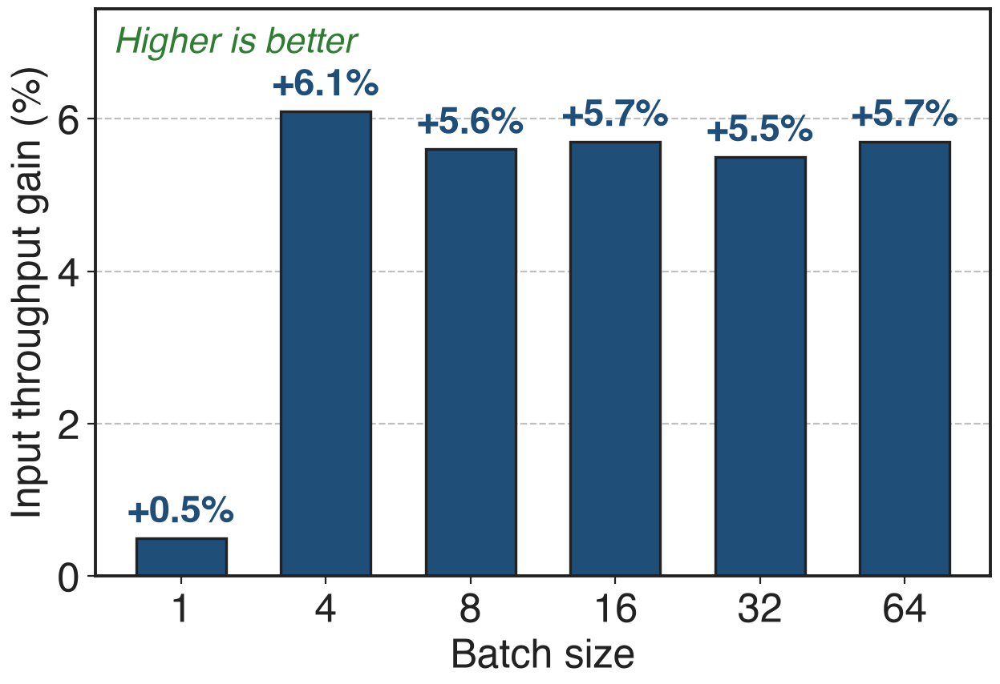{right 55%}
- LongCat-Flash-Lite-FP8, 8×H20, router GEMM only
- Router shapes: **1.06–2.83×** over SGLang default
- GSM8K **0.798 → 0.802** (H200)
<!-- notes: Swapping only the router GEMM in SGLang raises LongCat-Flash-Lite-FP8 input throughput by 5.5 to 6.1 percent at batch 4 to 64 on eight H20s (1,024-token input, 128-token output); batch 1 is near parity. On the LongCat router shapes the kernel is 1.06 to 2.83x faster than SGLang's default within the dispatch ranges. On H200 the upstream PR measured 1.56 to 4.31x kernel speedup, +2.8 to 5.4% input throughput, and GSM8K 0.798 versus 0.802. Sources: LMSYS Tables 3, 10 and 11; SGLang PR #30247. -->

# The cost: crossovers, frozen weights, Hopper only
%% layout: two-col
- !!Below a crossover M!!, cuBLAS FP32 is faster
- SGLang min-M guard **64** / **128**: Lite decode keeps cuBLAS
- ~16-bit weights: close to FP32, not bit-exact
|||
- !!Online weight updates rejected!! while the split cache is active
- SM90 only; N divisible by 64; forward only
<!-- notes: Two GEMMs carry fixed overhead, so below a measured token count the single FP32 GEMM wins; SGLang dispatches by shape, with minimum M of 64 for the Chat router and 128 for Lite on H200, so Lite's decode at batch 64 or less stays on cuBLAS. The split is cached at load, and in-place weight writes do not invalidate it, so SGLang now refuses online weight updates while it is active; that matters for RL weight sync. The kernel is SM90 only (not sm103), needs N divisible by 64, and has no backward. Sources: LMSYS Router GEMM section; SGLang PRs #30247 and #31943; src/gemm/entry.cc checks; hpc-ops CLAUDE.md. -->

# Summary
- Exact FP32 router weights cost **1.96×** TF32's time
- ==Insight==: w ≈ w_hi + w_lo/256 turns one FP32 GEMM into two BF16 GEMMs
- One kernel: shared x tile, two FP32 accumulators, one store
- **1.30–3.22×** vs FP32 cuBLAS, error **36×** below TF32
%% qr: https://github.com/Tencent/hpc-ops
<!-- notes: Route GEMM keeps FP32 router weights to about 16 bits while running all math on BF16 Tensor Cores, and it beats both cuBLAS options on H20. Related decks: 26 (HPC-Ops overview), 29 (FP8 grouped GEMM), 31 (fused FP8 MoE), 55 (router design: loss-free balance and sigmoid gating). Sources: LMSYS blog; HPC-Ops README and source. -->
