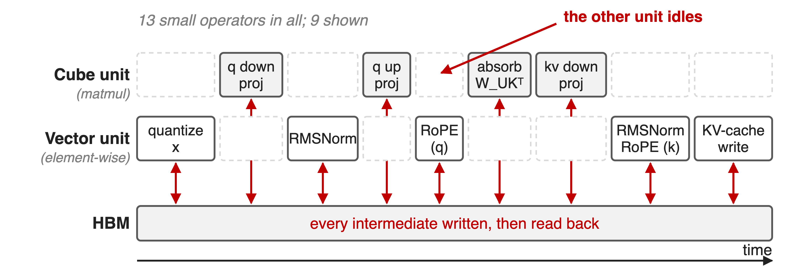
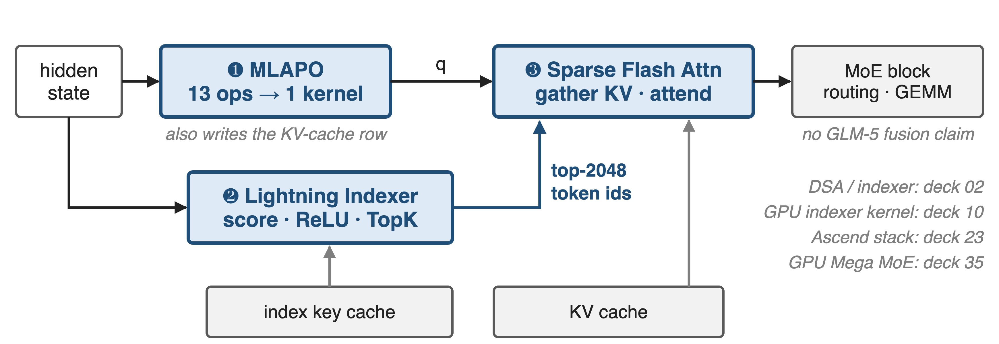
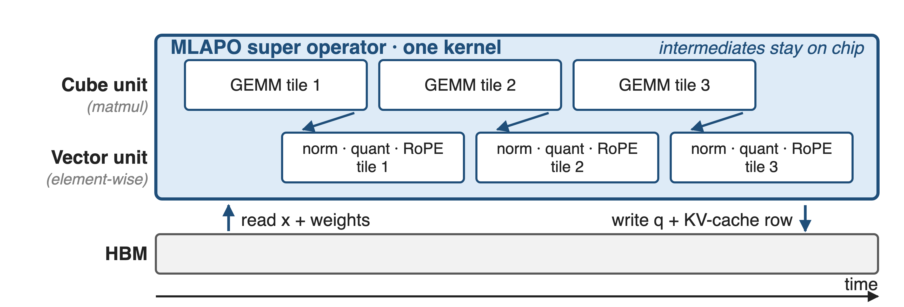
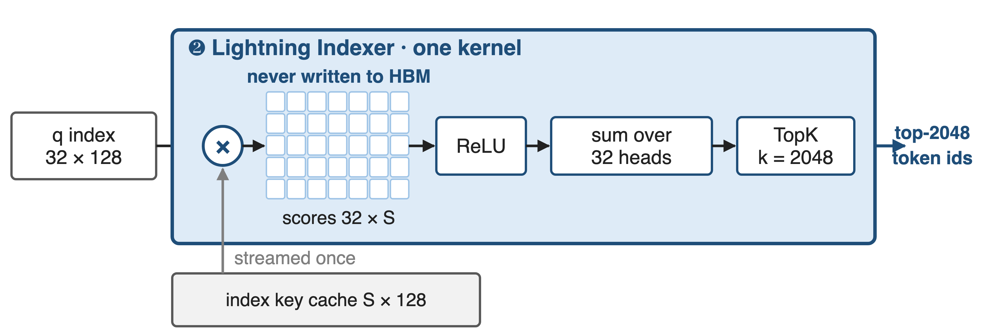
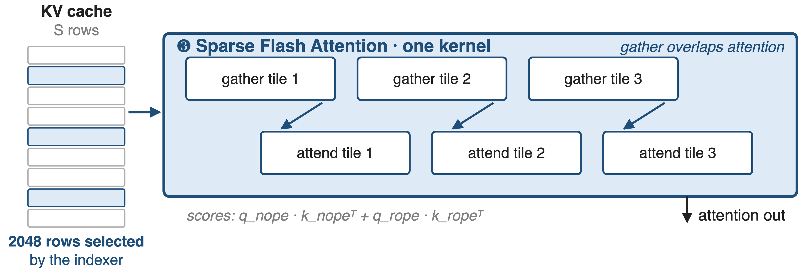
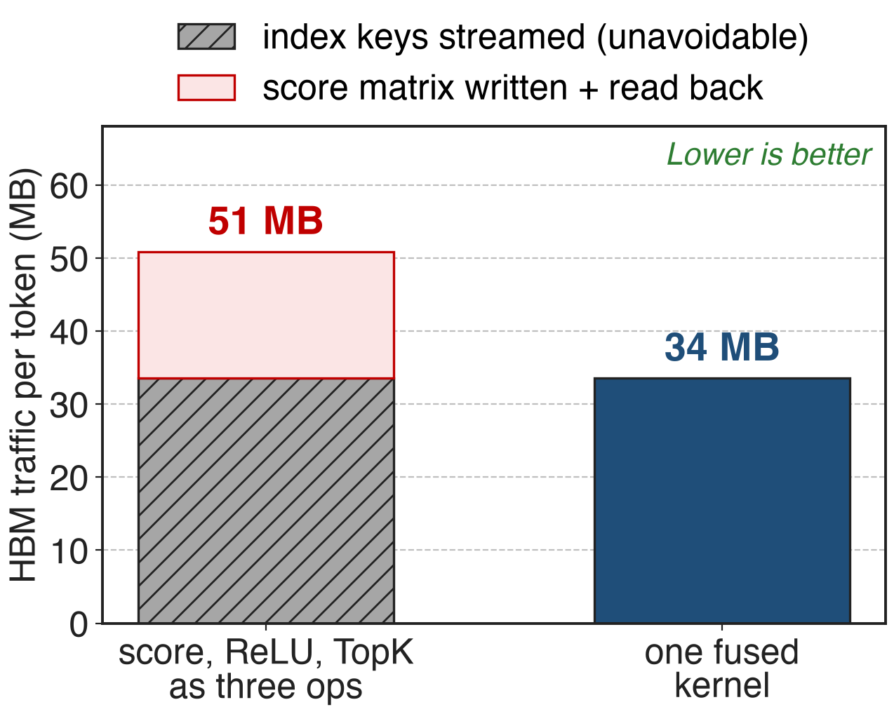
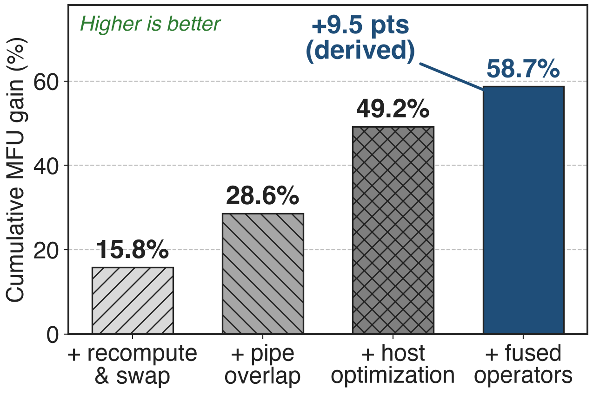

# GLM-5 ships on domestic NPUs from day one
- **744B** params, **40B** active, **256** experts, **80** layers, DSA sparse attention
- Adapted to **7** Chinese chip platforms; Ascend Atlas is the case study
- Target: the whole model served from **one** Atlas 800T A3 machine
<!-- notes: GLM-5 is a 744B-parameter MoE with 40B active parameters, 256 experts and 80 layers, and it uses DeepSeek Sparse Attention. The team adapted it to seven domestic chip platforms and uses Huawei Ascend as the worked example, with three pillars: extreme quantization, kernel fusion, and inference-engine scheduling. This deck is the fusion pillar; quantization is deck 44, the engine and the stack are decks 12 and 23. Sources: arXiv 2602.15763 §2.1 p.4, Table 10 p.36, §1 p.4 and §5 p.21. -->

# A thousand tiny kernels per decoded token
%% big: ≈1,000
%% sub: kernels per decoded token for MLA pre-processing alone — 13 small ops in each of 80 layers
%% source: Derived from GLM-5 report (arXiv 2602.15763): 13 pre-processing ops, §5 p.21-22; 80 layers, §2.1 p.4
<!-- notes: The report says MLAPO fuses thirteen small pre-processing operators into one. Multiply that by the eighty layers of the model and the attention front end alone dispatches on the order of a thousand kernels for every token you decode, before the attention math or the MoE block. That is the shape of the problem: not one slow kernel, but a crowd of small ones. The number is derived, not measured: 13 ops times 80 layers is 1,040. -->

# Op-by-op execution idles half of the AI core
{full}
> Each op uses one unit, writes its result to HBM, and the next op reads it back
<!-- notes: An Ascend AI core has a Cube unit for matrix work and a Vector unit for element-wise work. The pre-processing chain alternates between them: quantize, project, normalize, project, rotate, absorb, write the KV cache. While one unit runs, the other waits, and every arrow between two boxes is a round trip through HBM. The op list here is vLLM-Ascend's MLA pre-processing path; the GLM-5 report states the count, thirteen, but does not list the operators. Cube/Vector split: Pangu Ultra MoE, arXiv 2505.04519 §3 p.7. -->

# Insight: the operator boundary is the cost
- Every tensor between two ops is live for microseconds and read once
- The Cube and Vector units are independent hardware, not a single pipeline
--
> Fuse the phase: intermediates stay on chip, and both units work at the same time
<!-- notes: This is the observation the whole adaptation rests on. The intermediates in the chain are tiny and short-lived; they only reach HBM because the operator boundary forces them to. Put the whole phase inside one kernel and two things follow at once: the intermediates stay in the on-chip buffer, and the kernel can schedule Vector work on one tile while the Cube unit works on another. The report states exactly this benefit for MLAPO, "utilizing parallel processing between Vector and Cube units", and for the indexer, "allowing the NPU to overlap computation with memory access" (§5 p.21-22). -->

# Three super-operators carry the decode path
{full}
%% caption: GLM-5 report §5: Lightning Indexer, Sparse Flash Attention, MLAPO. The MoE block is not part of its fusion claims.
<!-- notes: One attention layer, three fused kernels. MLAPO turns the hidden state into queries and writes the KV-cache row. The Lightning Indexer scores the context and returns the 2048 tokens worth attending to. Sparse Flash Attention gathers those rows and runs the attention. The MoE block is drawn gray on purpose: the report claims no MoE fusion, although the Ascend stack does fuse grouped matmul with SwiGLU and quantization. Deck 02 covers DSA itself, deck 10 the GPU indexer kernel, deck 23 the full Ascend stack. -->

# ❶ MLAPO fuses 13 pre-processing ops
{full}
> Quantize, project, normalize, rotate, absorb, write cache — one kernel, two units
<!-- notes: MLAPO, Multi-head Latent Attention Pre-processing Optimization, fuses thirteen small operators into one super operator. The chain it absorbs, read from vLLM-Ascend's fused call: dynamic quantization of the hidden state, the q down-projection, RMSNorm on the q latent, re-quantization, the q up-projection, RoPE on the rope half, the absorb BMM with the K up-projection weight, the KV down-projection, RMSNorm on the KV latent, RoPE on the key, and the KV-cache scatter. Only the inputs and the final queries and cache row touch HBM. Source: GLM-5 §5 p.22; op list from vllm-ascend mla_v1.py and csrc/mla_preprocess. -->

# ❷ One kernel scores, rectifies and ranks
{full}
> The 32 × S score matrix never becomes a tensor in HBM
<!-- notes: DSA picks which tokens to attend to with a lightweight indexer: multiply the index query by every index key, rectify with ReLU, sum over the 32 index heads with per-head weights, then take the top 2048. As three separate operators, the score matrix for a long context is a large tensor that has to be written and read back. Fused, it is consumed tile by tile as it is produced. Shapes from Table 10 p.36 and the DSA section; the kernel description is §5 p.21. -->

# ❸ Gather and attend in one kernel
{full}
> Gathering the next tile of KV overlaps the attention math of the current one
<!-- notes: The third kernel takes the indexer's 2048 ids and does both jobs at once: selecting those rows out of the KV cache and running the causal sparse attention over them. The report says the kernel "handles the selection of TopK tokens from the KV cache and sparse attention computation in parallel" and that it was tuned for GLM-5's sparse pattern. vLLM-Ascend's variant goes further and also copies missing rows from host memory inside the same call. Sources: §5 p.22; csrc/attention/fused_scatter_copy_sparse_flash_attention. -->

# Fusion removes ~17 MB per decoded token
{right 60%}
%% caption: Analytic, not measured: bf16, 128K context, 32 index heads of dim 128 (Table 10)
- Index keys must be streamed either way
- The score matrix is pure fusion profit
- **1.5×** less indexer traffic per token
<!-- notes: An analytic estimate, because the report publishes no traffic numbers. At a 128K context the indexer must stream 33.5 megabytes of index keys per decoded token, and that cost is unavoidable. The 32-by-S score matrix adds another 17 megabytes of writes and reads if the three operators are separate. Fusing removes exactly that part, about a third of the traffic. The derivation is in notes/sources.md; the slide number is an estimate of what the described fusion removes, not a measurement, and it counts one indexer invocation, not a whole layer stack. -->

# Fused operators: the last +9.5 MFU points
{right 58%}
%% caption: Pangu Ultra MoE (arXiv 2505.04519) Table 5: 718B MoE training on 6K Ascend NPUs — different model, training not inference
- Cumulative gain over the baseline
- Final MFU **30.0%**
- Fusion comes last, after recompute, overlap and host fixes
<!-- notes: GLM-5 publishes no per-kernel numbers, so this is the closest public measurement on the same silicon: Huawei's own Pangu Ultra MoE paper, training a 718B MoE on six thousand Ascend NPUs. Four strategies, each cumulative: recompute and swap, pipeline overlap, host-side optimization, and fused operators, ending at 58.7 percent above baseline and an MFU of 30 percent. The fused-operator step is the last 9.5 points, which is derived by subtraction. Note what comes before it: host-side dispatch has its own fix, so fusion is paying for the device-side work. -->

# One domestic node, half the long-context cost
%% big: 50%
%% sub: lower deployment cost in long-sequence scenarios; a single Chinese node reported comparable to "dual-GPU international clusters"
%% source: GLM-5 report §5 p.22 — attributed to all hardware-level co-optimizations together (quantization + fusion + engine)
<!-- notes: The end-to-end claim in the report. Be careful with attribution: this number covers the whole set of hardware-level co-optimizations, W4A8 quantization and the engine work included, not fusion alone. The comparison baseline, "dual-GPU international clusters", is not defined in the report: no GPU model, no node count, no batch size or latency target. Quantization is deck 44. -->

# The cost: hand-written kernels, frozen shapes
%% layout: two-col
- !!One kernel per phase!!, written against one model's shapes
- !!Tied to NPU generations!!: A2/A3 vs Ascend 950 support differs
|||
- No per-kernel numbers published
- Change the architecture → rewrite the kernel
- MoE fusion is stack-level, not a GLM-5 claim
<!-- notes: Fusion is engineering debt by design. Each super-operator is written against specific tensor shapes and a specific NPU generation: the vLLM-Ascend kernel READMEs list which Atlas products each one supports, and some of the newer ones are 950-only. Nothing about the fused kernel survives a change in head dimension or sparsity pattern for free. And the report gives no per-kernel speedups, so the value of each kernel has to be taken on trust or measured yourself. The Notion row also lists a MoE Mega-Fusion; the report does not describe one. -->

# Summary
- MLA pre-processing alone: **13** ops per layer, **≈1,000** kernels per decoded token (derived)
- ==Insight==: intermediates exist only because the operator boundary does
- Three super-operators: MLAPO, Lightning Indexer, Sparse Flash Attention
- **1.5×** less indexer traffic (analytic); **50%** lower long-context deployment cost (whole stack)
%% qr: https://arxiv.org/abs/2602.15763
<!-- notes: Fusion on Ascend is not launch-overhead bookkeeping: it is how a chain of small ops stops round-tripping through HBM and starts using the Cube and Vector units at the same time. Related decks: 02 (DSA and the lightning indexer), 10 (the GPU indexer kernel), 12 (comm/compute fusion on Ascend), 23 (the Ascend adaptation stack), 35 (GPU Mega MoE), 44 (W4A8/W8A8 quantization). Source: arXiv 2602.15763 §5. -->
