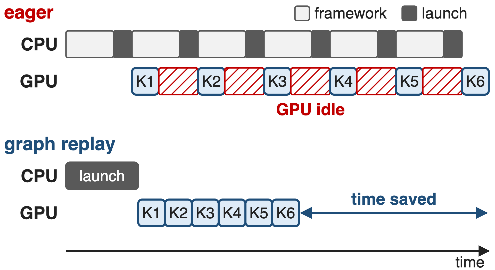
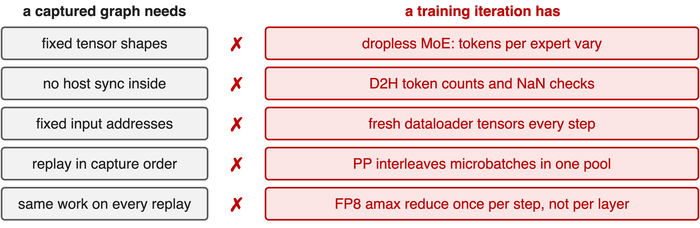
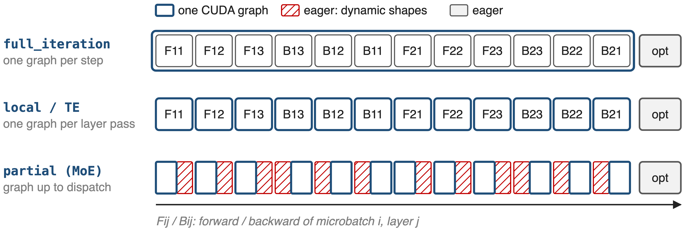
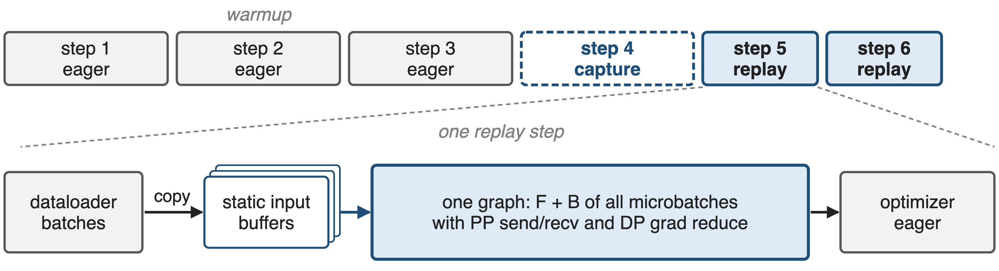
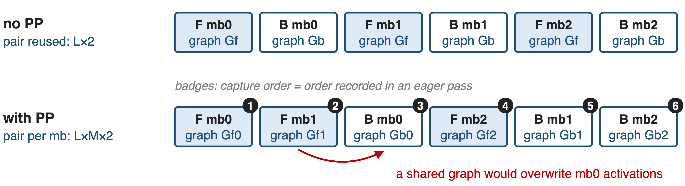
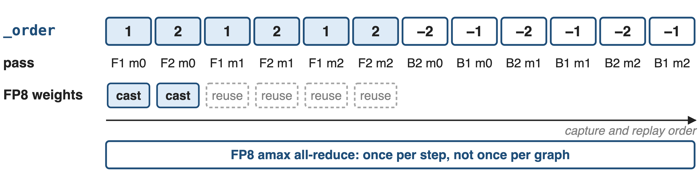
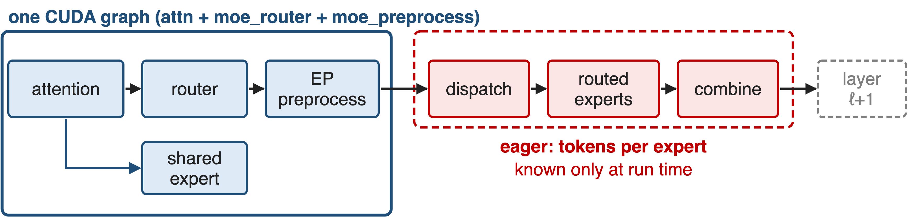
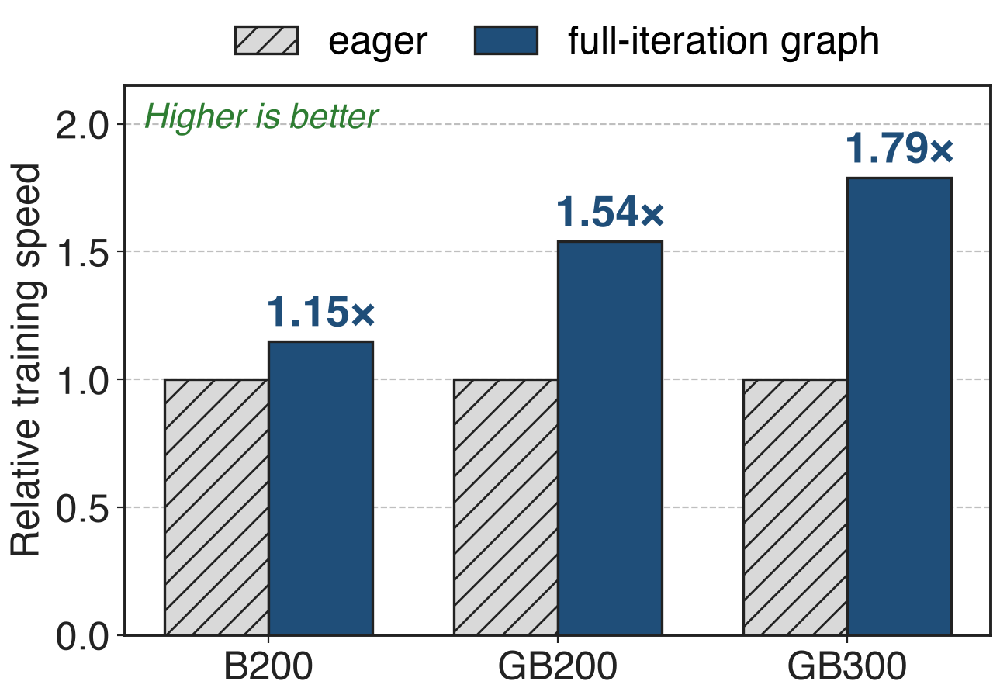

# Small kernels outrun the CPU that launches them
{right 55%}
- Per op: Python, framework, launch (~1–5 µs per kernel)
- MoE: routers, permutes, ~128-token expert GEMMs
- FP8/FP4: extra quantize kernels, faster GEMMs
<!-- notes: In eager mode every operator pays Python and framework cost on the host and then a kernel launch; NVIDIA's CUDA-graph guide uses roughly 1 to 5 microseconds per launch as a starting estimate. As long as kernels are long, the CPU stays ahead. MoE layers add many small kernels, DeepSeek-V3's 256 experts see only about 128 tokens each, and low precision makes the GEMMs faster while adding quantization kernels, so the GPU starts waiting for the CPU. A CUDA graph replays the whole recorded sequence with a single launch. Sources: dl-cuda-graph "Quantitative Benefits"; arXiv 2603.07685 §4.3.1 p.35 and §4.3.6 p.38-39. -->

# Eager FP4 training on GB300 runs 1.79× slower
%% big: 1.79×
%% sub: speedup from graphing the whole step: Llama 3.1 405B, FP4, 512 GB300 (1.15× on B200, 1.54× on GB200; FP8 shows none)
%% source: NVIDIA dl-cuda-graph docs, "Llama 3.1 405B" example (MLPerf Training v5.1)
<!-- notes: This is the host-overhead tax in today's numbers. In NVIDIA's MLPerf Training v5.1 Llama 3.1 405B submission on 512 GPUs with FP4, graphing the full forward-backward made training 1.15 times faster on B200, 1.54 times on GB200 and 1.79 times on GB300. The same benchmark in FP8 gains nothing on B200 or GB200, because its GEMMs are long enough to hide launch latency. Faster hardware and lower precision move the bottleneck to the CPU. Source: dl-cuda-graph docs, Llama 3.1 405B example, Performance Impact. -->

# Training breaks every rule a graph needs
{full}
> Naive capture either fails or silently replays stale data
<!-- notes: A captured graph freezes kernels, their pointer arguments and their order. Training violates that in five places: dropless MoE changes the number of tokens per expert every step; reading those counts, and the NaN check, are host syncs; the dataloader hands out fresh tensors; pipeline parallelism interleaves microbatches whose graphs share one memory pool; and FP8 needs one amax all-reduce per step, not one per replayed layer. Sources: arXiv 2603.07685 §4.3.6-4.3.7; Megatron CUDA graph guide; NVIDIA TE/Megatron CUDA graph doc. -->

# Fusion and plain graphs only go halfway
%% layout: two-col
- **Kernel fusion** (deck 42)
- Fewer launches per layer
- !!Per-op host cost remains!!
|||
- **Plain PyTorch graphs**
- Assume static everything
- !!No FP8 state, no PP order!!
> Needed: graph everything static, replayed in the order training runs
<!-- notes: Kernel fusion cuts the number of launches, and Megatron-Core fuses the router, permutation and RoPE paths (deck 42), but every remaining operator still costs host time. torch.cuda.graph and PyTorch's make_graphed_callables capture well-behaved callables, but on their own they do not manage FP8 scaling state, do not know the pipeline schedule, and fail on MoE's host syncs. Sources: arXiv 2603.07685 §4.3.6 p.38; NVIDIA TE/Megatron CUDA graph doc "Challenges with FP8 and Pipeline Parallelism". -->

# Insight: almost everything in a step is static
- Dense or drop-and-pad MoE: the whole forward-backward
- Dropless MoE: only dispatch → experts → combine vary
--
> Graph the largest static scope; replay graphs in capture order
<!-- notes: The turn is an inventory. For dense models and MoE with capacity padding, every shape in the forward-backward pass is fixed, so the whole step can be one graph. In a dropless MoE layer, attention, the router, the shared expert and EP preprocessing all have fixed shapes; only the token dispatch, the routed-expert GEMMs and the combine depend on routing. Megatron-Core turns this into three capture scopes, and makes every graph replay in the order it was captured so graphs can share memory. Source: arXiv 2603.07685 §4.3.6 p.39-41. -->

# Three implementations, three capture scopes
{full}
%% caption: --cuda-graph-impl full_iteration | local | transformer_engine; --cuda-graph-modules narrows per-layer capture
<!-- notes: One iteration without pipeline parallelism: forward and backward of three layers for two microbatches, then the optimizer. full_iteration turns everything except the optimizer into one graph. local and transformer_engine capture each layer pass separately, two different implementations of the same scope. With --cuda-graph-modules a MoE layer is captured only up to the dispatch, in forward and from the dispatch back in backward. Source: Megatron-Core CUDA graph guide (overview tables); arXiv 2603.07685 Fig. 23-24. -->

# ❶ full_iteration: one graph per training step
{full}
> Requires static shapes everywhere and --no-check-for-nan-in-loss-and-grad
<!-- notes: FullCudaGraphWrapper wraps Megatron's forward_backward_func. The first steps run eagerly (three by default); the next one is captured with torch.cuda.graph and every later step is a replay. Before each step, the StaticBufferLoader copies all microbatches from the dataloader into fixed buffers. The graph contains the forward and backward of every microbatch together with pipeline send/receive and data-parallel gradient reduction; the optimizer and logging stay eager. NaN checks are host syncs, so they must be disabled. The MLPerf Llama 3.1 405B submission captures all 126 layers this way. Sources: full_cuda_graph.py; Megatron CUDA graph guide; dl-cuda-graph Llama 3.1 405B example. -->

# ❷ local: record the order, then capture
{full}
> Automatic: the training schedule drives warmup, capture and replay
<!-- notes: With --cuda-graph-impl local, every graphable layer owns a CudaGraphManager. During an eager pass each runner records when its forward and backward first run; create_cudagraphs then captures them in exactly that order into one shared memory pool. Without pipeline parallelism microbatches run forward, backward, forward, backward, so one graph pair per layer is reused: L times 2 graphs. With PP the forward of microbatch 1 runs before the backward of microbatch 0, and a shared graph would overwrite microbatch 0's saved activations, so each microbatch gets its own pair: L times M times 2. Sources: cuda_graphs.py (_CudagraphGlobalRecord, CudaGraphManager); arXiv 2603.07685 p.41-42, Fig. 26. -->

# ❸ transformer_engine: capture ahead in _order
{full}
> TECudaGraphHelper turns the PP schedule into _order
<!-- notes: The TE path captures before training starts. Megatron's TECudaGraphHelper turns the pipeline schedule into TE's _order list, one-indexed model-chunk ids with positive for forward and negative for backward, builds sample inputs for every layer and microbatch, and calls make_graphed_callables. TE captures the graphs in that order and replay must follow it. For FP8 it defers the amax all-reduce to once per step and caches the FP8 weight casts, refreshing them only on the first microbatch; in the GPT-3 MLPerf run that removed up to 87.5 percent of the cast work. The training loop must call create_cudagraphs and cuda_graph_set_manual_hooks. Sources: cuda_graphs.py TECudaGraphHelper; TE graph.py; NVIDIA TE/Megatron CUDA graph doc; dl-cuda-graph GPT-3 175B example. -->

# ❹ MoE: graph everything before dispatch
{full}
> Whole-layer dropless graphs need sync-free dispatch (deck 19)
<!-- notes: For dropless MoE, --cuda-graph-modules attn moe_router moe_preprocess captures attention, the router, the shared expert when it is not overlapped with EP communication, and EP preprocessing in one graph per layer pass; dispatch, the routed experts and combine run eagerly. To keep memory in check, graphs captured in execution order share one pool, static input and output buffers are reused across graphs, and without PP a GPU-side is_first_microbatch flag lets microbatches share a graph. Megatron-Core's newer path makes the whole layer capturable with device-initiated grouped GEMM, HybridEP with a token budget, ECHO and paged stashing. Sources: arXiv 2603.07685 §4.3.6-4.3.7; Megatron CUDA graph guide. -->

# Full-iteration graphs: up to 1.79× on FP4
{right 60%}
- Llama 3.1 405B, 512 GPUs
- FP8 on B200/GB200: no gain
- vs per-layer: up to **19%** less memory
%% caption: MLPerf Training v5.1, NVIDIA dl-cuda-graph docs (Llama 3.1 405B example)
<!-- notes: The gain grows with the hardware generation: 1.15 times on B200, 1.54 on GB200 and 1.79 on GB300, all in FP4. In FP8 the same model was not CPU-bound on B200 or GB200, so graphs did not help. Across several LLMs with pipeline parallelism, full-iteration graphs also used up to 19 percent less memory than per-layer graphs, because they need no staging buffers at every graph boundary. For comparison, per-layer TE graphs gave GPT-3 175B 2.2 percent at 256 GPUs and 3.0 percent at 11,616 GPUs in MLPerf v4.1. Sources: dl-cuda-graph Llama 3.1 405B and GPT-3 175B examples. -->

# Partial graphs add 10% to DeepSeek-V3
%% big: +10%
%% tone: ours
%% sub: end-to-end speedup for DeepSeek-V3 training on GB200 with partial CUDA graphs, at about 7 GB extra memory
%% source: arXiv 2603.07685 §4.3.6 (p.42); part of the 1,048 TFLOPS/GPU GB200 configuration (Table 17)
<!-- notes: For dropless MoE the paper reports a 10 percent end-to-end speedup on DeepSeek-V3 GB200 training from partial graphs, after the memory optimizations kept the extra memory to about 7 GB. The final GB200 configuration, 256 GPUs at 1,048 TFLOPS per GPU, enables CUDA graphs for attn, moe_router and moe_preprocess; the H100 configuration leaves them off, because there the communication wall dominates. Sources: arXiv 2603.07685 §4.3.6 p.42, Table 17 p.74, App. B.2 p.87. -->

# Graphs cost memory, warmup and flexibility
%% layout: two-col
- !!Memory!!: static buffers, separate pools
- Eager warmup (3 steps), then capture
- Opaque: harder to debug and profile
|||
- No host syncs: NaN check off, TE RNG
- Dropless experts stay eager by default
- Long GEMMs gain little (H100 DSV3: off)
<!-- notes: Graphs need static input and output buffers and their own memory pools: about 7 GB on DeepSeek-V3 GB200 even after pool sharing and buffer reuse. They start after three eager warmup steps by default, capture takes time, and a captured step is opaque to debuggers. Everything inside must be sync-free: full_iteration requires --no-check-for-nan-in-loss-and-grad and a GPU-side RNG tracker, and the MLPerf setups also set NCCL environment variables. Dropless experts stay eager unless the sync-free path is used. When GEMMs are long, as for FP8 Llama on B200/GB200 or DeepSeek-V3 on H100, there is little launch overhead to remove. Sources: Megatron CUDA graph guide; arXiv 2603.07685 p.41-42, App. B.2; dl-cuda-graph Llama example. -->

# Summary
- Eager FP4 Llama 405B on GB300: **1.79×** slower
- ==Insight==: graph the largest static scope, replay in capture order
- full_iteration, per-layer (local or TE), MoE partial scopes
- **1.15–1.79×** full-iteration; **+10%** DeepSeek-V3 for ~7 GB
%% qr: https://github.com/NVIDIA/Megatron-LM
<!-- notes: CUDA graphs remove the host from the inner loop of training, and Megatron-Core offers them at whatever scope the model keeps static. Related decks: 19 (HybridEP sync-free dispatch), 34 (masked grouped GEMM for CUDA graphs), 42 (router, permutation and RoPE fusions), 11 (1F1B overlap). Guide: docs/user-guide/features/cuda_graph.md in the Megatron-LM repository. -->
