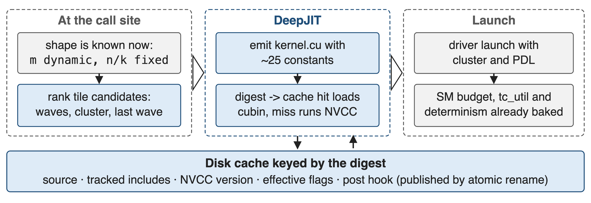
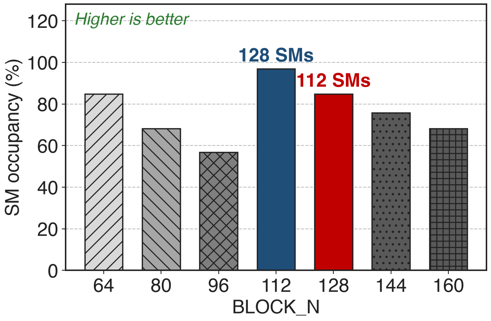
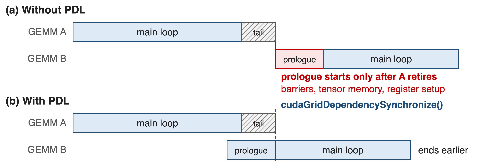

# Every DeepGEMM kernel is compiled on first use
- Installing the library compiles no CUDA kernels
- `compiled_dims = "nk"`: N and K become constants, M stays dynamic
- The shapes arrive at run time: tokens, experts, context length
<!-- notes: DeepGEMM ships Python plus CUDA headers; DeepJIT builds each kernel the first time it is called and caches the cubin on disk. The compiled_dims default matters: model dimensions are burned in, the token count is not, so one binary serves every batch size. -->

# A power-of-two tile can idle 20 SMs
%% big: 112 / 132
%% sub: thread blocks that get an SM at M = 256, N = 7168 with a 128x128 tile — BLOCK_N = 112 fills 128 of 132 instead
%% source: DeepGEMM README @ commit 8002b769 (2025-03-25), section "Unaligned block sizes"
<!-- notes: (256/128) x (7168/128) = 112 blocks on a 132-SM H800. The fix is a tile size nobody would pick by hand, 112, which divides 7168 exactly 64 times. You can only make that choice once you know N, and N is a property of the model, not of the library build. -->

# Ahead-of-time libraries pick tiles before the shape exists
- A template library freezes its tile set at build time
- !!Autotuning!! pays a benchmark at startup, and the winner varies per machine
> DeepGEMM selects block sizes, warpgroups, stages and cluster size deterministically — "without auto-tuning"
<!-- notes: Two obvious routes both fail. Compile every variant ahead of time and installation takes forever, or ship a few and fall back to a generic kernel. Autotune at runtime and you pay measurement time, and the kernel you get, hence the numerics, depends on the machine's mood that day. -->

# Insight: compile at the first call
- Then the shape is a constant: scheduler bounds, stages, SM budget, switches
- The compiler can unroll the MMA pipeline fully and spend fewer registers
--
> One compile per shape and config, then a content-addressed cache that every process on the node shares
<!-- notes: This is the Triton-style bet, made explicit in DeepGEMM's first release notes: JIT compilation mainly buys you small shapes, where full unrolling and constant bounds matter most. The cache is what keeps the bet affordable. -->

# DeepJIT turns a call into a cached cubin
{full}
%% caption: The digest covers the source, tracked includes, NVCC version, flags and post hook
<!-- notes: DeepJIT is now a separate header-only library with CUDA and Ascend backends. Entries are published by atomic rename with a .committed marker, so several processes can race on the same kernel and still share the result; DJ_JIT_CACHE_DIR can list a private cache in front of a read-only shared one. -->

# ❶ The heuristic ranks tiles, never benchmarks
{right 56%}
- Candidates: swap-AB x BLOCK_M x BLOCK_N x cluster
- Ranked by single wave, multicast, fewer waves, last-wave fill
%% caption: analytic: blocks that get one of the 132 SMs at M = 256, N = 7168
<!-- notes: The ranking is a pure function of the shape, so the same call always compiles the same kernel - which is also what makes the numerics reproducible. The chart applies the heuristic's own occupancy formula across the BLOCK_N candidates; 112 and 128 are the two values the README names. -->

# What the JIT burns into the generated source
- BLOCK_M/N/K, pipeline stages, swizzle modes, cluster size, thread counts
- `num_sms`, the tensor-core utilisation cap, the epilogue, the dtypes
> `set_tc_util(80)` compiles in idle cycles after each MMA so the clock does not drop
<!-- notes: About 25 template arguments per instantiation. Because the SM budget is a constant, a GEMM can be told to use 100 of 132 SMs and leave the rest to communication kernels; because the utilisation cap is a constant, the kernel inserts a computed number of dummy cycles after each UMMA instead of branching at run time. -->

# ❷ PDL overlaps the next kernel's prologue
{full}
%% caption: Every kernel calls cudaGridDependencySynchronize() after its own setup work
<!-- notes: The launch carries the programmatic-stream-serialization attribute, so the next grid may start while the previous one drains. DeepGEMM's kernels initialise barriers, allocate tensor memory and reconfigure registers first, and only then wait on the dependency - that prologue is the part that gets hidden. set_pdl() flips it for the whole library. -->

# ❸ One switch buys bitwise batch invariance
- `use_deterministic_algorithms(True)`: no cuBLASLt dispatch, no split-K
- Mega mHC falls back to a fixed 16-way split, reduced in a later kernel
- The test suite re-runs each GEMM **20 times** and demands bitwise equality
<!-- notes: Batch invariance means a token's output does not depend on where it sits in the batch. Split-K breaks it because the number of partial sums changes with the shape, and cuBLASLt breaks it because its heuristics pick different kernels for different batch sizes. Since the 2026-09 release the switch defaults to False, so you opt in. -->

# DeepSeek-V4 replaced cuBLAS to keep tokens stable
- Goal: bitwise alignment across pre-training, post-training and inference
- Split-K abandoned in most scenarios, then recovered by other optimisations
> cuBLAS "cannot achieve batch invariance", so V4 replaced it end-to-end with DeepGEMM (§3.3)
<!-- notes: This is the payoff for RL and for debugging: when a loss spike appears you can replay the step and get the same bits. V4 reports that their matrix multiplication matches or surpasses split-K performance in most major scenarios, so batch invariance is not paid for in throughput. -->

# The cost: the first call compiles
- SGLang ships a precompile pass with a **3600 s** default timeout; vLLM a warm-up module
- Kernels must be compiled and loaded **before** CUDA Graph capture
- The digest tracks includes, NVCC version and flags; other deps need `extra_signature`
<!-- notes: Be honest about the cold start: a serving stack that meets a new shape mid-flight pays a compile. Both major engines therefore walk the model once and compile everything first. The include parser is a line scanner, so a dependency it cannot see - CUTLASS, for example - has to be named in the signature or the cache will hand back a stale kernel. -->

# Summary
- A fixed tile can leave **20 of 132** SMs idle; the right tile fills 128
- ==Insight==: compile at the first call, when the shape is still a constant
- Ranking without benchmarking, PDL overlap, SM and determinism switches baked in
- **Bitwise batch invariance** on demand; V4 replaced cuBLAS end-to-end
%% qr: https://github.com/deepseek-ai/DeepJIT
<!-- notes: Related decks: 25 for the DeepGEMM library, 30 for the dense GEMM and its scaling layout, 43 for TileLang's batch-invariant kernels. -->
