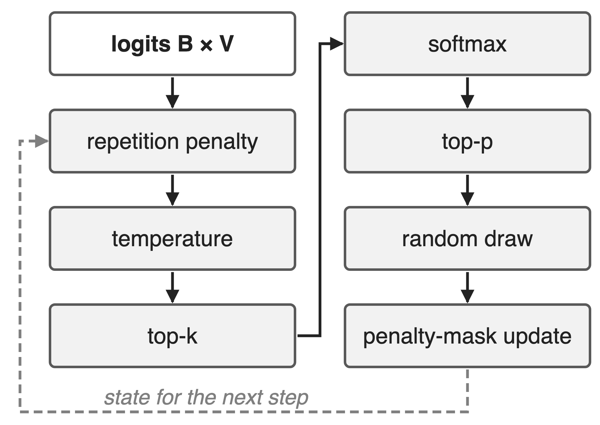
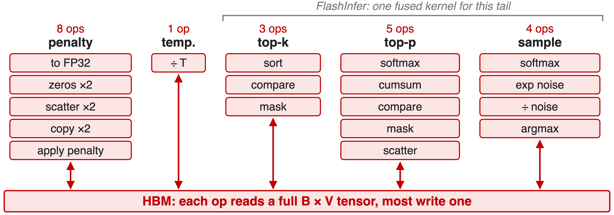
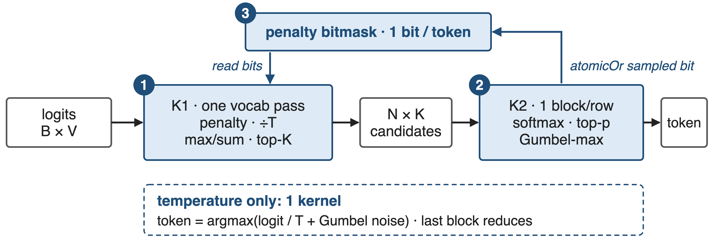
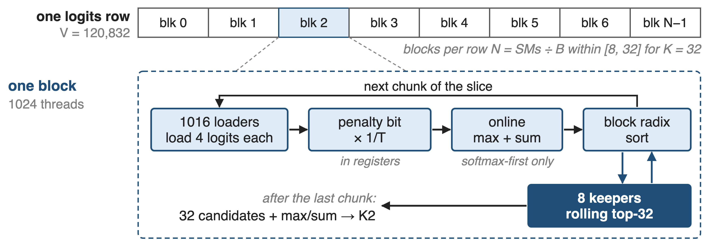
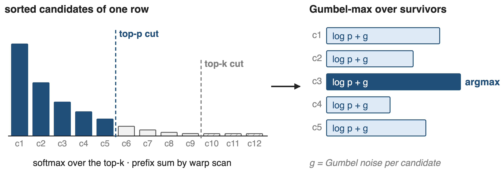
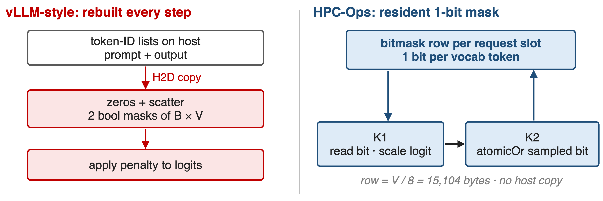
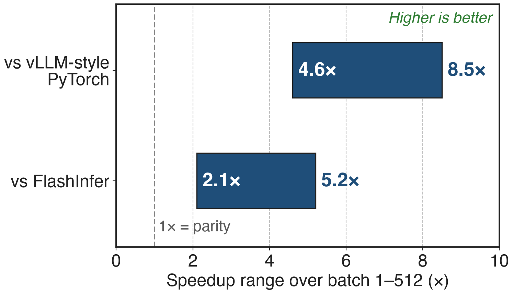
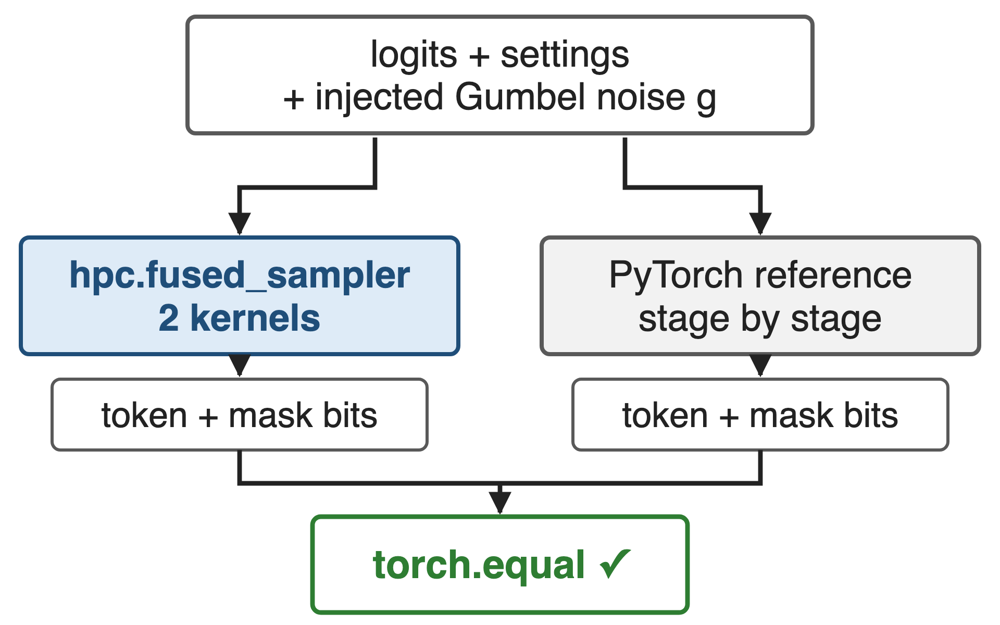

# Every decode step ends in a sampler
{right 55%}
- B × V logits in, B tokens out; V = **120,832** here
- Seven stages, once per generated token
- Small batches expose fixed launch and pass costs
<!-- notes: After the LM head, every row of B by V logits becomes one token: repetition penalty, temperature, top-k, softmax, top-p, the random draw, and an update of the penalty state for the next step. The HPC-Ops benchmark uses a 120,832-entry vocabulary. The README's argument is that in small-batch serving these many small vocabulary-wide kernels become a visible part of decode latency. Sources: HPC-Ops README "Sampler" write-up; hpc/sampler.py docstring (stage order); benchmark/sampler/README.md (vocab size). Library overview: deck 26. -->

# A PyTorch sampler runs ~20 vocabulary-wide ops
%% big: ~20
%% sub: separate tensor ops per decode step in a vLLM-style PyTorch sampler, each over a B × 120,832 tensor
%% source: Counted from HPC-Ops benchmark/sampler/benchmark_sampler.py (full sampling: repetition penalty, temperature, top-k 20, top-p 0.9)
<!-- notes: This is a count, not a timing: in the benchmark's vLLM-style baseline I count 21 tensor operations that each read or write a full batch-by-vocabulary tensor, 19 at batch 1; the list is in notes/sources.md. On top come two host-to-device copies of token histories. Each op is at least one kernel launch and one trip through HBM. -->

# Each stage re-reads the full vocabulary
{full}
> Top-k keeps 20 tokens, yet every op touches all 120,832
<!-- notes: The baseline casts the logits to FP32, rebuilds two presence masks from the token history, applies the penalty, divides by T, sorts the whole vocabulary for top-k, runs softmax and a cumulative sum for top-p, scatters back, and runs a second softmax plus exponential noise and argmax for the draw. FlashInfer's top-k/top-p sampling kernel fuses the tail, but in this benchmark the penalty, temperature and mask rebuild still run in front of it. Source: benchmark_sampler.py lines 134-180 (count in notes/sources.md). -->

# Insight: after top-k, at most 64 tokens matter
- Penalty, temperature: elementwise, fold into the read
- Softmax normalizer: online max + sum
- Sampling: argmax(log p + Gumbel noise)
--
> One read of the logits, then work on ≤ 64 candidates per row
<!-- notes: The kernel caps top-k at 32 or 64. Everything before the selection is elementwise, so it can run in registers while the logits stream in. The softmax normalizer is a running max and a rescaled running sum, which merges across blocks. And Gumbel-max turns the random draw into an argmax: add independent Gumbel noise to log-probabilities and take the largest. So only one pass needs the whole vocabulary; top-p, softmax over survivors and the draw run on the candidates. Source: hpc/sampler.py docstring; src/sampler/fused_sampler.cu header. -->

# Two kernels: one vocabulary pass, one tiny tail
{full}
%% caption: API: hpc.fused_sampler(logits, ...) · kernels: src/sampler/fused_sampler.cu and fused_sampler_temperature.cu
<!-- notes: K1 splits each row over N blocks and makes the single pass: penalty, temperature, optional softmax statistics, and a per-block top-K. K2 runs one block per row over the N times K candidates: merge, softmax, top-p, Gumbel-max draw, and it sets the sampled token's bit in the penalty mask, which K1 reads on the next step. When only temperature is on, a lighter one-kernel path computes argmax of logit over T plus Gumbel noise, and the last block to finish reduces the per-block winners. Sources: fused_sampler.cu header and launcher; fused_sampler_temperature.cu header; README. -->

# ❶ K1 reads each logit exactly once
{full}
> A block sort per chunk keeps the running top-K; V is never fully sorted
<!-- notes: Small batches get up to 32 blocks per row, N = SM count divided by batch, clamped to 8 to 32 for K = 32 (16 for K = 64), so a single request still fills the GPU. In each block, 1016 loader threads read 4 logits each, apply the penalty bit and 1/T in registers, and, if softmax comes before top-k, update an online max and sum. A block radix sort then merges the new chunk with the current top-32, which stays in 8 keeper threads. After the last chunk the block writes 32 candidates and its max and sum. The README calls this heap/merge-style selection; the current code uses cub BlockRadixSort. Source: fused_sampler.cu lines 161-289, 609-627. -->

# ❷ K2 samples by Gumbel-max over survivors
{full}
> argmax(log pᵢ + gᵢ) picks token i with probability pᵢ
<!-- notes: One block per row loads the N times K candidates and sorts them once. With softmax-first, the block maxima and sums from K1 give the full-vocabulary normalizer without another pass; with top-k-first, warp 0 runs a softmax over the k survivors. Top-p is a warp prefix scan: keep the first token and every token whose preceding mass is below p. The draw adds Gumbel noise to each survivor's log-probability and takes the warp argmax, ties to the smaller token id. Bars are schematic. Source: fused_sampler.cu lines 296-580; sampler_rng.cuh. -->

# ❸ The penalty mask never leaves the GPU
{full}
> One bit per token: K2 sets it, K1 reads it on the next step
<!-- notes: The baseline copies each request's prompt and output token ids to the GPU every step and scatters them into two batch-by-vocabulary boolean masks before applying the penalty. HPC-Ops keeps one bit per vocabulary token per request slot on the GPU, 15,104 bytes per slot for this vocabulary; K1 tests the bit and scales the logit by 1/penalty or penalty, and K2 sets the sampled token's bit with an atomic OR. Sources: hpc/sampler.py docstring; fused_sampler.cu apply_rp_temp and phase 5; benchmark_sampler.py lines 134-153. 15,104 = 120,832 / 8 (derived). -->

# Runs 4.6–8.5× faster than a vLLM-style sampler
{right 55%}
- BF16 logits, V = 120,832, batch 1–512
- Penalty 1.1, T 1.05, top-k 20, top-p 0.9
- **2.1–5.2×** faster than the FlashInfer path
<!-- notes: Across batch sizes 1 to 512 the fused sampler is 4.6 to 8.5 times faster than the vLLM-style PyTorch path and 2.1 to 5.2 times faster than the FlashInfer path; the README quotes the 8.5x maximum. Part of the gap is the penalty state: both baselines rebuild the presence masks every call. The pull request does not name the GPU; the library targets H20. Sources: hpc-ops PR #51 benchmark line; README Performance table; benchmark_sampler.py settings. -->

# Same noise in, bit-identical token out
{right 55%}
- Tests inject the Gumbel noise tensor
- BF16 and FP32 logits, top-K bound 32 or 64, all softmax orders
- Production: Philox noise, fresh per launch
<!-- notes: Because the randomness is explicit Gumbel noise, the kernel can take the noise as an input; the tests then require the sampled tokens and the penalty-mask writeback to equal a pure-PyTorch reference exactly, across softmax policies, max_topk 32 and 64, FP32 and BF16 logits and padded row strides. In production the kernel draws its own Philox noise with a per-launch offset, so repeated calls give fresh samples. Sources: tests/test_sampler.py; sampler_rng.cuh; hpc/sampler.py. -->

# The cost: top-64 bound, one vocabulary size
%% layout: two-col
- !!Never samples outside the top 32/64!!; top-k = 0 is not full-vocabulary
- !!V is compiled in!!: only 120,832 today
|||
- Repetition penalty only: a bit cannot count tokens
- Temperature path: one stream per device
- Draft-token mask: temperature path only
<!-- notes: The kernel always reduces each row to the top 32 or 64 candidates, so it cannot do pure full-vocabulary sampling, and top-k above 64 is unsupported. The vocabulary size is a template constant; any other size raises an error. The presence bit supports the multiplicative repetition penalty, not count-based frequency penalties. The temperature path shares a per-device workspace, so it must not run on several streams at once, and the speculative-decoding draft mask exists only on that path. Sources: hpc/sampler.py; sampler.h; fused_sampler.cu dispatch; fused_sampler_temperature.cu concurrency note. -->

# Summary
- vLLM-style sampling: **~20** vocabulary-wide ops per step
- ==Insight==: after top-k only ≤ 64 tokens matter; one read covers the rest
- Two kernels (one for temperature-only); penalty mask stays on GPU
- **4.6–8.5×** vs vLLM-style, **2.1–5.2×** vs FlashInfer
%% qr: https://github.com/Tencent/hpc-ops
<!-- notes: The fused sampler turns a chain of vocabulary-wide ops into one read of the logits plus a tail over a few dozen candidates per row, with Gumbel-max making the draw a reduction and the penalty state resident on the GPU. Related decks: 26 (HPC-Ops overview), 13 (fused AllReduce + RMSNorm, the other fusion operator), 38 (CUDA graphs, the other cure for launch overhead). Sources: README; PR #51; hpc-ops source. -->
