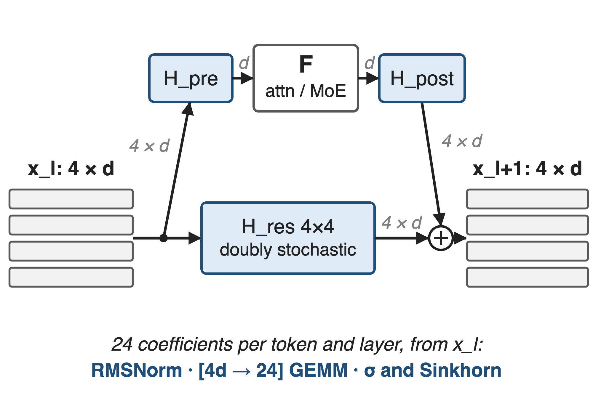
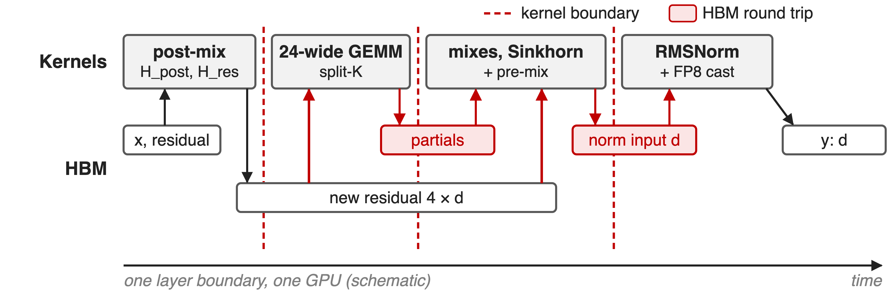
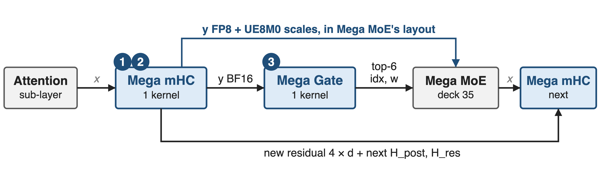
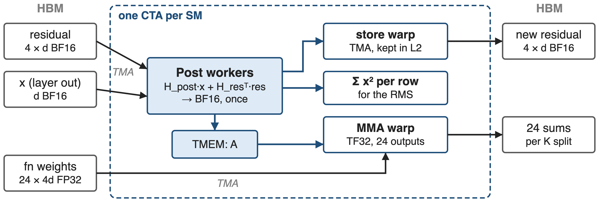
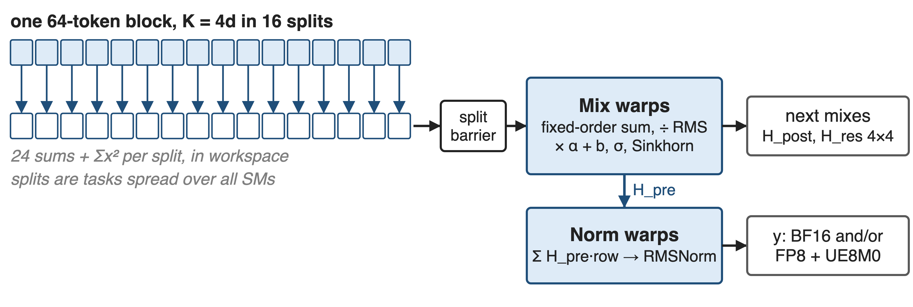
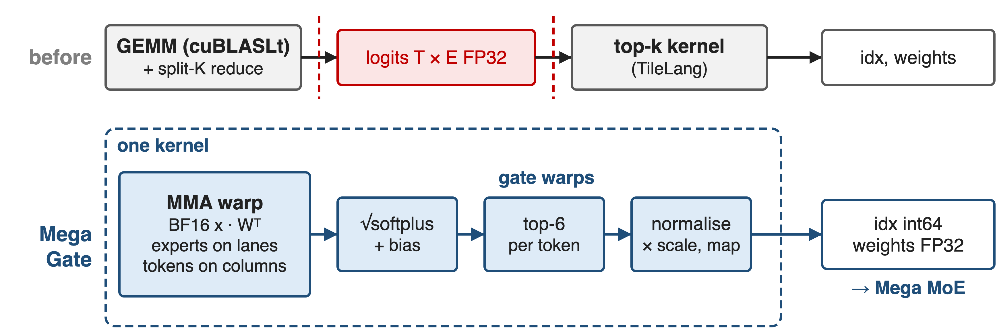
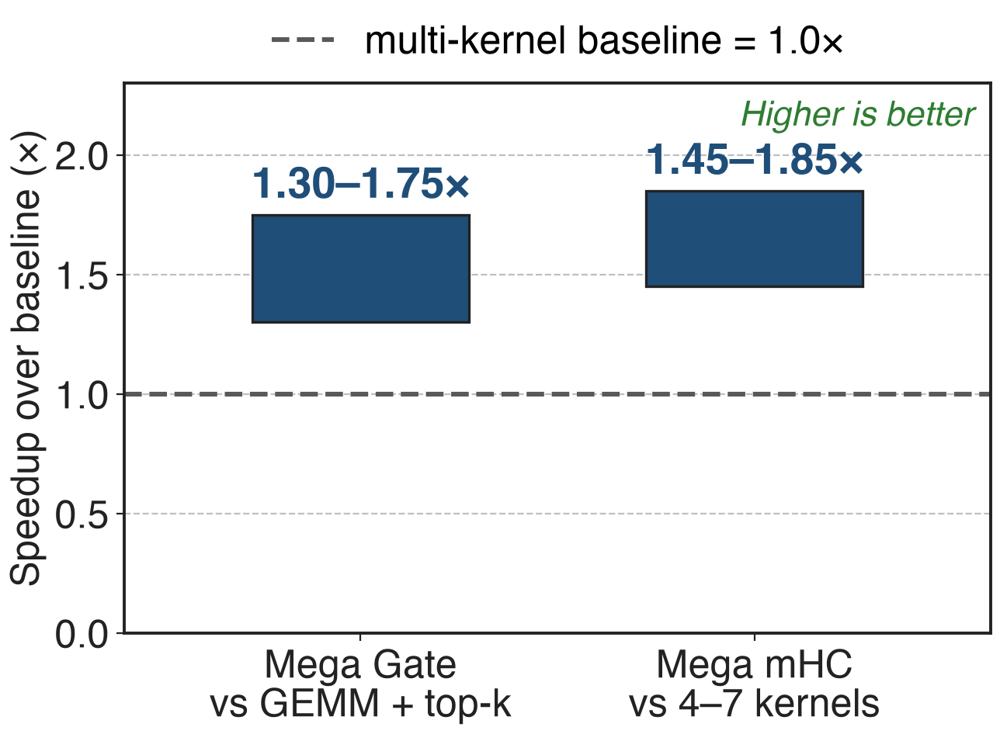
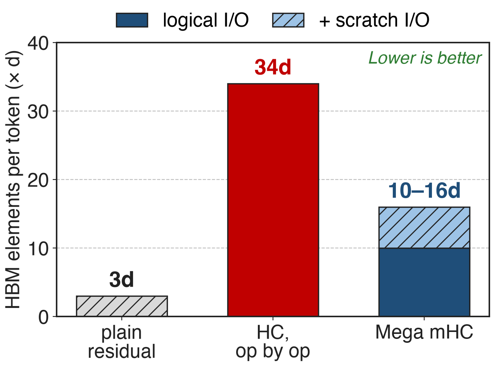
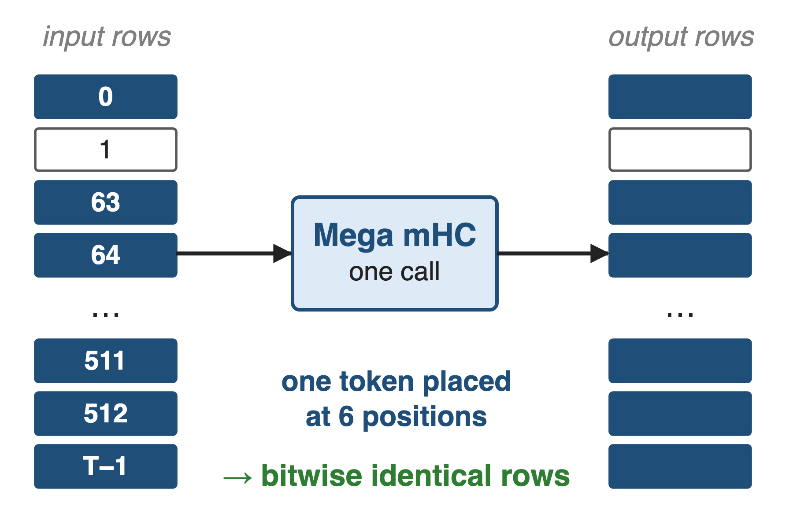

# V4 widens every residual stream to four rows
{right 55%}
- n = **4** streams: residual is 4 × d per token
- **24** mixing coefficients per token and layer
- Router: √softplus scores, top-**6** of **256** / **384**
<!-- notes: DeepSeek-V4 wraps every attention and MoE sub-layer in manifold-constrained hyper-connections. The residual becomes four streams of width d; H_pre mixes them into the layer input, H_post spreads the layer output back over the four streams, and H_res, a 4x4 doubly stochastic matrix produced by 20 Sinkhorn iterations, mixes the streams themselves. The 4 + 4 + 16 = 24 coefficients are recomputed for every token from its own stream. Every MoE layer also starts with a router: sqrt(softplus) affinities over 256 (Flash) or 384 (Pro) experts, plus the aux-loss-free balance bias, top-6. Sources: V4 §2.1 p.7, §2.2 p.7-8, §3.3 p.19, §4.2.1 p.24-25. Architecture deep dive: deck 61. -->

# Hyper-connections move about 11× the bytes
%% big: ≈ 11×
%% sub: memory traffic per token per layer for 4-stream hyper-connections run op by op: 34d vs 3d elements for a plain residual
%% source: Derived from the mHC paper (arXiv 2512.24880), Table 2 at n = 4; excludes the layer's own I/O
<!-- notes: The math between layers is tiny, but it touches the wide stream again and again. The mHC paper counts per-token memory access for one residual layer: a plain residual reads 2d and writes d; hyper-connections executed op by op read (5n+1)d and write (3n+1)d plus a few coefficients. At n = 4 that is 34d against 3d, about eleven times, and the paper notes this I/O significantly degrades throughput without fused kernels. Derivation in notes/sources.md. -->

# Four kernels re-read the stream at every boundary
{full}
> The new 4 × d residual is re-read twice, for 24 numbers of math
<!-- notes: This is the multi-kernel path DeepGEMM benchmarks against: TileLang mHC kernels with DeepGEMM's TF32 prenorm GEMM. A post-mix kernel writes the new residual; a split-K GEMM reads it back to compute the 24 projections and squared sums, writing partials; a fused kernel reduces them, applies sigmoid and Sinkhorn, and reads the new residual a second time to form the next layer input; a norm kernel reads that and writes the normalised, optionally FP8, input. The shifted variant uses seven kernels. Each boundary is a launch and a full barrier. Source: third-party/tilelang_ops/ref_mhc.py at the PR #432 merge commit (NORMAL_KERNELS, SHIFTED_KERNELS); schematic. -->

# Earlier fusion cut bytes but kept kernel boundaries
%% layout: two-col
**Op by op** (eager)
- Every mapping and merge is a kernel
- !!34d!! per token per layer
|||
**TileLang kernels** (mHC paper)
- Merge fused: (3n+1)d → (n+1)d reads
- **6.7%** training overhead, yet !!4–7 kernels!! per boundary
> Needed: one pass over each token's stream, in one kernel
<!-- notes: The mHC paper already fused a lot: one kernel for the projection and norm, one for the small coefficient ops, one for Sinkhorn, and an apply kernel that merges H_post and H_res with the residual, cutting that kernel's reads from (3n+1)d to (n+1)d and writes from 3nd to nd. Together with selective recomputation and DualPipe changes this kept mHC's overhead at 6.7% of the overlapped 1F1B stage in training. But the layer boundary is still four kernels, seven in the shifted variant, each with its own launch, its own pass over the stream and a global barrier. Sources: mHC paper §4.3.1 p.9-10, §1 p.4; V4 §3.4.2 p.20; ref_mhc.py. -->

# Insight: everything between two layers is row-local
- Post-mix, 24 outputs, Sinkhorn, pre-mix, RMSNorm: one token's row in, one row out
- Only the 4d-long dot products need other SMs (split-K)
--
> So one kernel can stream each token's residual through once; a router's top-k is row-local too
<!-- notes: Look at the dependency structure instead of the op list. Every step at a layer boundary uses only one token's own data: its layer output x, its four residual rows and its 24 coefficients. The only reduction that is long is the 4d-long dot product behind the 24 projections, and that splits cleanly along K across SMs. The router is the same: once a token's E scores exist, its top-k needs nothing else. So the whole boundary can be one kernel that reads each row once. Sources: tests/test_mega_mhc.py mhc_reference; csrc/apis/mega_gate.hpp. -->

# Both kernels sit around every MoE layer
{full}
%% caption: Tensor formats from the DeepGEMM APIs. ❶ ❷ zoom into Mega mHC, ❸ into Mega Gate
<!-- notes: Mega mHC takes the sub-layer output x, the four-row residual and this layer's H_post and H_res, and produces the new residual, the next layer's mixes, and the next layer's normalised input: BF16, FP8 with per-32 UE8M0 scales, or both, including the routed and shared-expert scale layouts that Mega MoE consumes. Mega Gate turns the BF16 input into top-6 int64 indices and FP32 weights, the types Mega MoE's buffer takes. Sources: csrc/apis/mega_mhc.hpp docstring (y_shared_sf is the Mega MoE shared-expert layout), csrc/apis/mega_gate.hpp, README Mega MoE usage. Mega MoE itself: deck 35. -->

# ❶ One pass feeds store, MMA and RMS
{full}
> Each new-residual element is computed once; the 24-wide GEMM never re-reads it from HBM
<!-- notes: Inside each CTA, two Post warpgroups read x and the four residual rows from shared memory, compute H_post times x plus H_res-transpose times the residual, and round to BF16 once; that rounding is the shared numerical boundary for every consumer. The value then goes three ways: back into the staging buffer that the store warp writes to HBM with an L2 keep hint, into tensor memory as the A operand of the TF32 MMA that produces the 24 projections, and into running sums of squares for the RMS. In the shifted variant the same pass also forms the pre-mixed layer input. Source: impls/sm100_mega_mhc.cuh, Post workers and output-store warp. -->

# ❷ Split-K partials finish inside the kernel
{full}
> Deterministic mode fixes 16 splits and the summation order: bitwise-stable output
<!-- notes: The projection's K dimension is 4d, so each 64-token block is cut into K splits that run as separate tasks across the GPU; each writes 24 partial sums and a partial sum of squares to a small workspace and arrives on a split barrier. Mix warps then add the splits in a fixed order, divide by the RMS, apply the scales and biases, the sigmoids and the Sinkhorn iterations; Norm warps apply H_pre to the new residual, run RMSNorm and emit BF16 and or FP8 with UE8M0 scales. With use_deterministic_algorithms the split count is fixed at 16; otherwise the fewest splits that minimise the longest task, up to 64. V4 §3.3 describes the earlier approach: split parts written out and reduced in a subsequent kernel. Sources: csrc/apis/mega_mhc.hpp notes, layout/mega_mhc.cuh, kernel role comments. -->

# ❸ Mega Gate: GEMM to top-6 in one kernel
{full}
> Ranks on score + bias; emits unbiased scores, normalised over the top-6 and scaled
<!-- notes: Before, a cuBLASLt GEMM (sometimes with a split-K reduce kernel) wrote FP32 logits for every token and expert, and a TileLang top-k kernel read them back. Mega Gate keeps both in one kernel: the router weights are the MMA's A operand, so each tensor-memory lane holds one expert and each column one token; gate warps apply sqrt(softplus), add the balance bias, rank, take top-6, normalise the unbiased scores and scale them, and optionally map logical experts to physical replicas, apply masks or keep fixed routes. When experts or K are split across CTAs, scores meet in a small workspace behind a per-block barrier. Sources: csrc/apis/mega_gate.hpp docstring, impls/sm100_bf16_mega_gate.cuh, tests/test_mega_gate.py. Bias: deck 55. -->

# Mega mHC gains 45–85%, Mega Gate 30–75%
{right 60%}
- SM100; ranges as published in PR #432
- mHC baseline: TileLang kernels + DeepGEMM GEMM
- Gate baseline: cuBLASLt GEMM + top-k kernel
<!-- notes: DeepGEMM's September release reports Mega mHC 45 to 85 percent faster and Mega Gate 30 to 75 percent faster than these multi-kernel paths, measured as the summed time of the baseline kernels over the fused kernel's time; only the ranges are published. The tests sweep 1 to 32768 tokens with hidden sizes 4096 and 7168 for mHC, and 4096 to 7168 with 384 experts plus other expert counts for the gate. Sources: PR #432; tests/test_mega_mhc.py and tests/test_mega_gate.py at the PR #432 merge commit. -->

# One pass cuts boundary traffic from 34d to 10–16d
{right 55%}
- Analytic, n = **4**, per token per layer
- Mega mHC also emits the normalised next input
- Scratch: norm boundary + one L2-kept re-read
<!-- notes: Counting elements per token at one layer boundary: a plain residual moves 3d and op-by-op hyper-connections 34d (mHC paper Table 2). Mega mHC's logical traffic is x plus four residual rows in, four new rows plus the normalised next input out: 10d, and it already covers the RMSNorm that Table 2 leaves to the layer. DeepGEMM's own test adds scratch traffic, the materialised norm boundary and, in normal mode, one re-read of the new residual that the kernel asks L2 to keep: 16d. For reference, the four-kernel path moves about 20d by the same counting. Analytic counts, derivation in notes/sources.md. -->

# Same token, same bits, any batch size
{right 50%}
- 30 repeated runs: bitwise equal
- Duplicated tokens: identical rows
- CUDA-graph replay and two streams match eager runs
> V4 once needed a second kernel for mHC's deterministic split-K; Mega mHC reduces in-kernel
<!-- notes: tests/test_mega_mhc.py checks each case against a PyTorch reference, then reruns 30 times and asserts bitwise-equal outputs, plants duplicated tokens at batch-dependent positions and asserts their rows are bitwise identical to row 0, and checks CUDA-graph replay and two concurrent streams against eager results. Determinism and batch invariance became opt-in for DeepGEMM in 2026-09 through use_deterministic_algorithms (deck 39). V4 §3.3 explains why mHC's 24-wide matmul needs split-K at small batch and how it was made deterministic with a separate reduction kernel. -->

# The cost: SM100, four streams, forward only
%% layout: two-col
**Mega mHC**
- n fixed at **4**; d a multiple of **1024**
- Forward only; warm streams before graph capture
- New residual still written; normal mode re-reads it
|||
**Mega Gate**
- ≤ **512** experts, top-k ≤ **32**
- √softplus scoring only
- Both kernels: SM100 only
<!-- notes: Both APIs assert compute capability 10. Mega mHC hard-codes four streams and needs the hidden size to divide into 16 blocks of 64; it has no backward entry point, so training keeps the recomputation scheme of the mHC paper; each CUDA stream must run it once before graph capture because its split barriers are allocated per stream. It still writes the new residual, which the next layer needs, and normal mode re-reads it. Mega Gate supports up to 512 routed experts and 32 selections, a hidden size that is a multiple of 256, and since PR #462 only sqrt(softplus) scoring. Sources: csrc/apis/mega_mhc.hpp, csrc/apis/mega_gate.hpp, layout/mega_mhc.cuh, tests, PR #462. -->

# Summary
- Op-by-op HC: **≈ 11×** a plain residual's traffic
- ==Insight==: work between layers is row-local, so stream each row once
- Mega mHC **45–85%**, Mega Gate **30–75%** faster than multi-kernel paths
- Analytic traffic **34d → 10–16d** per token
%% qr: https://github.com/deepseek-ai/DeepGEMM
<!-- notes: The architecture adds many small, memory-bound steps between layers; the kernels turn them back into one pass per token. Related decks: 61 (mHC architecture), 35 (Mega MoE, the consumer of both kernels' outputs), 25 (DeepGEMM), 39 (determinism switch), 55 (aux-loss-free bias). Sources: DeepGEMM PR #432, mHC paper Table 2, V4 §3.4.2. -->
