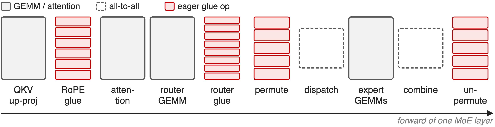
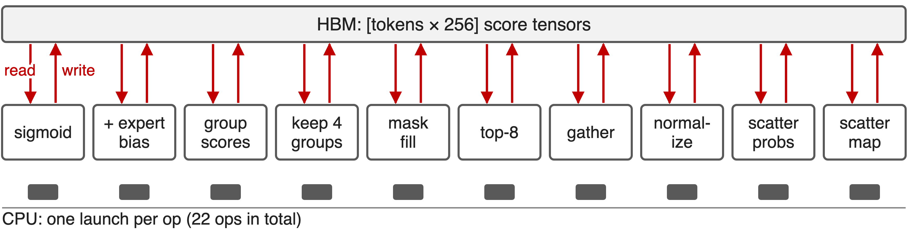
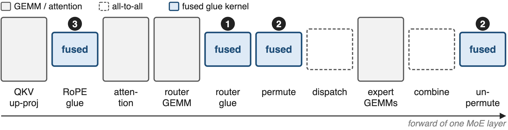
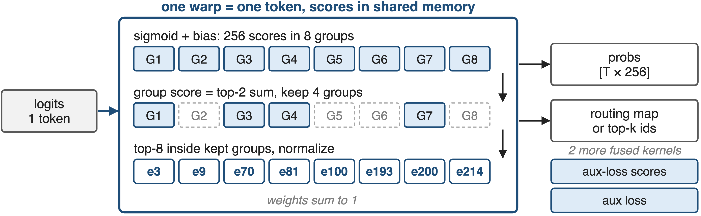
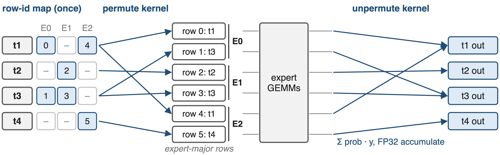
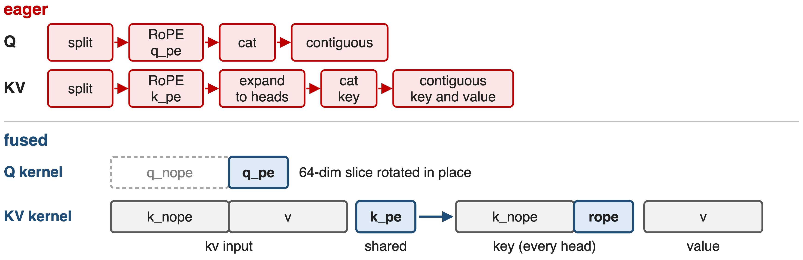
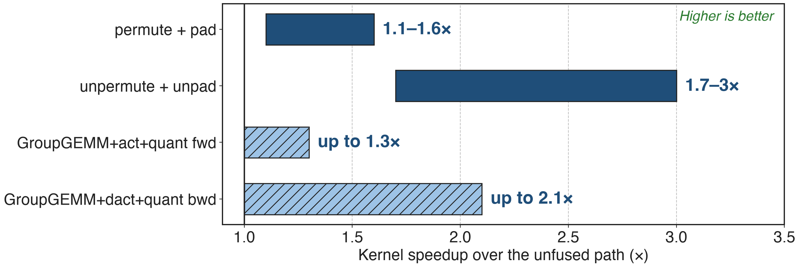

# Between the GEMMs, MoE layers run on glue
{full}
> DeepSeek-V3: top-8 of 256 experts; RoPE on 64 of 192 dims per head
<!-- notes: A DeepSeek-V3-style layer is more than its GEMMs. MLA splits queries and keys into a no-position part and a 64-dimensional RoPE part; the router turns 256 sigmoid scores into a top-8 choice limited to 4 node groups; and the dispatcher permutes tokens into expert-contiguous rows before the all-to-all and restores them after. Each of these glue stages is a chain of small tensor operations, schematic here, not to scale. Sources: DeepSeek-V3 report §2.1.2 and §4.2; arXiv 2603.07685 §2.1 and §4.3.1. -->

# Routing one microbatch takes 22 eager ops
%% big: 22
%% sub: PyTorch ops in the unfused DeepSeek-V3-style router forward; × 58 MoE layers ≈ 1,276 launches per forward pass (derived)
%% source: Counted from Megatron-LM moe_utils.topk_routing_with_score_function, unfused path (derivation in notes/sources.md)
<!-- notes: This is a count, not a timing. Following the unfused code path for sigmoid scores with an expert bias, group-limited top-k over 8 groups, top-8 and normalization, a single router forward issues 22 separate PyTorch operations, from the sigmoid to the two scatters that build the probability tensor and the routing map. Multiply by DeepSeek-V3's 58 MoE layers and the router alone is about 1,276 kernel launches per forward pass, before backward, the auxiliary loss, permutation or RoPE. Derived from moe_utils.py; 58 layers from arXiv 2603.07685 §4.2.1. -->

# Every glue op re-streams the tensor through HBM
{full}
> Each op is one launch plus a full read and write of a [tokens × 256] tensor
<!-- notes: In eager mode every step reads its input tensor from HBM and writes its output back, and every one of the 22 operations, grouped here into 10 steps, is a separate launch. The arithmetic per token is tiny, 256 scores, so these kernels are bound by memory traffic and launch latency, not by compute. The paper names exactly this: MoE routing and dispatching are composed of many small kernels that individually cannot saturate the GPU. Source: arXiv 2603.07685 §4.3.1 p.35; moe_utils.py. -->

# Graphs and per-op kernels only go halfway
%% layout: two-col
- **CUDA graphs** (deck 38)
- One launch for many ops
- !!Every HBM round trip remains!!
|||
- **Faster single ops**
- Each op still a full pass
- !!Unpermute copies tokens to FP32!!
> Needed: run each per-token chain in one pass over the data
<!-- notes: CUDA graphs remove the host launch cost, but the GPU still executes every small kernel with its own memory traffic, and dropless glue can stay outside the graph. Optimizing operations one at a time leaves the chain intact; Megatron's unfused unpermute even promotes the token tensor to FP32 when the router runs in FP32, and its own comment points to --moe-permute-fusion to avoid that allocation. Sources: Megatron CUDA graph guide; moe_utils.unpermute. -->

# Insight: glue is per-token and fits on chip
- Router: a token's 256 scores fit one warp's shared memory
- Permutation: one row-id map serves permute, unpermute, backward
- RoPE: only 64 of 192 dims per head change
--
> One kernel per chain: read once, compute on chip, write once
<!-- notes: None of these chains mixes tokens. One warp can load a token's 256 router logits into shared memory and do the score function, bias, group selection, top-k and normalization there. Permutation needs one map from token and expert to destination row, and that map can be computed once and reused by both directions and by backward. RoPE in MLA changes only the 64-dimensional slice of each 192-dimensional head. So each chain can be one kernel that reads its inputs once and writes its outputs once. Sources: TE fused router kernel; TE Triton permutation; DeepSeek-V3 MLA dimensions. -->

# Three flags turn glue stacks into kernels
{full}
%% caption: --moe-router-fusion (TE ≥ 2.7) · --moe-permute-fusion · --apply-rope-fusion (MLA with YaRN)
<!-- notes: Megatron-Core exposes the fusions as three flags. Router fusion calls Transformer Engine's fused router kernels; permutation fusion calls Transformer Engine's Triton permute and unpermute kernels; RoPE fusion uses Megatron's own Triton kernels for MLA with a cached YaRN table. The paper's GB200 DeepSeek-V3 configuration lists router, permute and MLA RoPE fusion next to CUDA graphs. Sources: transformer_config.py; arXiv 2603.07685 §9.2.2 p.75. -->

# ❶ One warp routes one token
{full}
> Backward fused too; the aux loss adds two fused kernels
<!-- notes: Transformer Engine's fused_topk_with_score_function assigns one warp per token with its own shared-memory buffer. It computes sigmoid or softmax scores, adds the expert bias for selection, scores the 8 groups by their top-2 sum, keeps 4, picks the top 8 experts inside them, normalizes and scales, and writes the probabilities and the routing map, or dense top-k indices, in one pass. The expert ids are an illustrative example. Two more kernels compute the scores for the auxiliary loss and the loss itself, and all three have fused backward kernels. Sources: TE router.py and fused_topk_with_score_function.cu; TE PR 1883; arXiv 2603.07685 §4.3.4. -->

# ❷ One row-id map drives permute and unpermute
{full}
> Probs and FP8 scales move with the tokens (HybridEP fusion: deck 19)
<!-- notes: Four tokens, three experts. A preprocessing step, three small Triton passes run once per forward, turns the routing map into a row-id map: for each token and expert, the destination row in the expert-contiguous buffer. The permute kernel copies each token, its routing probability and, for FP8, its scaling factors to those rows, optionally padding each expert to an alignment. After the expert GEMMs, the unpermute kernel reads the same map and sums each token's copies, weighted by the probabilities, in FP32. Backward reuses the map. Sources: TE common/triton/permutation.py; arXiv 2603.07685 §4.3.3 and §5.4.1. -->

# ❸ RoPE touches only the 64-dim slice
{full}
<!-- notes: The eager MLA path splits q into its no-position and RoPE parts, rotates the RoPE part, concatenates the halves back and makes the result contiguous; for keys it rotates the shared k_pe, expands it to all heads, concatenates and makes key and value contiguous. The fused Q kernel rotates only the trailing 64 dimensions of each head in place, so the 128-dimensional part is never read. The fused KV kernel reads the up-projected kv once, rotates k_pe once per token and writes key and value for every head directly. Both use a cached YaRN cos/sin table. Sources: fused_mla_yarn_rope_apply.py; multi_latent_attention.py. -->

# ❹ Padding and quantization ride along
- Pad experts to 16/32/128 tokens inside the permute
- FP8 scaling factors permuted with their tokens
- Activation + quantize in the grouped-GEMM epilogue
> Each fused step removes one more HBM pass, and stays CUDA-graph safe
<!-- notes: Low-precision training adds its own glue. FP8 and FP4 grouped GEMMs need the tokens of each expert padded to a multiple of 16 or 32, and Megatron pads to 128 for CUDA-graph-friendly grouped quantization; fusing that padding into the permutation avoids one global-memory read and write. The permute kernel also moves FP8 scaling factors alongside the tokens. On the expert side, NVIDIA's CuTe DSL kernels fuse the SwiGLU or other GLU activation and the MXFP8 or NVFP4 quantization into the grouped-GEMM epilogue and track tokens per expert on the GPU, which keeps them sync-free. Sources: arXiv 2603.07685 §5.4.1-5.4.2; TE Triton permutation; NVIDIA blog on advanced fusion kernels. -->

# Fused permutation kernels run 1.1–3× faster
{full}
%% caption: Solid: measured ranges (TE PR #1921). Hatched: published maximum only (NVIDIA fusion-kernel blog)
<!-- notes: Transformer Engine's fused permute-and-pad runs 1.1 to 1.6 times faster than permuting and padding separately, and the fused unpermute-and-unpad 1.7 to 3 times faster, across the configurations in its permutation benchmark. On the expert side, the fused grouped-GEMM kernels with activation and quantization reach up to 1.3 times in forward and 2.1 times in backward over the unfused path. No kernel benchmark for the router or MLA-RoPE fusion is published. Sources: TE PR 1921; NVIDIA technical blog, Boosting MoE Training Throughput with Advanced Fusion Kernels. -->

# Fusions add 0.4–8% on DeepSeek-class training
- Permute + pad: **+0.4%** MFU, ~**1 GB** less memory (~600B FP8 MoE)
- Fused expert kernels: up to **+8%** DeepSeek-V3, **+93%** GPT-OSS
- DeepSeek-V3 on GB200, all fusions + graphs: **1,048** TFLOPS/GPU
> No isolated end-to-end number is published for router or RoPE fusion
<!-- notes: End to end the gains depend on how host- and memory-bound the run is. The fused permute-and-pad added 0.4 percent MFU and cut about 1 GB of peak memory in a roughly 600-billion-parameter FP8 Megatron run. The sync-free fused expert kernels contributed up to 8 percent on DeepSeek-V3 and up to 93 percent on GPT-OSS pre-training in NVIDIA's internal tests. The paper's best DeepSeek-V3 configuration on 256 GB200 GPUs, with router, permute and MLA-RoPE fusion plus CUDA graphs, reaches 1,048 TFLOPS per GPU; the router and RoPE fusions are not measured in isolation. Sources: TE PR 1921; NVIDIA fusion-kernel blog; arXiv 2603.07685 Table 17 and §9.2.2. -->

# Fusion trades determinism and flexibility
%% layout: two-col
- !!Fused aux loss not bitwise deterministic!!
- Batch-invariant MoE needs unfused permute
- Quantile balancing: no router fusion
|||
- MLA RoPE fusion: training only, YaRN only
- Needs TE ≥ 2.7 and Triton
- Each new router variant needs kernel work
<!-- notes: The fused auxiliary-loss kernel is not bitwise reproducible: in Megatron's test it mismatched on 7 of 7 repeats for the standard aux loss, so deterministic mode rejects only that fusion while keeping fused top-k routing. Batch-invariant MoE requires the unfused permute and unpermute, and quantile-balancing routing asserts router fusion off. MLA RoPE fusion is marked experimental, supports training only and only YaRN RoPE. Router fusion needs Transformer Engine 2.7 or newer, and every new score function or grouping rule, such as sqrtsoftplus, needed kernel support first. Sources: Megatron PR 6967; transformer_config.py; router.py; moe_utils.py. -->

# Summary
- Eager router: **22** ops per layer (derived), each an HBM pass
- ==Insight==: glue is per-token; one kernel per chain
- Router: one warp per token; permutation: one row-id map; RoPE in place
- **1.1–3×** fused permutation; **+8%** DeepSeek-V3 from fused experts
%% qr: https://arxiv.org/abs/2603.07685
<!-- notes: The fusions do not change the math; they change how many times the data crosses HBM and how many launches the host issues. Related decks: 38 (CUDA graphs), 19 (HybridEP with permute fused into dispatch), 53 (memory-efficient permutation), 55 (loss-free routing with expert bias), 34 (masked grouped GEMM for CUDA graphs). -->
