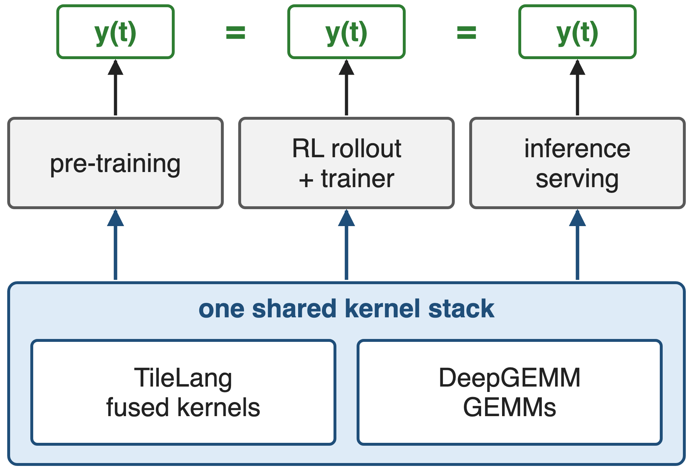
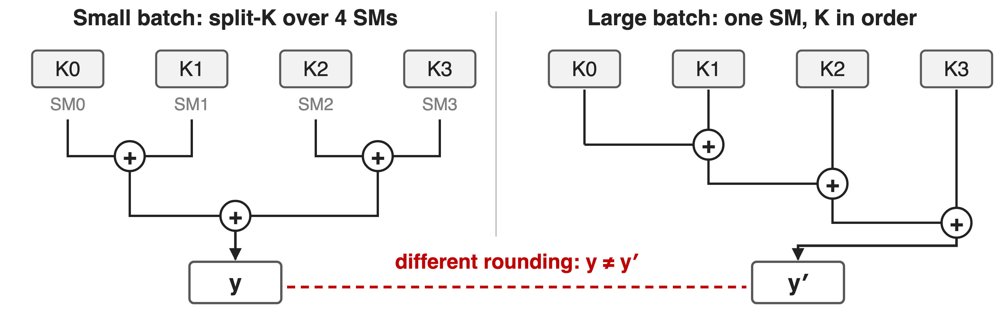
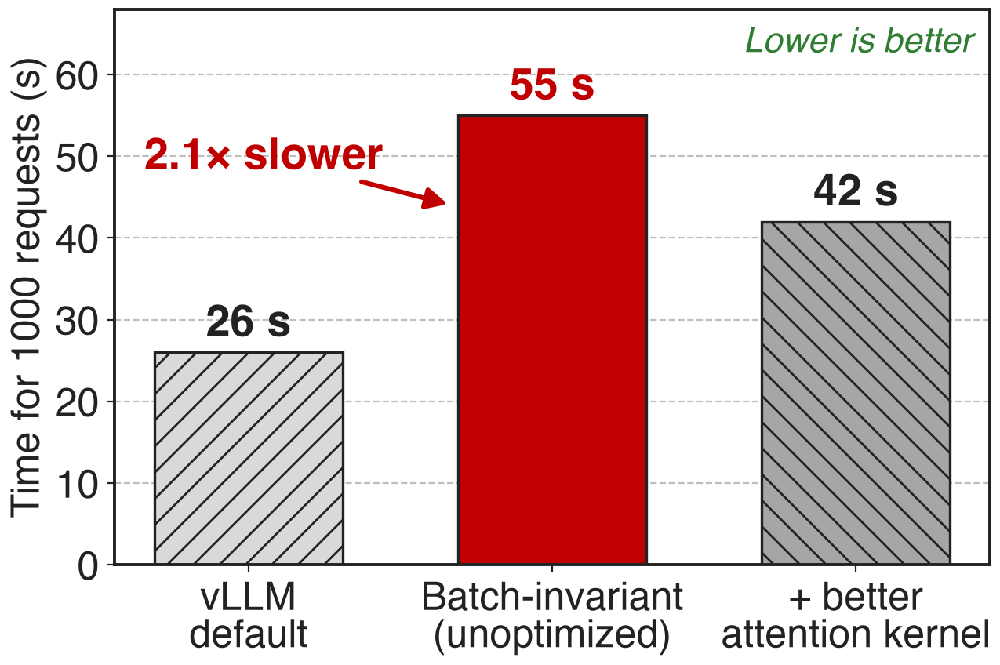
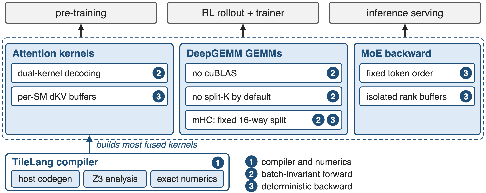
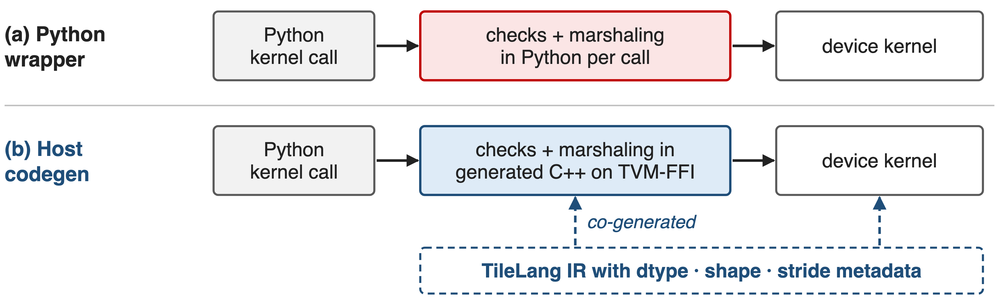
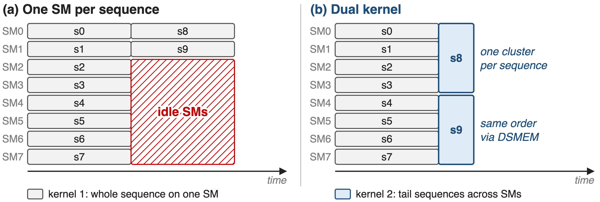
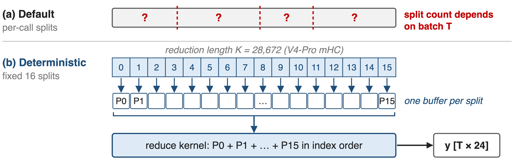
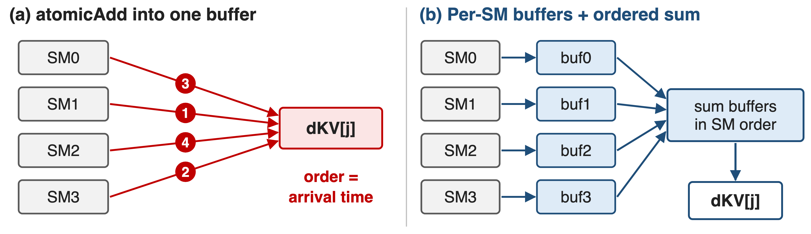
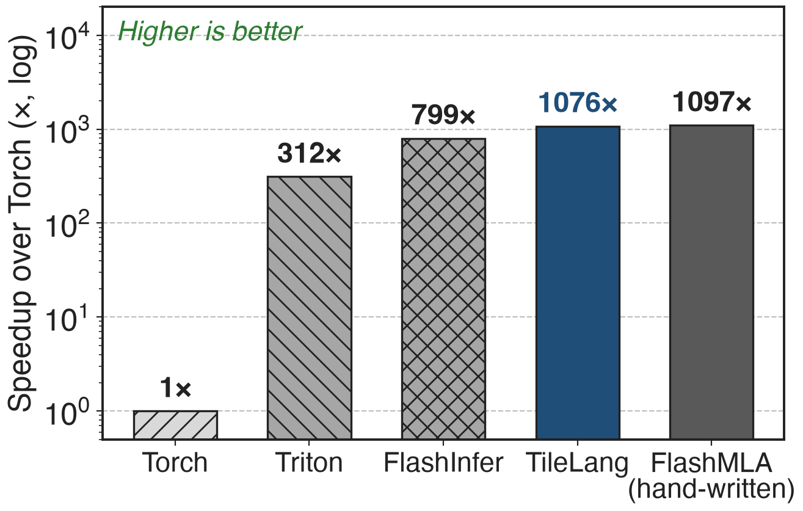

# Pre-training, RL and serving must agree bit for bit
{right 50%}
- V4-Pro: **1.6T** params, **49B** active
- New layers (CSA/HCA, mHC) would mean hundreds of small ATen ops
- One kernel stack serves every pipeline
<!-- notes: DeepSeek-V4's architecture, with hybrid compressed attention and manifold-constrained hyper-connections, would otherwise run as hundreds of fine-grained PyTorch ATen operators. DeepSeek replaces most of them with fused kernels written in TileLang and runs all matrix multiplications on DeepGEMM. One design goal is that pre-training, post-training and inference produce bitwise identical results for the same token. Sources: DeepSeek-V4 abstract, §3.2, §3.3. -->

# Same request, 80 different answers
%% big: 80 / 1000
%% sub: distinct completions from 1000 identical temperature-0 requests to Qwen3-235B served by vLLM
%% source: Thinking Machines Lab, "Defeating Nondeterminism in LLM Inference" (Sep 2025)
<!-- notes: DeepSeek does not publish a reproducibility measurement, so here is the size of the problem from Thinking Machines: the same prompt at temperature zero, sent 1000 times to Qwen3-235B on vLLM, gave 80 distinct completions; they first diverge at token 103, where 992 say "Queens, New York" and 8 say "New York City". For RL, the sampler and the trainer then compute different log-probabilities, so on-policy RL silently becomes off-policy. For pre-training, rerunning a loss spike does not reproduce it. Source: Thinking Machines blog, "How nondeterministic are completions?". -->

# Reduction order follows the batch, not the token
{full}
%% caption: K0–K3: partial dot products over four chunks of the reduction dimension (schematic)
> Float addition is not associative: batch-dependent splits and atomics change the bits
<!-- notes: The villain is not randomness but order. Kernels pick their strategy from the batch shape: a small batch has too few output tiles, so split-K or split-KV spreads one reduction over several SMs and merges partial sums as a tree; a large batch reduces the same row sequentially on one SM. Same inputs, different rounding. In the backward pass, atomicAdd adds contributions in whatever order threads arrive. A request's output therefore depends on who else is in its batch, i.e. on server load. Sources: DeepSeek-V4 §3.3; Thinking Machines blog, "Batch invariance and determinism". -->

# Naive batch invariance costs 2.1× serving time
{right 55%}
- One fixed kernel config: no split-K, no split-KV
- Small batches and tail waves lose parallelism
- Better attention kernel: still **1.6×**
%% caption: Thinking Machines, Qwen3-8B on one GPU; ratios derived
<!-- notes: The obvious fix is to use one kernel configuration for every shape and never split a reduction. Thinking Machines did exactly that in vLLM: 1000 requests took 55 seconds instead of 26, and 42 with an improved attention kernel. Their batch-invariant matmul alone was about 20% slower than cuBLAS. The other obvious fix, hand-writing hundreds of exact CUDA kernels, does not scale with V4's pace of architecture changes. Source: Thinking Machines blog, "Performance" and "Batch-invariant matrix multiplication"; 2.1x = 55/26 and 1.6x = 42/26 are derived. -->

# Insight: fix the order, then add parallelism back
- A token's bits depend only on its accumulation order
- So fix that order per token, at every batch size
--
> Regain parallelism without reordering: spread tails across SMs, sum per-SM buffers in order
<!-- notes: Batch invariance means a token's output is bitwise identical regardless of its position within the batch. The observation behind DeepSeek's kernels is that parallelism and a fixed order are not in conflict, as long as extra parallelism is added around the order rather than by changing it: a tail sequence can be spread over several SMs if they combine in the single-SM order, and an atomic accumulation can become per-SM buffers summed in a fixed order. Source: DeepSeek-V4 §3.3. -->

# Three layers make V4's kernels reproducible
{full}
%% caption: Where each fix lives in DeepSeek-V4 (§3.2–3.3)
<!-- notes: The overview. At the bottom, the TileLang compiler, which builds most of V4's fused kernels and adds host code generation, Z3-based integer analysis and exact numerics. In the middle, the kernels: attention, DeepGEMM matrix multiplications and the MoE backward. Mechanism 2 makes the forward pass batch-invariant; mechanism 3 makes the backward pass deterministic. All three pipelines on top share this stack. Sources: DeepSeek-V4 §3.2, §3.3; DeepGEMM mega_mhc.hpp for the fixed 16-way split. -->

# ❶ TileLang generates the host launcher too
{full}
> Per-call checks drop from tens–hundreds of µs in Python to under 1 µs
<!-- notes: As GPUs get faster, small kernels become dominated by fixed CPU overhead, and a common source is Python-side contract checks on every call. TileLang now co-generates the device kernel and a lightweight host launcher from the same IR, with the dtypes, shapes and strides embedded; the launcher is C++ on TVM-FFI, which has a compact calling convention and zero-copy tensor interop. DeepSeek measured the validation overhead dropping from tens or hundreds of microseconds to less than one microsecond per invocation. Source: DeepSeek-V4 §3.2 "Reducing Invocation Overhead with Host Codegen". -->

# ❶ TileLang keeps numerics exact by default
%% layout: two-col
- **Exact by default**: fast-math off
- Approximations opt-in: `T.__exp`, `T.__log`
- IEEE intrinsics: `T.ieee_fdiv`, explicit rounding
|||
- **Bit-identical to CUDA**: NVCC-aligned lowering
- `T.annotate_layout` pins accumulation order
- Z3 checks index math in seconds
> A TileLang kernel can be tested bit for bit against its CUDA reference
<!-- notes: Fast-math is disabled at the compiler level; precision-affecting approximations exist only as explicit operators such as T.__exp, and when strict IEEE-754 semantics are needed there are intrinsics with explicit rounding modes. TileLang's simplification and lowering rules are aligned with NVCC, and layout annotations pin layout-dependent lowering, so the evaluation and accumulation order can match a hand-written CUDA kernel exactly. The Z3 SMT solver, using quantifier-free non-linear integer arithmetic, proves index facts for vectorization, barrier insertion and simplification at a compile cost of a few seconds. DeepSeek reports the conservative defaults remain competitive. Source: DeepSeek-V4 §3.2. -->

# ❷ Decode attention splits only the tail wave
{full}
> No split-KV: the tail kernel follows kernel 1's accumulation order exactly
<!-- notes: Batch-invariant decoding cannot use split-KV, because how a sequence is split would depend on the batch. With one SM per sequence, full waves run at full throughput, but the last, partially filled wave leaves most SMs idle: wave quantization. DeepSeek uses two kernels. Kernel 1 computes a whole sequence on one SM for the full waves. Kernel 2 handles the final partial wave by spreading each sequence over the SMs of a thread-block cluster, exchanging data through distributed shared memory, along a calculation path designed to keep kernel 1's accumulation order. Which kernel a sequence lands in depends on the batch, but its bits do not. DeepSeek calls the overhead negligible. Schematic: 8 SMs, 10 sequences. Source: DeepSeek-V4 §3.3. -->

# ❷ GEMMs keep one K order at every batch
{full}
> Elsewhere: DeepGEMM replaces cuBLAS end to end and drops split-K
<!-- notes: cuBLAS is not batch-invariant, so V4 replaces it end to end with DeepGEMM, and drops split-K in most scenarios, adding other optimizations so the GEMMs match or beat split-K in most major cases. One GEMM cannot avoid splitting: mHC's projection has only 24 output columns (4 + 4 + 16 for n_hc = 4) but a reduction length of 4 × 7168 = 28,672 on V4-Pro (both derived from the paper's configuration). DeepGEMM's deterministic mode always uses 16 splits, writes each split's partial output separately, and a later kernel reduces them in index order. Sources: DeepSeek-V4 §3.3; DeepGEMM csrc/apis/mega_mhc.hpp and layout/mega_mhc.cuh. -->

# ❸ Backward sums in a fixed order, not atomically
{full}
> MoE backward: a fixed token order and per-rank buffers pin every write position
<!-- notes: Run-to-run non-determinism mostly comes from atomic additions in the backward pass. In sparse attention, many query blocks contribute to the gradient of the same KV token; with atomicAdd the order is whatever order SMs arrive in. V4 gives each SM its own accumulation buffer and then performs a global deterministic summation. In the MoE backward, SMs from different ranks writing into the same receive buffer would negotiate write positions at run time; V4 pre-processes the token order within each rank and isolates buffers across ranks, which fixes both what expert parallelism sends and the accumulation order. Source: DeepSeek-V4 §3.3 "Determinism". -->

# TileLang reaches 98% of FlashMLA in ~70 lines
{right 55%}
- MLA decoding on H100 (TileLang paper)
- Hand-written FlashMLA: **1097×** over Torch
- TileLang: **1076×**, about **70** lines of Python
> The DSL costs little speed: 98% of the hand-written kernel
<!-- notes: Is the DSL a performance compromise? In the TileLang paper's MLA decoding benchmark on H100, the TileLang kernel reaches up to 98 percent of hand-optimized FlashMLA, ahead of FlashInfer and Triton, in about 70 lines of Python. This is TileLang's own 2025 benchmark, not a DeepSeek-V4 measurement; DeepSeek only says that TileLang kernels remain competitive under conservative numeric defaults. Source: TileLang paper arXiv 2504.17577, §5.2 and Fig. 14(a). -->

# The cost: own kernels, lost split-K, no numbers
%% layout: two-col
- !!No published overhead!!: only "minimal"
- !!Split-K dropped!! in most GEMMs
- Every GEMM from DeepGEMM, none from cuBLAS
|||
- Tail kernel needs clusters and DSMEM
- Invariant to batch position, not parallel layout
- Z3 adds seconds of compile time
<!-- notes: DeepSeek publishes no overhead or reproducibility numbers for V4, only "minimal" and "negligible". Dropping split-K needs other GEMM optimizations to stay fast, and the guarantee requires owning every GEMM: cuBLAS is gone from the stack. The tail-wave kernel relies on thread-block clusters and distributed shared memory, available since Hopper. The guarantee is about a token's position in a batch and alignment across pre-training, post-training and inference; the paper does not claim invariance across different parallel layouts. Sources: DeepSeek-V4 §3.2-3.3. Related: deck 39 (DeepJIT determinism switches), deck 25 (DeepGEMM). -->

# Summary
- Non-invariant kernels: **80 / 1000** distinct answers (Qwen3, vLLM)
- ==Insight==: fix each token's accumulation order, add parallelism around it
- TileLang: host checks **< 1 µs**, **98%** of FlashMLA
- V4: batch-invariant forward, deterministic backward
%% qr: https://arxiv.org/abs/2606.19348
<!-- notes: Reproducibility is a kernel property: decide each token's accumulation order once, and spend engineering on keeping parallelism without changing it. Related decks: 14 (Mega MoE, whose fused output is tested bit-identical to the non-fused path), 25 (DeepGEMM), 39 (DeepJIT and determinism switches), 61 (mHC), 63 (anticipatory routing, where reproducible runs help chase loss spikes). Sources: DeepSeek-V4 §3.2-3.3; Thinking Machines blog; TileLang paper. -->
