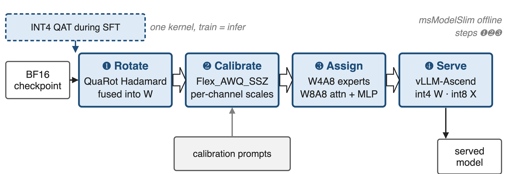
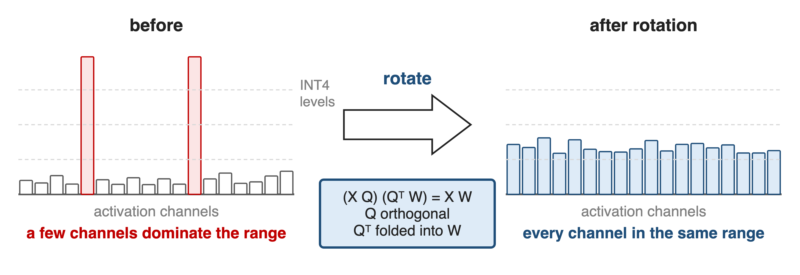
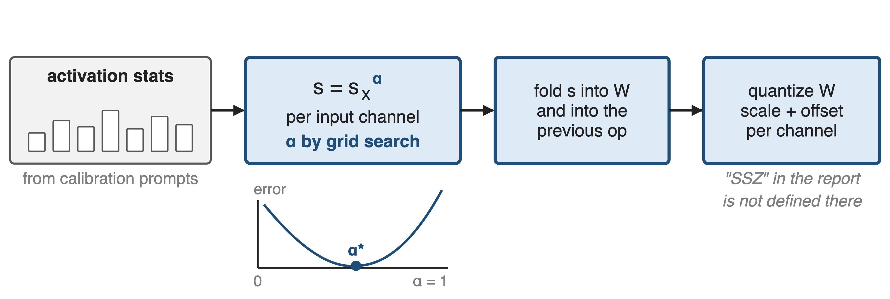
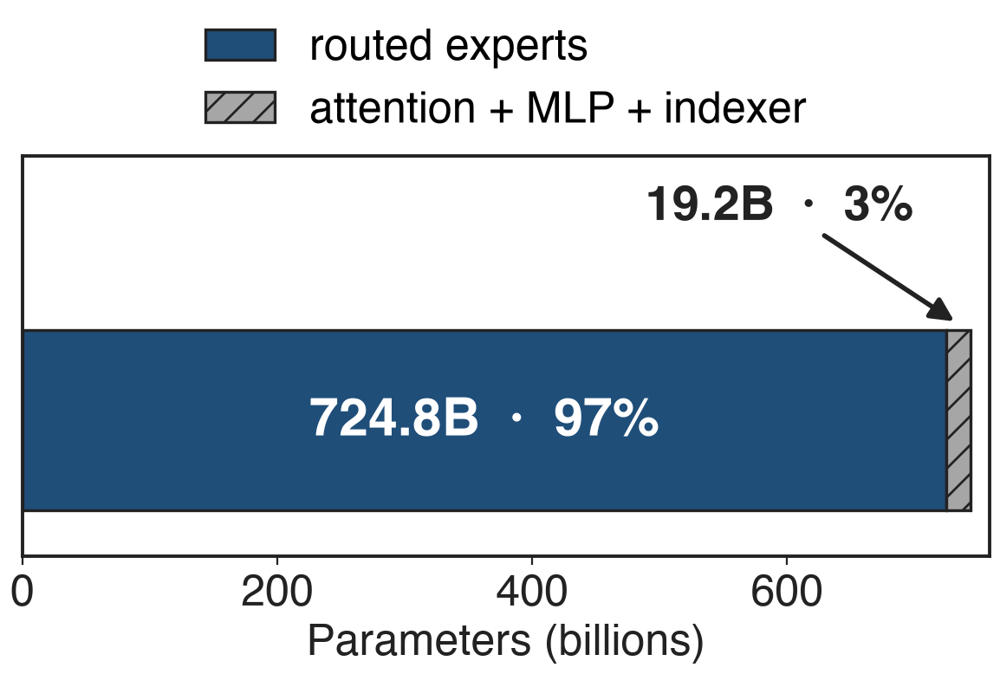
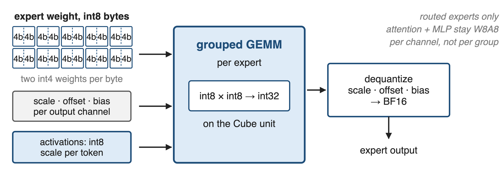
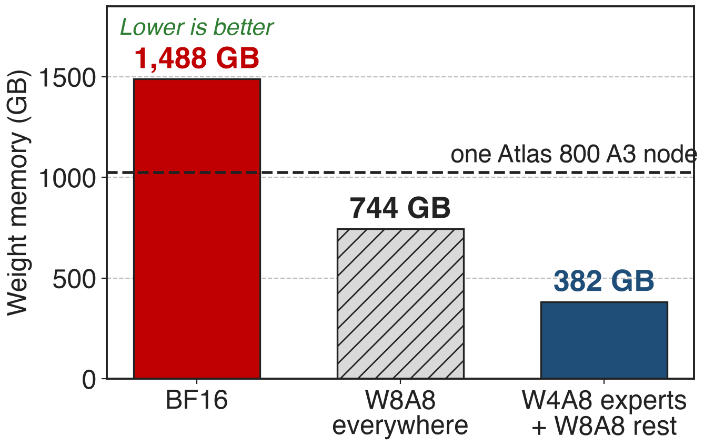

# GLM-5 must serve 744B weights from one node
- **744B** params (**40B** active), **256** experts, 75 MoE + 3 dense layers
- Deployment target: one Atlas 800 A3 node, **128 GB × 8**
- Contexts up to **200K** tokens — the KV cache competes with the weights
<!-- notes: GLM-5 is a 744B-parameter MoE serving contexts of up to 200K tokens, and the Ascend target is a single Atlas 800 A3 node with eight 128-gigabyte NPUs. Quantization is the first of the report's three Ascend pillars; kernel fusion is deck 37 and the engine work is decks 12 and 23. Sources: GLM-5 report Table 10 p.36, §5 p.21, and the vLLM-Ascend GLM-5 deployment guide for the node configuration. -->

# 1.49 TB of weights, 1,024 GB of node
%% big: 1.49 TB
%% sub: BF16 weights for 744B parameters, against a 1,024 GB node that also holds the KV cache
%% source: Derived: 744e9 × 2 bytes (GLM-5 report Table 10); node = "128GB × 8" from the vLLM-Ascend GLM-5 guide
<!-- notes: At BF16 the weights alone are about 1.5 terabytes, and one Atlas 800 A3 node has roughly 1 terabyte of NPU memory. Even after the weights fit, a 200K-token context needs a large KV cache out of the same memory. So the question is not whether to quantize but how far, and where. Both numbers are derived: 744 billion parameters times two bytes, and eight times 128 gigabytes. -->

# Both obvious precision plans fail
%% layout: two-col
- **INT8 everywhere** (W8A8)
- Weights **744 GB**: they fit
- !!Only ~280 GB left!! for the KV cache
|||
- **4 bits everywhere**
- Activations carry !!outlier channels!!
- One outlier eats the whole INT4 range
> Quantize the memory hogs hard, the shared path gently — but 4-bit needs outliers gone first
<!-- notes: Two plans suggest themselves and both disappoint. INT8 for everything fits the node, but leaves only about 280 gigabytes for the KV cache, activations and buffers — and long context is exactly the case this deployment is for. Four bits for everything runs into the outlier problem: a handful of activation channels are orders of magnitude larger than the rest, so a shared INT4 scale leaves the ordinary channels with almost no levels. The memory numbers are derived; the outlier phenomenon is the one QuaRot and SmoothQuant were written for. -->

# Insight: the outliers live in the basis
- Outlier channels are a property of the coordinates, not of the information
- An orthogonal matrix's transpose is its inverse, so a rotation changes nothing
--
> Rotate the model, fold the transpose into the weights, and the outliers are gone for free
<!-- notes: This is QuaRot's observation and the reason the stack starts with a rotation. If you insert an orthogonal matrix and its transpose around a linear layer the output is unchanged; the computational-invariance argument from SliceGPT lets you fuse those rotations into the weight matrices offline. The activations in the rotated basis are spread evenly, so there is nothing left to protect with mixed precision. Source: QuaRot, arXiv 2404.00456 §1 and §3.1. -->

# Four steps turn BF16 into a served W4A8 model
{full}
%% caption: Steps ❶–❸ run offline in msModelSlim (GLM-5 report §5); INT4 QAT is §2.4.3
<!-- notes: The pipeline: rotate the model so the activations are outlier-free, calibrate per-channel scales on a calibration set, assign a precision to every tensor, then serve with int4 weights and int8 activations. The report names msModelSlim as the tool and QuaRot and Flex_AWQ_SSZ as the algorithms. INT4 QAT in the SFT stage, described elsewhere in the report, feeds the checkpoint that enters this pipeline — the report does not explicitly tie the two, so the figure draws it as a dashed input. -->

# ❶ Rotating the model deletes the outliers
{full}
> Bar heights are schematic: the point is that no channel keeps the range to itself
<!-- notes: QuaRot applies randomized Hadamard transforms to the hidden state, the feed-forward activations, parts of the attention module and the KV cache, and fuses them into the weights wherever possible, so inference pays nothing for most of them. The result is an equivalent network with no outlier features, which is what makes 4-bit weights and 8-bit activations safe to use together. These bars are illustrative; the report publishes no activation statistics for GLM-5. -->

# ❷ Calibration searches the scales per layer
{full}
%% caption: The report names Flex_AWQ_SSZ but does not define it; the search shown is AWQ's (arXiv 2306.00978, Eq. 5)
<!-- notes: After rotation the remaining job is bookkeeping: pick a per-channel scale that balances weight and activation error. AWQ's own method collects per-channel activation averages on a calibration set, parameterizes the scale as that average raised to alpha, and grid-searches alpha in zero to one; the scale is folded into the weights and into the previous operator, so nothing extra runs at inference time. SSZ reads as a scale-shift-zero, that is asymmetric, weight quantizer — msModelSlim checkpoints do carry a per-channel scale, offset and bias — but the report never defines the name. SmoothQuant, which the Notion row names, is the ancestor of the idea and is not mentioned in the GLM-5 report. -->

# ❸ The experts hold 97% of the weights
{right 58%}
%% caption: Derived from the GLM-5 report Table 10 — 256 × 3 × 6144 × 2048 × 75 layers
- Experts: **724.8B** params, few tokens each
- Attention + MLP: **19.2B**, every token
- So: **W4A8** experts, **W8A8** everywhere else
<!-- notes: This is why the split falls where it does. The routed experts are 97 percent of the parameters but each expert sees only the tokens routed to it, so their weights are a memory problem rather than an accuracy-critical path. Attention and the dense MLP are three percent of the weights and every token crosses them, so the report keeps them at INT8. The report's own wording is structural — standard attention and MLP blocks use W8A8, MoE experts use W4A8 — and the percentages here are derived from the architecture table. -->

# W4A8: int4 weights, int8 activations
{full}
> The precision plan ships as a per-tensor table inside the checkpoint
<!-- notes: Concretely, in vLLM-Ascend the expert weights arrive as int8 tensors that pack two 4-bit values each, with a scale, an offset and a bias per output channel; activations are quantized to int8 per token at run time; the grouped GEMM multiplies int8 by int8 into int32 on the Cube unit and the result is dequantized. Per-group quantization is rejected — per-channel only — and the W4A8 scheme is registered for MoE layers only. The checkpoint carries a quant_description entry naming the scheme for every weight tensor. -->

# ❹ INT4 QAT makes training match inference
- INT4 **quantization-aware training** during the SFT stage
- **One kernel** for training and for offline weight quantization
--
> Bitwise-identical behaviour between training and inference, by construction
<!-- notes: The fourth step is the one that is easy to miss: the report applies INT4 QAT during supervised fine-tuning rather than only post-training quantization, and it uses a single quantization kernel for training and for offline weight quantization so that training and inference agree bit for bit. That removes the usual class of bugs where the deployed model behaves slightly differently from the one you fine-tuned. Source: GLM-5 report §2.4.3 p.10; the report does not state explicitly that this is the checkpoint used for the Ascend W4A8 build. -->

# 382 GB of weights, 642 GB free
{right 58%}
%% caption: Derived from Table 10 parameter counts; node capacity from the vLLM-Ascend GLM-5 guide
- **1.95×** smaller than W8A8
- **642 GB** free, not 280 GB
- The guide: use w4a8 weights at **200K** context
<!-- notes: The hybrid plan puts the weights at about 382 gigabytes: 1.95 times smaller than INT8 everywhere, and a third of the node instead of three quarters. That difference is the whole point — the vLLM-Ascend guide tells you to use the w4a8 weights for 200K-token contexts precisely because they leave more memory for the KV cache, and lists w4a8 as deployable on a single A2 node as well. All three bars are derived from the parameter counts; the node capacity is from the deployment guide. -->

# The accuracy numbers are not published
- GLM-5 report: W4A8 "without significant accuracy loss" — **no numbers**
- QuaRot's own paper, LLaMA2-70B at 4 bits: **≤ 0.47** ppl, **99%** of zero-shot
- No public accuracy table for the quantized GLM-5 weights
<!-- notes: Be honest about the evidence. The GLM-5 report asserts that W4A8 reduces memory without significant accuracy loss and gives no measurement. The strongest public numbers are from QuaRot's own paper, on LLaMA2-70B on GPUs: at most 0.47 WikiText-2 perplexity loss and 99 percent of zero-shot accuracy retained with everything at 4 bits — a different model, a different stack, and a stricter setting than this hybrid plan. The vLLM-Ascend accuracy section points at a benchmark harness rather than publishing results. -->

# The cost: calibration, QAT, and a frozen plan
%% layout: two-col
- !!Calibration + QAT!! cost data and training time
- !!Per-channel only!!: the runtime rejects per-group
|||
- W4A8 covers experts, not attention
- Fused MLA pre-processing: w8a8 by default, "w4a8 may not benefit"
- Re-quantize after any architecture change
<!-- notes: The costs are real. Calibration needs a representative dataset and QAT needs SFT compute. The runtime accepts only per-channel W4A8 weights, so finer group-wise schemes are off the table. W4A8 is an expert-weight scheme, so the attention path stays at INT8 and does not shrink. And the quantized build interacts with the fusion work from deck 37: the MLA pre-processing super operator is on by default for w8a8 weights and the guide says w4a8 may not benefit, listing it as a knob to disable under memory pressure. -->

# Summary
- **1.49 TB** of BF16 weights against a **1,024 GB** node (derived)
- ==Insight==: outliers live in the basis — rotate, and 4-bit weights become safe
- Rotate (QuaRot) → calibrate (Flex_AWQ_SSZ) → **W4A8** experts, **W8A8** attention + MLP → INT4 QAT
- **382 GB** of weights, **1.95×** under W8A8; accuracy numbers are not published
%% qr: https://arxiv.org/abs/2602.15763
<!-- notes: The shape of the stack: make the activations quantizable, then spend bits where the parameters are. Related decks: 37 (super-operator fusion on the same silicon), 23 (the Ascend adaptation stack), 12 (comm/compute fusion), 45 and 48 (FP4 and NVFP4 on GPUs), 46 and 47 (FP8 training). Source: GLM-5 report arXiv 2602.15763 §5 and §2.4.3. -->
