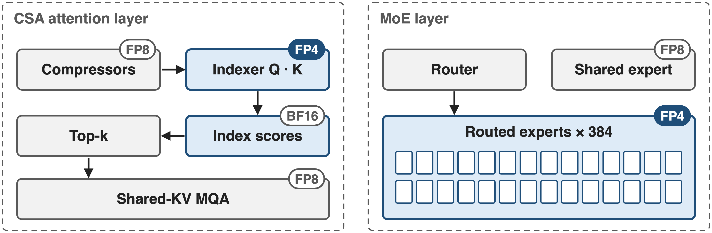
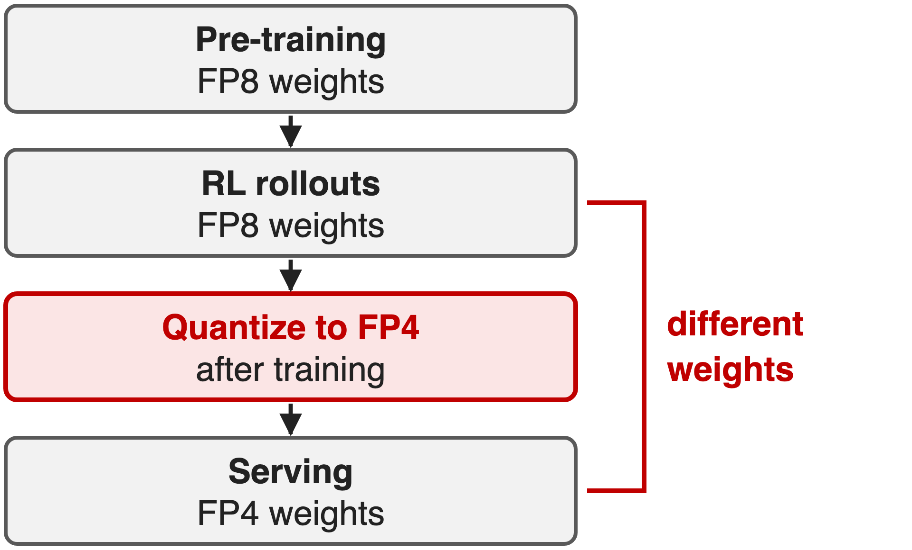
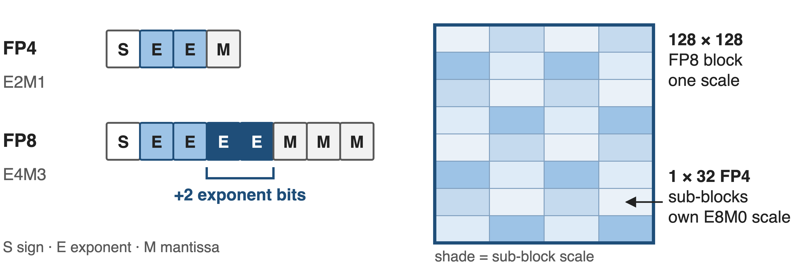
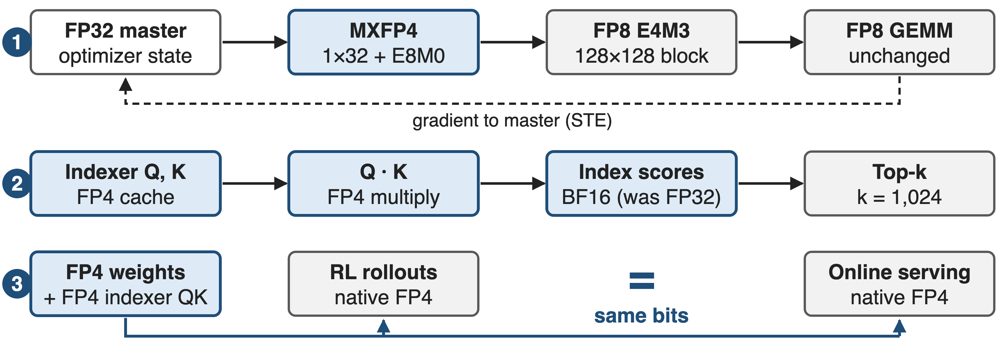
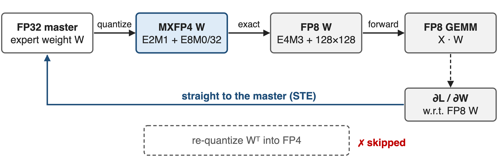
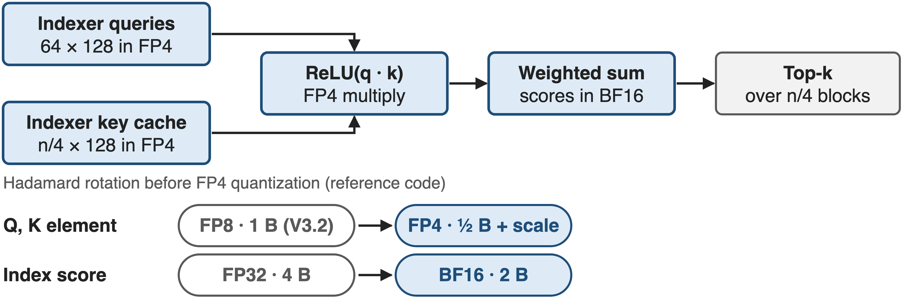
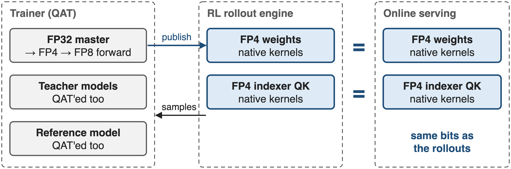
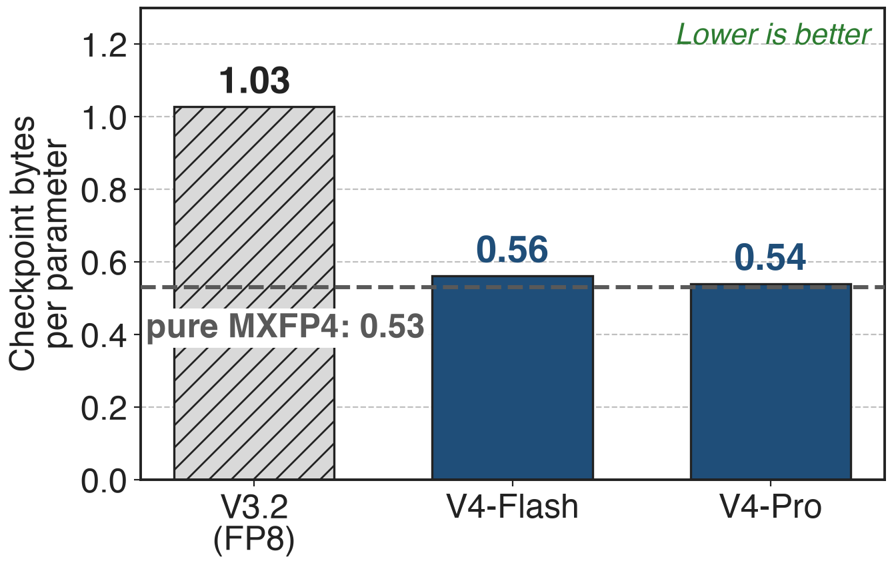

# V4 runs two hot spots in FP4
{full}
> Applied as QAT in post-training; other linear weights stay FP8 (E4M3, 128 × 128 blocks)
<!-- notes: DeepSeek-V4's linear weights are FP8: E4M3 with one scale per 128 by 128 block. Two places go further, to 4-bit FP4: the routed MoE experts, and the query-key path of CSA's lightning indexer, the selector from deck 01, whose index scores also drop from FP32 to BF16. Both are introduced during post-training as quantization-aware training. Sources: V4 Sec. 1 and 5.2.1; precision from the released config.json. -->

# Expert weights are nearly all of V4
%% big: ~97%
%% sub: of V4-Pro's 1.6T parameters are routed-expert weights: ~1.55 TB even in FP8
%% source: Analytic: 61 layers × 384 experts × 3 matrices × 7,168 × 3,072 = 1.547T parameters (V4 §4.2.1); 1 byte per FP8 weight
<!-- notes: Why the experts. V4-Pro has 61 MoE layers, each with 384 routed experts of three 7,168 by 3,072 matrices. That is 1.55 trillion of its 1.6 trillion parameters, about 97 percent, and Flash is the same at 97.5. At one byte per weight in FP8 the experts alone are about 1.55 TB of memory to hold and stream. This is our arithmetic from the published shapes; the paper calls expert weights a major source of GPU memory occupancy. -->

# FP8 is too big; FP4 after training drifts
{right 55%}
- !!Stay FP8!!: 1 B per expert weight
- !!Quantize after RL!!: rollouts sample a model nobody serves
- !!FP8 indexer, FP32 scores!!: the 1M-token scan stays heavy
> Villain: training stacks speak FP8, so FP4 arrives after training, when nothing can adapt
<!-- notes: Three status-quo options. Keep FP8: simple, but every expert weight costs a byte. Quantize to FP4 after training: the model never adapts to the rounding, and RL rollouts are sampled from FP8 weights that users never see. And for the indexer, V3.2 ran it in FP8 with FP32 scores, while at a million tokens the indexer is the largest term in a CSA layer. The common cause: the training stack is FP8, so FP4 only appears after training. Sources: V4 Sec. 5.2.1; V3.2 Sec. 2.1. -->

# Key idea: FP4 → FP8 dequantization is exact
{full}
> E4M3 has 2 more exponent bits, so 1×32 FP4 scales fold into a 128×128 FP8 block: QAT reuses the FP8 stack
<!-- notes: The turn is a numeric fact. MXFP4 stores each weight as E2M1, one sign, two exponent bits, one mantissa bit, with an 8-bit power-of-two scale shared by 32 weights. FP8 E4M3 has two more exponent bits and two more mantissa bits. So when an FP4 weight is converted to FP8, the per-32 scale can be absorbed into the FP8 exponent, as long as the sub-block scales inside one 128 by 128 FP8 block are not too far apart; DeepSeek verified that empirically for V4's weights. Exact conversion means the existing FP8 training framework runs unmodified. Sources: V4 Sec. 5.2.1; MX format from Rouhani et al. 2023, Table 1. -->

# Three FP4 paths, one set of bits
{full}
%% caption: ❶ expert-weight QAT through FP8 · ❷ FP4 indexer QK with BF16 scores · ❸ native FP4 in RL rollouts and serving
<!-- notes: The design in three lanes. One: expert weights keep an FP32 master; the forward pass sees them quantized to MXFP4 and losslessly widened to FP8, so the usual FP8 GEMMs run; gradients go straight back to the master. Two: the indexer's queries and compressed keys are cached and multiplied in FP4, and the index scores are kept in BF16 for the top-k selector. Three: whenever no backward pass is needed, RL rollouts and serving load the real FP4 weights. Source: V4 Sec. 5.2.1. -->

# ❶ Experts train through FP4, compute in FP8
{full}
> MXFP4 is 4.25 bits per weight vs 8 in FP8; the backward pass never re-quantizes Wᵀ, whose MX scales would sit on the wrong axis
<!-- notes: Challenge: train against FP4 rounding without building an FP4 training stack. Forward: the FP32 master weight is quantized to MXFP4, one E8M0 scale per 32 weights, then dequantized exactly to FP8 with one scale per 128 by 128 block, and the existing FP8 GEMM runs. Backward: the gradient is taken with respect to that FP8 weight and applied directly to the FP32 master, which is a straight-through estimator. A side benefit: MX scales are shared along one axis, so a transposed copy would need fresh quantization; this scheme never needs it. Sources: V4 Sec. 5.2.1; Rouhani et al. Sec. 3. -->

# ❷ The indexer scores blocks in FP4
{full}
> At 1M the indexer does 14× a CSA layer's core-attention work (analytic, deck 01): the right place for FP4
<!-- notes: Challenge: at a million tokens, the lightning indexer scans 262,144 compressed keys per query per CSA layer, 14 times the multiply-adds of the attention it feeds, by our count from deck 01. After QAT its queries and compressed keys are cached, loaded and multiplied entirely in FP4; the reference code applies a Hadamard rotation before the FP4 quantization to spread information across dimensions. The index scores, previously FP32, are stored in BF16 for the top-k selector. Sources: V4 Sec. 2.3.4 and 5.2.1; reference inference code. -->

# ❸ Rollouts and serving share the FP4 bits
{full}
> RL samples the exact model users get, and native FP4 kernels load about half the expert bytes of FP8
<!-- notes: Challenge: reinforcement learning should sample from the model that will be deployed. During RL inference and rollout, where no backward pass is needed, V4 loads native FP4 weights instead of simulating quantization, and treats the indexer QK path the same way. So the rollout policy and the online model are the same bits, and kernels move roughly half the bytes of FP8. Teacher and reference models in the distillation and RL pipeline go through QAT as well. Source: V4 Sec. 5.2.1. -->

# Top-k selection runs 2× faster
%% big: 2×
%% tone: ours
%% sub: faster top-k selector with BF16 index scores, still recalling 99.7% of KV entries
%% source: DeepSeek-V4 §5.2.1; measured by DeepSeek, setup not further specified
<!-- notes: The one measured kernel result in the paper: moving the index scores from FP32 to BF16 within the QAT process makes the top-k selector twice as fast, while 99.7 percent of the KV entries chosen before are still chosen. The paper gives no further breakdown, for example of the FP4 QK speedup by itself. Source: V4 Sec. 5.2.1. -->

# V4-Pro ships at 0.54 bytes per parameter
{right 60%}
- V4-Pro: 1.6T params in 865 GB
- V3.2: 671B params in 690 GB
- Derived: repo size ÷ stated params
> 2.4× V3.2's parameters in 1.25× its bytes
<!-- notes: The released checkpoints show the memory effect. V4-Pro's weights on Hugging Face total 864.7 GB for 1.6 trillion parameters, 0.54 bytes per parameter, close to the 0.53 of pure MXFP4 because experts dominate. V3.2, in FP8, is 689.5 GB for 671 billion, 1.03. So V4-Pro holds 2.4 times the parameters in 1.25 times the bytes. Sizes summed from the Hugging Face file listings; parameter counts are the paper's rounded totals. -->

# Cost: no FLOP gain yet, and a scale caveat
- FP4 × FP8 peak = FP8 × FP8 on existing hardware; ~⅓ gain only on future chips
- Exact only while sub-block scales stay close (verified empirically)
- Post-training only; no FP4 vs FP8 accuracy ablation published
> Today's win is memory and bandwidth, not FLOPs
<!-- notes: Honest limits. Today the gain is memory and bandwidth, not math: the paper notes FP4 by FP8 matrix multiplies peak at the same FLOPs as FP8 by FP8 on existing hardware, and could be about a third more efficient on future hardware. The lossless widening holds only while the FP4 sub-block scales inside each FP8 block stay within a bounded ratio; DeepSeek checked this for current weights rather than guaranteeing it. And QAT is applied in post-training only, without a published accuracy comparison against FP8. Sources: V4 Sec. 1 and 5.2.1. -->

# Summary
- !!Pain!!: ~97% of V4-Pro's weights are routed experts (analytic)
- ==Insight==: FP4 → FP8 dequantization is exact, so QAT rides the FP8 stack
- ❶ expert QAT + STE ❷ FP4 indexer QK, BF16 scores ❸ native FP4 rollouts = serving
- **2×** faster top-k at **99.7%** recall; **0.54 B** per parameter shipped
%% qr: https://arxiv.org/abs/2606.19348
<!-- notes: To recap: almost all of V4's parameters are routed experts, and at a million tokens the indexer dominates CSA. Because FP4 widens exactly into FP8, DeepSeek trains against FP4 inside its FP8 stack, runs the indexer QK path in FP4 with BF16 scores, and serves the same FP4 bits it samples in RL: a 2× faster top-k at 99.7 percent recall and a checkpoint at 0.54 bytes per parameter. Paper: arXiv 2606.19348; companion decks 01 (CSA) and 03 (HCA). -->
