# Hopper pretraining runs its GEMMs in 8-bit floats
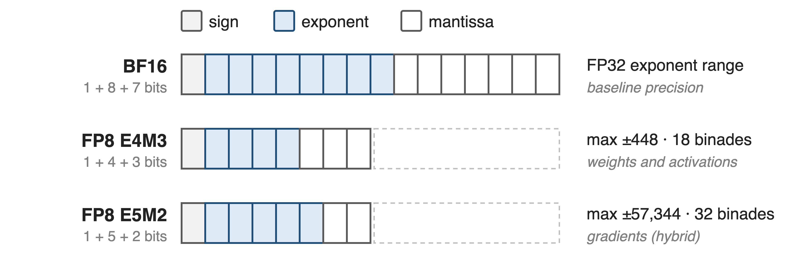{full}
> DeepSeek-V3 (671B MoE, 14.8T tokens) ran every linear-layer GEMM in FP8 on H800s
<!-- notes: FP8 is two formats: E4M3 with 3 mantissa bits and a max of 448, and E5M2 with 2 mantissa bits and a max of 57,344; BF16 keeps FP32's 8-bit exponent. This deck is rung one of a precision ladder: FP8 on Hopper here, MXFP8 on Blackwell in deck 47, NVFP4 in deck 48. Sources: FP8 Formats for Deep Learning (arXiv 2209.05433) Table 1 and Sec. 3.1; DeepSeek-V3 report Sec. 3.3 and abstract. -->

# BF16 training leaves the FP8 tensor cores idle
%% big: 1.92×
%% sub: raw FP8 GEMM speed over BF16 on H200, 5B-model shapes
%% source: Transformer Engine docs, "GEMM Speedups Across Precisions": 5B model on H200 NVL, pre-quantized inputs
- The catch: E4M3 spans only **18 binades** per scale
<!-- notes: With inputs already in FP8, TE measures 1.92x the BF16 GEMM throughput for a 5B model's shapes on H200. Getting there in training means fitting activations, weights and gradients into 8 bits, and E4M3 spans just 18 binades for any one scale factor (FP8-formats paper Sec. 3.1). -->

# One scale per tensor lets outliers erase values
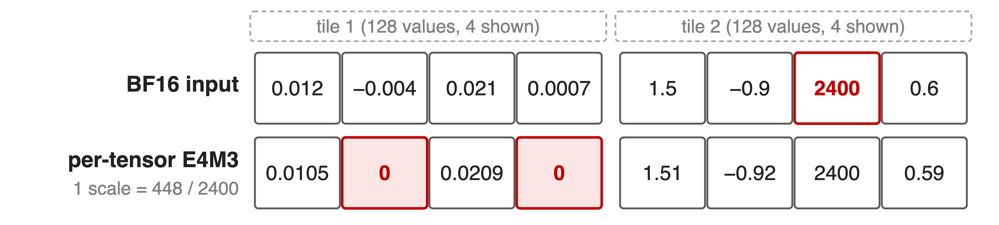{full}
> One outlier (2400) sets the scale; small values fall below E4M3's 2⁻⁹ floor and flush to 0
<!-- notes: Worked example computed with round-to-nearest-even E4M3 and scale 448/amax (sources.md, analytic). FP16's single global loss scale cannot work for FP8, so TE gives every tensor its own scale (TE FP8 primer). Delayed scaling makes this worse: it predicts amax from a history window, and Megatron-Core does not recommend it for precision reasons (arXiv 2603.07685 Sec. 5.3.1). Current scaling fixes staleness but costs a second pass over the tensor and still has one scale; gradients then need E5M2 with only 2 mantissa bits. -->

# Insight: outliers are local, so scales must be local
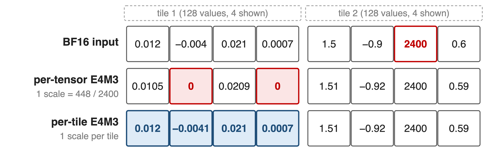{full}
> Give every 128 values their own scale, and E4M3 holds activations, weights and gradients
<!-- notes: DeepSeek-V3 observes that outliers follow tokens and channels, so a scale per small group effectively shares exponent bits within the group; with that, it uses E4M3 for all tensors instead of the hybrid E4M3/E5M2 split (DeepSeek-V3 Sec. 3.3.2, "Mantissa over Exponents"). Same worked example: tile 1 now gets its own scale and keeps all four values. -->

# Each linear layer runs three GEMMs in FP8
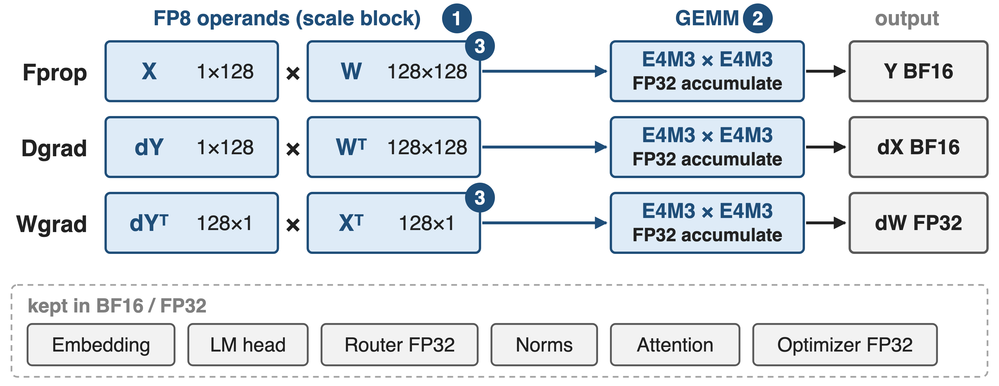{full}
%% caption: ❶ scale blocks · ❷ FP32 accumulation · ❸ FP8 caching and FP8 all-gather
<!-- notes: Fprop, Dgrad and Wgrad all take FP8 inputs and write BF16 or FP32 (DeepSeek-V3 Fig. 6, Sec. 3.3.1; TE Performance Considerations Table 2 for which operand is read rowwise or columnwise). Embedding, LM head, router, norms and attention stay in BF16 or FP32, as do master weights, gradients and optimizer states (DeepSeek-V3 Sec. 3.3.1; Megatron-Core report Sec. 5.1). Three mechanisms follow, numbered as in the figure. -->

# ❶ Scale each 1×128 tile and 128×128 block
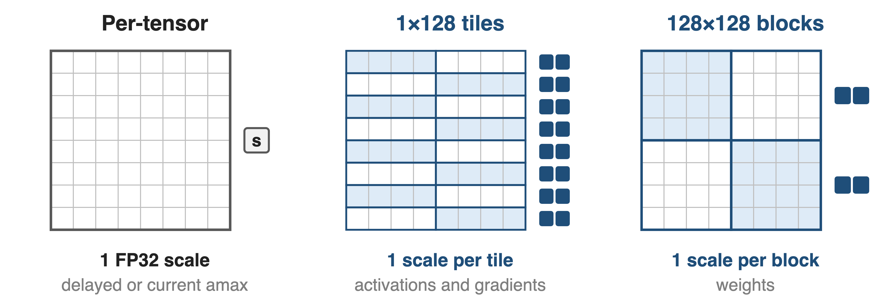{full}
> Scale = 448 / amax of the block, rounded down to a power of 2, kept in FP32
<!-- notes: TE's Float8BlockScaling (the DeepSeek-V3 scheme): activations and gradients use 1x128 tiles, one scale per token per 128 channels; weights use 128x128 blocks. Scales are computed online from the current block amax, so there is no amax history and no cross-rank scale synchronization (TE FP8 Blockwise Scaling docs; DeepSeek-V3 Sec. 3.3.2 "Online Quantization"). -->

# ❶ Row tiles must be quantized twice
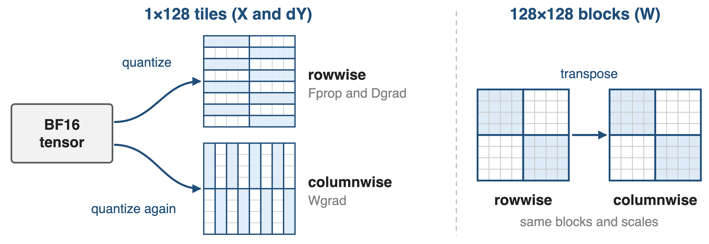{full}
> Why not 128×128 everywhere? Block-scaled activation gradients diverged a 16B MoE at ~300B tokens
<!-- notes: Wgrad reads X and dY columnwise, and Hopper FP8 GEMMs need that operand physically transposed. A 1x128 tile and a 128x1 tile cover different elements, so TE quantizes both copies from the BF16 source; a 128x128 block covers the same elements either way, so data and scales are just transposed (TE FP8 Blockwise Scaling docs, "Handling transposes"). DeepSeek-V3 App. B.2 tried 128x128 for Dgrad tensors and the 16B MoE diverged after about 300B tokens. -->

# ❷ Accumulate in FP32 every 128 elements
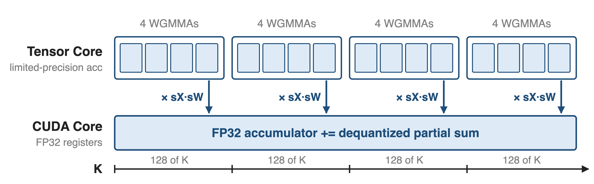{full}
> H800 FP8 tensor cores keep ~14 accumulator bits: nearly 2% max error at K = 4096
<!-- notes: DeepSeek-V3 Sec. 3.3.2, "Increasing Accumulation Precision": after 128 elements of K (4 WGMMAs) the partial result moves to FP32 registers on CUDA cores, where it is multiplied by the two per-group scales and added. One promotion interval equals one scale group, so dequantization is free there; two warpgroups overlap promotion and MMA to keep tensor cores busy. -->

# ❸ Cache activations in FP8, even for BF16 GEMMs
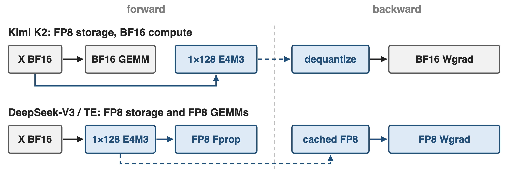{full}
> Kimi K2: MoE up-projection and SwiGLU inputs as 1×128 E4M3 tiles, no measurable loss increase
<!-- notes: Kimi K2 Sec. 2.4.3: those inputs are compressed to FP8-E4M3 in 1x128 tiles with FP32 scales; K2 deliberately does not run FP8 GEMMs because preliminary studies showed risk. DeepSeek-V3 Sec. 3.3.3 caches FP8 inputs for Wgrad, keeps the linear after attention in a custom E5M6 format, and recomputes SwiGLU from FP8 inputs. Each cached tensor costs about 1.03 bytes per element instead of 2 (derived: 128 bytes plus a 4-byte scale per tile). -->

# ❸ Cast FP32 masters straight to FP8 for all-gather
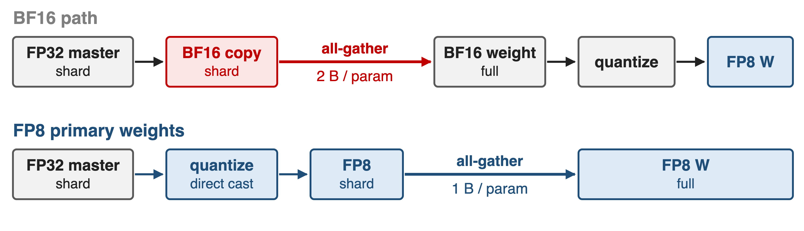{full}
> Half the all-gather bytes and no BF16 weight copy; MXFP8 cannot do this (deck 47)
<!-- notes: Megatron-Core "FP8 primary weights" (--fp8-param-gather): after the optimizer step, FP32 shards are quantized directly to FP8, so the parameter all-gather moves 1 byte per parameter instead of 2 (arXiv 2603.07685 Sec. 5.2.2 and 5.3.5). Per-tensor recipes all-reduce the amax first; blockwise needs a 2D-aware amax kernel. MXFP8 still gathers BF16 because it would need both quantization directions. EP dispatch in FP8 is the same idea for tokens: deck 18. -->

# Blockwise FP8 stays within 0.25% of BF16 loss
%% big: < 0.25%
%% tone: ours
%% sub: relative loss error vs BF16: 16B MoE (1.33T tokens), 230B MoE (0.9T tokens)
%% source: DeepSeek-V3 Technical Report, Sec. 3.3 and App. B.1 (1×128 / 128×128 scales + FP32 promotion)
- Per-tensor FP8 (simulated): GPT-175B perplexity **6.68** vs **6.65**
<!-- notes: DeepSeek-V3 validated the full recipe on two MoE models before using it for the 14.8T-token run; the relative loss error stayed below 0.25%. The older per-tensor evidence, from the FP8-formats paper Table 4, used simulated FP8 and reports GPT-175B at 75% of training: 6.68 FP8 vs 6.65 16-bit perplexity. -->

# FP8 GEMMs run 1.4–1.7× faster than BF16 on H200
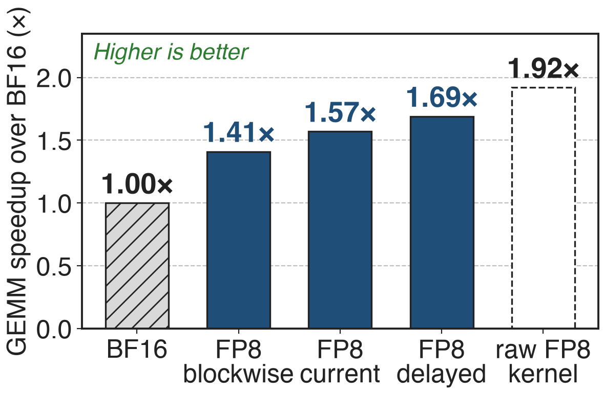{right 55%}
- Includes per-step quantization (5B model)
- Blockwise is slowest: Hopper emulates block scales
- End to end: **~10–25%** for large MoE
> At scale: DeepSeek-V3 on 1,024 H100s reaches 368 TFLOPS/GPU with blockwise FP8
<!-- notes: TE "GEMM Speedups Across Precisions", 5B model (hidden 4096, FFN 16384, 24 layers) on H200 NVL in autocast mode: delayed 1.69x, current 1.57x, blockwise 1.41x; raw pre-quantized FP8 1.92x. The gap to 1.92x is the quantization work. Megatron-Core reports roughly 10-25% end-to-end gains for large-scale MoE (Sec. 4.3.5) and 368 TFLOPS/GPU for DeepSeek-V3 on 1,024 H100 with FP8-BLK (Table 11). -->

# FP8 caching saves ~16 GB of activations per GPU
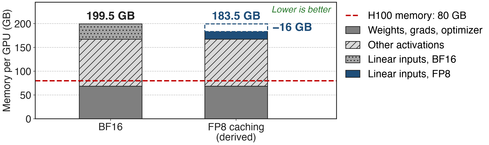{full}
> Only ~32 of 131 GB are FP8-eligible; pair with recompute (deck 52) and offload (deck 54)
<!-- notes: Megatron-Core report Table 3: DeepSeek-V3 in BF16 with PP4 x VPP4 x EP64 on 256 GPUs needs 199.5 GB per GPU, 131 GB of it activations. FP8 halves the roughly 32 GB of linear-layer inputs saved for backward, saving about 16 GB, about 12% (Sec. 4.1.3). The FP8 bar is derived: 199.5 minus 16. So "activations halved" holds per cached tensor, not for the whole model. -->

# The price: emulated scales, copies, padding
- Hopper emulates block scales: **1.41×** vs **1.69×** per-tensor
- Two FP8 copies per 1×128 tensor; BF16-weight layers save no memory
- Shapes must divide by 128; MoE pads tokens per expert
> On Blackwell, MXFP8 (deck 47) makes block scaling native; NVFP4 (deck 48) goes to 4 bits
<!-- notes: TE FP8 Blockwise docs: block-scaled GEMMs are software-emulated on Hopper. TE Performance Considerations: a 1024x1024 Linear uses 6.00 MB after forward in BF16 and 6.02 MB in FP8 with BF16 weights, because the FP8 weight copy offsets the FP8 input. Alignment: blockwise needs the last dimension and the leading product divisible by 128; Megatron-Core pads tokens per expert to 128 (Sec. 5.4.1). Router, embeddings, head and attention stay in high precision. TE runs Float8BlockScaling on Blackwell by emulating it with MXFP8. -->

# Summary
- BF16 leaves **1.92×** raw FP8 GEMM speed unused on H200
- ==Insight==: outliers are local, so scale per 1×128 tile / 128×128 block and accumulate in FP32
- **< 0.25%** loss gap; **1.41–1.69×** GEMM speedup; **~16 GB** activations saved
- Next rungs: MXFP8 (deck 47), NVFP4 (deck 48)
%% qr: https://github.com/NVIDIA/TransformerEngine
<!-- notes: Pain: 1.92x raw FP8 GEMM throughput idle under BF16 (TE docs). Insight: local scales let E4M3 hold every tensor; FP32 promotion every 128 elements fixes Hopper's 14-bit accumulation. Results: DeepSeek-V3 under 0.25% loss error; TE 1.41x to 1.69x GEMM speedups on H200; Megatron-Core about 16 GB of DeepSeek-V3 activations saved. -->
