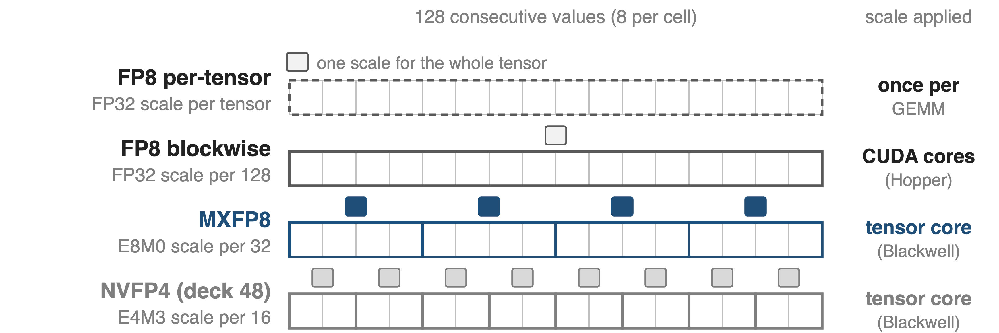
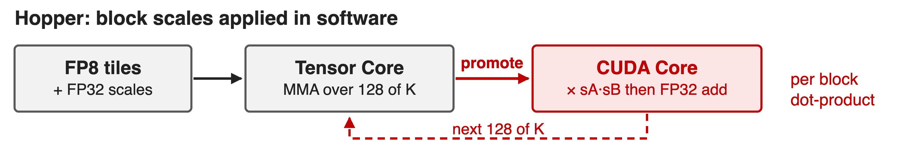
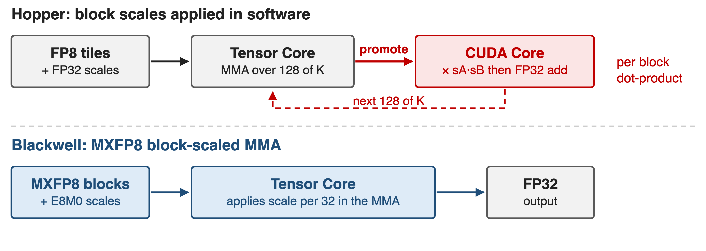
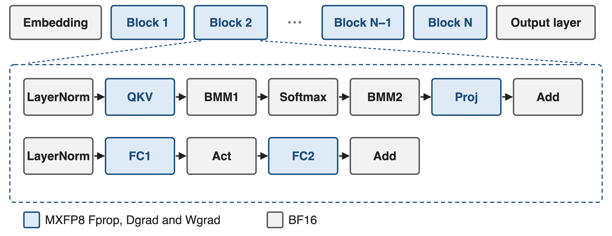
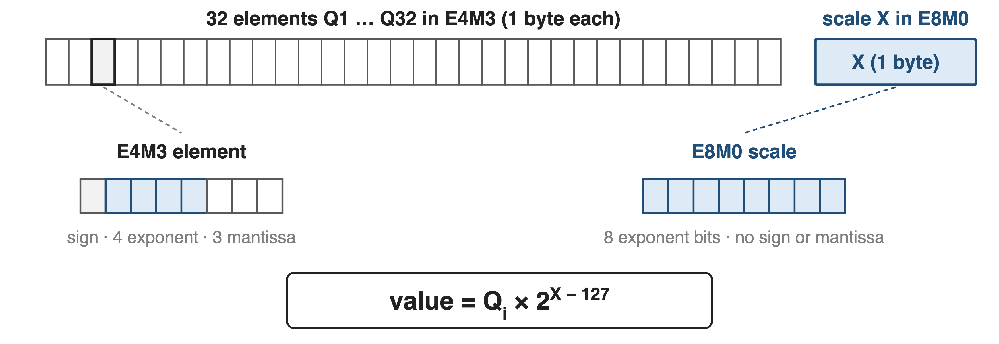
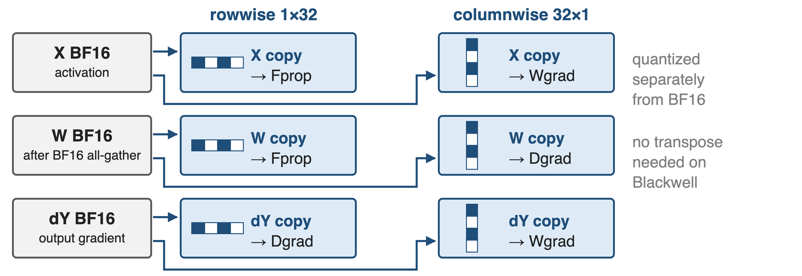
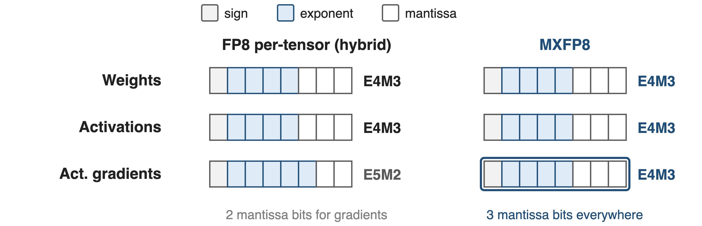
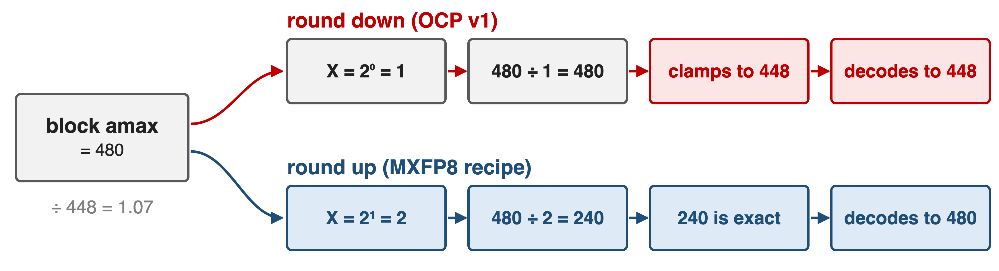
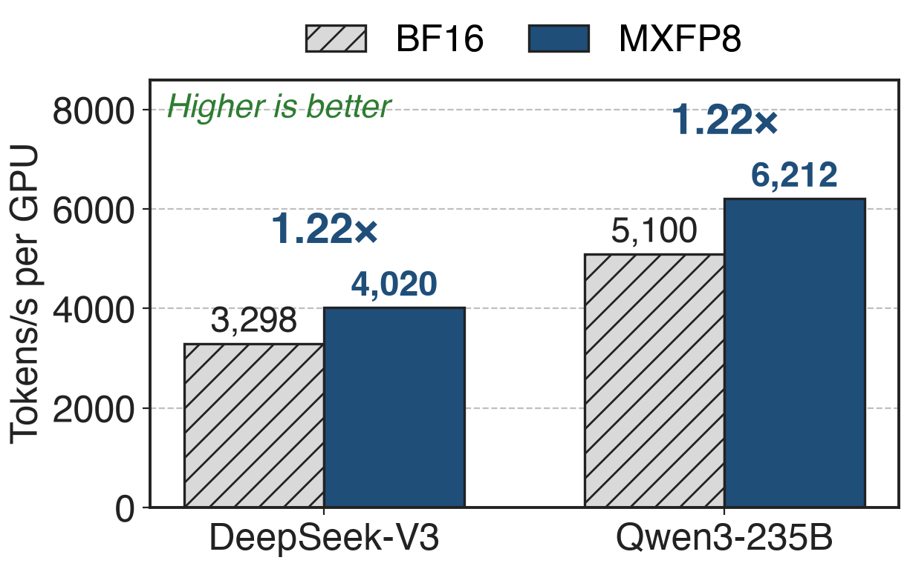
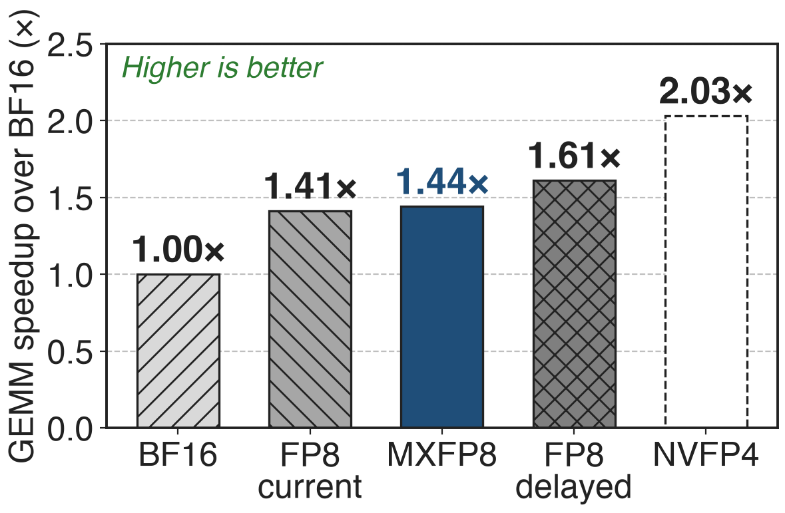

# Blackwell moves FP8 scales into the tensor core
{full}
> Megatron-Core's default FP8 recipe on Blackwell: DeepSeek-V3 trains at 1,048 TFLOPS/GPU on GB200
<!-- notes: Rung two of the precision ladder. Deck 46 covered FP8 on Hopper: one scale per tensor, or DeepSeek-style 1x128 tiles whose scales are applied in software. MXFP8 gives every 32 values their own power-of-two scale, and Blackwell tensor cores apply it. NVFP4 (deck 48) goes to 16-value blocks of 4-bit numbers. Sources: MXFP8 paper Sec. 2; TE MXFP8 docs; Megatron-Core MoE report Sec. 5.3.3 and Table 11. -->

# On Hopper, finer FP8 scales cost GEMM speed
%% big: 1.41×
%% sub: blockwise FP8 GEMM speedup over BF16 on H200, below per-tensor current scaling (1.57×)
%% source: Transformer Engine docs, "GEMM Speedups Across Precisions": 5B model on H200 NVL, autocast (deck 46)
- The accurate recipe is the slow one: block scales are **software-emulated** on Hopper
<!-- notes: Same TE benchmark as deck 46: on H200 the DeepSeek-style blockwise recipe reaches 1.41x over BF16, current per-tensor scaling 1.57x and delayed scaling 1.69x. TE's blockwise docs state that block-scaled GEMMs are software-emulated on Hopper. Finer scales buy accuracy and cost throughput. -->

# Software block scales detour through CUDA cores
{full}
> Per-tensor FP8 skips the detour, but keeps E5M2 gradients and leaves some blocks in BF16
<!-- notes: DeepSeek-V3 (Sec. 3.3.2) promotes partial sums to FP32 CUDA-core registers every 128 elements of K and multiplies the two group scales there. The MXFP8 paper (App. A.3) explains why: with fine-grained scales, scale factors must be processed once per block dot-product, which is expensive in software. The fast alternative, per-tensor FP8, needs E5M2 gradients, and the FP8 baseline in the paper keeps the first and last transformer blocks in BF16, as Nemotron-H does. -->

# Insight: let the tensor core apply the scale
{full}
> With scaling in hardware, small blocks cost no speed: shrink them to 32, then fix the numerics
<!-- notes: Blackwell tensor cores consume the per-block scale X together with the quantized values (MXFP8 paper Sec. 2). In the paper's words, hardware support for scaling avoids the tradeoff between smaller block sizes and hardware speed (Sec. 4). The remaining questions are numerical: which encoding and how to compute the scale. -->

# MXFP8 quantizes every linear layer of every block
{full}
%% caption: ❶ the MX block format · ❷ E4M3 for all tensors · ❸ round the scale up
<!-- notes: MXFP8 paper Sec. 3.2.1 and Fig. 3: QKV, attention projection, FC1 and FC2 run Fprop, Dgrad and Wgrad in MXFP8 in all transformer blocks, unlike per-tensor recipes that leave some blocks in BF16. The attention BMMs, softmax, activation, residual adds, layer norms, embedding and output layer stay in BF16. -->

# ❶ 32 values share one power-of-two scale byte
{full}
> 8.25 bits per value: the same overhead as 1×128 FP32 scales, 4× finer (derived)
<!-- notes: MX blocks have K = 32 elements; the shared scale X is UE8M0, a pure power of two from 2^-127 to 2^127 (MXFP8 paper Sec. 2; TE MXFP8 docs). Per value, 8 bits of data plus 8/32 of a scale byte is 8.25 bits, exactly what a 4-byte FP32 scale per 128 values costs in the blockwise recipe (derived in sources.md). Peak tensor-core math rate for MXFP8 is 2x BF16 (paper Table 1). -->

# ❶ Each operand needs row and column copies
{full}
> Copies cannot be derived from each other, so MXFP8 weights are all-gathered in BF16
<!-- notes: Each tensor feeds GEMMs that reduce along different axes, so the framework keeps two copies quantized along rows (1x32) and columns (32x1) (paper Sec. 3.2.1; TE MXFP8 "Handling transposes"). Blackwell supports TN, NT and NN layouts, so nothing is physically transposed, but the two copies cover different elements and must both come from high precision. Megatron-Core therefore all-gathers MXFP8 parameters in BF16 (report Sec. 5.2.2), unlike blockwise FP8 in deck 46. -->

# ❷ E4M3 everywhere, gradients included
{full}
> Within 32 values, E4M3's 17.8 binades cover the range; the extra mantissa bit matters
<!-- notes: MXFP8 paper Sec. 3.2.2 and Fig. 4: E5M2 for weights or activations worsened perplexity at 843M parameters, and E5M2 activation gradients caused a substantial perplexity degradation for an 8B model on 1T tokens. The paper gives curves, not a single gap number, so none is shown. -->

# ❸ Round the scale up, not down
{full}
> OCP v1's round-down overflows the block max; round-up removed the 843M training issues
<!-- notes: Algorithm 1 in the paper: X = 2^ceil(log2(amax / 448)). Rounding up guarantees no scaled value exceeds the E4M3 maximum; the OCP v1 suggestion effectively rounds down, so the largest values saturate. Worked example (analytic, sources.md): amax 480 clamps to 448 with X = 1, while X = 2 gives 240, which E4M3 represents exactly. Fig. 5 shows the OCP rounding causing training issues on an 843M model at 300B and 1T tokens. Blackwell implements this rounding in hardware (App. A.2). -->

# MXFP8 tracks BF16 within 0.5% over 15T tokens
%% big: < 0.50%
%% tone: ours
%% sub: validation-perplexity gap vs BF16 throughout pre-training, 8B model, 15T tokens
%% source: Mishra et al., arXiv 2506.08027, Sec. 3.1 and App. A.4 (MX numerics simulated on 3,072 Hopper GPUs)
- 16B MoE (2.5B active), 1T tokens: final loss within **0.1%**
<!-- notes: The 8B model (32 blocks, hidden 4096) matched BF16 in validation perplexity and in MMLU and 9-task reasoning scores (Sec. 3.1, Fig. 2). The 16B-total, 2.5B-active MoE trained on 1T tokens ended within 0.1% of BF16 loss (App. A.4). Caveat: these runs simulated MXFP8 by casting to MXFP8 and back before each GEMM on Hopper. -->

# MXFP8 trains DeepSeek-V3 1.22× faster than BF16
{right 55%}
- 256 GB200 GPUs, 4k sequence
- Each precision with its own best parallel config
- GB300 in MXFP8: **1,233** TFLOPS/GPU
<!-- notes: Megatron-Core MoE report Table 11: DeepSeek-V3 BF16 3,298 vs MXFP8 4,020 tokens/s/GPU (857 vs 1,048 TFLOPS); Qwen3-235B 5,100 vs 6,212 (750 vs 919 TFLOPS). Both ratios are 1.22x (derived). The configurations differ (App. B Table 20: DeepSeek-V3 BF16 uses PP8 EP32, MXFP8 PP4 EP64), so this is best-tuned versus best-tuned. -->

# On B300, MXFP8 GEMMs match per-tensor speed
{right 55%}
- 5B model, quantization included
- Blackwell: MXFP8 **1.44×** vs current **1.41×**
- Hopper: blockwise **1.41×** vs current **1.57×**
> Delayed scaling is still fastest (1.61×), but it trades precision for speed
<!-- notes: TE "GEMM Speedups Across Precisions", 5B model on B300 in autocast mode: MXFP8 about 1.44x, FP8 current scaling 1.41x, FP8 delayed scaling 1.61x, NVFP4 about 2.03x over BF16. Compared with Hopper, where blockwise trailed current scaling (1.41x vs 1.57x), fine-grained scaling no longer costs GEMM speed. Delayed scaling remains faster but is not recommended for precision (Megatron-Core report Sec. 5.3.1). NVFP4 is deck 48. -->

# The price: two copies, BF16 all-gather, simulation
- Two quantized copies per tensor: memory and quantize kernels
- Parameters all-gathered in BF16; shapes divisible by 32
- Published accuracy runs were simulated on Hopper
> Blackwell only (SM 10.x); NVFP4 (deck 48) halves the bits again
<!-- notes: Two copies: paper Sec. 3.2.1 and Sec. 5, which lists lowering this storage overhead as future work; Megatron-Core Sec. 5.3.3 notes the extra columnwise data and ongoing work on grouped quantization and fused activation-quantization. BF16 all-gather: Megatron-Core Sec. 5.2.2. Alignment: TE MXFP8 docs (last dimension and leading product divisible by 32). Supported devices SM 10.0 and 10.3 (TE docs). The accuracy evidence used simulated MX numerics (paper Sec. 3.1). -->

# Summary
- Hopper's fine FP8 scales live in software: **1.41×** vs **1.57×** per-tensor
- ==Insight==: tensor cores apply a power-of-two scale per 32 values; E4M3 everywhere, scale rounded up
- **< 0.50%** perplexity gap at 8B / 15T; **1.22×** end to end on GB200
%% qr: https://arxiv.org/abs/2506.08027
<!-- notes: Pain: on H200 the blockwise recipe reaches 1.41x over BF16 vs 1.57x for per-tensor current scaling (TE docs). Insight: block scaling in hardware removes the speed cost of small blocks; the recipe is E4M3 for all tensors with round-up E8M0 scales. Results: under 0.5% validation-perplexity gap for 8B on 15T tokens (paper), 1.22x tokens/s for DeepSeek-V3 and Qwen3-235B on GB200 (Megatron-Core, derived), 1.44x GEMM speedup on B300 (TE). -->
