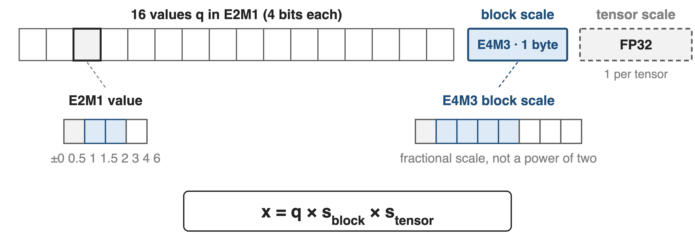
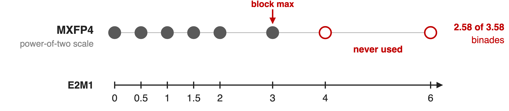
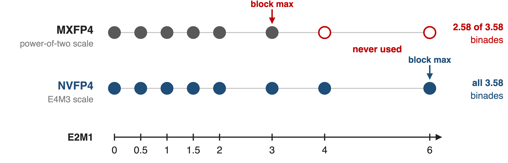
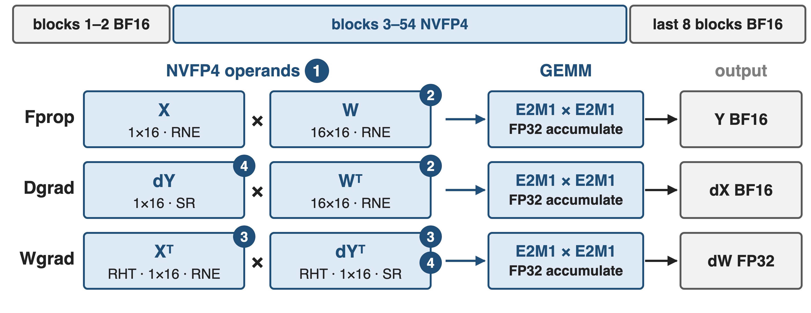
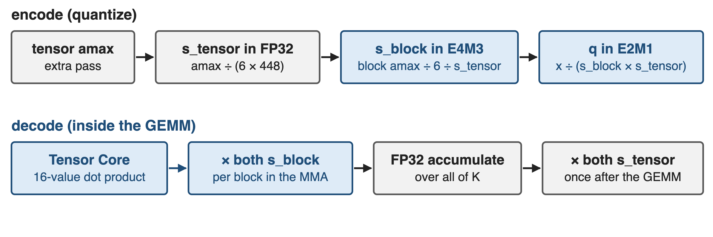
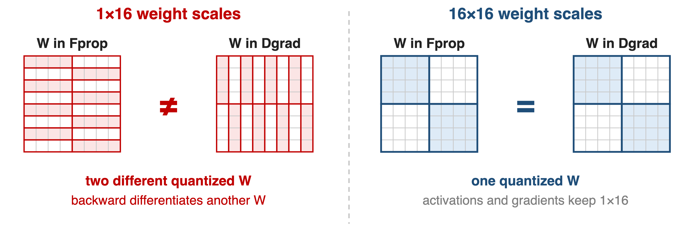
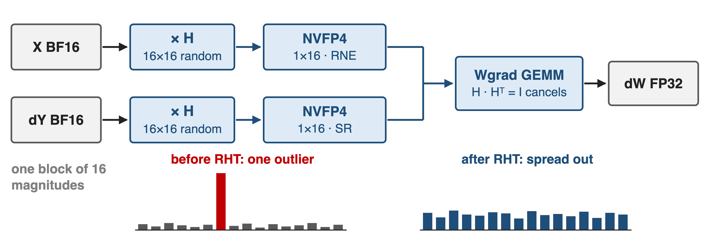
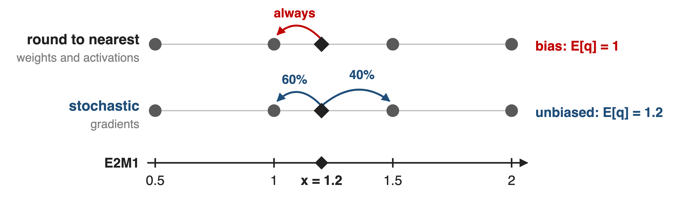
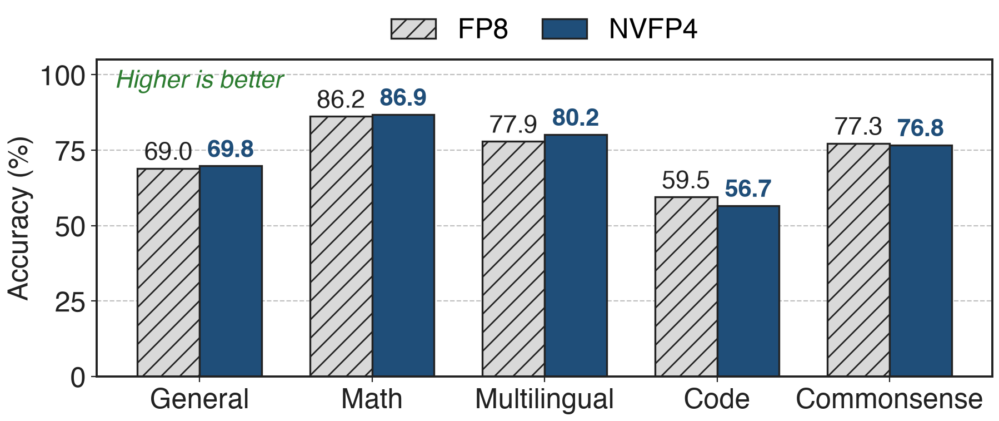
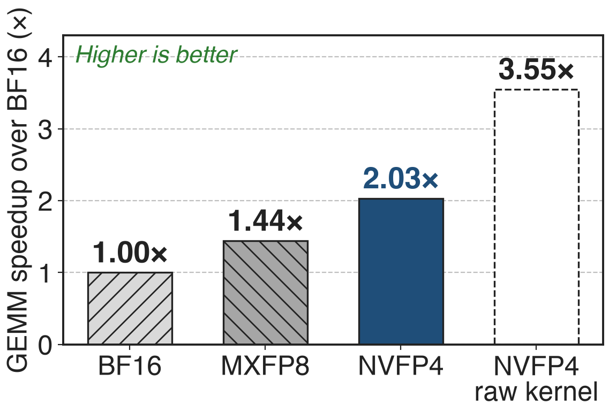

# NVFP4: 16 four-bit values share an FP8 scale
{full}
> MLPerf Training: Llama 3.1 405B pretrained in NVFP4 on 512 GB300 GPUs in 64.6 minutes
<!-- notes: Rung three of the precision ladder: FP8 on Hopper (deck 46), MXFP8 on Blackwell (deck 47), now NVFP4. Each value is E2M1, one of eight magnitudes from 0 to 6; every 16 values share an E4M3 scale and the whole tensor shares an FP32 scale (NVFP4 paper Sec. 2; TE NVFP4 docs). Blackwell FP4 math runs at 4x BF16 on GB200 and 6x on GB300 (paper Table 1). The MLPerf result is from NVIDIA's "3 Ways NVFP4" blog. -->

# Naive 4-bit formats waste tokens or diverge
%% big: +36%
%% sub: more training tokens MXFP4 needs to reach NVFP4's loss (8B model, 1T tokens)
%% source: NVIDIA, "Pretraining LLMs with NVFP4", arXiv 2509.25149, Sec. 5 and Fig. 6 (same recipe for both formats)
- All layers in NVFP4 with nearest rounding: **diverges early**
<!-- notes: With the full recipe applied to both formats, MXFP4 ends at about 2.5% loss gap to BF16 versus 1.5% for NVFP4, and needs 1.36T instead of 1T tokens to match NVFP4's loss (Sec. 5). Without the recipe, NVFP4 on every linear layer with round-to-nearest diverges early in training (App. E.1). Four bits leave no slack. -->

# Power-of-two scales waste FP4's top samples
{full}
> MXFP4 rounds its E8M0 scale up; worst case the block max lands at 3 and ±4, ±6 go unused
<!-- notes: NVFP4 paper App. B.4: with a block amax of 3 plus a little, the power-of-two decode scale rounds up to 1, the max quantizes to 3, and only 2.58 of the 3.58 binades of E2M1 are used. Rounding the scale up is what MXFP8 does to avoid saturation (deck 47); at 4 bits the waste is a large share of the format. -->

# Insight: spend bits on the scale, not the values
{full}
> An E4M3 scale per 16 values stores each block's max at near-FP8 precision, ≥ 6.25% of values
<!-- notes: Paper Sec. 2: a smaller block (16 vs 32) narrows the range per block, and a fractional E4M3 scale maps the block max close to 6, so all E2M1 samples are used. One value in 16 (6.25%) is the block max and is effectively stored at FP8 precision. The rest of the recipe removes the remaining error sources one at a time. -->

# The recipe pairs one fix with each error source
{full}
%% caption: ❶ two-level scales · ❷ 16×16 weight blocks · ❸ Hadamard on Wgrad inputs · ❹ stochastic rounding on gradients
<!-- notes: Paper Sec. 4 and Fig. 5: all three GEMMs of each linear layer take NVFP4 inputs and write BF16 or FP32. The 12B model keeps the first 2 and last 8 of its 62 blocks in BF16, 16% of linear layers (App. A.1); attention, embeddings, the output head, norms and optimizer state stay high precision (Sec. 4.1). Ablations on the 12B run show removing any one technique worsens loss (Fig. 4). -->

# ❶ Tensor scale keeps block scales in E4M3 range
{full}
> Block scales apply per 16 values inside the MMA; tensor scales once after the GEMM
<!-- notes: Paper App. B and TE NVFP4 docs: s_tensor = global amax / (6 x 448) remaps the tensor so every block scale fits E4M3; s_block = block amax / 6 / s_tensor. Tensor Cores multiply each 16-value partial dot product by both block scales and apply the two tensor scales after the GEMM (App. B.3, Eq. 5). The global amax costs an extra pass over the tensor (App. B.1). Per value: 4 + 8/16 = 4.5 bits (derived). -->

# ❷ 16×16 weight blocks: one W in both passes
{full}
> Weights adapt to coarser 16×16 blocks; activations and gradients keep finer 1×16 scales
<!-- notes: Paper Sec. 4.3: scales follow the dot-product dimension, which flips between forward and backward, so 1x16 weight scales give two different quantized weights and the backward pass differentiates a different function. 16x16 weight blocks (like DeepSeek-V3's 128x128 in deck 46, but finer) give one quantized W in both passes. Activations are less sensitive to this mismatch (App. E.5). -->

# ❸ Rotate Wgrad inputs to spread outliers
{full}
> 16×16 Hadamard: better than 4×4, as good as 128×128 at 12B; only on Wgrad inputs
<!-- notes: Paper Sec. 4.2, App. C: a random Hadamard transform rotates each 16-value tile so one outlier spreads across the tile; applied to both Wgrad operands, the rotations cancel inside the GEMM because H times H-transpose is the identity. Transforming Fprop or Dgrad inputs gave no benefit or hurt (App. E.4.1), and a single fixed random sign vector suffices (App. E.4.3). The inset bars are illustrative. -->

# ❹ Round gradients stochastically to remove bias
{full}
> SR on gradients is essential at 12B; SR on weights or activations hurts
<!-- notes: Paper Sec. 4.4, App. E.3: nearest rounding sends 1.2 to 1 every time, a systematic bias that gradients accumulate; stochastic rounding picks 1 with probability 0.6 and 1.5 with 0.4, so the expected value is 1.2 (worked example, sources.md). Applied to gradients feeding both Dgrad and Wgrad; on forward tensors it adds error and diverged a 1.2B model. Blackwell rounds stochastically in hardware (TE docs). -->

# NVFP4 stays within 1.5% of FP8 loss at 10T
%% big: < 1%
%% tone: ours
%% sub: relative loss gap vs FP8 in the stable phase (12B, 10T tokens); slightly above 1.5% after LR decay
%% source: NVIDIA, arXiv 2509.25149, Sec. 3 and Fig. 2 (FP8 baseline: blockwise 1×128 / 128×128)
- Longest public 4-bit pretraining run at the time: **12B** model, **10T** tokens
<!-- notes: The 12B hybrid Mamba-Transformer (Nemotron-Nano-12B-v2 architecture) was trained twice, in FP8 with the DeepSeek-style blockwise recipe and in NVFP4. The gap stays under 1% while the learning rate is constant and widens to slightly above 1.5% during the final decay (Sec. 3). -->

# Accuracy matches FP8: MMLU-Pro 62.58 vs 62.62
{full}
> Code trails by 2.9 points (MBPP+ 55.91 vs 59.11); the paper suspects noisy final-checkpoint evals
<!-- notes: Paper Table 2 category averages: General 68.99 vs 69.82, Math 86.20 vs 86.88, Multilingual 77.93 vs 80.24, Code 59.52 vs 56.67, Commonsense 77.29 vs 76.75 (FP8 vs NVFP4); MMLU-Pro 5-shot 62.62 vs 62.58. The code gap of 2.85 points on the category average is the one honest exception. -->

# NVFP4 GEMMs run 2.03× BF16 on B300
{right 55%}
- 5B model, quantization included
- **1.41×** over MXFP8 (derived)
- Raw kernel **3.55×**: quantize work eats the rest
<!-- notes: TE "GEMM Speedups Across Precisions", 5B model on B300: NVFP4 about 2.03x over BF16 in autocast mode, 3.55x with pre-quantized inputs; MXFP8 about 1.44x. 2.03 / 1.44 = 1.41x (derived). The gap to 3.55x is the per-step quantization cost: global amax pass, Hadamard transform, two FP4 copies; Megatron-Core fuses RHT into quantization and still computes the Hadamard twice (report Sec. 5.4.3). -->

# The price: BF16 layers and a residual gap
- **16%** of linear layers stay BF16 at 12B
- ~**1.5%** final loss gap; one 12B hybrid, no MoE yet
- Blackwell only; RHT needs BF16 inputs
> Remedy: a BF16 forward pass from 8.2T tokens cuts the gap to 0.5% for ~6% of compute
<!-- notes: BF16 share: paper App. A.1 (first 2 and last 8 blocks); stable with only the last 4 (Fig. 4). Residual gap: Sec. 3. MoE and larger models are future work (Sec. 6); NVIDIA's training blog calls NVFP4 training still in the research phase. TE NVFP4 requires SM100+ and applies RHT to BF16 inputs only (TE docs). Remedy: App. D, switching the forward pass to BF16 at 8.2T tokens recovers most of the loss gap with about 6% of total compute in higher precision. -->

# Summary
- MXFP4 needs **+36%** tokens; naive NVFP4 diverges
- ==Insight==: FP8 scale per 16 values, FP32 per tensor; then 16×16 weights, Wgrad Hadamard, SR on gradients
- **< 1%** (end **~1.5%**) loss gap to FP8 at 12B / 10T; **2.03×** BF16 GEMM speed on B300
%% qr: https://arxiv.org/abs/2509.25149
<!-- notes: Pain: power-of-two 4-bit scaling costs 36% more tokens and plain NVFP4 diverges (paper Sec. 5, App. E.1). Insight: spend bits on the scale; then fix consistency, outliers and bias where each hurts. Results: under 1% loss gap in the stable phase and about 1.5% at the end vs FP8 over 10T tokens, MMLU-Pro 62.58 vs 62.62 (paper); 2.03x GEMM speedup over BF16 on B300, 1.41x over MXFP8 (TE docs, derived). Ladder: deck 46 FP8, deck 47 MXFP8. -->
