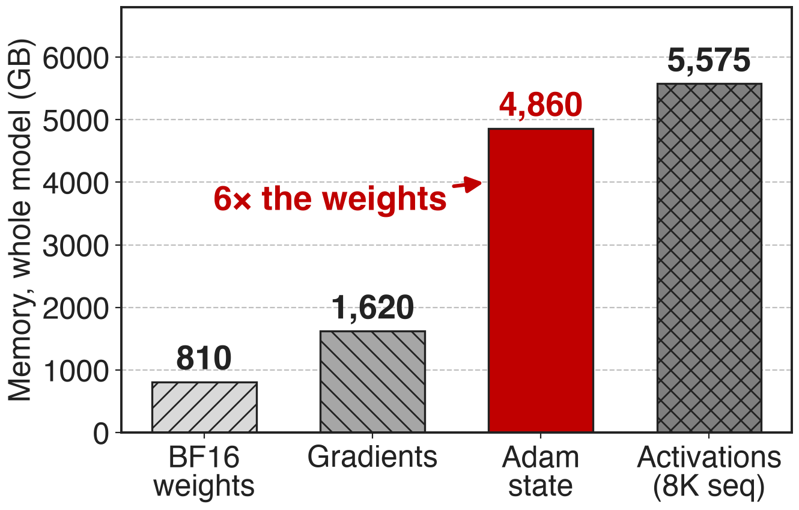
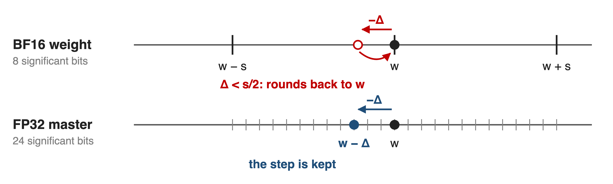
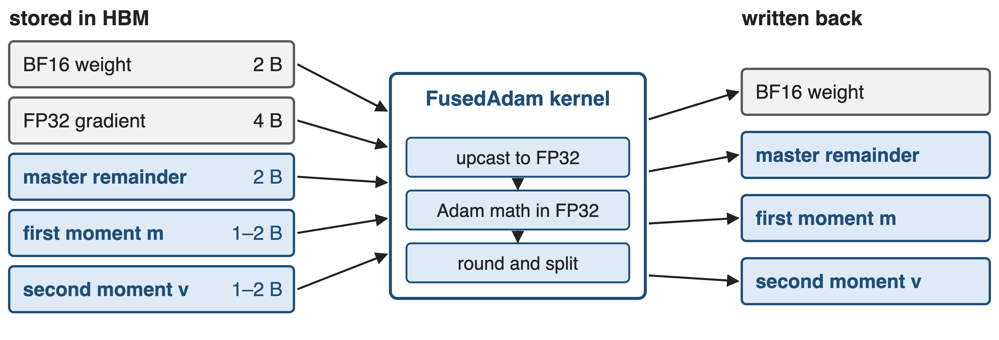
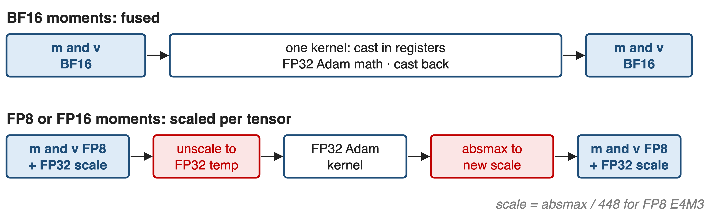
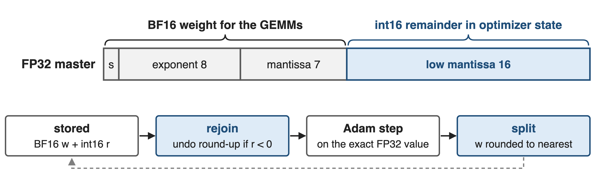
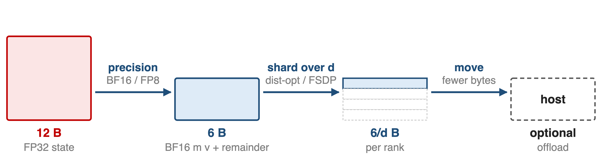
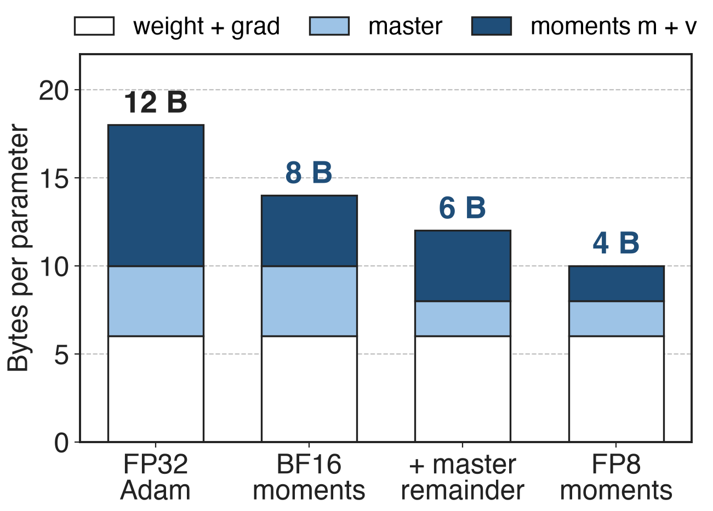
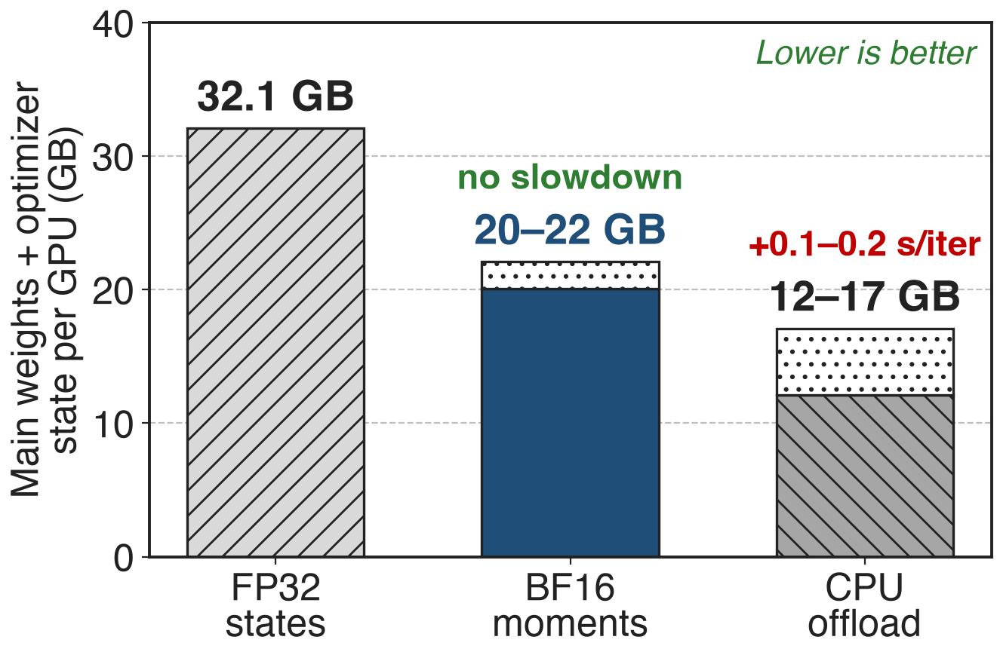

# Adam's state outweighs the model six to one
{right 55%}
- Mixed-precision Adam: FP32 master, m and v
- **12 B** per parameter vs **2 B** for the BF16 weight
- Llama-405B: **4,860 GB** of Adam state
<!-- notes: Mixed-precision training keeps a BF16 copy of each weight for the GEMMs, but the optimizer holds an FP32 master weight plus Adam's first and second moments, 12 bytes per parameter, six times the weight itself. The MCore report's Llama-405B example puts the totals at about 810 GB of BF16 weights, 1,620 GB of gradients and 4,860 GB of optimizer state, next to 5,575 GB of activations at 8K. Source: arXiv 2603.07685 §3.1.1 p.12 and §4.1.6 p.26. -->

# Optimizer state takes 32 GB per GPU
%% big: 32.1 GB
%% sub: of FP32 master weights and Adam moments per GPU for DeepSeek-V3 (BF16, 256 GPUs): 16% of a 199.5 GB footprint on an 80 GB H100
%% source: Megatron-Core MoE report, arXiv 2603.07685, Table 3 and §4.1.6
<!-- notes: Even after PP4, VPP4 and EP64 have spread DeepSeek-V3 over 256 GPUs, each GPU still holds 32.1 GB of main weights and optimizer states, 16% of the 199.5 GB the configuration needs before optimizations, on 80 GB devices. Activations are larger, but this part is pure storage that is touched once per step. Source: arXiv 2603.07685 §4.1.1 Table 3 p.20 and §4.1.6 p.25. -->

# Sharding and offloading keep all 12 bytes
%% layout: two-col
- **Shard** (distributed optimizer, FSDP)
- 12/d per rank, still **12 B** in total
- Needs data-parallel ranks (deck 70)
|||
- **Offload** to CPU memory
- Saves 15–20 GB on DeepSeek-V3
- !!+0.1–0.2 s!! per iteration, needs a fast host link
> Neither makes the 12 bytes per parameter any smaller
<!-- notes: The distributed optimizer and FSDP divide the optimizer state across d data-parallel ranks, but every byte still exists somewhere and the saving depends on the DP size (deck 70). Optimizer-state offloading moves states and master weights to the host between steps: on GB200 with NVLink-C2C it frees 15-20 GB for DeepSeek-V3 at 0.1-0.2 s per iteration, and it is less attractive on systems with slower host links. Sources: Megatron-LM dist_optimizer.md; arXiv 2603.07685 §4.1.6 p.26-27. -->

# Naive BF16 Adam rounds small updates away
{full}
%% caption: Schematic. BF16 keeps 8 significant bits: a step below half a spacing (at most 2⁻⁸ of |w|) is lost
> The villain: storing state in the same precision the update is computed in
<!-- notes: The obvious way to halve the state is to keep everything in BF16. But BF16 has 8 significant bits, so the gap between neighbouring values near w is up to 2 to the minus 7 of |w|; any Adam step smaller than half that gap rounds back to w and the weight never moves. That is why DeepSeek-V3 keeps master weights and gradients in FP32 "to ensure numerical stability" even though it stores the moments in BF16. The format arithmetic is in notes/sources.md; DeepSeek-V3 report §3.3.3. -->

# Insight: store compactly, compute in FP32
- Moments only feed the update: BF16 storage suffices
- The FP32 master's top half already is the BF16 weight
--
> Decouple storage from compute: upcast inside the fused kernel, update in FP32, round once on the way out
<!-- notes: Two observations make the design. First, the moments are statistics that only feed the update; DeepSeek-V3 stored them in BF16 without observable degradation, and the MCore report states that states tolerate lower storage precision as long as the update itself is computed in higher precision. Second, the master weight does need FP32 accuracy, but 16 of its 32 bits are already stored as the BF16 weight. So keep everything compact in memory and do all arithmetic in FP32 registers. Sources: DeepSeek-V3 §3.3.3; arXiv 2603.07685 §4.1.6. -->

# FusedAdam upcasts, updates, and rounds once
{full}
%% caption: --use-precision-aware-optimizer --exp-avg-dtype / --exp-avg-sq-dtype {fp32, fp16, bf16, fp8} --main-params-dtype {fp32, fp16} --main-grads-dtype {fp32, bf16}
<!-- notes: With --use-precision-aware-optimizer, Megatron hands the BF16 parameters to Transformer Engine's FusedAdam, which owns the master weights. Four precisions are configurable: main gradients, main parameters, first moment and second moment. The kernel loads the compact state, upcasts to FP32, runs the Adam math in FP32, and writes compact state back. Only Adam is supported, and it needs TE's FusedAdam. Sources: arguments.py; optimizer_config.py; optimizer/__init__.py; TE fused_adam.py; arXiv 2603.07685 §4.1.6. -->

# ❶ Moments travel in BF16 or FP8
{full}
> BF16 costs nothing extra; FP8 and FP16 share one FP32 scale per tensor
<!-- notes: BF16 has FP32's exponent range, so FusedAdam needs no scaling: the cast happens in registers inside the Adam kernel, and the path is even CUDA-graph capturable. FP16 and FP8 (E4M3) need a scale. TE keeps one FP32 scale per tensor, computed as the tensor's absolute maximum divided by the format range, 448 for E4M3; each step it unscales into a temporary FP32 tensor, runs the kernel, and re-quantizes. Moments drop from 8 to 4 bytes per parameter in BF16 and to 2 in FP8. Sources: TE fused_adam.py (_apply_scale, fuse_unscale); arXiv 2603.07685 §4.1.6 p.26. -->

# ❷ BF16 weight plus remainder is exact FP32
{full}
> The master weight costs 2 bytes instead of 4 and stays bit-exact FP32
<!-- notes: An FP32 number's high 16 bits are a BF16 number. Instead of a separate FP32 master copy, FusedAdam stores only the low 16 bits as an int16 remainder next to the BF16 weight. Because the BF16 weight is rounded to nearest, a negative remainder means it was rounded up; the kernel subtracts one before rejoining the halves, applies the update in FP32, and splits again with rounding. Megatron enables this by default (store_param_remainders) when Transformer Engine is 2.1 or newer and parameters are BF16. Sources: optimizer_config.py docstring; TE adam.cu AdamFunctorMasterParamRemainder. -->

# ❸ Smaller state shards and offloads cheaper
{full}
%% caption: Optimizer-state bytes per parameter with BF16 moments + remainder (the MCore report's 6 + 8/d keeps a full FP32 master)
> Distributed optimizer: 6 + 12/d → 6 + 8/d bytes per rank; CPU offload requires this flag; Megatron-FSDP takes the same dtypes
<!-- notes: Precision composes with the other memory levers instead of replacing them. With the distributed optimizer, the MCore report gives 6 + 12/d bytes per parameter per rank, falling to 6 + 8/d with BF16 moments. Optimizer CPU offload in Megatron must be used together with --use-precision-aware-optimizer, and BF16 states reduce what has to be transferred. Megatron-FSDP accepts --exp-avg-dtype and --exp-avg-sq-dtype, including fp8. Sources: arXiv 2603.07685 §4.1.6 p.26-27; arguments.py; megatron_fsdp.md. Related decks: 70 (FSDP), 54 (offload). -->

# Optimizer state drops from 12 to 6 bytes
{right 58%}
%% caption: Analytic, per parameter, no sharding; number on top = optimizer-state bytes (master + m + v)
- BF16 moments: **12 → 8 B**
- + master remainder: **6 B**, still exact FP32
- FP8 moments: **4 B**
<!-- notes: Per parameter, standard mixed-precision Adam spends 12 bytes on the master weight and two FP32 moments. BF16 moments, the configuration the MCore report calls typical, bring that to 8 bytes; the remainder trick brings the master to 2 bytes for 6 in total; FP8 moments reach 4. The BF16 weight and FP32 gradient, 6 bytes, are untouched here; --main-grads-dtype bf16 could shrink the gradient too. Arithmetic in notes/sources.md. -->

# BF16 moments free 10–12 GB per GPU
{right 58%}
- DeepSeek-V3, 256 GPUs, BF16
- **No performance overhead**: cast inside the fused kernel
- Offload saves more but costs time
<!-- notes: For DeepSeek-V3, BF16 moments cut the 32.1 GB of main weights and optimizer state by about 10-12 GB per GPU, roughly half of the optimizer-state memory, with no performance overhead because the FP32 cast happens inside the fused Adam kernel. Optimizer-state offloading frees 15-20 GB but adds 0.1-0.2 s per iteration on GB200; the two compose, since smaller states mean shorter transfers. Remaining-memory ranges are derived by subtraction. Source: arXiv 2603.07685 §4.1.6 p.26-27, Table 3. -->

# DeepSeek-V3 recipes keep low-precision states
%% layout: two-col
- **MCore final configs**
- H100: **368** TFLOPS/GPU, GB200: **1,048**
- Both list low-precision optimizer states
|||
- **DeepSeek-V3 training**
- BF16 moments, no observable degradation
- Master weights and gradients stay FP32
<!-- notes: MCore's best DeepSeek-V3 configurations, 368 TFLOPS per GPU on 1,024 H100 and 1,048 on 256 GB200, both list low-precision optimizer states among their memory optimizations, and the report credits BF16 moments as one of the techniques that bring DeepSeek-V3 from 199.5 GB to under 80 GB per GPU. DeepSeek trained V3 itself with BF16 AdamW moments and FP32 master weights and gradients. Sources: arXiv 2603.07685 Tables 17-18 p.74 and §10 p.78; DeepSeek-V3 report §3.3.3 p.18. FP8 training context: decks 46-48. -->

# The cost: Adam only, one scale per tensor
%% layout: two-col
- Adam via TE FusedAdam; remainders need TE ≥ 2.1
- CUDA graphs: FP32 or BF16 moments, no remainders
|||
- FP8 and FP16: one scale per tensor, FP32 temporaries
- !!FP8 moments!!: no convergence study in these sources
- FP16 master is lossy
<!-- notes: The flag only works with Adam through Transformer Engine's FusedAdam, and the remainder trick needs TE 2.1 or newer and BF16 parameters; with FP8 primary weights under non-delayed recipes MCore keeps its own FP32 master instead. Capturable mode for CUDA graphs requires FP32 master weights, both moments FP32 or both BF16, and no remainders. FP16 and FP8 states use a single scale per tensor, so one outlier sets the scale for the whole tensor, and each step allocates temporary FP32 copies. BF16 moments have production evidence; FP8 moments have none in the sources read; an FP16 master is a real precision loss, unlike the exact remainder. Sources: TE fused_adam.py; optimizer_config.py; optimizer/__init__.py. -->

# Summary
- Adam state: **12 B** per parameter; **32.1 GB/GPU** for DeepSeek-V3
- ==Insight==: store compactly, compute in FP32 inside the fused kernel
- BF16/FP8 moments, exact FP32 master from a 16-bit remainder
- **12 → 6 B** per parameter; **10–12 GB/GPU** saved, no slowdown
%% qr: https://github.com/NVIDIA/Megatron-LM
<!-- notes: The precision-aware optimizer shrinks optimizer state without touching update precision: moments in BF16 or FP8, master weights rebuilt exactly from the BF16 weight plus a 16-bit remainder, all arithmetic in FP32 registers. It composes with sharding and offload. Sources: arXiv 2603.07685 §4.1.6; Megatron-LM arguments.py and optimizer_config.py; Transformer Engine fused_adam.py and adam.cu; DeepSeek-V3 report §3.3.3. -->
