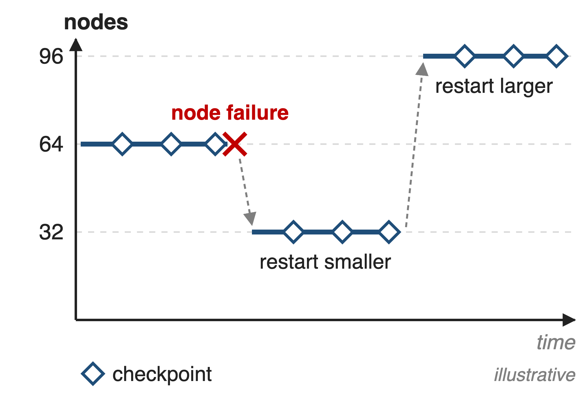
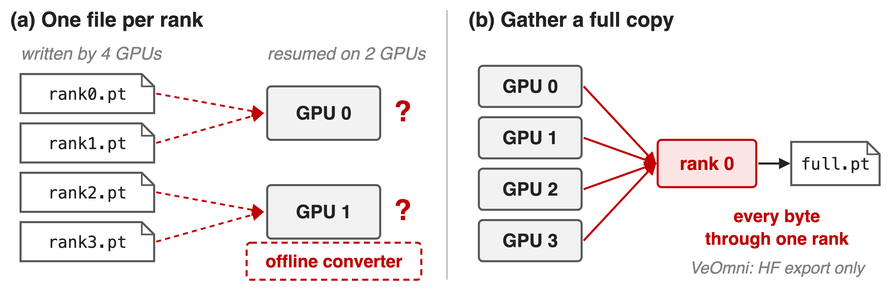
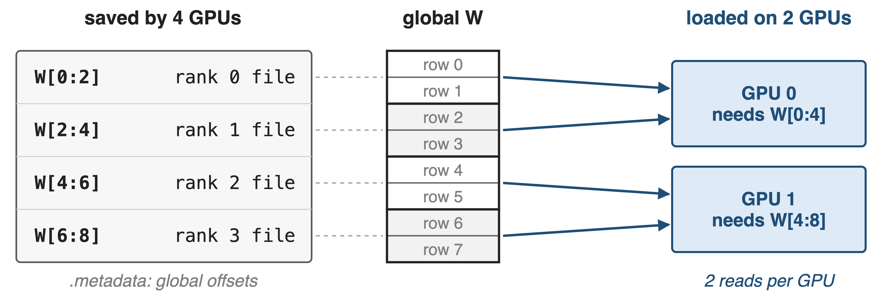
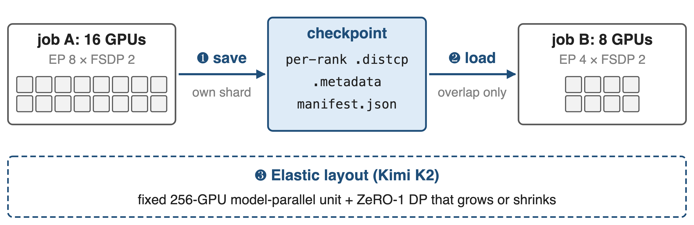
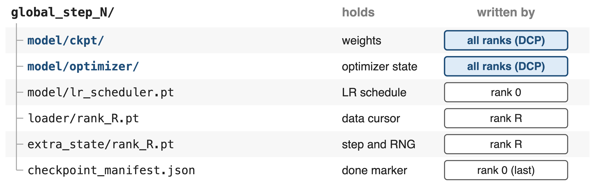
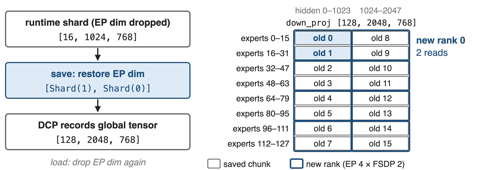
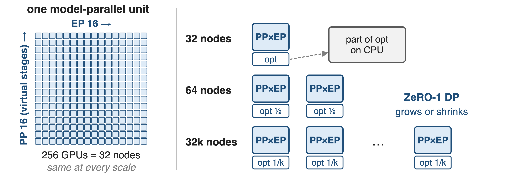
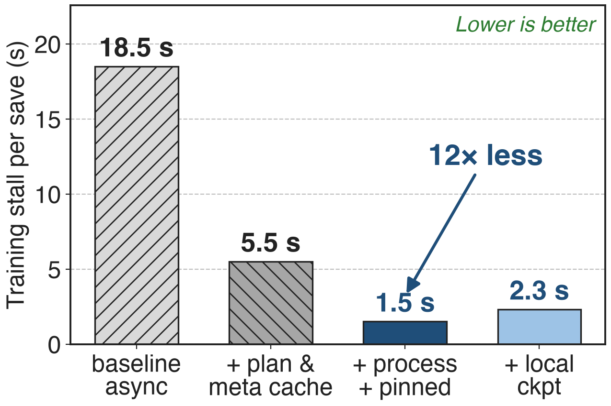
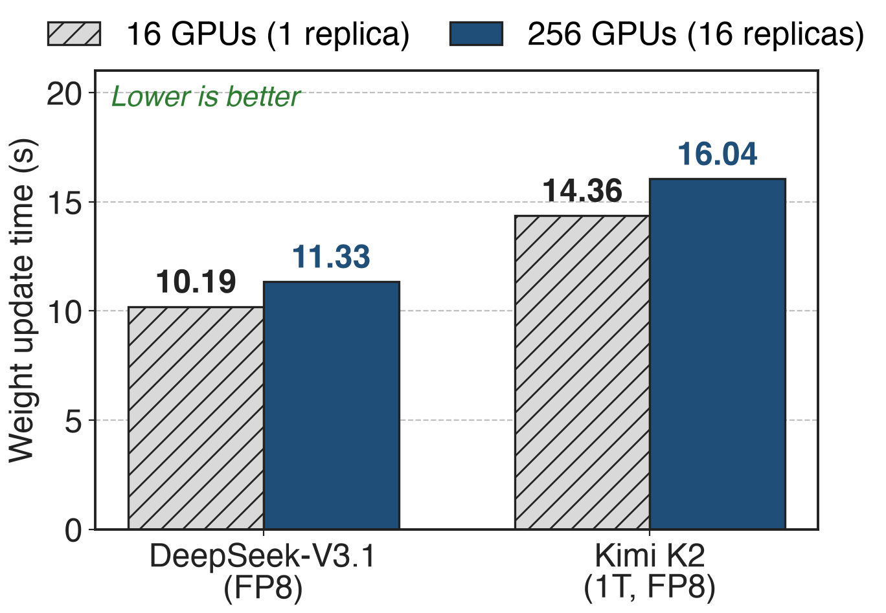

# Long runs restart on whatever GPUs remain
{right 55%}
- Kimi K2: **1.04T** MoE, **15.5T** tokens on H800
- Built to run on any multiple of **32** nodes
- Every restart reloads the last checkpoint
<!-- notes: A long pretraining run is not one job but a chain of restarts: nodes fail, quota changes, and the next segment may run on fewer or more GPUs than the last one. Moonshot designed Kimi K2's training layout for exactly this: the report says training "often progresses under dynamic resource availability", so K2 can run on any number of nodes that is a multiple of 32. Whatever the new size, the job must reload the last checkpoint. The node counts in the figure are illustrative. Sources: K2 arXiv 2507.20534 §2.3, §2.4.1-2.4.2, §2.5. -->

# Even async checkpoint saves stall every GPU
%% big: 18.5 s
%% sub: training stall per checkpoint: Llama 3 405B, 432 H200 GPUs
%% source: PyTorch blog "Distributed Checkpoint: Efficient checkpointing in large-scale jobs" (Sep 2025), results table
<!-- notes: Checkpoints are not free. In Meta and Google's measurement on 432 H200 GPUs training Llama 3 405B, even the baseline asynchronous save blocked training for 18.5 seconds per checkpoint, the full save then took about 126 seconds in the background, and loading took 94 seconds. Frequent interruptions force frequent saves, so this stall is paid over and over, and a restart on a different number of GPUs has to be able to read the same files. Source: PyTorch blog, Sept 11 2025, results table. -->

# Rank-file checkpoints fit only one layout
{full}
> A per-rank file records who held the bytes, not which slice they are
<!-- notes: The two naive designs both fail elasticity. Saving one file per rank is fast, but the file only means something to the layout that wrote it; resuming on two GPUs instead of four needs an offline converter that knows every parallel scheme. Gathering a full copy on rank 0 is layout-free but funnels every byte through one process; for K2 the weights and gradient buffers alone are about 6 TB per model-parallel group. VeOmni uses the gather path only to export HuggingFace weights, never to resume. Sources: K2 §2.4.2; VeOmni docs/usage/checkpoint.md. -->

# Insight: a shard is a slice of a global tensor
{full}
> Record global offsets once; any new layout is just a different set of reads
<!-- notes: If each rank stores its shard together with where that shard sits in the global tensor, the checkpoint no longer depends on the layout that wrote it. A job with a different number of GPUs allocates its own shards, asks for the global ranges it needs, and reads exactly the stored chunks that overlap. In this toy example four GPUs saved two rows each; two GPUs each read two chunks. PyTorch Distributed Checkpoint calls this load-time resharding. Source: PyTorch DCP docs (torch.distributed.checkpoint, 2.14). -->

# Save once, then load into any mesh
{full}
%% caption: ❶❷ PyTorch DCP as used by VeOmni (parent deck 28); ❸ Kimi K2's layout choice. Mesh sizes are the running example
<!-- notes: Three pieces make this work in practice. One: every rank saves only its own shard, plus one metadata file with the global offsets and a manifest that marks the step complete. Two: at load time the new job reads only the overlapping chunks, even when expert-parallel sizes change. Three, from Kimi K2: pick a parallel layout whose model-parallel part never changes, so only the data-parallel degree moves with the node count. -->

# ❶ Every rank writes only its own shard
{full}
> A step counts only when the manifest and every DCP .metadata exist
<!-- notes: This is VeOmni's step directory. Weights and optimizer state are two separate DCP directories written by all ranks, so the weights can be shipped without the optimizer, which is roughly twice as large under Adam. The scheduler comes from rank 0; data cursors and RNG are per rank. Completeness needs both the manifest, written last by rank 0, and each DCP directory's metadata, written last by DCP, so a crash mid-save leaves a step that resume skips. Saves can run asynchronously or be staged on node-local disk, but not both at once. Source: VeOmni docs/usage/checkpoint.md. -->

# ❷ The loader reads only overlapping chunks
{full}
%% caption: Old layout from VeOmni's EP+FSDP2 docs (Qwen3-30B-A3B); new layout illustrative, same rule EP × FSDP = world size
<!-- notes: Experts are the tricky case. At run time VeOmni keeps only the local expert shard and drops the expert-parallel mesh dimension, so a plain save would not know where the shard belongs. On save, its ModelState and OptimizerState wrappers restore the EP dimension: the shard becomes a DTensor on the (EP-FSDP, EP) mesh with placements Shard(1), Shard(0), and DCP records the global 128 by 2048 by 768 tensor. A new job with EP 4 asks for 32 experts per rank; new rank 0 reads old chunks 0 and 1. After loading, the EP dimension is dropped again. Sources: docs ep_fsdp2.md (DCP Support), extra_parallel.md; dcp_checkpointer.py; DCP docs. -->

# ❸ K2 fixes model parallelism, flexes only DP
{full}
%% caption: Kimi K2 report §2.4.2: ~6 TB of BF16 weights + FP32 grad buffers per 256-GPU unit; ~30 GB of state per GPU
<!-- notes: Kimi K2 removes most resharding by design. Its model-parallel unit is fixed: 16-way pipeline parallelism with virtual stages times 16-way expert parallelism, 256 GPUs or 32 nodes, holding about 6 terabytes of BF16 weights and FP32 gradient buffers. Only ZeRO-1 data parallelism changes with the node count, and it shards the optimizer states across replicas; at 32 nodes some optimizer state goes to CPU memory instead. So every GPU holds about 30 GB of state at every scale, and small and large experiments share one configuration. EP 16 was the smallest feasible size. Source: K2 §2.4.2. -->

# Optimized DCP cuts the save stall 12×
{right 60%}
- Llama 3 405B, 432 H200 GPUs
- Cache plans and metadata; save from a process
- Local disks: full save ~126 s → ~47 s
<!-- notes: Same 405B job, each column adding one optimization. Caching the save plan and the global metadata removes most of the collectives: 18.5 to 5.5 seconds. Saving from a separate process instead of a thread avoids GIL contention, and pinned shared-memory staging halves staging time: 1.5 seconds, 12 times less than the baseline (derived). Writing to local disks raises the stall slightly to 2.3 seconds because deduplication is skipped, but the full save drops from about 126 to about 47 seconds and loading from 94 to 80. Source: PyTorch blog, results table. -->

# K2 weights reshard into 16 replicas in 16 s
{right 60%}
- Same idea at RL time: train layout → TP16 inference
- Broadcast once; each replica keeps its own shard
- 16× more GPUs, only 12% more time
<!-- notes: The same global-view idea moves weights between differently sharded engines in RL. Moonshot's checkpoint engine takes each training worker's parameters, broadcasts the full set to all workers, and lets each inference engine copy only the shard its own layout needs, pipelined parameter by parameter. On H20 inference clusters, updating Kimi K2 FP8 takes 14.36 seconds for one TP16 instance and 16.04 seconds for sixteen, 12 percent more for 16 times the GPUs (derived). The K2 report states the bound as under 30 seconds. Sources: checkpoint-engine README benchmark table; K2 §3.3.2, App. G. -->

# The cost: collectives, cursors, 32-node quanta
%% layout: two-col
- !!DCP collectives!!: dedup, metadata, reshard grow with scale
- !!Data cursors!! are per rank; new ranks resume weights only
|||
- K2: elastic in 32-node steps; small runs offload optimizer
- No format guarantee across PyTorch versions
> Weights and optimizer reshard freely; data position and RNG do not
<!-- notes: DCP's own collectives for deduplication, global metadata and resharding get costlier as jobs grow, which is why plan and metadata caching matter. VeOmni's data cursors are sharded by data-parallel rank; if any rank finds no cursor file the whole job resumes weights only and the data loader restarts. K2's elasticity comes in quanta of 32 nodes, and at the smallest size part of the optimizer state lives in CPU memory. PyTorch gives no backward-compatibility guarantee for saved state across versions. Sources: PyTorch blog; VeOmni global_state_callback.py; K2 §2.4.2; DCP docs. -->

# Summary
- Even async saves stall training **18.5 s** per checkpoint (405B, 432 GPUs)
- ==Insight==: shards are slices of global tensors, so any layout can read them
- **1.5 s** stall with optimized DCP; K2 runs on any multiple of **32** nodes
- Parent: deck 28 (VeOmni); related 54 (offload), 70 (FSDP)
%% qr: https://github.com/ByteDance-Seed/VeOmni
<!-- notes: Distributed checkpointing turns the checkpoint from a dump of rank files into a set of slices with global coordinates, so a restart can use whatever GPUs are available. VeOmni gets this from PyTorch DCP plus its EP-dimension restore; Kimi K2 complements it by keeping the model-parallel unit fixed and letting only data parallelism change. Related decks: 28 (VeOmni), 54 (pipeline-aware offload), 70 (Megatron-FSDP). -->
